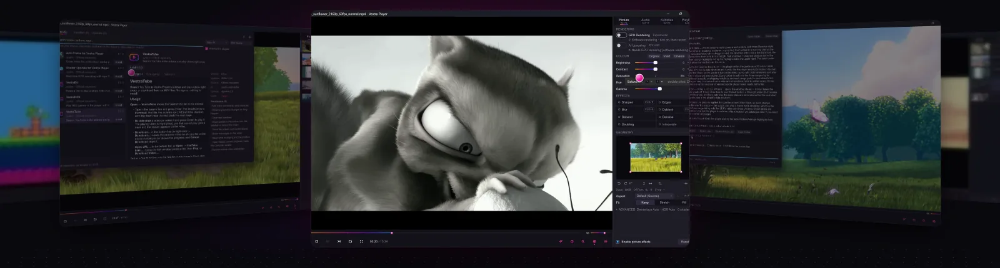
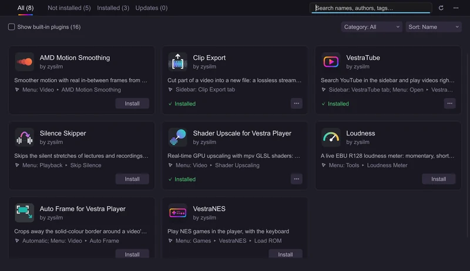
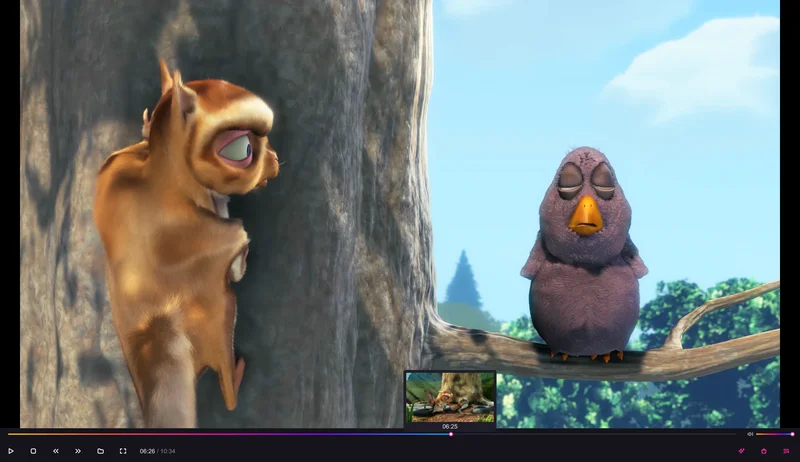
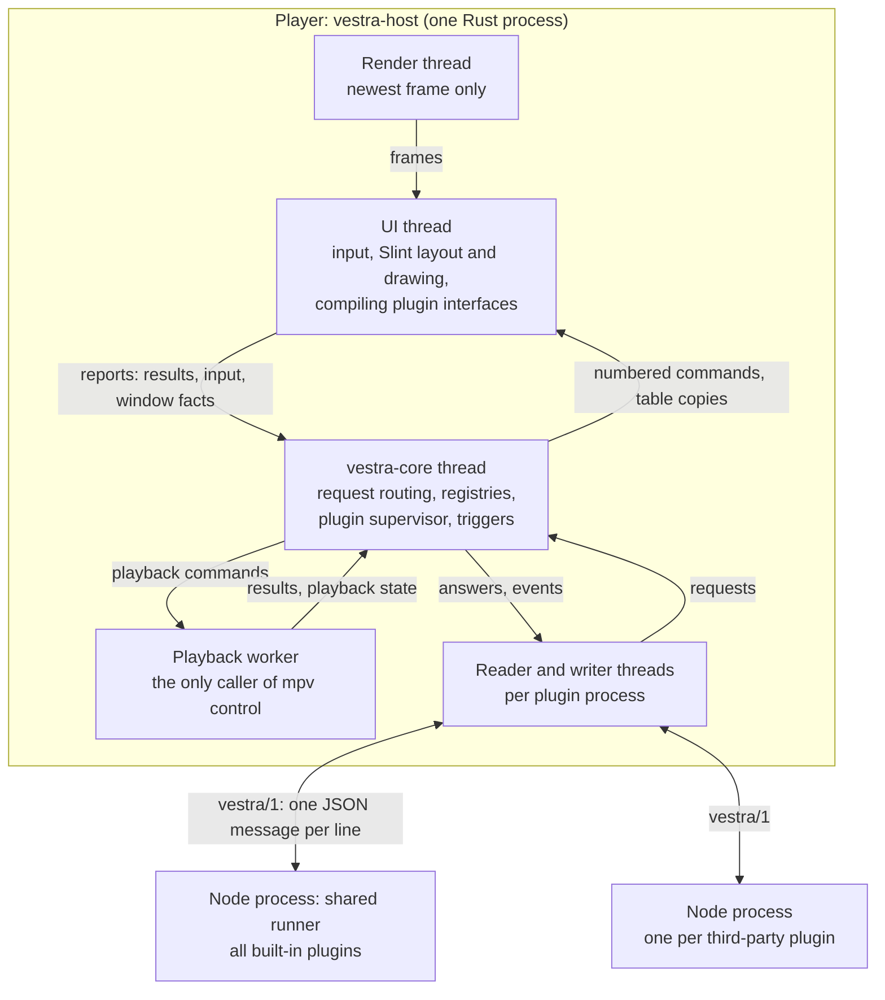

<p align="center"></p>
<p align="center"><b>Next-generation media player.<br>Built to extend, enhanced by AI.</b></p>
<p align="center">
  <a href="https://github.com/vestrasys/vestra-player/actions/workflows/main.yml"></a>
  <a href="https://github.com/vestrasys/vestra-player/releases"></a>
  
  <a href="https://vestrasys.github.io/vestra-player-sdk/"></a>
  <a href="https://www.npmjs.com/package/@vestra-player/sdk"></a>
  <a href="LICENSE"></a>
</p>
<p align="center">
  <a href="https://github.com/vestrasys/vestra-player/releases">Releases</a> ·
  <a href="https://github.com/vestrasys/vestra-player-sdk">Plugin SDK</a> ·
  <a href="https://github.com/vestrasys/vestra-player-plugins">Plugins</a> ·
  <a href="agentic-workflow/">Agentic Workflow</a>
</p>

Vestra Player is an open-source video player for macOS and Windows. It aims for rich, discoverable controls (menus, shortcuts, a docked playlist, deep video and audio settings) on a modern, extensible architecture. Playback is handled by [libmpv](https://mpv.io); the interface is native [Slint](https://slint.dev); and everything you use (playback bar, playlist, video and audio adjustments, subtitles, screenshots and export, history, hotkeys, the plugin store) is a TypeScript plugin, and the store adds more, such as the NES emulator VestraNES.

<table>
  <tr>
    <td width="50%"><a href=".github/readme/picture-adjustments.webp"></a><br><b>Picture adjustments</b>: colour, effects and geometry, applied while the video plays.</td>
    <td width="50%"><a href=".github/readme/plugin-store.webp"></a><br><b>Plugin Store</b>: install a plugin and it appears right away, with no restart needed.</td>
  </tr>
  <tr>
    <td><a href=".github/readme/playlist.webp"></a><br><b>Playlist</b>: thumbnails and durations in the sidebar; plugins can add tabs of their own.</td>
    <td><a href=".github/readme/vestranes.webp"></a><br><b>VestraNES</b>: a plugin can be a whole NES emulator, running inside the player.</td>
  </tr>
  <tr>
    <td><a href=".github/readme/seek-preview.webp"></a><br><b>Seek-bar preview</b>: a thumbnail of the frame under the pointer as it moves along the bar.</td>
    <td><a href=".github/readme/ai-workshop.webp"></a><br><b>Vestra Player AI</b> (experimental): describe a plugin and it writes, checks and tests it.</td>
  </tr>
</table>

<sub>Footage: Big Buck Bunny © 2008, Caminandes 2, Sintel and Tears of Steel © Blender Foundation, <a href="https://creativecommons.org/licenses/by/3.0/">CC BY 3.0</a>; Elephants Dream © 2006 Blender Foundation / Netherlands Media Art Institute, <a href="https://creativecommons.org/licenses/by/2.5/">CC BY 2.5</a>; Spring © Blender Foundation, <a href="https://creativecommons.org/licenses/by/4.0/">CC BY 4.0</a>; Twin Dragons (open-source NES homebrew) by Garydos, surt and Shiru, code <a href="https://github.com/Garydos/twin-dragons-nes">zlib</a>, graphics <a href="https://opengameart.org/content/twin-dragons">CC BY 3.0</a>.</sub>

## Core ideas

- **Everything is a plugin.** The Rust host only provides shared infrastructure: playback, UI composition, processing chains, plugin lifecycle. Product features live in plugins.
- **One public API for everyone.** Built-in and third-party plugins use the same API, `vestra/1`, through the [`@vestra-player/sdk`](https://www.npmjs.com/package/@vestra-player/sdk) package. If a built-in plugin needs something, the public API grows; there are no private back doors.
- **Plugins out of process.** Plugins run in Node.js, outside the host: the built-ins share one process, every other plugin has its own. The player validates every request when it serves it; a manifest declares nothing about what a plugin may call, and a few areas are for built-in plugins only. Stopping a plugin releases everything it owns.
- **Native UI.** Plugin windows and panels are Slint components, compiled and composed by the host with a shared theme and widget set.
- **Signed plugin store.** Plugins install from a signed index (Ed25519), built from source in [vestra-player-plugins](https://github.com/vestrasys/vestra-player-plugins).
- **Cross-platform.** All OS-specific code sits in a thin platform layer (`src/host/src/platform/`), one module per system; everything else is shared.

## Architecture



**Player and plugins.** The player is one Rust program: it plays video with libmpv, draws the interface with Slint and runs the plugins. Everything else (playlist, subtitles, Plugin Store, Vestra Player AI) is a TypeScript plugin in a Node process: the built-ins share one to save memory, each third-party plugin has its own, isolated but not sandboxed. Plugin interfaces are Slint files compiled by the player.

**Threads.** Whatever can wait has its own thread, so one wait never holds unrelated work:

- **UI thread.** Slint's event loop: windows, input, drawing, compiling plugin interfaces.
- **`vestra-core`.** The core, a single-threaded state machine that takes no locks and never waits: it routes plugin requests, keeps the registries, runs the plugin supervisor, evaluates triggers and directs playback. It sleeps on one event queue between events.
- **Playback.** One worker sends every mpv command; a render thread hands the interface only the newest frame, so a slow interface skips frames, never lags.
- **Plugin I/O and helpers.** A reader and a writer per plugin process; helpers for blocking calls (process creation, files, clipboard).

**The interface is the core's client.** The two exchange only messages, so a stalled UI thread (a window compiling or being dragged, a GPU wait) freezes only the window: plugins, triggers and playback control carry on. Only requests whose answer depends on the interface (opening a window, mounting a panel) wait for it; the rest never queue behind.

**Plugin supervisor.** Part of the core decides when each process exists: pure decision logic, tested by deterministic simulation.

- **On-demand start.** A plugin's first run is recorded (commands, keys, settings pages, event subscriptions). These then appear without a process; first use starts it.
- **Automatic standby.** A plugin holding nothing only its process can serve (a window, panel, stream or filter chain) stops after 30 s without use.
- **Held events.** Clicks and events arriving while a plugin starts wait in order until it is ready.
- **Kept through standby.** Trigger conditions (still evaluated), timeline marks, the always-on-top setting, session storage.
- **Limits.** Third-party plugins start a few at a time, clicks first. Their count follows the machine's memory (3 to 16), each has a heap cap, and low memory puts the longest-unused idle ones in standby.
- **Faults.** A crash stops only that plugin, not playback. It restarts after a doubling pause; five crashes in ten minutes turn it off with a reason.
- **Watchdogs.** The shared runner restarts after five missed heartbeats. On Windows a stalled GPU renderer counts as a lost device: the player restarts where it was.

**From a plugin to the core.** The [SDK](https://vestrasys.github.io/vestra-player-sdk/) turns the line protocol into handles. A plugin learns the player's state by reading it once, a discrete event (`source.ready`), a trigger or a stream; only the stream keeps it running.

A trigger hands the core a condition as data, evaluated even while the plugin has no process; on a flip the core starts one if needed, and the SDK calls `enter` or `leave`:

```ts
import type { Plugin } from "@vestra-player/sdk";

export default function activate(plugin: Plugin) {
  const { when, window } = plugin;
  plugin.trigger()
    .firesOn(when.playing.and(when.fullscreen))
    .enter(() => window.setAlwaysOnTop(true))
    .leave(() => window.setAlwaysOnTop(false));
}
```

A stream delivers every state change until `stop()`:

```ts
// inside activate(plugin); StateStream is an SDK type
const view = plugin.windows.create("ui/left.slint");
let feed: StateStream | undefined;
view.onClose(() => feed?.stop());
plugin.commands.add({
  id: "left",
  path: ["Tools", "Time Left"],
  run: async () => {
    await view.show();
    feed?.stop();
    feed = plugin.player.stream((s) =>
      view.set({ text: `${Math.round((s.duration ?? 0) - (s.position ?? 0))} s` }),
    );
  },
});
```

## License

Vestra Player is licensed under [GPL-3.0-or-later](LICENSE). The SDK and the plugins repository are Apache-2.0.
