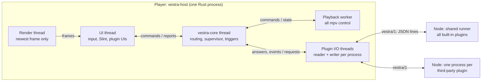

<p align="center"></p>
<p align="center"><b>Next-generation media player.<br>Built to extend, enhanced by AI.</b></p>
<p align="center">
  <a href="https://github.com/vestrasys/vestra-player/actions/workflows/main.yml"></a>
  <a href="https://github.com/vestrasys/vestra-player/releases"></a>
  
  <a href="https://vestrasys.github.io/vestra-player-sdk/"></a>
  <a href="https://www.npmjs.com/package/@vestra-player/sdk"></a>
  <a href="LICENSE"></a>
</p>
<p align="center">
  <a href="https://github.com/vestrasys/vestra-player/releases">Releases</a> ·
  <a href="https://github.com/vestrasys/vestra-player-sdk">Plugin SDK</a> ·
  <a href="https://github.com/vestrasys/vestra-player-plugins">Plugins</a> ·
  <a href="agentic-workflow/">Agentic Workflow</a>
</p>

Vestra Player is an open-source video player for macOS and Windows. It aims for rich, discoverable controls (menus, shortcuts, a docked playlist, deep video and audio settings) on a modern, extensible architecture. Playback is handled by [libmpv](https://mpv.io); the interface is native [Slint](https://slint.dev); and everything you use (playback bar, playlist, video and audio adjustments, subtitles, screenshots and export, history, hotkeys, the plugin store) is a TypeScript plugin, and the store adds more, such as the NES emulator VestraNES.

<table>
  <tr>
    <td width="50%"><a href=".github/readme/picture-adjustments.webp"></a><br><b>Picture adjustments</b>: colour, effects and geometry, applied while the video plays.</td>
    <td width="50%"><a href=".github/readme/plugin-store.webp"></a><br><b>Plugin Store</b>: install a plugin and it appears right away, with no restart needed.</td>
  </tr>
  <tr>
    <td><a href=".github/readme/playlist.webp"></a><br><b>Playlist</b>: thumbnails and durations in the sidebar; plugins can add tabs of their own.</td>
    <td><a href=".github/readme/vestranes.webp"></a><br><b>VestraNES</b>: a plugin can be a whole NES emulator, running inside the player.</td>
  </tr>
  <tr>
    <td><a href=".github/readme/ai-video.webp"></a><br><b>AI Upscaling and Motion Smoothing</b>: sharper low-res video, and 30 fps doubled to 60 fps.</td>
    <td><a href=".github/readme/ai-workshop.webp"></a><br><b>Vestra Player AI</b> (experimental): describe a plugin and it writes, checks and tests it.</td>
  </tr>
</table>

<sub>Footage: Big Buck Bunny © 2008, Caminandes 2, Sintel and Tears of Steel © Blender Foundation, <a href="https://creativecommons.org/licenses/by/3.0/">CC BY 3.0</a>; Elephants Dream © 2006 Blender Foundation / Netherlands Media Art Institute, <a href="https://creativecommons.org/licenses/by/2.5/">CC BY 2.5</a>; Spring © Blender Foundation, <a href="https://creativecommons.org/licenses/by/4.0/">CC BY 4.0</a>; Twin Dragons (open-source NES homebrew) by Garydos, surt and Shiru, code <a href="https://github.com/Garydos/twin-dragons-nes">zlib</a>, graphics <a href="https://opengameart.org/content/twin-dragons">CC BY 3.0</a>.</sub>

## Core ideas

- **Everything is a plugin.** The Rust host only provides shared infrastructure: playback, UI composition, processing chains, plugin lifecycle. Product features live in plugins.
- **One public API for everyone.** Built-in and third-party plugins use the same API, `vestra/1`, through the [`@vestra-player/sdk`](https://www.npmjs.com/package/@vestra-player/sdk) package. If a built-in plugin needs something, the public API grows; there are no private back doors.
- **Plugins out of process.** Plugins run in Node.js, outside the host: the built-ins share one process, every other plugin has its own. The player validates every request when it serves it; a manifest declares nothing about what a plugin may call, and a few areas are for built-in plugins only. Stopping a plugin releases everything it owns.
- **Native UI.** Plugin windows and panels are Slint components, compiled and composed by the host with a shared theme and widget set.
- **Signed plugin store.** Plugins install from a signed index (Ed25519), built from source in [vestra-player-plugins](https://github.com/vestrasys/vestra-player-plugins).
- **Cross-platform.** All OS-specific code sits in a thin platform layer (`src/host/src/platform/`), one module per system; everything else is shared.

## Architecture



**Player and plugins.** The player is one Rust program: it plays video with libmpv, draws the interface with Slint and runs the plugins. Everything else (playlist, subtitles, Plugin Store, Vestra Player AI) is a TypeScript plugin in a Node process: the built-ins share one to save memory, each third-party plugin has its own, isolated but not sandboxed.

**Threads.** Whatever can wait has its own thread, so no wait holds unrelated work:

- **UI thread.** Slint's event loop: windows, input, drawing, compiling plugins' Slint files.
- **`vestra-core`.** A single-threaded state machine that takes no locks and never waits: it routes plugin requests, runs the supervisor, evaluates triggers and directs playback.
- **Playback.** One worker sends every mpv command; a render thread hands the interface only the newest frame, so a slow interface skips frames.
- **Plugin I/O and helpers.** A reader and writer per plugin process; helpers for blocking calls (process creation, files, clipboard).

**The interface is the core's client.** The two exchange only messages, so a stalled UI thread (a window compiling or dragged, a GPU wait) freezes only the window: plugins, triggers and playback control carry on.

**Plugin supervisor.** Part of the core decides when each process exists: pure logic, tested by deterministic simulation.

- **On-demand start.** A plugin's first run is recorded (commands, keys, settings pages, event subscriptions). These then appear without a process; first use starts it.
- **Automatic standby.** A plugin holding nothing only its process can serve (a window, panel, stream or filter chain) stops after 30 s idle.
- **Held events.** Clicks and events wait in order while a plugin starts.
- **Kept through standby.** Trigger conditions (still evaluated), timeline marks, the always-on-top setting, session storage.
- **Limits.** Third-party plugins start a few at a time, clicks first; memory sets their count (3 to 16), each has a heap cap, and low memory parks the longest-idle.
- **Faults.** A crash stops only that plugin, which restarts after a doubling pause; five crashes in ten minutes turn it off, saying why.
- **Watchdogs.** Five missed heartbeats restart the shared runner. On Windows a stalled GPU renderer restarts the player where it was.

**From a plugin to the core.** The [SDK](https://vestrasys.github.io/vestra-player-sdk/) turns each call into `vestra/1` lines on the plugin's pipes: requests, answers and events. In the blocks below, as in the diagram (plugins on the right, the core on the left), `←` is a line the plugin sends to the core and `→` one the core sends back. A plugin learns the player's state by a single read, a discrete event (`source.ready`), a trigger or a stream. Following the lines of two examples shows how the core works.

A trigger hands the core a condition as data:

```ts
import type { Plugin } from "@vestra-player/sdk";

export default function activate(plugin: Plugin) {
  const { when, window } = plugin;
  plugin.trigger()
    .firesOn(when.playing.and(when.fullscreen))
    .enter(() => window.setAlwaysOnTop(true))
    .leave(() => window.setAlwaysOnTop(false));
}
```

```text
← {"id":2,"method":"triggers.set","params":{"trigger":0,"when":{"all":[{"all":[{"phase":["ready"]},{"paused":false}]},{"fullscreen":true}]}}}
→ {"id":2,"result":{"seq":1}}
← {"id":3,"method":"triggers.declare","params":{"names":[],"unnamed":1}}
→ {"id":3,"result":null}
  … the user plays in fullscreen …
→ {"data":{"edge":"enter","seq":1,"state":{…},"trigger":0},"event":"triggers.fired"}
← {"id":6,"method":"window.setAlwaysOnTop","params":{"onTop":true}}
→ {"id":6,"result":null}
```

- **`← triggers.set`.** The plugin's reader thread parses the line and puts it on the core's one event queue, beside the playback worker's reports and the interface's. The core sleeps on that queue until an event arrives or its periodic steps are due (every 16 ms). A turn handles interface reports first, then the other events in order: at least 128, then as many as fit in 4 ms. The rest wait a turn, which keeps the periodic steps on time. The core stores the condition and answers through the plugin's writer thread.
- **`→ triggers.fired`.** The playback worker reports "playing"; the interface reports "fullscreen" and ends its 16 ms tick with `FactsSettled`, on which the core broadcasts `window.state`. In that turn the core re-evaluates the stored condition. On the flip the supervisor starts a parked plugin, the event waits until it is ready, and the SDK calls `enter`.
- **`← window.setAlwaysOnTop`.** The core never touches a window. It records the setting, answers at once and pushes a numbered command onto one queue for the UI thread; a last-value-wins snapshot replaces a waiting one of its kind. It wakes Slint's event loop with `invoke_from_event_loop`, at most one wake pending; the wake applies everything waiting, in order, and reports `Applied(n)`.

A stream follows every state change while a window shows it:

```ts
// inside activate(plugin); StateStream is an SDK type
const label = plugin.windows.create("ui/position.slint");
let feed: StateStream | undefined;
label.onClose(() => feed?.stop()); // window closed: stop the stream
plugin.commands.add({
  id: "position",
  path: ["Tools", "Position"],
  run: async () => {
    await label.show(); // the user opens the window
    feed?.stop();
    feed = plugin.player.stream((state) =>
      label.set({ text: `${Math.round(state.position ?? 0)} s` }),
    );
  },
});
```

```text
← {"id":10,"method":"events.subscribe","params":{"event":"source.state","why":["a stream opened at main.js:12"]}}
← {"id":11,"method":"source.state","params":{}}
→ {"id":10,"result":null}
→ {"id":11,"result":{…}}
→ {"data":{…,"paused":false,"phase":"ready","position":6.8,…},"event":"source.state"}    about 10 a second while playing
← {"id":12,"method":"ui.set","params":{"id":"position","property":"text","seq":1,"value":"7 s"}}
  … the user closes the window …
← {"id":43,"method":"events.unsubscribe","params":{"event":"source.state"}}
```

- **`← events.subscribe`, `← source.state`.** The core records the subscription and passes the read to the playback worker, whose result returns on the same queue. An open stream keeps the supervisor from parking the plugin.
- **`→ source.state`.** The core forwards each playback-worker report in the turn it arrives. Another plugin's flood cannot slow this: besides the turn budget, a reader thread answers `limit` itself once its plugin has 320 requests or 4 MiB unanswered, and a plugin that leaves 1024 messages unread is stopped.
- **`← ui.set`.** Unlike `setAlwaysOnTop`, the answer depends on the interface: the command takes the same queue and wake, the UI thread writes the property and reports the result, and only then does the core answer. A stalled interface delays just these answers; the stream keeps flowing.

## License

Vestra Player is licensed under [GPL-3.0-or-later](LICENSE). The SDK and the plugins repository are Apache-2.0.
