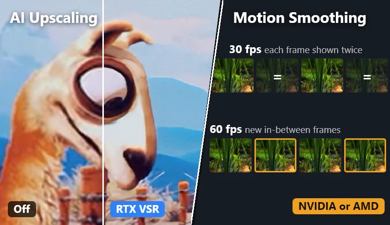
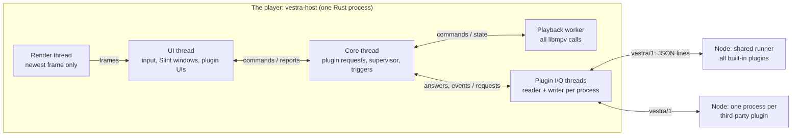

<p align="center"></p>
<p align="center"><b>Next-generation media player.<br>Built to extend, enhanced by AI.</b></p>
<p align="center">
  <a href="https://github.com/vestrasys/vestra-player/actions/workflows/main.yml"></a>
  <a href="https://github.com/vestrasys/vestra-player/releases"></a>
  
  <a href="https://vestrasys.github.io/vestra-player-sdk/"></a>
  <a href="https://www.npmjs.com/package/@vestra-player/sdk"></a>
  <a href="LICENSE"></a>
</p>
<p align="center">
  <a href="https://github.com/vestrasys/vestra-player/releases">Releases</a> ·
  <a href="https://github.com/vestrasys/vestra-player-sdk">Plugin SDK</a> ·
  <a href="https://github.com/vestrasys/vestra-player-plugins">Plugins</a> ·
  <a href="agentic-workflow/">Agentic Workflow</a>
</p>
<p align="center"><sub>Agentic Workflow: how a team of AI agents builds this repository.</sub></p>

Vestra Player is an open-source video player for Windows and macOS; Linux is not supported yet. It is a Rust player built on [libmpv](https://mpv.io) for playback and [Slint](https://slint.dev) for its windows, and every feature is a TypeScript plugin running in Node. Its AI features are AI Upscaling (RTX Video Super Resolution), Motion Smoothing (AMD and NVIDIA) and Vestra Player AI, which writes plugins from a description.

<table>
  <tr>
    <td width="50%"><a href=".github/readme/picture-adjustments.webp"></a><br><b>Picture adjustments</b>: colour, effects and geometry, applied while the video plays.</td>
    <td width="50%"><a href=".github/readme/plugin-store.webp"></a><br><b>Plugin Store</b>: install a plugin and it appears right away, with no restart needed.</td>
  </tr>
  <tr>
    <td><a href=".github/readme/playlist.webp"></a><br><b>Playlist</b>: thumbnails and durations in the sidebar; plugins can add tabs of their own.</td>
    <td><a href=".github/readme/vestranes.webp"></a><br><b>VestraNES</b>: a plugin can be a whole NES emulator, running inside the player.</td>
  </tr>
  <tr>
    <td><a href=".github/readme/ai-video.webp"></a><br><b>AI Upscaling and Motion Smoothing</b>: sharper low-res video, and 30 fps doubled to 60 fps.</td>
    <td><a href=".github/readme/ai-workshop.webp"></a><br><b>Vestra Player AI</b> (experimental): describe a plugin and it writes, checks and tests it.</td>
  </tr>
</table>

<sub>Footage: Big Buck Bunny © 2008, Caminandes 2, Sintel and Tears of Steel © Blender Foundation, <a href="https://creativecommons.org/licenses/by/3.0/">CC BY 3.0</a>; Elephants Dream © 2006 Blender Foundation / Netherlands Media Art Institute, <a href="https://creativecommons.org/licenses/by/2.5/">CC BY 2.5</a>; Spring © Blender Foundation, <a href="https://creativecommons.org/licenses/by/4.0/">CC BY 4.0</a>; Twin Dragons (open-source NES homebrew) by Garydos, surt and Shiru, code <a href="https://github.com/Garydos/twin-dragons-nes">zlib</a>, graphics <a href="https://opengameart.org/content/twin-dragons">CC BY 3.0</a>.</sub>

## Install

Download the installer from [Releases](https://github.com/vestrasys/vestra-player/releases). The player runs on Windows 10 or 11 (x64) and on macOS 15 or later (Apple silicon).

### Build from source

You need three things first:

- rustup, which installs the toolchain in `rust-toolchain.toml`.
- Node 26 (`src/packaging/node.json`).
- The native dependency archive (libmpv, FFmpeg) of the release named in `src/packaging/deps.json`. Extract it, set `MPV_LIBRARY_DIR` to that folder, and put the folder on `PATH`.

Then, in `src/`:

```sh
npm ci
node scripts/stage-plugins.mjs <dir>/plugins           # build the built-in plugins
VESTRA_BUILTIN_PLUGINS=<dir>/plugins npm start          # run the player with them
npm run ci:local                                        # the checks CI runs
npm run package:windows                                 # or package:macos
```

## How it is built

The player is one Rust program (the `vestra-host` crate). It plays media with libmpv, draws its windows with Slint, and starts the plugins. Everything you use is a TypeScript plugin in a Node process outside the player: the playback bar, playlist, adjustments, subtitles, capture and export, history, shortcuts, the Plugin Store and Vestra Player AI.

Plugins talk to the player over `vestra/1`, a JSON-lines protocol on the plugin's stdin/stdout, through the `@vestra-player/sdk` package. Inside the player, the core holds all state outside the windows (plugins, playback, triggers and packages), and the UI thread draws the windows. A trigger is a condition, such as "playing and fullscreen", that a plugin hands to the core. The core watches the condition and tells the plugin when it turns true or false.

Built-in plugins ship with the player and share one Node process, the shared runner. Third-party plugins come from the store, and each gets its own process.



Built-in and third-party plugins use the same public API. The only exceptions are three built-in-only API areas: `commands.run` (`commands.list` and `commands.run`), `palette.lead` (`set`, `clear` and `done`) and `app.windows` (`app.openWindow`). The Plugin Store installs from an index that is signed with Ed25519 and published from [vestra-player-plugins](https://github.com/vestrasys/vestra-player-plugins). Plugins are trusted code: the player has no permission system, and each third-party plugin runs in its own process, isolated from the player but not sandboxed.

## Staying responsive

Anything that can block (drawing, libmpv calls, plugin stdin/stdout, file access) runs on its own thread, so a slow window or a slow plugin never stalls playback or other plugins. The core never touches a window and never waits on the UI thread: the two exchange only messages. If the UI thread stalls, only the windows freeze, while plugins, triggers and playback control carry on. The render thread keeps only the newest video frame, so a slow UI thread skips frames instead of falling behind.

## Plugin lifecycle

The supervisor, the part of the core that decides when each plugin process runs, works like this:

- **Started on demand.** A new plugin runs once, and the player records its commands, shortcuts and settings pages. After that they appear without a running process, and the first use starts the plugin.
- **Stopped when idle.** After 30 seconds of idle time, a plugin goes into standby: its process stops, but its menus, shortcuts and triggers stay. A plugin goes into standby only if it holds nothing that needs a live process, such as an open window, a panel, a stream or a video filter.
- **Limited.** Third-party plugins start a few at a time, and user actions go first. The machine's memory sets how many third-party plugin processes may run at once (3 to 16). A plugin with its own process has a 512 MiB heap cap, and the shared runner's heap cap is 1 GiB.
- **Contained.** A crash stops only that plugin, which restarts after a delay that doubles each time. Five crashes in ten minutes turn it off, and the player says why.

## Writing a plugin

A plugin is a TypeScript package that uses the [SDK](https://vestrasys.github.io/vestra-player-sdk/). For example, this trigger keeps the window on top while a video plays in fullscreen. The player evaluates the condition itself, even while the plugin is in standby:

```ts
import type { Plugin } from "@vestra-player/sdk";

export default function activate(plugin: Plugin) {
  const { when, window } = plugin;
  plugin.trigger()
    .firesOn(when.playing.and(when.fullscreen))
    .enter(() => window.setAlwaysOnTop(true))
    .leave(() => window.setAlwaysOnTop(false));
}
```

The [SDK documentation](https://vestrasys.github.io/vestra-player-sdk/) has the tutorial, guides and API reference. [doc/architecture.md](doc/architecture.md) explains how the player is put together.

## License

Vestra Player is licensed under [GPL-3.0-or-later](LICENSE). The SDK and the plugins repository are Apache-2.0.
