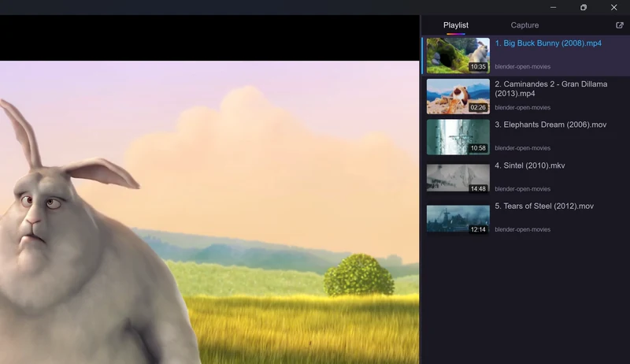

<p align="center"></p>
<p align="center"><b>Next-generation media player.<br>Built to extend, enhanced by AI.</b></p>
<p align="center">
  <a href="https://github.com/vestrasys/vestra-player/actions/workflows/main.yml"></a>
  <a href="https://github.com/vestrasys/vestra-player/releases"></a>
  
  <a href="https://vestrasys.github.io/vestra-player-sdk/"></a>
  <a href="https://www.npmjs.com/package/@vestra-player/sdk"></a>
  <a href="LICENSE"></a>
</p>
<p align="center">
  <a href="https://github.com/vestrasys/vestra-player/releases">Releases</a> ·
  <a href="https://github.com/vestrasys/vestra-player-sdk">Plugin SDK</a> ·
  <a href="https://github.com/vestrasys/vestra-player-plugins">Plugins</a> ·
  <a href="agentic-workflow/">Agentic Workflow</a>
</p>
<p align="center"><sub>Agentic Workflow: how a team of AI agents builds this repository.</sub></p>

Vestra Player is an open-source video player for Windows and macOS; Linux is not supported yet. It is a Rust player built on [libmpv](https://mpv.io) for playback and [Slint](https://slint.dev) for its windows, and every feature is a TypeScript plugin running in Node. Its AI features are AI Upscaling (RTX Video Super Resolution), Motion Smoothing (AMD and NVIDIA) and Vestra Player AI, which writes plugins from a description.

<table>
  <tr>
    <td width="50%"><a href=".github/readme/picture-adjustments.webp"></a><br><b>Picture adjustments</b>: colour, effects and geometry, applied while the video plays.</td>
    <td width="50%"><a href=".github/readme/plugin-store.webp"></a><br><b>Plugin Store</b>: install a plugin and it appears right away, with no restart needed.</td>
  </tr>
  <tr>
    <td><a href=".github/readme/playlist.webp"></a><br><b>Playlist</b>: thumbnails and durations in the sidebar; plugins can add tabs of their own.</td>
    <td><a href=".github/readme/vestranes.webp"></a><br><b>VestraNES</b>: a plugin can be a whole NES emulator, running inside the player.</td>
  </tr>
  <tr>
    <td><a href=".github/readme/ai-video.webp"></a><br><b>AI Upscaling and Motion Smoothing</b>: sharper low-res video, and 30 fps doubled to 60 fps.</td>
    <td><a href=".github/readme/ai-workshop.webp"></a><br><b>Vestra Player AI</b> (experimental): describe a plugin and it writes, checks and tests it.</td>
  </tr>
</table>

<sub>Footage: Big Buck Bunny © 2008, Caminandes 2, Sintel and Tears of Steel © Blender Foundation, <a href="https://creativecommons.org/licenses/by/3.0/">CC BY 3.0</a>; Elephants Dream © 2006 Blender Foundation / Netherlands Media Art Institute, <a href="https://creativecommons.org/licenses/by/2.5/">CC BY 2.5</a>; Spring © Blender Foundation, <a href="https://creativecommons.org/licenses/by/4.0/">CC BY 4.0</a>; Twin Dragons (open-source NES homebrew) by Garydos, surt and Shiru, code <a href="https://github.com/Garydos/twin-dragons-nes">zlib</a>, graphics <a href="https://opengameart.org/content/twin-dragons">CC BY 3.0</a>; Morevna © Morevna Project, <a href="https://creativecommons.org/licenses/by-sa/4.0/">CC BY-SA 4.0</a> (the AI Upscaling and Motion Smoothing image is shared under the same licence).</sub>

## Install

Download the installer from [Releases](https://github.com/vestrasys/vestra-player/releases). The player runs on Windows 10 or 11 (x64) and on macOS 15 or later (Apple silicon).

### Build from source

You need three things first:

- rustup, which installs the toolchain in `rust-toolchain.toml`.
- Node 26 (`src/packaging/node.json`).
- The native dependency archive (libmpv, FFmpeg) of the release named in `src/packaging/deps.json`. Extract it, set `MPV_LIBRARY_DIR` to that folder, and put the folder on `PATH`.

Then, in `src/`:

```sh
npm ci
node scripts/stage-plugins.mjs <dir>/plugins           # build the built-in plugins
VESTRA_BUILTIN_PLUGINS=<dir>/plugins npm start          # run the player with them
# PowerShell: $env:VESTRA_BUILTIN_PLUGINS="<dir>/plugins"; npm start
npm run ci:local                                        # the checks CI runs
npm run package:windows                                 # or package:macos
```

## How it works

Every feature is a TypeScript plugin running in Node, outside the player. That covers the playback bar, playlist, adjustments, subtitles, capture and export, history, shortcuts, the Plugin Store and Vestra Player AI. Built-in plugins use the same public API as third-party plugins. The player keeps playback responsive whatever a plugin does.

- [doc/architecture.md](doc/architecture.md): how the player is put together (threads, plugin processes, the store, a code map).
- [SDK documentation](https://vestrasys.github.io/vestra-player-sdk/): how to write a plugin (tutorial, guides, API reference).

## License

Vestra Player is licensed under [GPL-3.0-or-later](LICENSE). The SDK and the plugins repository are Apache-2.0.
