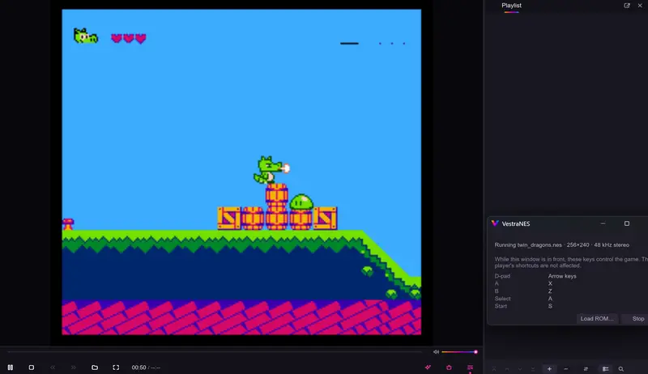
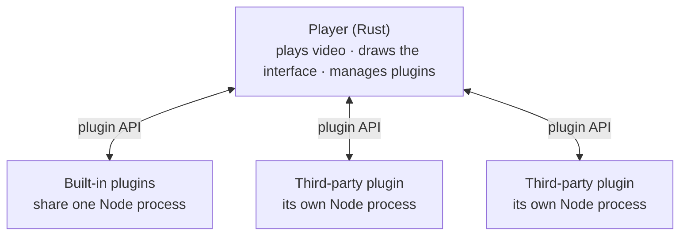

<b>A fast, keyboard-friendly desktop video player where every feature is a plugin.</b>

  
  
  
  
  
  

  <a href="https://github.com/vestrasys/vestra-player/releases">Releases</a> ·
  <a href="https://github.com/vestrasys/vestra-player-sdk">Plugin SDK</a> ·
  <a href="https://github.com/vestrasys/vestra-player-plugins">Plugins</a> ·
  <a href="agentic-workflow/">Agentic Workflow</a>

Vestra Player is an open-source video player for macOS and Windows. It aims for rich, discoverable controls (menus, shortcuts, a docked playlist, deep video and audio settings) on a modern, extensible architecture. Playback is handled by [libmpv](https://mpv.io); the interface is native [Slint](https://slint.dev); and everything you use (playback bar, playlist, video and audio adjustments, subtitles, screenshots and export, history, hotkeys, the plugin store) is a TypeScript plugin, and the store adds more, such as the NES emulator VestraNES.

<table>
  <tr>
    <td width="50%"> <b>Picture adjustments</b>: the Adjustments and Effects column (bottom bar, or Alt+1 for its Picture panel); changes apply while the video plays.</td>
    <td width="50%"> <b>Plugin Store</b>: install plugins from the bottom bar; they appear right away.</td>
  </tr>
  <tr>
    <td> <b>VestraTube</b>: search YouTube in the sidebar and play a video.</td>
    <td> <b>VestraNES</b>: a plugin can be a whole emulator.</td>
  </tr>
  <tr>
    <td> <b>Seek-bar preview</b>: a thumbnail of the frame under the pointer.</td>
    <td> <b>Vestra Player AI</b> (experimental): describe a plugin and it writes, checks and tests it, with your own AI provider.</td>
  </tr>
</table>

Footage: Big Buck Bunny © 2008 Blender Foundation, <a href="https://creativecommons.org/licenses/by/3.0/">CC BY 3.0</a>; Spring © Blender Foundation, <a href="https://creativecommons.org/licenses/by/4.0/">CC BY 4.0</a>; Twin Dragons (open-source NES homebrew) by Garydos, surt and Shiru, code <a href="https://github.com/Garydos/twin-dragons-nes">zlib</a>, graphics <a href="https://opengameart.org/content/twin-dragons">CC BY 3.0</a>.

## Core ideas

- **Everything is a plugin.** The Rust host only provides shared infrastructure: playback, UI composition, processing chains, plugin lifecycle. Product features live in plugins.
- **One public API for everyone.** Built-in and third-party plugins use the same API, `vestra/1`, through the [`@vestra-player/sdk`](https://www.npmjs.com/package/@vestra-player/sdk) package. If a built-in plugin needs something, the public API grows; there are no private back doors.
- **Plugins out of process.** Plugins run in Node.js, outside the host: the built-ins share one process, every other plugin has its own. The host checks every call against the capabilities the plugin declares, and stopping a plugin releases everything it owns.
- **Native UI.** Plugin windows and panels are Slint components, compiled and composed by the host with a shared theme and widget set.
- **Signed plugin store.** Plugins install from a signed index (Ed25519), built from source in [vestra-player-plugins](https://github.com/vestrasys/vestra-player-plugins).
- **Cross-platform.** All OS-specific code sits in a thin platform layer (`src/host/src/platform/`), one module per system; everything else is shared.

## Architecture

**Player and plugins.** The player is one Rust program: it plays video with libmpv, draws the interface with Slint and runs the plugins. Everything beyond playing a file, such as the playlist, subtitles, the Plugin Store and Vestra Player AI, is a plugin. A plugin is a TypeScript program that runs in Node and talks to the player through the same message-based API, built-in or not.

**Interface.** A plugin describes its windows and panels in Slint files. The player compiles them, places them in the main window or in a window of their own, and tells the plugin what the user does. The plugin sends back data, not pixels, so even long lists stay fast.

**Isolation.** Each third-party plugin runs in its own process; the built-in plugins share one. A plugin can use only what its manifest declares. When a plugin crashes, only that plugin stops, and playback goes on.

**Plugin manager.** One part of the player decides when each plugin runs ([details](doc/architecture/supervisor.md)):

- **On demand.** A plugin that is not in use is stopped, but its menu items, keys and settings stay; using one starts it again. A plugin that is doing something visible keeps running.
- **Within limits.** Plugins start a few at a time, each has a memory cap, and when memory runs low the plugins unused the longest are stopped first.
- **Faults.** A crashed plugin starts again after a short pause; one that keeps crashing is turned off, and the user is told why.

More in the [architecture overview](doc/architecture/README.md#2-loading-and-stopping-plugins).

## Repository layout

| Path | Contents |
| --- | --- |
| `src/host/` | The Rust host: playback, UI composition, plugin and package management, platform layer |
| `src/runtime/` | The Node.js runners: `shared-runner` for the built-ins, `runner` for each other plugin's process |
| `src/plugins/` | The built-in product plugins |
| `src/packaging/` | Installer builds for macOS and Windows |
| `doc/` | Design documents, architecture and process notes ([index](doc/README.md)) |

The SDK lives in [vestra-player-sdk](https://github.com/vestrasys/vestra-player-sdk); the YouTube and Bilibili plugins and the store index live in [vestra-player-plugins](https://github.com/vestrasys/vestra-player-plugins).

## License

Vestra Player is licensed under [GPL-3.0-or-later](LICENSE). The SDK and the plugins repository are Apache-2.0.
