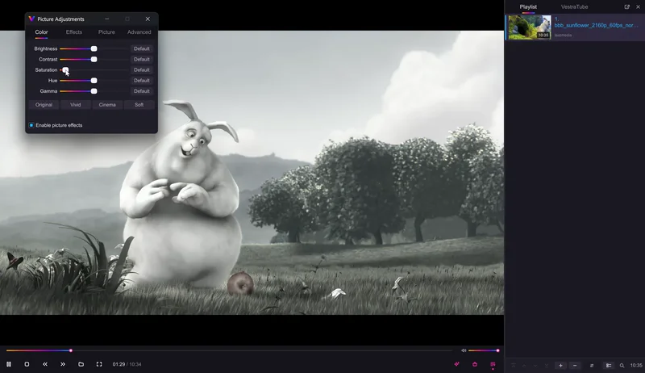
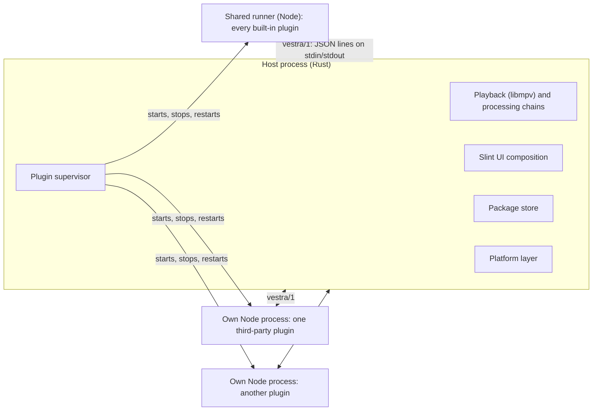

<h1 align="center">Vestra Player</h1>

<b>A fast, keyboard-friendly desktop video player where every feature is a plugin.</b>

  
  
  
  
  
  

  <a href="https://github.com/vestrasys/vestra-player/releases">Releases</a> ·
  <a href="https://vestrasys.github.io/vestra-player-sdk/">Plugin SDK docs</a> ·
  <a href="https://github.com/vestrasys/vestra-player-plugins">Plugins</a> ·
  <a href="doc/README.md">Design docs</a> ·
  <a href="agentic-workflow.md">Agentic Workflow</a>

  <picture>
    
  </picture>

Vestra Player is an open-source video player for macOS and Windows. It aims for rich, discoverable controls (menus, shortcuts, a docked playlist, deep video and audio settings) on a modern, extensible architecture. Playback is handled by [libmpv](https://mpv.io); the interface is native [Slint](https://slint.dev); and everything you use (playback bar, playlist, video and audio adjustments, subtitles, screenshots and export, history, hotkeys, the plugin store) is a TypeScript plugin, and the store adds more, such as the NES emulator VestraNES.

<table>
  <tr>
    <td width="50%"> <b>Picture adjustments</b>: right-click ▸ Video, changes apply while the video plays.</td>
    <td width="50%"> <b>Plugin Store</b>: install plugins from the bottom bar; they appear right away.</td>
  </tr>
  <tr>
    <td> <b>VestraTube</b>: search YouTube in the sidebar and play a video.</td>
    <td> <b>VestraNES</b>: a plugin can be a whole emulator.</td>
  </tr>
  <tr>
    <td> <b>Seek-bar preview</b>: a thumbnail of the frame under the pointer.</td>
    <td> <b>Vestra Player AI</b> (experimental): describe a plugin and it writes, checks and tests it, with your own AI provider.</td>
  </tr>
</table>

Footage: Big Buck Bunny © 2008 Blender Foundation, <a href="https://creativecommons.org/licenses/by/3.0/">CC BY 3.0</a>; Spring © Blender Foundation, <a href="https://creativecommons.org/licenses/by/4.0/">CC BY 4.0</a>; Concentration Room © 2010 Damian Yerrick, GPL-3.0-or-later.

## Core ideas

- **Everything is a plugin.** The Rust host only provides shared infrastructure: playback, UI composition, processing chains, plugin lifecycle. Product features live in plugins.
- **One public API for everyone.** Built-in and third-party plugins use the same API, `vestra/1`, through the [`@vestra-player/sdk`](https://www.npmjs.com/package/@vestra-player/sdk) package. If a built-in plugin needs something, the public API grows; there are no private back doors.
- **Plugins out of process.** Plugins run in Node.js, outside the host: the built-ins share one process, every other plugin has its own. The host checks every call against the capabilities the plugin declares, and stopping a plugin releases everything it owns.
- **Native UI.** Plugin windows and panels are Slint components, compiled and composed by the host with a shared theme and widget set.
- **Signed plugin store.** Plugins install from a signed index (Ed25519), built from source in [vestra-player-plugins](https://github.com/vestrasys/vestra-player-plugins).
- **Cross-platform.** All OS-specific code sits in a thin platform layer (`src/host/src/platform/`), one module per system; everything else is shared.

## Architecture

**UI.** Plugins describe their windows and panels in `.slint` files; the host compiles them, places them in the main window or a tool window, and forwards their callbacks to the plugin. Plugins send values and row changes, not pixels, so a 20,000-row playlist is a native `ListView` over rows the host holds ([large lists](doc/architecture/large-lists.md)).

**Processes.** Built-in plugins share one Node process, the shared runner; every other plugin gets its own, apart from the player and from each other. A Node process costs about 50 MB, one more plugin in the shared runner about 1 MB (the 14 built-ins of a headless start: 704 MB as separate processes, 61 MB shared, on Windows). The host checks each call against the plugin's declared capabilities and caps messages at 1 MiB. A crashed plugin takes only itself down; playback runs in the host and goes on.

**Plugin supervisor.** One component of the host decides when each plugin process should exist ([supervisor](doc/architecture/supervisor.md)). Its core is pure: it takes events (a process started, became ready, exited; a menu item was clicked; a timer is due) and returns actions (start this, stop that), and does no I/O itself, so it is tested by deterministic simulations. A thin adapter carries out its actions.

- **Plugins start when needed.** At its first run the host records what a plugin adds (menu items, keys, settings pages, the files and addresses it opens). A plugin that holds nothing live (no mounted panel, open window, filter chain or playback listener) then rests in **standby**: no process, but its entries stay and work. The first use starts it again (tens of milliseconds for a built-in, a few hundred for its own process), and 30 s without use puts it back. A plugin that holds something live never stands by. Session storage survives standby.
- **Bounded starts.** Built-ins start first. Third-party plugins start a few at a time, clicks before background starts, and their processes are created off the UI thread.
- **Bounded memory.** Each own process has a 512 MB JavaScript heap (the shared runner 1 GB). At most 3–16 third-party processes run at once, depending on physical memory; past that, and under memory pressure, the least recently used idle plugins go to standby.
- **Stops and faults.** A stopped plugin loses everything it owned and has 5 s to clean up (300 ms after a fault; 1 s for all plugins together when the player quits). A built-in that crashes restarts after a growing pause; another plugin keeps its entries and starts again on its next use; 5 crashes in 10 minutes leave it stopped. A fault the shared runner cannot attribute to one plugin restarts the runner (first at once, then with a growing pause); after the third restart in a minute each built-in runs in its own process for the session.

More in the [architecture overview](doc/architecture/README.md#2-loading-and-stopping-plugins).

## Repository layout

| Path | Contents |
| --- | --- |
| `src/host/` | The Rust host: playback, UI composition, plugin and package management, platform layer |
| `src/runtime/` | The Node.js runners: `shared-runner` for the built-ins, `runner` for each other plugin's process |
| `src/plugins/` | The built-in product plugins |
| `src/packaging/` | Installer builds for macOS and Windows |
| `doc/` | Design documents, architecture and process notes ([index](doc/README.md)) |

The SDK lives in [vestra-player-sdk](https://github.com/vestrasys/vestra-player-sdk); the YouTube and Bilibili plugins and the store index live in [vestra-player-plugins](https://github.com/vestrasys/vestra-player-plugins).

## License

Vestra Player is licensed under [GPL-3.0-or-later](LICENSE). The SDK and the plugins repository are Apache-2.0.
