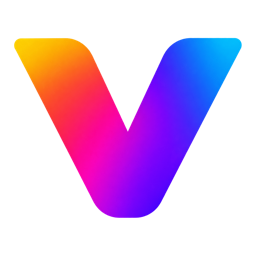

<p align="center"></p>
<h1 align="center">Vestra Player</h1>
<p align="center"><b>A fast, keyboard-friendly desktop video player where every feature is a plugin.</b></p>
<p align="center">
  <a href="https://github.com/vestrasys/vestra-player/actions/workflows/main.yml"></a>
  <a href="https://github.com/vestrasys/vestra-player/releases"></a>
  
  <a href="https://vestrasys.github.io/vestra-player-sdk/"></a>
  <a href="https://www.npmjs.com/package/@vestra-player/sdk"></a>
  <a href="LICENSE"></a>
</p>
<p align="center">
  <a href="https://github.com/vestrasys/vestra-player/releases">Releases</a> ·
  <a href="https://vestrasys.github.io/vestra-player-sdk/">Plugin SDK docs</a> ·
  <a href="https://github.com/vestrasys/vestra-player-plugins">Plugins</a> ·
  <a href="doc/README.md">Design docs</a> ·
  <a href="agentic-workflow.md">Agentic Workflow</a>
</p>

Vestra Player is an open-source video player for macOS and Windows. It aims for rich, discoverable controls (menus, shortcuts, a docked playlist, deep video and audio settings) on a modern, extensible architecture. Playback is handled by [libmpv](https://mpv.io); the interface is native [Slint](https://slint.dev); and everything you use (playback bar, playlist, video and audio adjustments, subtitles, screenshots and export, history, hotkeys, the plugin store) is a TypeScript plugin, and the store adds more, such as the NES emulator VestraNES.

## Core ideas

- **Everything is a plugin.** The Rust host only provides shared infrastructure: playback, UI composition, processing chains, plugin lifecycle. Product features live in plugins.
- **One public API for everyone.** Built-in and third-party plugins use the same API, `vestra/1`, through the [`@vestra-player/sdk`](https://www.npmjs.com/package/@vestra-player/sdk) package. If a built-in plugin needs something, the public API grows; there are no private back doors.
- **Isolated plugins.** Each plugin runs in its own Node.js process. The host checks every call against the capabilities the plugin declares, and stopping a plugin releases everything it owns.
- **Native UI.** Plugin windows and panels are Slint components, compiled and composed by the host with a shared theme and widget set.
- **Signed plugin store.** Plugins install from a signed index (Ed25519), built from source in [vestra-player-plugins](https://github.com/vestrasys/vestra-player-plugins).
- **Cross-platform.** All OS-specific code sits in a thin platform layer (`src/host/src/platform/`), one module per system; everything else is shared.

## Architecture

```text
┌──────────────────────── Host process (Rust) ────────────────────────┐
│  Playback (libmpv)        Slint UI composition     Package store    │
│  Processing chains        Plugin process manager   Platform layer   │
└──────────────────────────────────▲──────────────────────────────────┘
                                   │  JSON-RPC (one JSON message per line)
                                   │  over stdin/stdout, protocol vestra/1
        ┌──────────────────────────┼──────────────────────────┐
┌───────┴────────┐        ┌────────┴───────┐        ┌─────────┴──────┐
│ Node process   │        │ Node process   │        │ Node process   │
│ plugin (TS)    │        │ plugin (TS)    │  ...   │ plugin (TS)    │
│ + SDK + .slint │        │ + SDK + .slint │        │ + SDK + .slint │
└────────────────┘        └────────────────┘        └────────────────┘
```

Plugins describe their windows and panels in `.slint` files; the host compiles them, places them in the main window or a tool window, and forwards their callbacks back to the plugin.

## Repository layout

| Path | Contents |
| --- | --- |
| `src/host/` | The Rust host: playback, UI composition, plugin and package management, platform layer |
| `src/runtime/` | The runner that starts each plugin in its Node.js process |
| `src/plugins/` | The built-in product plugins |
| `src/packaging/` | Installer builds for macOS and Windows |
| `doc/` | Design documents, architecture and process notes ([index](doc/README.md)) |

The SDK lives in [vestra-player-sdk](https://github.com/vestrasys/vestra-player-sdk); the YouTube and Bilibili plugins and the store index live in [vestra-player-plugins](https://github.com/vestrasys/vestra-player-plugins).

## License

Vestra Player is licensed under [GPL-3.0-or-later](LICENSE). The SDK and the plugins repository are Apache-2.0.
