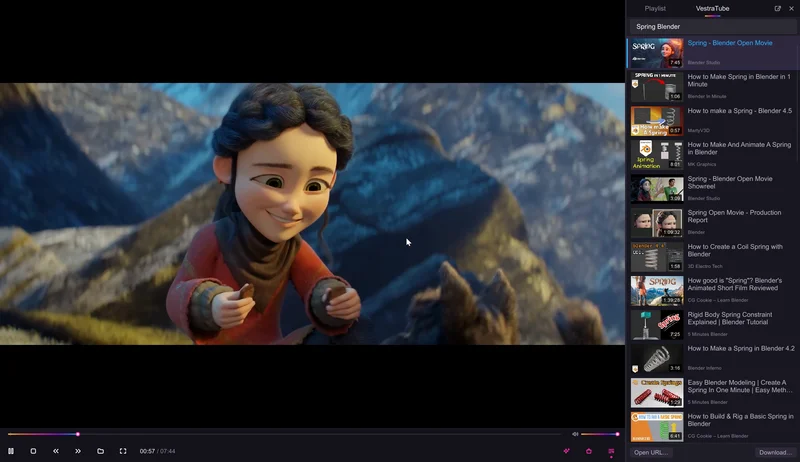
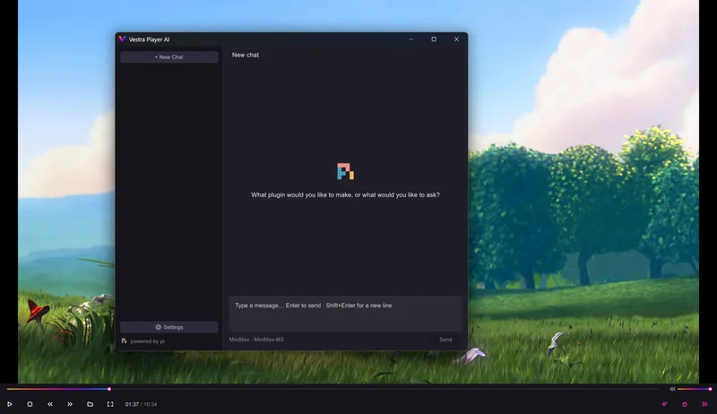

<p align="center"></p>
<h1 align="center">Vestra Player</h1>
<p align="center"><b>A fast, keyboard-friendly desktop video player where every feature is a plugin.</b></p>
<p align="center">
  <a href="https://github.com/vestrasys/vestra-player/actions/workflows/main.yml"></a>
  <a href="https://github.com/vestrasys/vestra-player/releases"></a>
  
  <a href="https://vestrasys.github.io/vestra-player-sdk/"></a>
  <a href="https://www.npmjs.com/package/@vestra-player/sdk"></a>
  <a href="LICENSE"></a>
</p>
<p align="center">
  <a href="https://github.com/vestrasys/vestra-player/releases">Releases</a> ·
  <a href="https://vestrasys.github.io/vestra-player-sdk/">Plugin SDK docs</a> ·
  <a href="https://github.com/vestrasys/vestra-player-plugins">Plugins</a> ·
  <a href="doc/README.md">Design docs</a> ·
  <a href="agentic-workflow.md">Agentic Workflow</a>
</p>

<p align="center">
  <picture>
    
  </picture>
</p>

Vestra Player is an open-source video player for macOS and Windows. It aims for rich, discoverable controls (menus, shortcuts, a docked playlist, deep video and audio settings) on a modern, extensible architecture. Playback is handled by [libmpv](https://mpv.io); the interface is native [Slint](https://slint.dev); and everything you use (playback bar, playlist, video and audio adjustments, subtitles, screenshots and export, history, hotkeys, the plugin store) is a TypeScript plugin, and the store adds more, such as the NES emulator VestraNES.

<table>
  <tr>
    <td width="50%"><a href=".github/readme/picture-adjustments.webp"></a><br><b>Picture adjustments</b>: right-click ▸ Video, changes apply while the video plays.</td>
    <td width="50%"><a href=".github/readme/plugin-store.webp"></a><br><b>Plugin Store</b>: install plugins from the bottom bar; they appear right away.</td>
  </tr>
  <tr>
    <td><a href=".github/readme/vestratube.webp"></a><br><b>VestraTube</b>: search YouTube in the sidebar and play a video.</td>
    <td><a href=".github/readme/vestranes.webp"></a><br><b>VestraNES</b>: a plugin can be a whole emulator.</td>
  </tr>
  <tr>
    <td><a href=".github/readme/seek-preview.webp"></a><br><b>Seek-bar preview</b>: a thumbnail of the frame under the pointer.</td>
    <td><a href=".github/readme/ai-workshop.webp"></a><br><b>Vestra Player AI</b> (experimental): describe a plugin and it writes, checks and tests it, with your own AI provider.</td>
  </tr>
</table>

<sub>Footage: Big Buck Bunny © 2008 Blender Foundation, <a href="https://creativecommons.org/licenses/by/3.0/">CC BY 3.0</a>; Spring © Blender Foundation, <a href="https://creativecommons.org/licenses/by/4.0/">CC BY 4.0</a>; Concentration Room © 2010 Damian Yerrick, GPL-3.0-or-later.</sub>

## Core ideas

- **Everything is a plugin.** The Rust host only provides shared infrastructure: playback, UI composition, processing chains, plugin lifecycle. Product features live in plugins.
- **One public API for everyone.** Built-in and third-party plugins use the same API, `vestra/1`, through the [`@vestra-player/sdk`](https://www.npmjs.com/package/@vestra-player/sdk) package. If a built-in plugin needs something, the public API grows; there are no private back doors.
- **Plugins out of process.** Plugins run in Node.js, outside the host: the built-ins share one process, every other plugin has its own. The host checks every call against the capabilities the plugin declares, and stopping a plugin releases everything it owns.
- **Native UI.** Plugin windows and panels are Slint components, compiled and composed by the host with a shared theme and widget set.
- **Signed plugin store.** Plugins install from a signed index (Ed25519), built from source in [vestra-player-plugins](https://github.com/vestrasys/vestra-player-plugins).
- **Cross-platform.** All OS-specific code sits in a thin platform layer (`src/host/src/platform/`), one module per system; everything else is shared.

## Architecture

```text
┌──────────────────────── Host process (Rust) ────────────────────────┐
│  Playback (libmpv)        Slint UI composition     Package store    │
│  Processing chains        Plugin process manager   Platform layer   │
└───────────▲─────────────────────────▲───────────────────────▲───────┘
            │ JSON-RPC, stdin/stdout  │ protocol vestra/1     │
            │ one message per line    │                       │
┌───────────┴──────────┐     ┌────────┴───────┐      ┌────────┴───────┐
│ Shared runner (Node) │     │ Node process   │      │ Node process   │
│ all built-in plugins │     │ other plugin   │ ...  │ other plugin   │
│ + SDK + .slint       │     │ + SDK + .slint │      │ + SDK + .slint │
└──────────────────────┘     └────────────────┘      └────────────────┘
```

Plugins describe their windows and panels in `.slint` files; the host compiles them, places them in the main window or a tool window, and forwards their callbacks back to the plugin. Plugins send values and row changes, not pixels, so a 20,000-row playlist is a native `ListView` over rows the host holds ([large lists](doc/architecture/large-lists.md)).

Built-in plugins share one Node process, the shared runner; every other plugin gets its own, apart from the player and from each other. A Node process costs about 50 MB, one more plugin in the shared runner [about 1 MB](doc/process/rounds/2026-10-plugin-memory.md): on Windows, the 14 built-ins that run in a headless start measured 704 MB of working set as separate processes and 61 MB shared ([measurements](doc/process/rounds/2026-10-shared-runner.md#163-measurements)).

[Lazy activation](doc/process/rounds/2026-10-lazy-activation.md), on for everyone since host 0.6.7 (on-demand start, [supervisor](doc/architecture/supervisor.md)), keeps plugins that are not in use from running. As with a Chrome MV3 service worker, a plugin holding nothing live (a mounted panel such as the playback bar, an open window, a filter chain, a playback listener) is stopped after 30 seconds idle; the host keeps its menus, keys and file types, and the next use starts it again: tens of milliseconds for a built-in, a few hundred for a plugin in its own process. Session storage carries state across the stop. Most built-ins hold a mounted panel or a playback listener, so they stay running.

The host checks each call against the declared capabilities and caps messages at 1 MiB. A stopped plugin loses everything it owned and has 5 s to exit (300 ms after a fault, 1 s in all when the player quits); a crashed plugin process takes only its plugin down, and playback, which runs in the host, goes on. In the shared runner, an uncaught exception traced to one plugin stops that plugin, which runs in its own process if started again; a runner exit, an unattributed fault, five missed 2 s heartbeats or a full input queue restarts every built-in in a new runner (panels and windows gone for 1.2–1.4 s in a kill drill), and the third restart within a minute leaves them in separate processes until the player quits. More in the [architecture overview](doc/architecture/README.md#2-loading-and-stopping-plugins).

## Repository layout

| Path | Contents |
| --- | --- |
| `src/host/` | The Rust host: playback, UI composition, plugin and package management, platform layer |
| `src/runtime/` | The Node.js runners: `shared-runner` for the built-ins, `runner` for each other plugin's process |
| `src/plugins/` | The built-in product plugins |
| `src/packaging/` | Installer builds for macOS and Windows |
| `doc/` | Design documents, architecture and process notes ([index](doc/README.md)) |

The SDK lives in [vestra-player-sdk](https://github.com/vestrasys/vestra-player-sdk); the YouTube and Bilibili plugins and the store index live in [vestra-player-plugins](https://github.com/vestrasys/vestra-player-plugins).

## License

Vestra Player is licensed under [GPL-3.0-or-later](LICENSE). The SDK and the plugins repository are Apache-2.0.
