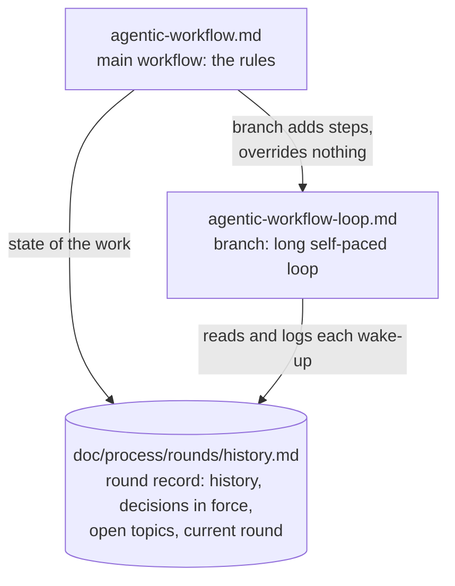

# Agentic workflow

How this repository is built by a team of AI agents: a coordinator, an API maintainer, plugin authors, an infrastructure maintainer, researchers and independent reviewers, with the user giving requirements and rulings.

| Document | What it covers | When to read it |
| --- | --- | --- |
| [agentic-workflow.md](agentic-workflow.md) | The main workflow: roles and file ownership, how information flows, plugin API requests and negotiation, refactoring the API, checks and GUI tests, when to ask the user, concurrency and machine rules, report format | Every agent, before any work |
| [agentic-workflow-loop.md](agentic-workflow-loop.md) | A branch of the main workflow for long self-paced work while the user is away: what must be settled first, where state lives, what to do on each wake-up, one step of work, side requests, blocked steps, how a loop ends; optional patterns for migrations, spec tests, performance and releases | The coordinator, when it runs a project as a loop |

Where the two differ, the main workflow wins. Changes to either file need the user's approval.
