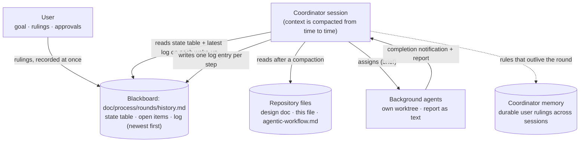
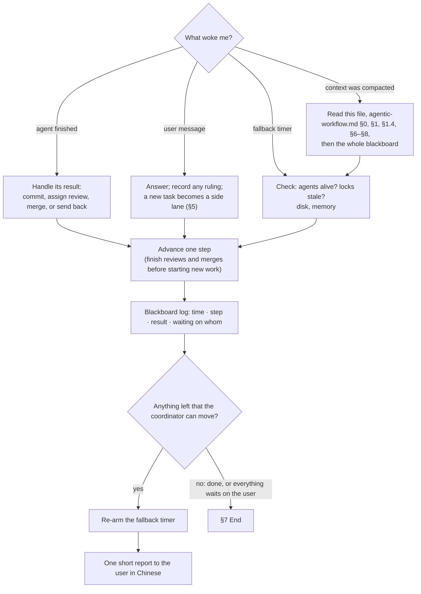
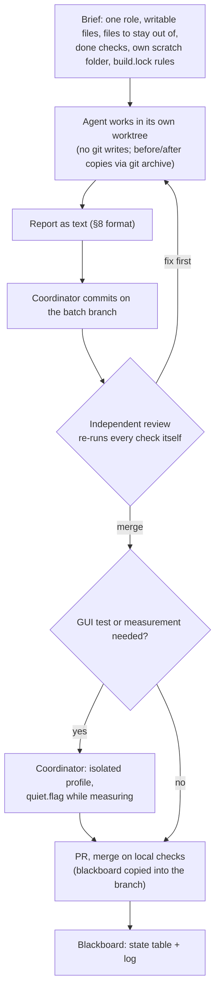
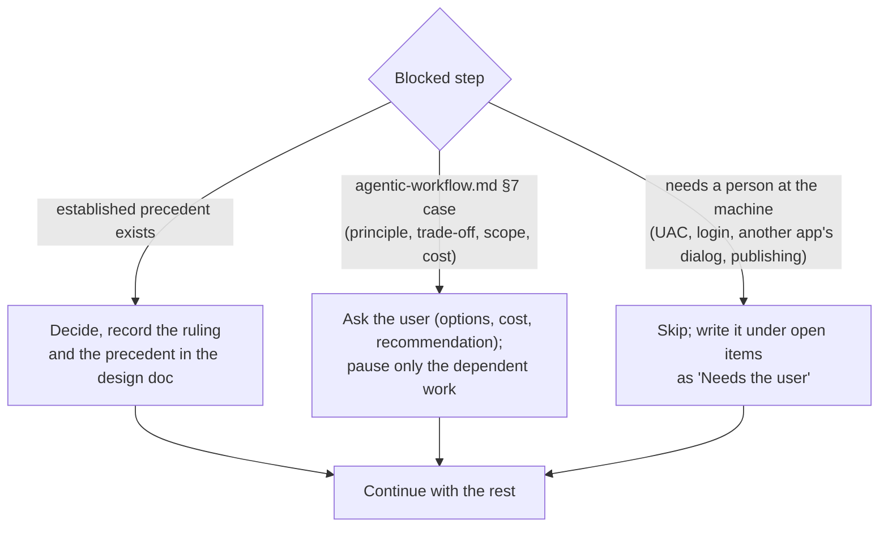

# Agentic workflow: long-running loop

This file supplements [agentic-workflow.md](agentic-workflow.md) for work the coordinator drives on its own over many hours: the user is away, and the session goes through several context compactions. It adds steps and does not override a rule there. Where the two differ, agentic-workflow.md wins.

Use it when a project has more than a few steps and the user wants it to keep moving without them. A single task, or one the user watches step by step, does not need it.

## 1. Before the loop starts

The user and the coordinator settle these before the first wake-up:

| Item | Where it lives |
| --- | --- |
| Goal and done criteria: when the loop may stop | The round record (the blackboard) |
| Steps or batches, each with its own done criteria | The design doc or the blackboard |
| Open design questions, answered | The design doc |
| Authority: what the coordinator decides alone, what stops for the user, which resources it may use (machine, paid services, releases, pushes) | The blackboard, "User rulings" |
| The loop prompt: one line that names this file and the blackboard | The `/loop` command |

Questions answered up front are what keep the user from being interrupted later.

## 2. Where the state lives

- The conversation is not the state; files are. After a compaction, trust the blackboard and these files, not the summary.
- Write a user ruling into the blackboard the moment it is given, with both halves if it supersedes an earlier one.
- Agents report as text. They cannot write report files. When a report is long and needed later (for example research for a summary), the coordinator saves it to the scratchpad from the agent's transcript instead of retyping it.

## 3. Each wake-up

How much to read:

- **After a compaction or at the start**: this file, the listed workflow sections and the whole blackboard.
- **Any other wake-up**: the blackboard's state table and its latest log entries only. Do not re-read files that are already in context and have not changed: they add tokens, bring compaction sooner and add no information.

How often to wake:

- **Agents running**: their completion notifications wake the coordinator. The timer is only a fallback for a hung agent or a lost notification: **20–30 min**. A wake-up that finds nothing new costs little, because it reads only the state table (above).
- **Waiting on something that sends no notification** (an external CI run, a publish): check at that thing's own pace.
- **Nothing to wait for**: do not idle. Stop the loop (§7).

## 4. One step of work

- **Two agents at once** when their files are disjoint; each brief lists the other's files. Up to the limit in agentic-workflow.md §8.
- **Fixes go back to the agent that wrote the code**, so it keeps its context.
- **A re-review states its blocking bar**: regression, data loss, two writers on one resource, stuck forever. Anything below the bar becomes a follow-up item, not another fix round. Without a bar, reviews can return the same batch several times.
- **A brief too big for one agent is split by the coordinator**; agents never start agents.

## 5. User requests during the loop

A request that arrives mid-loop (a bug report, a recording, a question) becomes a **side lane**: its own line in the blackboard's open items, its own agents and branch, and its own merge. The main batches keep moving. If the request changes the main plan, record the ruling first and then adjust the state table.

Answer questions directly. When the user asks not to record something, do not record it.

## 6. When something needs a person

The machine rules of agentic-workflow.md §8 (build lock, quiet flag, disk and memory guards, one player at a time, GUI only in an isolated profile) apply unchanged while the user is away. Absence is never a reason to skip a review, a check or a measurement.

## 7. End

The loop ends when the done criteria are met, or when everything left waits on the user. Then:

1. Stop the timer.
2. Fold the round's lasting decisions, lessons and open topics into the sections of [history.md](../doc/process/rounds/history.md) and clear its "Current round" log. Git keeps the old text.
3. Report to the user in Chinese: what was done, what waits on them, and what was left open.

## Appendix: patterns that worked

These are optional. Pick the ones that fit the project.

| Project type | Pattern | Why |
| --- | --- | --- |
| Refactor or migration | Write characterization tests of today's behaviour first, including known bugs marked "expected to change" | The new code is checked against facts, not memory |
| Refactor or migration | Wire the new code with a preset that reproduces the old behaviour; prove zero difference; flip values batch by batch; delete the old preset last | Every batch is small and reversible |
| Refactor or migration | Every transitional field or switch names the batch that removes it, and that batch's brief carries a grep check | Nothing temporary survives silently |
| Work against a written design | A separate spec-test author writes tests from the design tables without reading the implementation | An independent check that the code matches the design, not the implementer's reading of it |
| Performance | Fix the metric first (p99, ticks over one frame), measure with the machine quiet, compare before and after on the same data | Impressions mislead; numbers settle it |
| Deliverables outside the repo (releases, videos, web pages) | Build and check them locally or in an isolated profile; leave the outward publish step to the user | Publishing is hard to undo |
