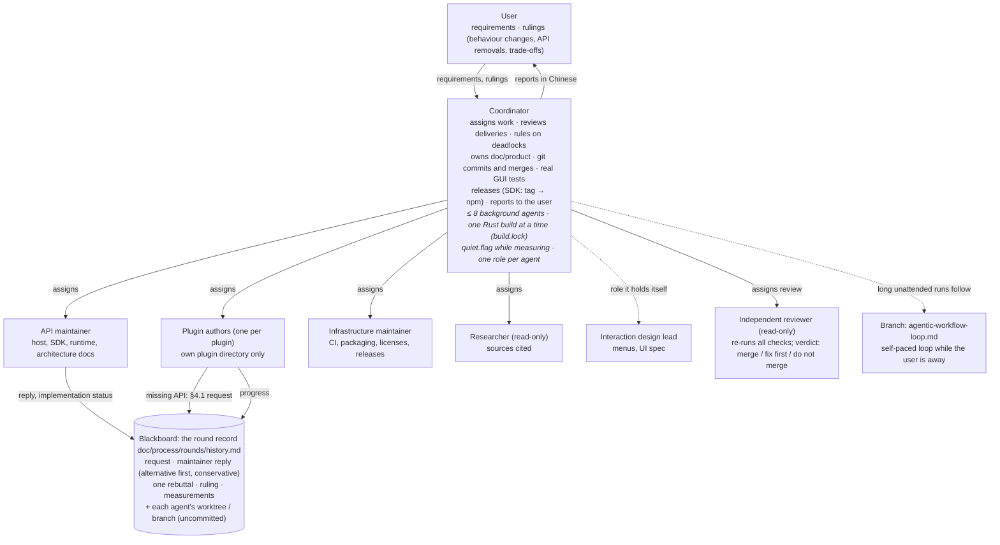
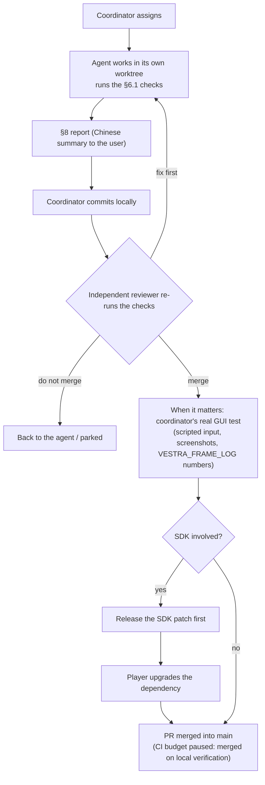
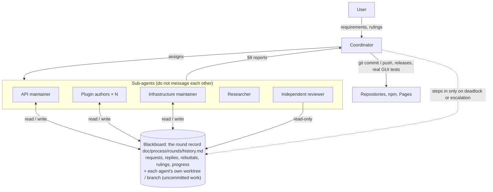

# Agentic workflow: a simulated plugin community of agents

This file is the authority for how agents work on this repository (it replaces `doc/process/community-workflow.md`, 2026-10-27).

This project develops the player with several agents that simulate a plugin community: **plugin authors** are independent consumers who depend only on the public plugin API, the **API maintainer** is the single point that maintains the host and the SDK, and the **coordinator** schedules and integrates. The goal is not only to build the features, but also to test whether the API is easy to understand, whether changes stay under control, and whether the maintainer can meet different needs without opening a back door for any one plugin.

This document applies to all agent work. When the coordinator drives a project on its own for a long time (a self-paced loop while the user is away), it also follows the branch [agentic-workflow-loop.md](agentic-workflow-loop.md), which adds steps and overrides nothing here. Every agent reads this document and the section for its own role before starting work.

The API evolves in two directions, with different processes:

| | Bottom-up (§4, the usual case) | Top-down (§5, refactoring the API itself) |
| --- | --- | --- |
| Trigger | A plugin hits an API gap during implementation | The API itself is hard to use or the architecture needs refactoring |
| Who starts it | The plugin author submits a request | The maintainer designs and releases the new API |
| Can plugin authors propose new capabilities | Yes | **No**, they can only report a "migration blocker" |
| Product behavior | Evolves with the plugin | **Stays unchanged** (equivalent migration) |

## 0. Overview (2026-10-27)

Who does what, and how one piece of work travels from a request to `main`. The sections below are the rules; this is the map.



From assignment to main:



- **Ask the user**: API removals, signature or behaviour changes (§1.6) · changing an established principle · conflicting requirements · new paid services or licences · no precedent.
- **Decide without asking**: pure additions · bug fixes · details where mpv or mainstream players have an established practice · SDK patch releases.

## 1. Roles and file ownership

| Role | Writable scope | Responsibilities |
| --- | --- | --- |
| Coordinator (main session) | Record files; git commit and push; GUI tests | Assigns tasks, reviews deliveries, rules on blockers, integrates, runs real GUI tests, reports to the user. Does not write the SDK in place of the maintainer, and does not write plugins in place of the authors |
| API maintainer (1) | SDK repository `vestra-player-sdk`, `src/runtime/`, `src/host/`, `src/scripts/`, `src/tests/`, `doc/plugins/`, `doc/architecture/` | Maintains the host, the SDK, the wire protocol, the manifest rules and the build tools; handles capability requests; keeps the SDK, host, docs and examples consistent |
| Plugin author (1 per plugin) | Only its own plugin directory: built-in plugins in `src/plugins/<name>/`; third-party plugins hosted in the plugin repository [vestra-player-plugins](https://github.com/vestrasys/vestra-player-plugins) (`zysilm.vestratube`, `zysilm.vestranes`, `zysilm.clipexport`, `zysilm.shaderupscale`, `zysilm.amdmotion`, `zysilm.autoframe`) in `plugins/<name>/` | Designs and implements its own plugin and writes its tests; submits a request when a capability is missing |
| Infrastructure maintainer (1, added 2026-10-24) | `.github/` in all three repositories, `src/packaging/`, and in the plugin repository `scripts/`, `registry/`, `plugins/owners.toml`, `revoked.json`; `doc/process/ci.md` | CI and its cost, packaging and third-party licenses, the release process, the signed index and the plugin repository rules, rehearsals of repository-level operations such as git history changes. Does not change the plugin API or plugin business logic |
| Researcher (on demand, added 2026-10-24) | None (read-only; output goes in the report, and the coordinator puts it into the docs) | Research on external sources, terms and feasibility. Every conclusion cites its source; insufficient evidence is stated plainly |
| Interaction design lead (the coordinator may also take this role) | `doc/product/` | Maintains the global menu domains and the interface guidelines, reviews plugin designs for consistency |
| Independent reviewer (per batch) | Review records | Does not take part in implementation. Reads the source, runs the commands and checks the outputs personally, and does not accept "someone else said it passed". Rechecks the check items and test evidence before merge; real GUI tests still belong to the coordinator |

Constraints shared by all agents:

- **Language (user rule)**: everything addressed to the user is **Chinese**, without exception: answers, reports, progress notes and the one-line remarks between tool calls. Everything in the repositories is **English**: docs, round records, SDK docs, READMEs, commit messages, PR bodies. Agent briefs are English; sub-agents report to the coordinator in Chinese.

- **Plugin independence**: plugins do not import each other, do not read each other's directories and do not communicate directly (no private messages, shared files or dedicated connections); the only shared things are the public SDK, public host state and mature third-party dependencies. Every plugin can load, run and be deactivated when no other plugin exists. Deactivating a plugin revokes only its own resources.
- **The core does not know plugins**: the host routes by capability and registration, and does not write special business logic keyed on a plugin id.
- **Safety**: first-party Rust forbids `unsafe`; TS uses erasable syntax (`erasableSyntaxOnly`).
- **git**: sub-agents do not run `git commit`, `push`, `reset`, `checkout -- <path>` or other commands that change history or discard other people's changes; the coordinator makes all commits. **Force pushes (including `--force-with-lease` after a rebase) need the user's go-ahead first, even on the coordinator's own branches** (user rule).
- **One role per agent**: a brief names exactly one role from the table above and keeps to its writable scope. A task that spans roles is split (for example the maintainer writes the host part and records a finding for the plugin author) instead of giving one agent two roles. `doc/product/` changes needed by another role are written as a patch or a request in the round record and applied by the interaction design lead.
- **GUI**: only the coordinator operates the screen. Sub-agents do not start player windows and do not simulate mouse or keyboard input, so that several agents do not fight over the same window.
- **Builds**: Rust uses a `CARGO_TARGET_DIR` outside the repository (`/tmp/vestra-review-target` on macOS; on the Windows laptop one directory per agent under `C:\vestra\`, see §8 "Machine protocol") and does not create `target/` in the repository.
- **Paid services**: model-based features such as the plugin workshop use a local mock and do not call a paid LLM.
- Key decisions are written into files, not left only in agent messages.

## 1.4 How information flows (2026-10-24)

Control is a star; state lives on a "blackboard":



- **Control (star)**: assigning work, rulings, merges and releases go only through the coordinator; sub-agents do not message each other. This follows the same idea as plugin independence: each role depends only on public agreements (this document, this round's record, the public API), not on another agent's private explanations.
- **State (blackboard)**: §4 requests, replies, rebuttals and rulings are written directly in this round's record. The author writes the request, the maintainer reads it and replies in the same place, and the author accepts or rebuts in the same place; the coordinator does not relay, and steps in only for the deadlock in §4.3 item 6 or the cases in §7. The original reply is the basis, which avoids distortion through retelling.
- **The coordinator is both a bottleneck and a single point of failure**: when several deliveries arrive at once, they queue for review, commit and GUI tests; one wrong operation affects everything. Therefore:
  - reviews that can run in parallel go to the independent reviewer, and the coordinator does only git, releases and GUI;
  - commands that change repository state are checked step by step, not chained with pipes (`rebase … | tail && push` once pushed anyway during a conflict because the pipe swallowed the exit code);
  - progress and records are collected into one batch before pushing, to trigger CI less often (§8).

## 1.5 Cross-platform rule (2026-10-21)

Vestra must support both macOS and Windows, and possibly Linux later.

- **The plugin API is OS-independent**: signatures, semantics and error codes must not contain concepts specific to one operating system. The host absorbs OS differences; where that is truly impossible, it returns a uniform `unsupported` and the reference docs state which OS is affected.
- **OS-specific code lives only in the host's platform modules**: one implementation per OS, separated with `cfg(target_os)`; shared code does not call OS interfaces directly. The same applies to the SDK and the plugin runner (Node side): OS differences are concentrated in one platform file, not scattered around.
- **Plugins do not call OS commands directly**: for example `sips`, `plutil`, `sw_vers`, `security`, `/usr/bin/open`. If needed, submit a request per §4 and the core provides a cross-platform capability; a cross-platform pure Node implementation is also fine.
- **Every shared change passes the cross-platform check**: compile the host for the Windows target, and scan plugins and the SDK for OS commands. The check scripts are in `src/scripts/`, see §6.1.

## 1.6 The SDK lives in its own repository (2026-10-21)

The source of the plugin SDK `@vestra-player/sdk` exists only in the [vestra-player-sdk](https://github.com/vestrasys/vestra-player-sdk) repository. The player depends on the npm version in `src/package.json` (`"@vestra-player/sdk": "^1.0.0"`, locked by `package-lock.json`), and `npm ci` installs it into `src/node_modules/@vestra-player/sdk`; the runner, plugins, examples, workshop and packaging layout all use this installed package. This repository has no SDK source, and you must not copy one in again.

**Changing the SDK (types, TestHost, CLI, wire client, `./runtime`)**

1. First change the SDK repository: code, tests, README; `npm run check`, `format:check`, `test` and `npm pack --dry-run` pass. For changes that need the host to cooperate (a new capability, a new command limit, `apiVersion`), the host and the SDK each change their own side and both are released together.
2. SDK release: change `version` in `package.json` (user ruling, 2026-10-26: a patch bump by default, for additions and removals alike; a removal first ships as a deprecation in one patch and is removed in a later one, and `apiVersion` stays `vestra/1`; a major version and a new `apiVersion` only on the user's explicit decision), commit, create the tag `v<version>` and push it; after the tag is pushed, `publish.yml` publishes to npm (once `NPM_TOKEN` exists).
3. Then upgrade the dependency in the player: point `src/package.json` at the new version (while on git tags, change the `#v<version>` in the URL; after publishing to npm, use `npm install @vestra-player/sdk@<version>`), run `npm install` to refresh `package-lock.json`, run all §6.1 checks with strict SDK agreement (`npm run ci:local -- --strict-sdk`), and commit together with the host changes. Product data that only warned on main must match from this commit on, except changes merged after the SDK release was cut, which are listed in the PR.
4. Testing an unreleased SDK locally: in the player's `src/`, temporarily run `npm install <SDK repository directory>` (or `npm link`), and after verifying, **change it back** to the locked version; do not commit a `file:` dependency.

**Release cadence.** An SDK patch is released when plugins can see the change: a new or changed member, a contract change, a TestHost fix that makes plugin tests agree with the player, or a plugin blocked on an unreleased fix. Product-data syncs, documentation and internal refactors are not released on their own. They go out with the next such release, or with the sync release cut before each player release, so every player release ships an SDK whose product data matches it.

**API change rules (user ruling, 2026-10-26)**

Plugins never bundle the SDK: they import it as types only, and the player builds the `plugin` object with its own copy. A player upgrade therefore needs no plugin change, and plugin authors decide for themselves whether to follow a new SDK. What keeps old plugins working is that the API is changed carefully:

1. **Additions** (new members, new optional fields, new capabilities): the maintainer decides alone and releases them as a patch. A plugin that uses an addition declares the player version it needs in `minPlayerVersion`.
2. **Removals, signature changes and changes to existing behaviour** (error codes, defaults, when something happens): the maintainer first writes what changes, why, which plugins are affected and how they migrate, and **the user approves it before any work starts**. After approval the change ships as a deprecation in one SDK patch and the removal in a later one, with at least one published player release in between.
3. **Plugins are not forced to update.** Every SDK release's CHANGELOG entry opens with who must change and what happens to a plugin that doesn't.
4. **Later, when third-party plugins exist** (registered as an open item, not done yet): the packing tool records the SDK version a plugin was built with, and the player warns in the store and the plugin details when a plugin was built before a breaking change ("built on an older interface, parts may not work; the author has not updated it"), together with its last update date. Only when a removed API is essential to a plugin is it disabled, with the reason shown to the user.

**New APIs must be general (user ruling, 2026-11-10)**

The SDK is the whole surface plugins can reach, and every member added to it is kept, documented and modelled in TestHost for as long as plugins may use it. An API shaped around one feature makes the SDK larger without making it more capable, and every later feature then asks for its own member. **Necessity comes first (user ruling, 2026-11-13).** Before the generality check, ask whether the player is needed at all. If a plugin can do it with Node and the existing members, it is not a host method. If several plugins would repeat the same careful code, it may become an SDK helper that runs in the plugin's own process (as `storage.json` and `tools.run` do): no protocol message, no capability, nothing for TestHost to model. Only what needs the player's state or a capability only the player has (§4.3 item 4) goes on to the rules below. The generality rule alone asks "would several plugins use it?" and never "could they do it themselves?"; `media.sources` (11-10) passed it although a plugin-side table would have done.

**New APIs and capabilities (user ruling, 2026-11-13).** A new member, message or event needs no capability unless it crosses a boundary: it changes the user's own settings or the player beyond the plugin's own contributions, acts on other plugins, or reaches an OS-protected resource (clipboard, keychain, camera, microphone, screen). One that crosses a boundary uses the existing capability for that boundary; a new capability name needs the user's yes. The existing capabilities stay as they are: some declarations also steer behaviour (start-up subscriptions, wake, start-up waits), so renaming or merging them is a behaviour change, not a cleanup.

So, before any new member, capability or message is added (bottom-up request §4 or the maintainer's own design):

1. **Name at least two or three different plugins that would use it.** They may be existing plugins or plausible ones (a bookmarks plugin, a history plugin, a comparison tool), but each must be a different kind of plugin with a concrete use, written in the request or the design: "plugin X calls it to …". Two variants of the same feature (two exporters, two upscalers) count as one.
2. **If only one plugin needs it, extend an existing API instead.** In order of preference:
   - add an optional field or a new mode to an existing call (old callers unchanged);
   - generalise an existing call so the old behaviour is its simplest case (one input → N inputs, one source → a list);
   - add a small, general primitive that the feature can be built from in the plugin;
   - only when none of these fits, add the specific API — and the request says why the general forms were rejected.
3. **Shape the name and the arguments by what it does, not by who asked.** No feature names in API names (`media.sources`, not `clipCollection.refs`); arguments describe the operation (`parts`, `start`, `end`), not one plugin's UI.
4. **Security and resource limits are part of the generality check.** A general primitive must not widen what a plugin can read, write or run beyond what the user did (for example, a source reference is minted only for a file the user opened, and opening it needs `playback.control` like any other open). Name only boundaries the player enforces: plugin processes are not sandboxed and `player.state.source` shows the playing file's path, so a token hiding a path is a convenience, not a boundary. If the general form needs a wider boundary than the specific one, say so and let the user rule (§7).
5. **The review checks this rule.** The independent reviewer of an API batch lists the named users and the extended alternatives, and returns the batch when a member serves one feature only without the written reason from item 2.
6. **Record it.** The SDK CHANGELOG entry of a new member names its intended users in one line ("used by Clip Export's collection; also for bookmarks, history and resume"), and the reference docs show at least one use that is not the requesting plugin's.

Example (2026-11-10, SDK 1.7.8 before release): the clip-collection feature first got `media.sources` and a separate `media.join`/`joinCheck`. `media.sources` (persistent references to files the user opened) passes item 1 — bookmarks, history and resume, comparison and chapter tools all need it. `media.join` served only the merged export, so it was folded into the existing export API as an export with several input parts (one part is today's single clip), with a pre-check every export can use.

This rule does not change the version rules above: additions stay patch releases, removals and behaviour changes still need the user's approval.

**The host changes the Slint widget library (`src/host/ui/palette.slint`, `src/host/ui/vestra/`)**

The SDK package carries a read-only copy for authors' editors and for TestHost, which checks the values a plugin sets against the library's structs and properties; the player's version is authoritative. When you change the widget library:

1. `cd src && node scripts/sync-sdk-slint.mjs --write <SDK repository directory>` copies the files from `host/ui` into `slint/` in the SDK repository; when adding a new library file, first add it to the script's `SLINT_FILES`.
2. The copy reaches the SDK with its next release under the release cadence above; the player's change merges without waiting for it. Before the next player release, the SDK is released and the dependency upgraded as described above.
3. `npm run sdk:sync-slint` and `tests/sdk/host-agreement.test.ts` (`npm run test:sdk`) compare the installed SDK with the host. Contract data, meaning anything that decides whether the player accepts a request or how a plugin or TestHost behaves (capability table, `apiVersion`, limits, error codes, wire shapes, menu ids, wake events), fails the check and blocks the merge. Product data, a snapshot of how the player looks now (built-in command and submenu tables, the widget-library copy, the player's own translations, palette colours), only warns between releases. It is checked strictly (`VESTRA_SDK_STRICT=1`, `ci:local -- --strict-sdk`) when the player upgrades its SDK dependency and before every player release.

Commits, tags and pushes in the SDK repository are made by the coordinator, the same as in this repository.

## 2. Plugin development process

1. **Design** (new plugin or new feature): the author writes a proposal using the §2.1 template, the interaction lead checks menu domains and interface consistency, and the maintainer checks the required capabilities. Only the affected parts are reviewed; the designs of all plugins are not reopened.
2. **Vertical slice**: the author's first delivery must be a real user path: menu entry → plugin code → public API call → observable result. Probe scripts do not count as product progress.
3. **Extension**: fill in the other features on top of the slice. When a capability is missing, submit a request per §4 and continue with the parts that do not depend on it.
4. **Self-check**: `npm run plugin -- check|test|build <name>` all pass.
5. **Acceptance**: the coordinator runs real GUI tests (§6), and the independent reviewer rechecks per batch.

### 2.1 Plugin proposal template

```text
1. Purpose and scenarios: what the user wants to do, what the plugin is responsible for, non-goals, preconditions for use that do not depend on other plugins
2. Entry table: feature | main menu path | other entries (buttons/shortcuts) | runs directly or opens an interface | enabling condition | state source
3. Interface: sketch and control order, window or bottom bar/sidebar, shown by default or not, open/close/reopen, focus
4. State and failure: no media/loading/playing/paused/source change/continuous dragging/repeated clicks; when changes are submitted and when they take effect; cancellation and failure recovery
5. API usage: the smallest TS/Slint example; mark each item "existing" or "extension requested"
6. Acceptance scenarios: user action | observable result | evidence (screenshot/output/test)
```

Menus are organized by user domain (File, Playback, Video, Audio, Subtitles, View, Games, Plugins); sub-features such as reset and presets stay in their own domain. Changing a global menu path requires a proposal and cannot be self-approved.

## 3. Keep the start gate and acceptance separate

This is the biggest pitfall this project has hit (retrospective of 2026-10-18): "final product acceptance" was mistaken for "the precondition for starting to write plugins", so the public API phase lasted two days and not a single plugin was started. Rules:

- **The start gate looks only at actual dependencies**: work can start once the host and the SDK build, minimal calls for real playback, plugin loading, menus and Slint windows run, and the delivered interfaces come with usage notes and a list of known gaps. Full acceptance of all capabilities is not a start condition for all plugins.
- **A gap blocks only the parts that depend on it**: mark items "implemented, pending verification / verified / missing / truly blocked"; a missing capability must not return a fake success, but it does not stop authors from writing the parts that do not depend on it.
- **The maintainer does not take over plugin business logic**: saving, parsing, downloading, presets and so on stay in the plugins.
- **When the same path fails a second time**, the coordinator must decide: fix a clear defect, switch the implementation approach, mark it as a pending item that affects only that path, or escalate to the user (§7). Do not automatically add finer-grained probes.
- **Reports track product progress**: every report gives the number of plugins "assigned / with a runnable slice / accepted", and which plugins the shared blockers affect. If two reports in a row have no new slice, the coordinator must review and remove unrelated preconditions; growth in the number of tests and docs does not count as progress.
- The final delivery standard is not lowered because the start gate is relaxed: product requirements such as playback continuity and resource cleanup must still pass real tests before completion is announced.

## 4. Bottom-up: plugins extend the API

### 4.1 Request format

```text
Requesting plugin / code location
User action and expected result
Why the existing API cannot do it (with a minimal reproduction)
Desired usage (usage example)
Who owns the state and resources; behavior on failure, cancellation and missing capability
Whether it breaks an existing contract, and which plugins it affects
Minimal acceptance scenario
```

### 4.2 How the maintainer handles requests

1. **Classify first**: the existing implementation violates its contract (fix it as a defect; authors must not be made to work around it with a new request), a docs or usage problem, a capability gap, or a breaking design change.
2. **Look for an existing way first**: can the existing API, an implementation inside the plugin, or a third-party library do it; make a minimal extension only when a shared capability is truly needed. A capability used by only one plugin can still go into the core; what matters is whether the responsibility belongs to the basic capabilities. Do not generalize endlessly because of one need.
3. **Release compatible extensions promptly**: new optional parameters or independent capabilities are released after the regression tests of the affected plugins pass; plugins that do not use them need no change. Note: changing default behavior, error semantics, resource ownership or lifecycle also breaks compatibility; looking only at type signatures is not enough.
4. **Switch breaking changes all at once**: write down the plan, the affected plugins and migration examples, **get the user's approval first** (§1.6 "API change rules"), and migrate together per §5; the old usage keeps working until the switch.
5. **Prevent patch loops**: when several requests point to the same capability, or one change keeps leading to new breaking requests, pause changes in that area and merge them into one design topic before deciding.
6. **A rejection must come with an alternative**; authors must not be left to add hidden entry points on their own.

A request is closed when the requesting plugin's actual call works and the necessary regression tests pass; other plugins do not wait for it.

### 4.3 Negotiation: the maintainer is conservative by default

The core must stay lean, so the maintainer **does not accept** API requests by default. The author has to prove that the change is unavoidable; the maintainer does not have to prove that it can be avoided. Requests go through the following process:

1. **A draft is not an approval**. Core interfaces written in a requirements document (such as Appendix A of the [feature requirements](../doc/product/feature-requirements.md)) are only the author's draft requests. Each one must be submitted separately per §4.1 and go through the whole process in this section.
2. **The maintainer first replies with an approach, and does not start implementing first**. For each request, the maintainer first gives a way to do it without changing the API, and states the cost of doing it that way:
   - combine existing APIs;
   - the plugin implements it itself with Node, ffmpeg or OS commands;
   - reduce the requirement, for example drop edge cases or change the interaction;
   - state directly that it will not be done.
3. **The author may rebut once**, but must give concrete evidence: a minimal reproduction, or an explanation of what the alternative cannot do at the user level (behavior, performance, reliability). Saying only "it is inconvenient" or "it means more code" is not a reason.
4. **The maintainer rules**, and the result can only be one of three: reject and give an alternative, accept in rewritten form (narrower scope, different shape), or accept. The core is changed only when at least one of the following holds:
   - it needs the host's internal state or a capability only the host has, such as windows, rendering, mpv properties, the binding table;
   - plugins cannot communicate with each other, and the capability itself has to be shared across plugins, such as timeline markers or the settings page summary;
   - the responsibility belongs to the core in the first place, such as basic playback actions.
   - several plugins need it, or it is a general basic capability that many plugins will use later, such as the clipboard, runtime images, the settings page. If each plugin implemented such a capability with OS commands on its own, that would be reinventing the wheel with inconsistent behavior, so it should go into the core.

   Conservative means not expanding the core for the special needs of a single plugin; it does not mean pushing everything onto the plugins.

   Whatever can be done as an optional extension is not done as a breaking change. When several requests point to the same capability, merge them into one design topic (§4.2 item 5).
5. **Record the result**. The result of each request is written into this round's record: the request, the maintainer's alternative, the author's rebuttal, the ruling and its reasons. A rejected request can be raised again only with new evidence.
6. **The coordinator handles only deadlocks**. When the maintainer still rejects after the author's rebuttal, and the author believes the alternative would leave a user-visible feature missing, the coordinator rules or escalates to the user (§7). The coordinator does not write proposals for either side.

Negotiation does not block starting work: while waiting for the result, the author first does the parts that do not depend on the request (§3).

## 5. Top-down: refactoring the API itself

Used when the API as a whole is hard to use and needs a new shape (for example, on 2026-10-20 the flat RPC bindings were replaced with the handle-based SDK v2).

### 5.1 Phases

| Phase | Owner | Content | Completion condition |
| --- | --- | --- | --- |
| P0 Preparation | Coordinator | Create a branch; record the baseline: all static checks, each plugin's test results, line counts | Baseline recorded |
| P1 Design and implementation | Maintainer | New SDK and unit tests, fake-host test tools, design notes, usage examples, migration guide; **migrates one reference plugin personally** | All static checks pass; the reference plugin builds and its tests pass, and old protocol concepts no longer appear in its source |
| P2 Design review | Coordinator | Reviews item by item against the design requirements, focusing on whether the usage examples are short and readable (a single example longer than about 30 lines means the abstraction is not good enough) | No migration is assigned before it passes |
| P3 Plugin migration | 1 migrator per plugin, at most 4 at a time | Equivalent migration following the migration guide; small plugins first, large plugins later | See §5.3 |
| P4 Remove the old API | Maintainer | Remove the old API and the code, examples and scripts that serve only it; full static checks | No code references the old API |
| P5 Full GUI test | Coordinator | §6 | All scenarios pass; after defects are fixed, the affected items are retested |
| P6 Commit | Coordinator | Update docs and status, commit and push, report to the user | Merging into the mainline is the user's decision |

The compatibility layer exists only during the migration; its exit condition is "all plugins migrated", and it is removed in P4.

The SDK is in its own repository (§1.6): the SDK parts of P1 and P4 are done on a branch in the SDK repository; during the migration the player depends on a pre-release tag of that branch (for example `v2.0.0-rc.1`); after P4 the SDK is released officially, and the player switches to the official version before entering P5.

### 5.2 Rules for migrators

- Behavior stays unchanged: the same menu items (path, title, enabling condition), windows and controls, callback effects, and error message semantics. Code structure may improve, but user-visible features must not be added or removed.
- Remove home-made wheels in the plugin that the SDK already provides (update merging, result query retries, stale event filtering, name conversion, hand-written cleanup lists).
- Existing tests switch to the SDK's fake host, and the original coverage must not shrink.
- **No new features, no new capability requests, no "while I'm here" fixes to unrelated behavior.** Existing bugs that are found are noted in the report and not fixed in this round.
- Do not change the SDK repository, `src/runtime`, `src/host`, `src/scripts` or sibling plugins, and do not bypass the SDK to call the underlying transport directly.
- When existing behavior **cannot be expressed** with the new SDK, this is a "migration blocker": stop that part, write down which behavior, where the old code is, why the new SDK cannot express it, and a minimal reproduction, then continue migrating the other parts. The coordinator passes it to the maintainer for a ruling (extend the SDK or give a way to write it); the migrator does not invent an alternative on its own.

### 5.3 Migration completion conditions (self-checked by the migrator, rechecked by the coordinator)

- `npm run plugin -- check|build|test <name>` all pass.
- A grep for old protocol concepts in the plugin source (excluding tests) returns nothing; each necessary exception is explained with its reason.
- The plugin directory keeps only: `manifest.json`, source (`.ts`, `.slint`, `.mjs` that is genuinely hand-written source), `tests/`, a short `README.md` (features, entries, limits); plus `package.json` and `package-lock.json` when there are npm dependencies; plus `licenses/` and the dependency list when there are license obligations. Handover artifacts, per-plugin build scripts and committed `dist/` are all removed.
- Report the line counts (excluding tests) before and after the migration, and the home-made wheels that were removed.

## 6. Verification

### 6.1 Static checks (after every shared change; run by the maintainer, rechecked by the coordinator)

In `src/`: `npm run check`, `npm run format:check`, `npm run boundaries`, `npm run test:sdk`, `npm run plugins:build`, `npm run plugin -- test <name>` for each plugin, `npm run portability` (build output goes to `$CARGO_TARGET_DIR/portability`, or to `vestra-target/portability` in the system temp directory when it is not set, never into the repository).
In `src/host/`: `cargo fmt --check`, `cargo clippy --locked --all-targets -- -D warnings`, `cargo test --locked`.
CI (GitHub Actions) runs the same checks, plus typos, cargo-deny, cargo-shear and the unsafe rule; to run them all locally at once use `cd src && npm run ci:local`, see [ci.md](../doc/process/ci.md).
When you change a plugin in the plugin repository (`vestratube`, `vestranes`, `clipexport`, `shaderupscale`, `amdmotion`, `autoframe`) or a public API that may affect them, also run in the plugin repository: `npm ci`, `npm run check`, `npm run format:check`, `npm run boundaries`, `npm run portability`, `npm run build`, `npm test` (the same as its CI).
When you change the SDK, also run in the SDK repository: `npm ci`, `npm run check`, `npm run format:check`, `npm test`, `npm pack --dry-run` (the same as its CI).

### 6.2 Real GUI tests (coordinator)

Load all plugins in the same player process, operate each item with real mouse and keyboard events, and take screenshots. The user does not use the computer during the test; use `caffeinate -d` to keep the display from sleeping.

| Scope | Required scenarios |
| --- | --- |
| All | All plugins active; the right-click menu domain groups are correct, and every plugin's menu items are present and usable |
| Basic playback | Open, play/pause, drag to seek, speed, mute and volume |
| Playlist | Add, select to play, previous/next item, end-of-playback notice, the notice when switching to a source outside the list |
| Video / audio processing | Effects actually apply to the picture or sound; controls return to default after reset; playback does not stop during continuous dragging |
| Subtitles | Load an external SRT, mixed Chinese and English display, track selection, style and undo |
| Screenshot export | The output matches the source frame pixel for pixel |
| Online video, VestraNES | Public videos play; a ROM loaded from Games ▸ VestraNES shows a picture and the keys control it while the VestraNES window is in front (`vestratube` and `vestranes` are in the plugin repository: load them with `--plugin <plugin repository checkout>/plugins/<name>`, after running `npm ci` in the checkout) |
| Plugin workshop | Generate → validate → install → the generated plugin works |
| Deactivation | Deactivating one processing plugin revokes only its own effect, and the other plugins' effects remain (there is currently no public deactivation entry, so a test plugin or the host test driver is needed) |

Record the action, screenshot and result for each item. Keep evidence sources apart: physical input, the system file panel, callback simulation, headless runs and mocks must not stand in for each other. Correct low-level parameters do not prove that dragging does not stutter; a menu that opens does not prove the picture keeps updating while it is open.

Defect ownership: plugin defects go back to that plugin's author (or to a new agent that fixes only that defect, with reproduction steps attached); SDK and host defects go back to the maintainer; obvious UI fixes of one or two lines may be made directly by the coordinator and recorded. After a fix, only the affected items are retested.

## 7. When to ask the user for a ruling

First reproduce, clarify the contract and compare options; escalate only if the issue still falls into one of the following:

- It would change an established principle (direct dependencies between plugins, plugin-specific business logic in the core, relaxing Safe Rust, and so on).
- Product requirements conflict with each other and need a trade-off between freedom, learning cost, performance and experience.
- It clearly expands the core or the scope, or introduces a new platform, license obligations or paid services.
- There is evidence that the established technical route (Slint, the TS/Rust split, and so on) cannot meet a key scenario.
- The maintainer and the reviewer still disagree substantially after adding evidence.

When escalating, give: the specific problem, reproduction evidence, the options and their costs, the recommended option, and a one-sentence question the user needs to answer. Pause only the work that depends on the decision. Ordinary bugs, docs clarifications, compatible extensions and implementation choices within the authorized scope are resolved by the team itself.

## 8. Concurrency and reports

- **At most 8 background agents run at the same time** (user ruling 2026-10-31, raised from 3); Rust builds still run one at a time under `build.lock`, so agents beyond the build slot read, write code, review or run non-cargo checks while they wait. While the maintainer is busy with one module, the authors must not all be left waiting; shared modules can be split by file or interface and delegated.
- **Parallel maintainer instances** (2026-10-27): when two maintainer tasks touch disjoint files, two maintainer agents may run at once; the brief lists the files each one must stay out of. Evidence: UI fixes ∥ render pacing, deinterlace ∥ shared runner and session storage ∥ shared runner merged with only a version-number conflict.
- The coordinator schedules the time slots for building, integration and use of real devices centrally.
- **Machine protocol (2026-10-27)** — the laptop is shared with the user and has limited RAM:
  - **One Rust build at a time**: before any cargo build or test an agent creates `C:\vestra\build.lock` (if it exists, wait and retry every 60 s) and deletes it when done; each agent uses its own `CARGO_TARGET_DIR` under `C:\vestra\` and deletes it at the end. Evidence: before this rule five or six parallel builds left 0.3 GB free and the user had to stop every agent; none since.
  - **Quiet while measuring**: the coordinator creates `C:\vestra\quiet.flag` during frame-rate or timing measurements; agents start no heavy work while it exists. Evidence: an early "UI redraws drop video to 10 fps" measurement turned out to be memory starvation, not a real coupling; later measurements were reproducible.
  - **Hardware tests are the coordinator's call**: researchers run read-only queries only; GPU decode/render/interop tests run short (≤ 60 s), one at a time, and stop on any hang or driver reset (after an unexplained bugcheck on 2026-10-27).
  - To test an unreleased SDK in a player worktree, briefs say `npm install --no-save <clone>` and restore with `npm ci` (a plain `npm install` rewrites `package.json`/`package-lock.json` and `npm ci` cannot undo it).
  - **Low memory: check the `Proc` pool tag first** (2026-10-28). `NtQuerySystemInformation(SystemPoolTagInformation)` needs no admin; `Proc` live objects far above the running process count means exited processes are being held by a driver. Evidence: ~19 GB lost overnight to the AMD iGPU driver 31.0.14005 holding every exited process (agents start hundreds of thousands of processes); fixed by Adrenalin 26.10.1; until a fix, a reboot clears it. It is not the player's code.
  - **Sub-agents do not start agents of their own**: the limit of 8 counts every agent on the machine, and a child agent escapes the coordinator's scheduling and review. A brief that is too big is split by the coordinator. Evidence (2026-10-31): the docs maintainer handed two pages to a child agent while three agents were already running.
  - **`npm run portability` is a cargo build** (it runs `cargo check` for the Windows target in `$CARGO_TARGET_DIR`): take `build.lock` for it like any cargo command. Evidence (2026-10-31): a reviewer ran it without the lock, alongside the coordinator's release build.
  - **Measurements wait for `quiet.flag` to be honoured**: an agent checks for `C:\vestra\quiet.flag` before every heavy step (build, test, package), not only before starting; a check run that started before the flag invalidates the coordinator's numbers. Evidence (2026-10-31): a frame-rate A/B overlapped a review build and had to be repeated.
  - **`ci:local` needs FFmpeg on PATH** (`. C:\vestra\env.ps1 -Ffmpeg`): five host tests call ffmpeg and fail with "program not found" otherwise.
- **SDK releases: tag only the merged commit, after checking its version** (2026-10-28): `git show origin/main:package.json` must show the version being tagged before `git tag v<version>`. Evidence: a tag pushed after a failed merge pointed at the previous release; the release job's version check stopped it, and the release moved to the next patch because deleting a tag needs the user.
- **Every batch gets an independent review before merge**, including follow-up fixes when the review asked for them; fixes go back to the agent that wrote the code (it keeps its context). Evidence (2026-10-26/27): reviews caught defects that passed every test — a stop-path regression that hung plugin cleanup for 5 s, a missing packaging license entry that would fail the next installer build, a VRAM handle leak, session storage using 16× its quota in memory, an infinite request loop in VestraTube's infinite scroll, misaligned exact thumbnails on 1 fps/VFR sources.
- **Measurements, not impressions**: GUI checks use scripted input plus `VESTRA_FRAME_LOG` numbers (produced/presented per second, `pacing:`/`ui:`/`mpv:` segments), with a forced render target (`VESTRA_RENDER_TARGET`) to reproduce large screens. Evidence: the 4K menu-hover stutter was located this way (AccessKit tree rebuild, 120–160 ms per hover) and verified fixed (presented 10–14 → 54–60).
- **What the coordinator decides without asking the user** (user rulings 2026-10-27): SDK patch releases within the §1.6 release cadence (the release environment needs no manual approval; tag → npm); which checks count as contract data and which as product data, as long as nothing a plugin's requests or behaviour depend on is made advisory; product details where mpv's default or mainstream players (PotPlayer, mpv, IINA, VLC; Chrome for plugin models) have an established practice — adopt it and mention it. Still asked: §1.6 removals and behaviour changes, real trade-offs, anything without a precedent; technical terms are explained in plain language when asking.
- **Process changes go into this document**, not only into an agent's memory (user rule).
- **Long-running loop** (2026-11-03): self-paced work while the user is away follows [agentic-workflow-loop.md](agentic-workflow-loop.md), the branch of this document written from the plugin process supervisor project (B0–B7). A project may still add a temporary role (for example a spec test author) in its round record; it cannot override a rule here.
- **Round records** (user, 2026-11-03): the round record is [doc/process/rounds/history.md](../doc/process/rounds/history.md). When a piece of work ends, its lasting decisions, lessons and open topics are folded into that file and its log is deleted; git keeps the old text.
- **Diagrams are Mermaid**, not ASCII art (user rule, 2026-10-27): every edge is written out (`A --> B`), so an LLM reads the graph without relying on column alignment, and GitHub renders it for people. Plain-text templates stay in `text` blocks.
- **CI cost**: in private repositories macOS is billed at 10x and Windows at 2x. One push to a branch runs CI only once; record-only changes are collected into one batch before pushing; do not rerun both the push and the PR runs at the same time; macOS runs only when a PR is opened, when the `ci:macos` label is added, and on main, nightly and release ([ci.md](../doc/process/ci.md)).

Every sub-agent reports at the end in the following format:

```
## Result
One sentence: done / partly done / blocked.

## Changes
- Files added / modified / deleted

## Checks
- Commands actually run → result (exit code, pass/fail counts)
- Checks not run and why

## Migration blockers or API requests (if any)

## Problems found but not fixed (if any)
```

State only checks that were actually run; write "not run" for those that were not.
