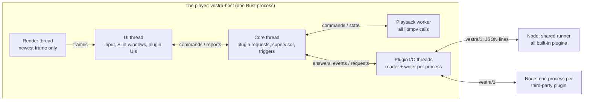

# Architecture

This document describes the high-level architecture of Vestra Player. Read it if you want to find your way around the code. It covers only what changes rarely. How a single module works is in that module's doc comment, and the plugin API is on the [SDK site](https://vestrasys.github.io/vestra-player-sdk/).

## Bird's-eye view

The **player** is one Rust program, the `vestra-host` crate. It plays media with libmpv, draws its windows with Slint, and starts and supervises the plugins. Every feature is a **plugin**: a TypeScript package that runs in a Node process outside the player. That covers the playback bar, playlist, adjustments, subtitles, capture and export, history, shortcuts, the Plugin Store and Vestra Player AI.

Plugins talk to the player over `vestra/1`, a JSON-lines protocol on the plugin's stdin/stdout, through the `@vestra-player/sdk` package.

Inside the player, the **core** holds all state outside the windows: plugins, playback, triggers and packages. The **UI thread** owns the windows. The two exchange only messages.

**Built-in plugins** ship with the player (`src/plugins/`, ids `vestra.<name>`). **Third-party plugins** are everything else, installed from the store or loaded for development.

Built-ins share one Node process, the **shared runner**, to save memory. Each third-party plugin gets its own process.

## Key choices

- **Rust for the player.** The player owns the native windows, the playback state and the plugin processes, and it does that in safe code. Every crate forbids `unsafe` except the small wrappers in `src/host/unsafe/`. libmpv comes in through the `rsmpv` safe wrapper.
- **libmpv for playback.** The project's value is in interaction, feature organisation and extensibility, so playback reuses a mature engine for demuxing, decoding, sync, subtitles and filters. Plugins never call libmpv directly: they use the player's playback API, and the playback worker translates.
- **Slint for the windows.** Plugin authors use a mature UI language, with its own layout, widgets and styles, instead of one the project would have to build. The player compiles plugin `.slint` files at run time with `slint-interpreter`, so no Rust toolchain is needed. Only data passes between a plugin's TypeScript and its Slint files: property values one way, callbacks the other.
- **Plugins in TypeScript, in Node processes outside the player.** Authors get the Node standard library, the network, the file system and npm. A separate process is also a failure boundary: a crashing or hung plugin cannot bring the player down. Built-ins share one process only to save memory.

## Code map

### `src/host/`

The `vestra-host` crate. Its workspace also holds the crates in `unsafe/` and nothing else.

- `main.rs`, `launch.rs`: start-up and the command line.
- `host/`: the core (`Core`) and the UI thread's state around it (`Host`).
  - `driver.rs` is the only place where the two meet. It runs the core's thread and the queue into the core.
  - `outbox.rs` is the queue back to the UI thread. It carries the core's commands in order, and the UI thread reports back how many it has applied.
- `api/`: the plugin API, one module per API area (`ui_window.rs`, `playback_control.rs`, `triggers.rs`…). Each area implements the `Capability` trait. The trait serves the area's requests and says what its registrations look like in a recording (see Plugin lifecycle). `api::lookup` maps a method name to its area.
- `supervisor/`: the **supervisor**, the part of the core that decides when each plugin process runs. It is pure logic with no I/O and no clock: time comes in as a number, and decisions go out as `Action`s. `host/supervisor/` is the adapter that carries those actions out.
- `process/`: plugin processes. Spawning, the reader and writer threads, back-pressure (`unanswered.rs`) and the shared runner (`shared_runner.rs`). The reaper (`reaper.rs`) waits for each stopped process to exit and kills it after a grace period.
- `playback/`: everything around libmpv.
  - The playback worker (`backend.rs`), rendering, subtitles, upscaling and motion smoothing.
  - The processing chain (`processing.rs`): the video and audio filters that plugins ask for, applied through libmpv.
  - The position model (`position_model.rs`): it predicts when playback will reach a time a trigger waits for, so the core needs no polling.
  - FFmpeg jobs for capture and export.
- `ui/`: the Slint side.
  - The shell (`composition.rs`): the main window's own Slint layout, with named slots (bottom bar, sidebar, backdrop, adjust column) where plugin panels appear.
  - The panels themselves, each compiled on its own (`panels.rs`).
  - Menus, the command palette and the settings window.
- `conditions.rs`, `triggers.rs`: the `when` language and the triggers built on it.
- `packages/`: manifests, `.vxp` archives, validation, and the package store on disk.
- `platform/`: per-OS code (see Platform layer).
- `i18n/`: translation catalogs for the player and for plugins.
- `diag.rs`: the host log. A plugin's stderr goes to the player's stderr and to the plugin log, with the plugin's id in front.
- `ui/*.slint` (beside `src/`): the shell's own Slint files.
- `tests/`: integration tests that run the real binary headless or offscreen. Pure logic (the supervisor, conditions, the position model) is tested by deterministic simulations with time passed in (`supervisor/sim.rs`, `triggers_sim.rs`).

### `src/host/unsafe/`

Small crates that wrap OS and GPU calls:

- `win32`: Windows system calls.
- `render`: GPU rendering of libmpv.
- `texture`: video textures for software rendering.
- `pip`: macOS picture-in-picture.
- `open`: macOS open-document events.

`gpu-probe` sits here too but is not part of the player.

### `src/runtime/`

The Node side of the process boundary:

- `runner.ts` runs one plugin in its own process.
- `shared-runner.ts` runs the built-ins in one process.
- `boot.ts` is one plugin's life inside either: activation, readiness and stop.

### `src/plugins/`

The built-in plugins. Each is an ordinary plugin package: a manifest, TypeScript, Slint files and locales. `preferences/` is small and worth reading first. `store/` is the Plugin Store client.

### `src/packaging/`, `src/scripts/`, `src/tests/`

- `src/packaging/`: installers and the native dependency bundle (libmpv, FFmpeg, Node).
- `src/scripts/`: repository checks (`check-*.mjs`) and `ci-local.mjs`.
- `src/tests/sdk/`: Node tests that check the SDK and the player agree.

## Threads

Anything that can block (drawing, libmpv calls, plugin stdin/stdout, file access) runs on a thread of its own, so a slow window or a slow plugin never stalls playback or other plugins:

- **UI thread** (the main thread): Slint's event loop, input, drawing, and compiling plugin Slint files.
- **Core thread** (`vestra-core`): handles one event at a time from a single queue. The queue carries plugin messages, playback reports and the UI thread's reports. The core never touches a window: what it needs from the UI thread goes through the outbox.
- **Playback worker**: owns the libmpv handle and sends every libmpv command.
- **Render thread**: draws the video and keeps only the newest frame for the UI thread. A slow UI thread skips frames; it never falls behind.
- **Plugin I/O**: a reader, a writer and a stderr thread for each plugin process. The reader parses lines and queues them for the core.
- **Helpers** for the remaining blocking work: spawning processes, writing recordings, the clipboard, package validation, cover art, and FFmpeg jobs.

The core never waits on the UI thread. A stalled UI thread freezes only the windows, while plugins, triggers and playback control keep running. Slow turns on either thread are logged (`host/stall.rs`).

## How plugins talk to the player

A plugin sends **requests** and gets **answers**, and the player sends **events**. The SDK turns each call into these messages. The SDK's [Messages](https://vestrasys.github.io/vestra-player-sdk/documents/Messages.html) page is the message reference.

The core validates every request when it serves it. Two rules keep a busy plugin from hurting the others:

- **Back-pressure.** Each plugin has a cap on unanswered requests and on bytes in flight. Past the cap, the reader thread refuses requests itself, before they reach the core. A plugin that leaves its incoming messages unread is stopped.
- **Bounded turns.** The core handles a bounded number of events per turn and leaves the rest for the next one, so its periodic steps stay on time.

A plugin learns the player's state in one of four ways:

- a one-off read;
- a discrete event;
- a stream of state changes;
- a **trigger**: a condition in the `when` language (for example "playing and fullscreen") that the plugin hands to the core as data. The core evaluates it and sends `enter` and `leave` when it turns true or false.

Command states such as enabled or checked use the same conditions, so menus follow playback even when a plugin is not running.

## Plugin lifecycle

- **On-demand start.** A new plugin runs once. The supervisor saves a **recording** of what it registered: commands, shortcuts, settings pages and the events it waits for. From then on the player shows those registrations without a process, and the first use starts the plugin. A recording is dropped when the plugin or the player is upgraded.
- **Standby.** After 30 s of idle time a plugin goes into **standby**: its process stops, and its recording stands in for it.
  - Some things only a live process can serve, and a plugin holding one keeps running: an open window or panel, a stream, an event listener, or something it holds in playback such as a filter in the processing chain.
  - In standby, the plugin's triggers are still evaluated and its session storage is kept.
  - Events that arrive while it starts again wait in order.
- **Limits.**
  - Third-party plugins start a few at a time, and user actions go first.
  - The machine's memory sets how many third-party processes may run at once.
  - Under memory pressure, idle third-party plugins go into standby.
  - A plugin with its own process has a 512 MiB heap cap. The shared runner's heap cap is 1 GiB. A plugin loaded for development has none.
- **Crashes.**
  - A crash stops only that plugin, which starts again after a delay that doubles each time. Five crashes within ten minutes turn it off until it is reloaded, and the player shows a notice saying why.
  - The shared runner answers a heartbeat. If it stops answering, it is restarted with the built-ins it runs. If that keeps happening, the built-ins move to their own processes until the player quits.

## The store

The Plugin Store is a built-in plugin:

1. It downloads the official index together with its Ed25519 signature.
2. It checks the signature against the public keys shipped inside the Plugin Store's own package.
3. It checks each download against the size and SHA-256 that the index lists.
4. The player validates the archive before installing it.

The official index is published from the [vestra-player-plugins](https://github.com/vestrasys/vestra-player-plugins) repository.

## Invariants and deliberate absences

- **No permission system.** Plugins are trusted code, and a separate process isolates failures but is not a sandbox.
  - A manifest declares only who the plugin is, not what it may call, and Node runs without a permission model.
  - The player validates each request it serves, but that is a contract check, not a security boundary.
  - The only restriction is three built-in-only API areas: `commands.run` (`commands.list`, `commands.run`), `palette.lead` (`palette.lead.set`, `.clear`, `.done`) and `app.windows` (`app.openWindow`). `host/dispatch.rs` checks them by whether the caller ships with the player.
- **One API.** Built-ins have no private channel.
  - Plugins depend on a public contract, not on the player's internal objects, as in VS Code's extension host.
  - The built-ins prove that the contract is enough. When one needs more, the API grows for everyone.
- **The UI thread is the core's client.** The core never calls into Slint or a window, and the UI thread reaches the core only through `host/driver.rs`. The compiler enforces this, because the core sits behind a private field.
- **The supervisor decides and the adapter acts.** The supervisor has no I/O and no clock, so it can be tested by simulation.
- **`unsafe` only in `src/host/unsafe/`.** Every other crate forbids it, and `scripts/check-unsafe-policy.mjs` checks that.
- **Plugins reach the SDK only through its public entry points.** `scripts/check-boundaries.mjs` checks that.

## Platform layer

Most OS-specific code is in `src/host/src/platform/`, one file per OS:

- `windows.rs`.
- `macos.rs`.
- `other.rs`: Linux and the rest, where most calls answer `unsupported`.

The three files provide the same set of functions, listed in `platform/mod.rs`. The raw OS calls behind them live in the `src/host/unsafe/` crates.

The split is not total. Some other modules carry small `cfg(target_os…)`, `cfg(unix)` or `cfg(windows)` branches, mostly for file paths, processes and rendering details. `npm run portability` lists them.
