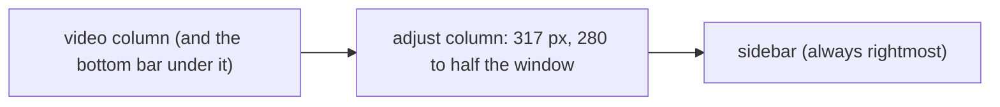

# The adjust slot and the adjust column (menu redesign step 3b)

2026-11-07. Status: **implemented** in the host (player 0.7.6) and SDK 1.6.11. Design: the menu redesign proposal (§3.1, §3.3, §7.2 H4–H6, §8 step 3b), approved 2026-11-07. Builds on [sidebar-tabs.md](sidebar-tabs.md) and [panel-slots.md](panel-slots.md).

## Contract

`ui.mount("adjust", …)` is a fourth slot beside `bottom`, `sidebar` and `backdrop`. A plugin only declares the slot; the host decides how it looks and may change that at any time. The SDK docs state its purpose (controls that change what is playing), what the GUI does today (marked "may change") and the rule: if the user still looks at the panel after closing it, it is `sidebar`; otherwise it is `adjust`. Older players refuse the slot (`invalid`), so a plugin using it declares `minPlayerVersion` 0.7.6.

## Presentation (today)

- Layout `[video][adjust][sidebar]`; both columns may be open; each has its own 3 px splitter. A floating sidebar leaves the adjust column rightmost.
- The strip is the sidebar's (`sidebar-tabs.slint`) with `keys` (the key under each title) and `detachable: false`. It is drawn with one tab too. No close or detach button. The key is the label of the command the tab's plugin's commands name as their `home` (`sidebar_tabs::tab_command`, the most named), rewritten when the binding table, the commands, the shell or the tabs change.
- Narrow window: docked only while the video keeps `ADJUST_DOCKED_VIDEO` (480 px, provisional) beside a docked sidebar; otherwise it floats over the right of the video, 300 px, `bg-list` at 90 %, a shadow on its left, and takes no width. The sidebar keeps its own rules (video to 318, then hidden). Esc inside the overlay closes it (`adjust-dismiss`).
- Fullscreen (G-01): one `Overlay` with an open flag per column. The right edge pops out every column shown by preference, the sidebar outermost and the adjust column left of it; a column's toggle (`host/adjust`, a panel's `toggle()`) pops out that column only. The leave delay starts left of both; the fullscreen bar ends at both (`columns-popped-width`, `Policy::overlay_extent`). The title strip (G-19) stays above both overlays.
- Remembered in `ui_state.adjustSlot { visible, width, active, order }`; it starts closed.
- Bottom-bar strip: `[plugins…][»][🔍][Adjust][Sidebar]`; `host/adjust` (category Window, no default key, checkable: the dot while the column is wanted shown, disabled while no panel is in it), the `sliders` icon. `BarButtonsHost.adjust` counts in `own`, so in `fixed`.

## Code (`src/host/`)

| Where | What |
| --- | --- |
| `ui/sidebar_tabs.rs` | `Column` (Sidebar, Adjust): index, slot, prefix, first tabs (the playlist; video, audio, subtitles, playback), `always_tabbed`; `order` per column; `tab_command` |
| `ui/window_state.rs` | `Slot::Adjust`, `columns: [Option<Tabs>; 2]`, `Overlay.open: [bool; 2]`, `adjust_width`, `adjust_overlay_width`, `Snapshot.adjust`, `adjust_width`, `adjust_over_video`, `Error::Docked` |
| `ui/composition.rs`, `ui/host.slint` | `Slot::Adjust` (`parse`, `tabbed`), `column_content`, `adjust_column` (docked + one overlay), `VESTRA-MOUNT-ADJUST`, `adjust-*` properties |
| `host/mod.rs` | `ColumnState` per column (tabs, current tab, tabbed, woken, refresh failure, popped, shown, `opened`, keys) replaces the sidebar-only fields |
| `host/mounts.rs` | `apply_mounts`, `compile_shell` per column (`ColumnPlan`, `ColumnStrip`); `compiles` |
| `host/window.rs` | `column_memory`, `remember_column`, `tab_order`, `sync_column`, `tab_keys`, `tab_demand` per column; the tick writes `adjust-visible/overlay/popped` |
| `ui/bar_buttons.rs`, `ui/bar-strip.slint`, `ui/vestra/bar-buttons.slint` | the Adjust cell |
| `capabilities/ui_mount.rs`, `host/state.rs` | the slot on the wire, `layout.state.adjust`, `layout.set` (no detach), menus, recordings and placeholders |

## On demand (open question 1)

Ruling: compile on demand, measure, and report the number if it is clearly over one frame budget instead of pre-compiling. The adjust column's panels are left out of the shell until the column is first wanted shown in a run (`ColumnState::opened`; at start-up when it was left open). The first opening then recompiles the shell with the column's front tabs (`shell_refresh`, the sidebar's path); later openings are a property change. While the column is closed, its current tab neither wakes a parked plugin nor keeps one running (`Busy::ShownTab` only while open).

Measured (`composition::tests::the_adjust_columns_first_opening_cost`, ignored; release build, headless, median of 7, Ryzen 9 7940HS): see the table below.

The shell also holds the real playback bar, the visualizer backdrop and the playlist. "Whole" is compile, create and layout, the UI-thread stall of the first opening (the whole shell compiles again).

| Adjust panels compiled | none (closed) | 1 (Picture) | 2 (+ Audio) | 3 (+ copy) | 4 (+ copy) |
| --- | --- | --- | --- | --- | --- |
| Compile | 213 ms | 265 ms | 491 ms | 512 ms | 570 ms |
| Whole | 216 ms | 268 ms | 495 ms | 516 ms | 574 ms |
| Over the closed column | – | +52 ms | +279 ms | +300 ms | +358 ms |

The first opening with the four built-in panels of step 4 would stall the UI thread for about 0.57 s once per run (0.36 s of it the adjust panels). That is far over one frame budget and the 100 ms of the ruling; as ruled, it is reported, not pre-compiled. The Audio Workbench made a panel costs about 227 ms alone, much more than the Picture panel (52 ms), so slimming that file in step 5 matters. Options for the coordinator: pre-compile at idle after start-up (memory and 0.36 s of CPU every run), or `ComponentContainer` per panel (sidebar-tabs.md, option C).

## Not covered by automated tests

The GUI: dragging the splitter, the overlay over a narrow window, Esc, the fullscreen slide-out with both columns, the keys under the tabs, the Adjust button's dot, drops on a docked adjust panel. The host-level path end to end (mount, first open, park and wake of an adjust tab) runs only with the GUI, as for sidebar tabs.
