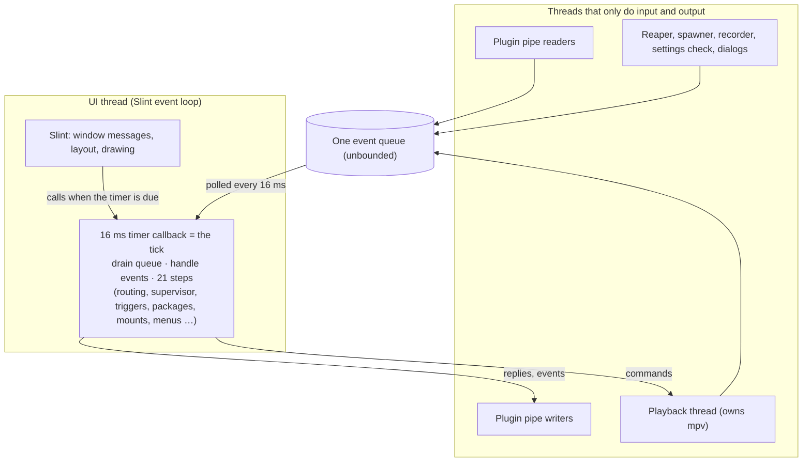
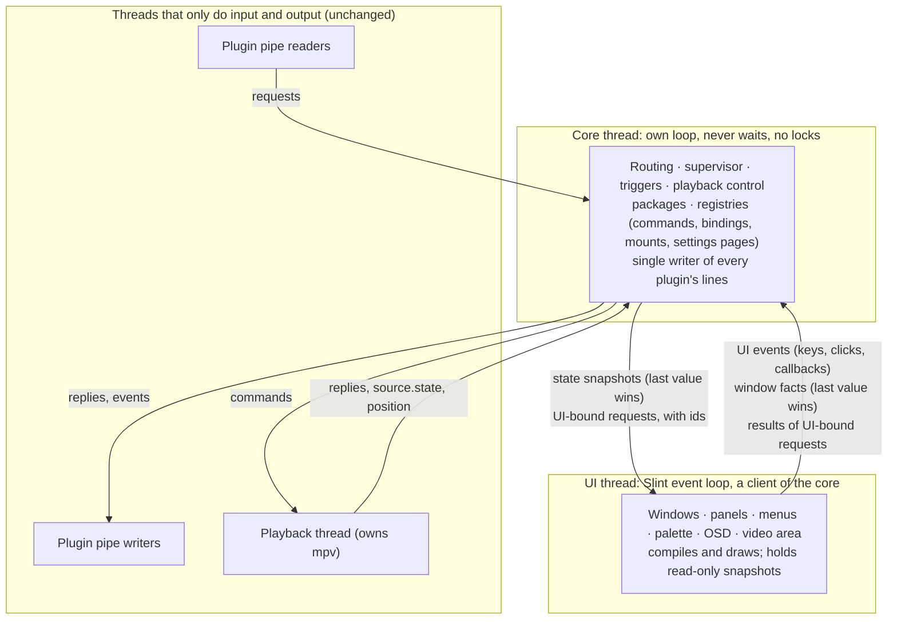

# The core thread (design)

**Status (2026-11-21): done.** The core runs on its own thread (`vestra-core`) and handles each event when it arrives, in player 0.10.2: plan steps S0–S2f split `Host` on one thread, S3a(1)–(4) gave the core its own thread with the queues between it and the interface, S3b made its loop event-driven, and S3c removed the transitional switch (`VESTRA_CORE_ON_UI`) and brought the documents to this state. The "As built" notes below record each step and what was measured against main. Written 2026-11-15 by the API maintainer from the user's rulings of that day. Work starts when release A (SDK 1.10.0 / player 0.10.0) is on main. The execution plan is [core-thread-plan.md](../process/core-thread-plan.md). The source inventory behind the numbers is the study [core-loop-study.md](../process/research/core-loop-study.md) (called "the study" below). This file is the authority for the design; where the study recommends something else, this file wins.

**Process note (user ruling, 2026-11-15).** The work follows the pattern of SDK 1.10.0: this design and the plan are written by Fable; the implementation is by Opus 5.5; static review (diffs and source read against this design, no builds, no logs) is by Fable at medium effort; builds, test runs, `ci:local` and the V1/V2 verification are run by Opus, so that review tokens are not spent on build and test noise.

No code was written or built for this document. Measured values are quoted with where they were measured. Everything the study marked "(inferred)" is still inferred here.

**In one paragraph.** The host's core (plugin request routing, the supervisor, triggers, playback control, packages) is a single-threaded state machine that never waits. Until player 0.10.2 it ran inside a callback on Slint's UI thread, so it stopped whenever anything else held that thread: Slint compiling a window, Windows' own loop while a window is dragged, the graphics library waiting for the GPU. The decision, now built, gave the core its own thread and made the UI thread one of its clients. A stalled interface now costs a frozen window, not stalled plugins, late triggers or lost playback control. No SDK change, no wire change, and the scheduling rules stay as they are.

**How to read it.** What was observed: [§1](#1-background-what-was-observed). How the core is driven today: [§2](#2-how-the-core-is-driven-today). What other projects do: [§3](#3-precedents). What was set aside: [§4](#4-options-considered). The rules: [§5](#5-the-decision); what still crosses the boundary in the code after stage S2: [§5.3](#53-cross-access-inventory-after-s2). What it buys: [§6](#6-what-a-ui-stall-costs-before-and-after). What can go wrong: [§7](#7-risks-and-open-points). How it is proven: [§8](#8-verification). Words: [§9](#9-glossary).

**How sources are written.** `P:` is the player repository, read on branch `evt-release-a` at `3100d94f` (release A before its last fixes); paths without a prefix directory are under `src/host/src/`. `L:` is local evidence on the development laptop, not in any repository.

## 1. Background: what was observed

### 1.1 The machine and the runs

The measurements are from the user's laptop on 2026-11-14 and 2026-11-15: internal panel driven by the AMD Radeon 780M, GPU rendering on the NVIDIA RTX 4070, so on the internal panel every presented frame crosses from one adapter to the other ("cross-adapter"). With an external screen driven by the NVIDIA adapter there is no crossing.

The user ran the portable builds of 0.7.6, 0.8.2 (the installed version), 0.8.4, 0.9.0 and the release A trial (0.10.0, `3100d94f`) by hand, each in an isolated profile with GPU rendering. All of them behave the same. **None of this is a regression of release A or of 0.9.0**; the installed 0.8.2 log shows the same lines for the days before.

| Evidence | Where |
| --- | --- |
| Host logs of each version, with the `ui stall:` lines | `L:C:\vestra\compare\profile-<version>\host.log`; the user's own 0.8.2 history in `L:C:\vestra\backup-profile-20261114-trial\Roaming-Vestra\logs\host.log` |
| Thread stacks taken automatically while the window did not answer (12 dumps, video playing) | `L:C:\vestra\compare\stacks-trial\` |
| The same with the video paused, ending in a lost device (6 dumps) | `L:C:\vestra\compare\stacks-trial-paused\` |
| The watcher that took them (asks the window every 0.2 s, dumps stacks after 1 s without an answer) | `L:C:\vestra\compare\watch.ps1`, started through `start.ps1` |
| Symbols for the trial build | `L:C:\vestra\compare\sym\` |

### 1.2 Three classes of stall

"Tick" is the host's 16 ms turn of work (§2). "UI thread" is the thread that runs Slint's event loop.

| Class | What holds the UI thread | Measured | Where the thread was |
| --- | --- | --- | --- |
| S1. Opening a tool window | Slint compiles the window's `.slint` file and creates it, synchronously, inside the request | 290–800 ms per open (Store 371–803 ms, About 257–453 ms, Workshop 430 ms); every open compiles again | `ui.open`: P:capabilities/ui_window.rs:78 → P:ui/view.rs:713 |
| S2. Dragging or resizing a window | Windows runs its own message loop inside `DefWindowProc` until the mouse button is released. Window messages still arrive, but winit's timers do not fire, so the tick does not run | "no tick" for 5–18 s in every version (for example 10,100 ms, 14,946 ms, 17,941 ms) | winit 0.30.13, the modal move/size loop |
| S3. Resizing on the cross-adapter path | The graphics library waits for the GPU on the UI thread | Three blocks of 5.6–5.9 s with identical stacks; with the video paused, repeated 1 s waits for 8.8 s, then `the GPU device was lost; restarting the player` | Slint `resize_event` → wgpu `Surface::configure` → `Device::maintain` (waits without a time limit for all submitted work) → `wgpu_hal::dx12::Device::wait`; and Slint draw → `Surface::get_current_texture` → `acquire_texture` (1 s timeout) |

Notes on S3:

- It appears only on the internal panel (cross-adapter). On the external screen the same code path returns quickly.
- It does not depend on video: it is worse with the video paused. The video render thread and the two fences shared with it are not the cause.
- wgpu has no 5 s constant. The likely release after about 5 s is Windows declaring the window hung after 5 s without message pumping ([IsHungAppWindow](https://learn.microsoft.com/en-us/windows/win32/api/winuser/nf-winuser-ishungappwindow)); that link in the chain is inferred, the stacks are not.
- Private memory rose from about 440 MB to about 1,750 MB across these stalls. No queue of ours is unbounded on that path (every per-frame post to the UI thread is coalesced); the likely cause is swap-chain buffers re-created on every size change and released only once the GPU queue drains (inferred).

### 1.3 What stops when the UI thread stalls

Everything the tick does, including work that has nothing to do with the interface:

| What stops | Seen as |
| --- | --- |
| Plugin requests (all 119 route entries) | `rpc player.audioDevices still waiting after 10 seconds`, `rpc ui.setMount still waiting after 10 seconds` in the plugin log during the 12–18 s gaps |
| Supervisor timers: standby after 30 s idle, start timeouts, wakes | Late by the length of the stall |
| Triggers: position reports and the `time` atom | Late; `on_demand_tick` runs the time atom from the tick (P:host/supervisor/mod.rs:1779) |
| Playback control from plugins and playback state to plugins | mpv itself is controlled off the UI thread (P:playback/backend.rs:1), but a plugin's command reaches the playback thread only through the tick, and `source.state` comes back only through the tick. Playback continues; plugins can neither control nor observe it |
| Video frames | The frame is handed to Slint and drawn on the UI thread (P:host/video.rs:433) |
| All windows | No repaint, no answer to clicks |

The core does not wait anywhere in this. It is held by the thread it lives on.

## 2. How the core is driven today

The host's state is one object, `Host` (P:host/mod.rs:338-598). It has two kinds of entry point: "handle one event" (`host.handle(event)`) and "do one periodic step" (the `*_tick` methods). Who calls them is outside the object, and there are two callers:

| Driver | Loop | Used for |
| --- | --- | --- |
| Windowed | Slint's event loop owns the thread. The host registers a repeating 16 ms `slint::Timer`; its callback drains the event queue (at least 128 events, then what a time budget allows) and runs 21 steps (P:main.rs:855-948) | Every real run |
| Headless | Our own loop: wait on the event queue for at most 10 ms, handle, run 8 steps (P:main.rs:676-730) | Offscreen tests |

Facts from the study (§0–§3 there, with file and line):

- `Host` has **130 fields** in 37 files: about 55 core, about 45 interface, about 30 used by both. Because some fields are Slint objects, the Rust compiler refuses to move the object to another thread (a type that may cross threads is called `Send`; one field that is not makes the whole object not `Send`, and the host forbids `unsafe`). The object has to be split before any part of it can run elsewhere.
- Everything reaches the host through **one queue** that the 16 ms timer polls. Nothing wakes the loop when an event arrives, so today a request waits 0–16 ms before it is handled even when nothing stalls.
- Every reply and event line to a plugin is produced on the UI thread. The only exceptions are request-limit refusals, written by the reader threads.
- The headless loop runs exactly the 8 core steps (activation, on-demand, power, diagnostics, packages, notifications, timeline, open files). It is the proof that the core runs without Slint's loop; the offscreen tests run it that way every day.

**The gap this document records.** Running the core on Slint's event loop was never a ruling. It was an early implementation choice: Slint objects can be touched only on Slint's thread, many plugin requests end in an interface change, so putting everything on that thread was the shortest path. It was never brought to the user as an architecture decision, and no architecture document states it as one. On 2026-11-15 the user called it a sword of Damocles: the core's "never waits" guarantee holds only for our own code, and any wait by Slint, the graphics library, a driver or the operating system on that thread voids it.

## 3. Precedents

Two research passes were made on 2026-11-15 (web and public source; the claims below are those the researcher could open and read).

### 3.1 Core logic on the UI loop, with one iron rule

| Project | What runs on the UI thread | The rule |
| --- | --- | --- |
| VS Code | Extensions run in a separate process, but the host-side RPC endpoint lives in the workbench, the renderer's UI thread ([extensionHostManager.ts](https://github.com/microsoft/vscode/blob/main/src/vs/workbench/services/extensions/common/extensionHostManager.ts), [extension host](https://code.visualstudio.com/api/advanced-topics/extension-host)). The closest analogue to today's Vestra | The peer is marked unresponsive after 3 s without an acknowledgement |
| Chromium | Service-worker lifecycle and timeout timers on the browser UI thread ([service_worker_version.cc](https://github.com/chromium/chromium/blob/main/content/browser/service_worker/service_worker_version.cc)); the extensions `ProcessManager` in the browser process | "Do not perform expensive computation or blocking IO on the main thread"; IPC arrives on a separate IO thread ([threading_and_tasks.md](https://chromium.googlesource.com/chromium/src/+/main/docs/threading_and_tasks.md)) |
| Zed | Foreground executor on the main thread, background executor elsewhere | "The main thread should never, ever block." ([blog](https://zed.dev/blog/zed-decoded-async-rust)) |
| Electron | The main process runs the UI thread | "Under no circumstances should you block this process and the UI thread" ([performance](https://www.electronjs.org/docs/latest/tutorial/performance)) |
| JetBrains IDEs | Writes only on the event dispatch thread, which "must be as fast as possible" ([threading model](https://plugins.jetbrains.com/docs/intellij/threading-model.html)) | A freeze watchdog runs off that thread and dumps stacks ([PerformanceWatcherImpl.kt](https://github.com/JetBrains/intellij-community/blob/master/platform/platform-impl/src/com/intellij/diagnostic/PerformanceWatcherImpl.kt)) |
| Kodi | The application thread is the GUI thread; other threads post messages to it ([ApplicationMessenger.cpp](https://github.com/xbmc/xbmc/blob/master/xbmc/messaging/ApplicationMessenger.cpp)) | A guard against waiting on itself |
| Celluloid | mpv events are processed on the GTK main loop ([celluloid-mpv.c](https://github.com/celluloid-player/celluloid/blob/master/src/celluloid-mpv.c)) | — |
| Figma | Plugins run on the main thread by design, for synchronous document access | The accepted cost: "When plugins freeze, it affects the perceived stability of Figma." ([blog](https://www.figma.com/blog/how-we-built-the-figma-plugin-system/)) |

So the design we have is common and defensible. Every project that keeps it enforces that nothing on that thread may wait. We cannot enforce that: the three stalls of §1.2 are in Slint, wgpu, the driver and Windows, not in our code.

### 3.2 Separated designs and what they cost

| Project | Structure | Cost they name |
| --- | --- | --- |
| mpv | The core is detached from any interface: "Not calling mpv_wait_event() will not stop playback". Synchronisation by two rules: property changes are coalesced ("only one event per changed property"), and commands are asynchronous with replies as events that "may be reordered" ([client.h](https://github.com/mpv-player/mpv/blob/master/include/mpv/client.h)) | A render thread waiting on a core API can "freeze the mpv core thread forever" (`render.h`) |
| mpv, 2014 | It hit our S2 exactly. Commit `97a82bcd` (2014-07-26), "win32: move window handling to a separate thread": "the message dispatcher won't return while the dragging is active, so mpv couldn't update the video at all." It moved the window message pump to its own thread and left the core and the renderer where they were; the dedicated GUI thread is still there (`video/out/w32_common.c`) | The author calls it "rough"; it needed a `WM_CLOSE` workaround |
| VLC | The Qt interface runs on its own thread, except on macOS where Cocoa forces the main thread ([qt.cpp](https://github.com/videolan/vlc/blob/master/modules/gui/qt/qt.cpp)) | A ready-barrier at start so the core does not start video before the window exists |
| IINA | A dedicated queue reads mpv events; processing hops to the main queue; queue overflow is a critical failure ([MPVController.swift](https://github.com/iina/iina/blob/develop/iina/MPVController.swift)) | — |
| Haruna / mpvqt | The mpv controller lives on a worker thread, driven by queued calls ([mpvabstractitem.cpp](https://github.com/KDE/mpvqt/blob/master/src/mpvabstractitem.cpp)) | — |

mpv's 2014 fix isolates the party that gets blocked (the window pump) instead of moving the core. We cannot do the same: Slint binds "receive window messages" and "draw the interface" to one thread. The equivalent for us is the reverse: leave Slint's thread to Slint and move what is not interface off it. Moving the core is this document; moving video is the independent video layer (§6.2). Both together give mpv's three threads: core, video, window.

### 3.3 Slint's own advice

"You should perform the minimum amount of work in the main thread and delegate the actual logic to another thread to avoid blocking animations", with `invoke_from_event_loop` to come back ([slint lib.rs, "Threading and Event-loop"](https://raw.githubusercontent.com/slint-ui/slint/master/api/rs/slint/lib.rs), [invoke_from_event_loop](https://docs.slint.dev/latest/docs/rust/slint/fn.invoke_from_event_loop)). By Slint's own documentation, today's structure is not the recommended use. No survey of larger open-source Slint applications was found.

### 3.4 Upstream state of the three stalls

| Stall | Upstream | State on 2026-11-15 |
| --- | --- | --- |
| S2 modal loop | winit [#3272](https://github.com/rust-windowing/winit/issues/3272) "`ControlFlow` is ignored while window is being resized on Windows", [#1484](https://github.com/rust-windowing/winit/issues/1484) (system menu / title bar freezes the event loop) | Both open. Slint [#5720](https://github.com/slint-ui/slint/issues/5720) open; [#5791](https://github.com/slint-ui/slint/issues/5791) closed as its duplicate, called "a bug in winit" |
| S3 configure wait | wgpu still calls `maintain(wait_indefinitely())` before configuring a surface | By design; no issue asks for its removal |
| S3 reconfigure on every resize event | Slint [#12730](https://github.com/slint-ui/slint/issues/12730) "Window resizing is laggy in release mode" (closed); [PR #12733](https://github.com/slint-ui/slint/pull/12733) "wgpu: defer swapchain reconfiguration to the next frame" | The PR was closed unmerged because it did not fix the Wayland case it was written for |
| S3 present mode | Slint [#8693](https://github.com/slint-ui/slint/issues/8693), where AutoVsync was hard-coded; a maintainer said "perhaps we can make it configurable" | Never done; no public setting |
| S3 `acquire_texture` 1 s waits | wgpu [PR #10511](https://github.com/gfx-rs/wgpu/pull/10511) "fix(dx12): fix 1 second hang for dropped `SurfaceTexture`s", merged 2026-11-14; [PR #10548](https://github.com/gfx-rs/wgpu/pull/10548) discards queued old-size frames after a resize | Merged, unreleased; reaches us only through a wgpu release and a Slint upgrade |

No report of the exact cross-adapter symptom was found in any project. A request to Slint is reasonable and was deferred by the user (2026-11-15: "the issue can wait, our problem is bigger").

## 4. Options considered

| Option | What it is | Why it was set aside |
| --- | --- | --- |
| A. Router thread | Only forwarding and keep-alive leave the UI thread | Little to gain. The shared runner's heartbeat already tolerates stalls. No request is a pure plugin-to-plugin forward: each of the 48 playback forwards touches host bookkeeping (standby accounting, activation tracking, `source.state` patching). A fast path would put a second writer on each plugin's pipe and break today's order. It ends up as a partial B (study §4.1) |
| **B. Core thread** | Supervisor, triggers, routing, playback control and packages on their own thread; the UI thread is a client | **Chosen** (§5). About 30–40 files and 5,000–10,000 changed lines, plus about 1,500 lines of messages (inferred) |
| C. Full split | All state on the core, the interface a thin mirror that applies diffs | 20,000–30,000 lines, a rewrite of the interface layer. Menu hover and palette typing would each take a round trip. No more resilient than B: a stalled interface cannot show anything in any design |
| Compile off-thread only | Compile `ui.open` and mount panels on a worker, as the settings check already does | Helps only S1. Does nothing for S2 and S3, the multi-second cases. Slint's compiled definitions hold `Rc` (single-thread reference counts), so only the check could move, not the result |
| Default adapter rule | At start, render on the adapter that drives the main window's screen, as mpv and Chromium effectively do; manual choice kept | A way around S3, not a fix: a user who selects the NVIDIA adapter on the internal panel still gets it, and the next cause of a wait on the UI thread is not covered. **Still planned as a separate item**, to keep the user's machine usable in the meantime |
| Keep-alive during the modal loop | A Win32 timer armed between `WM_ENTERSIZEMOVE` and `WM_EXITSIZEMOVE` posts the tick (branch `fix-modal-tick`, written, awaiting the user's manual check) | Removes S2 only. **Still planned as a separate item.** Under this design it stays useful for the interface side (content re-laid-out while dragging) |
| Per-plugin in-order queue | Keep today's order exactly: while a plugin has a UI-bound request unanswered, hold that plugin's later lines. Equivalent in effect to in-order delivery in selective-repeat ARQ or TCP: a resequencing buffer | Head-of-line blocking. One request stuck behind a frozen interface would hold every later request of that plugin, including those that never touch the interface. That brings back per plugin what the design removes globally. The study recommended it for the prototype (its §7 question 1); the user ruled against a queue |
| **Two independent streams** | As in QUIC: order inside a stream, none across streams, so one blocked stream does not hold the other | **Chosen** (rule R4). The order inside each stream comes for free from each thread handling its inbox in arrival order |

## 5. The decision

Rulings of the user, 2026-11-15, as numbered rules. "Core" is the new thread; "UI" is Slint's thread.

| No. | Rule |
| --- | --- |
| R1 | **The core has its own thread and its own loop.** It owns the plugin processes and the shared runner, the supervisor, triggers and conditions, request routing, playback control (the handle to the playback thread, `last_source`, the sequence), packages, timeline, session storage, power, and the notification bookkeeping. It stays single-threaded, lock-free and never waits |
| R2 | **The UI thread is a client of the core.** It owns the Slint objects and the windows: shell, views, panels, menus, palette, OSD timing, the video area, picture-in-picture, the settings window. It compiles, instantiates and draws. It decides nothing about plugins |
| R3 | **Two kinds of message cross between them, and nothing else.** (1) State snapshots: an immutable copy of a whole table or value; the receiver replaces what it had; several in a row collapse to the last ("last value wins"); no locks. (2) Requests and replies with ids, for work one side asks of the other |
| R4 | **Two streams per plugin, no ordering queue.** Requests that need the interface are carried out on the UI thread in arrival order. Requests that do not are carried out on the core in arrival order. There is no order between the two streams: the reply to a later UI-independent request may arrive before the reply to an earlier UI-bound one. Inside the UI-bound stream the order of execution is kept, not always the order of replies (§5.1, "Order inside the UI-bound stream") |
| R5 | **What a reply means (user ruling 2026-11-15).** For the UI-bound methods whose reply carries an interface result (10 in the ruling; 16 method names in the table of §5.1), the request is answered only when the UI thread has reported that result (after `ui.open` the view exists; after `ui.mount` the mount is ready; `ui.preparing` still precedes the `ui.mount` reply). For every other request that touches the interface (25 "reply independent" methods in the ruling; 22 method names in §5.1), a reply means the host has accepted and recorded the change; the interface shows it as soon as it can. This is what plugins could rely on before as well: a reply never meant the user had already seen the change. The move of `dialogs.open`, `dialogs.confirm`, `commands.run` (with a plan that asks) and `media.sources.locate` to the UI-bound set follows this rule's own definition (the reply carries an interface result: the user's answer); decided by the coordinator on 2026-11-15 and reported to the user. `layout.set` joins the UI-bound set for R13's reason (a read right after its reply must see the change; coordinator decision 2026-11-15, after the S2a review) |
| R6 | **Events and broadcasts keep the core's order.** The core is the single writer of every plugin's lines, as the UI thread is today. Side effects of a request are still sent before its reply; triggers that flip are still delivered before the state broadcast that flipped them |
| R7 | **A UI-independent request never waits for the UI.** This is the purpose of the change and a hard rule for every later addition: a new method that does not need the interface must not be routed through it |
| R8 | **The binding table and the command registry belong to the core.** The UI holds a read-only snapshot, replaced whole on every revision. Key callbacks on the UI thread look up the snapshot synchronously (Slint's key callback must answer "handled or not" at once and cannot wait for a round trip). Table updates and key events go through one queue on the UI side, so a key is never judged by a table older than the one that preceded it in that queue |
| R9 | **Facts the UI owns flow to the core as snapshots.** Window size, fullscreen, focus, layout and the menu state (`window_facts`) are sent by the UI when they change; the core evaluates conditions and triggers and broadcasts `window.state` from them |
| R10 | **Cadence in two steps.** First the core loop keeps today's fixed cadence, so that timing is unchanged and the differential checks can show zero difference. Then, as a separate merge, it handles each event when it arrives (the loop sleeps on its queue; a UI-independent request is answered in well under a millisecond instead of up to 16 ms). In the other direction the core wakes the UI with `invoke_from_event_loop`, not through the 16 ms timer |
| R11 | **No SDK change, no wire change, no change to the scheduling rules.** When a plugin starts, parks, wakes and is stopped is decided by the same supervisor rules ([supervisor.md](supervisor.md)); only the thread that runs them changes |
| R12 | **The readiness coupling is kept.** A plugin's run is ready only after its first `ui.open` / `ui.mount` was answered (P:host/dispatch.rs:118-144, P:host/supervisor/mod.rs:995-1030). A run that starts during an interface stall therefore becomes ready when the stall ends |
| R13 | **Handoff: state first, then the reply, then the broadcast** (from the plugin scan S0.3, 2026-11-15). For a UI-bound request, the core handles the UI's report in this order: (1) apply the state the report carries to the core's copy: the window facts snapshot (with the picture-in-picture `active` flag that `window.state` reports, host/state.rs:219, 225-228), the mount record and the tab order in the window facts; (2) send the reply; (3) broadcast what changed (`window.state`). A request the plugin sends after the reply therefore reads the new state. Facts reach the core both as snapshots and inside these reports, so they carry a sequence number from one counter on the UI side, and the core applies a facts value only when it is newer than the last one applied: coalescing a newer snapshot in place, ahead of an older report, never moves the core's copy backwards (`host/messages.rs`). The wire order (reply, then `window.state`) is today's: `window_tick` answers the video area (host/window.rs:301) before it replaces `window_facts` and broadcasts `window.state` (:308-311), so the differential checks stay equal. Only the core's copy is updated earlier than today, which no line on the wire shows. **Exception: `layout.set` (coordinator ruling 2026-11-15, from the S2d spec tests).** Today its `window.state` broadcast, already showing the change, goes out *before* its reply: the layout pass it runs before answering (api/ui_mount.rs:888-889) measures the facts and broadcasts them in place. That order stays, in S2 and through S3a (no wire change); a read after the reply sees the change all the same |

**Evidence for R13**, all in code that awaits correctly:

1. The SDK's `plugin/view/panel.ts:52-63` calls `layout.state` right after `await ui.mount`: the core's mount and layout record must be updated before the `ui.mount` reply goes out.
2. `plugin/window.ts:137-138` reads `window.state` right after `await window.setVideoArea`; the Window plugin's Mini Size compares it (`window/size.ts:31-34, 92-96`).
3. `plugin/window.ts:158-159` does the same after `window.setPictureInPicture` (`window/pip.ts:62`).
4. (The exception to R13's wire order: see R13.) The SDK's `layout.js:100-101` reads `layout.state` right after `await layout.set`; today the host runs a layout pass before answering for exactly this (api/ui_mount.rs:888-889). So `layout.set` is UI-bound (row 46): the UI applies it, runs the pass and reports the facts with the new tab order; the core applies them, then answers (added after the S2a review, coordinator decision 2026-11-15).

**The loop in R10's first step (decided for plan S3a, 2026-11-16).** "Today's fixed cadence" is not one thing: the windowed driver polls on a 16 ms timer, the headless driver waits on its queue for at most 10 ms. On two threads the windowed core loop runs on a fixed 16 ms period of its own and is not woken by events; the headless loop is unchanged (no interface, no second thread). The interface keeps its own 16 ms timer for its own steps and is woken for commands by `invoke_from_event_loop`. The two periods are not synchronised, so until R10's second step a UI-bound reply can leave up to one core period later than today (the core issues in one turn and answers in the next). That is measured in S3a; it is not a change of order.

**The 1 s timeout of `window.setVideoArea` (the S3a target; S2 keeps today's behaviour, see "As built in plan step S2d(1)" below).** The reply is due when the layout shows the size or when its deadline (request time + 1000 ms, host/state.rs:298) passes (:304). When the UI reports the fitted size, the core first checks the facts it already has: if they show the size already, it answers at once rather than waiting out the deadline. On the timeout path R13 holds for the state the core has, not for the size asked: the core applies the last window facts snapshot it received, then sends the reply (with the size the host computed, as today), and `window.state` reads that snapshot, which may still show the old size. That is today's behaviour too.

**As built in plan step S2d(1).** `window.setVideoArea`: the core checks the size and sends `WindowOp::VideoArea`; the interface fits the window and reports `UiReport::AreaFitted` (the core keeps the reply with its deadline, `Core::area_replies`) or the error as `UiReport::Answered`; each window tick reports the size its layout shows, after the bar, the columns and fullscreen changed it, as `UiReport::VideoArea` (last value wins), and the core answers the replies that size shows or whose second is up. The facts are not used for this: the window tick measures them before that layout, so answering from them would move each reply a tick later. Not checked at receipt either (today the reply waits for the next tick even when the size already shows); answering at once is S3a's choice. `UiReport::VideoArea` is sent before the tick's `WindowFacts`, so the reply still precedes `window.state`. The deadline runs on the interface's tick (`now` in the report), as today; on two threads S3a checks it on the core's own clock. `window.setPictureInPicture`: `WindowOp::Pip`, answered with `UiReport::Answered` **without a handoff**: `window.state` reads the interface's live PiP state on one thread, and a handoff carrying the new `active` flag would broadcast `window.state` with the reply, earlier than today's window tick. R13's handoff of the flag (the core's own copy, read by `window.state`) is S3a's. Offscreen runs have no native window and refuse both at once, so cases 2 and 3 and the timeout path are covered by unit tests of the seam (host/state.rs `seam_tests`), not by the offscreen spec tests.

**Open for S3a (from the S2d(1) review):** (1) answering `AreaFitted` at once when the core's copy already shows the size, as the paragraph above describes, is a wire timing change (the reply moves up to a tick earlier) and needs a ruling before it is built; (2) the deadline moves to the core's clock: receipt + 1000 ms measured on the interface's tick includes a UI stall, so on two threads the core checks it itself; (3) `UiReport::VideoArea` is sent every window tick, about 60 a second across the threads once they are two: send it only when the size changed or while a reply is pending; (4) the PiP `active` flag in `setPictureInPicture`'s handoff (R13 case 3), with `window.state` reading the core's copy. From the S2d(2) review: (5) a stale `UiReport::Batching(None)` from the previous window can clear the core's record after the next hand-over, so `Batching` needs a hand-over sequence number (or the interface alone asks for hand-overs); (6) a late `UiCommand::CancelMount` arriving after the window closed and the id 0 removal was applied needs a rule; (7) a failed batch puts its changes back with `push_front` into `Core::mount_queue` (host/mounts.rs, `prepare_mount_tick`), an interface write to core data.

**Test target (plan S2d on one thread, S3a on two):** for each of the four cases, the request followed at once by the read returns the post-change state, and the wire shows the reply before the `window.state` broadcast; for the timeout path, the reply and a read give the last reported state.

### 5.1 Which requests are in which stream

From the study's inventory of the 119 route entries (its §2.2, with every method named). The summary as the study had it; the method table below (plan S0.2) is the authority where they differ:

| Stream | Count | What |
| --- | --- | --- |
| UI-independent, forwarded to the playback thread | 48 | `source.*`, `playback.*`, `player.*`, `subtitles.*`, `processing.*`, `video.*`, `mpv.*`, `media.sources.*`, `snapshot.*`, `jobs.*`, `producer.*`, `sourceResolvers.*` |
| UI-independent, answered by the core | 36 | `triggers.*`, `events.*`, `timeline.*`, `sequence.*`, `storage.session.*`, `packages.*`, `secrets.*`, `system.*`, `rendering.*`, `commands.keys/list`, `drops.*`, `window.state`, `power.preventSleep`, and others |
| Touches the interface, but the reply does not depend on its result | 25 | `osd.*`, `appearance.set`, `commands.register/update/unregister`, `bindings.*`, `layout.*`, `ui.interaction`, `ui.menu`, `window.setAlwaysOnTop`, `palette.lead.*`, `commands.run`, `dialogs.*`, `host.run`, `app.system`, `clipboard.*` |
| **UI-bound: the reply depends on an interface result** | 10 | `ui.open`, `ui.set`, `ui.show`, `ui.close`, `ui.mount`, `ui.unmount`, `ui.setMount`, `settings.*`, `window.setVideoArea`, `window.setPictureInPicture` |

The reply-independent methods are answered by the core as soon as its own part is done (registry write, snapshot sent); the interface catches up when it can (R5, K13). Which of them stay there and which join the UI-bound stream is settled method by method in the table below.

#### The method table (plan S0.2)

Read on player 0.10.0 (tag `v0.10.0`, `c3f8ebea`). **Route count: 119**, the same as the study: 32 areas in `capabilities::ALL` (`api/mod.rs:207-240`) with 107 names, plus 12 names of `api/uncapable.rs:6-21`; 112 exact names and 7 `prefix.*` entries (`snapshot.*`, `jobs.*`, `media.sources.*`, `packages.*`, `sourceResolvers.*`, `subtitles.*`, `settings.*`). The router is `capabilities::lookup` (`mod.rs:300-308`), called from `Host::dispatch` (`host/dispatch.rs:149-196`) after the start-up gates of `host/handle.rs:68-105`. Files below are under `src/host/src/api/` unless a directory is named. The table has one row per route entry, except the two prefix entries whose names differ in stream: `media.sources.*` (rows 65a–65e) and `settings.*` (rows 83a–83d) have one row per name. So it has **126 rows for the 119 entries**.

Columns. **Today**: F = forwarded to the playback worker, answered later by `Event::Reply`; C = core only; U = touches the interface, reply independent of it; R = the reply needs an interface result. **Stream** (rule R4): I = UI-independent, answered by the core (or the worker) without waiting for the UI; B = UI-bound. **UI work**: what the core sends to the UI under the design, as a `UiCommand` kind (names from study §4.2, regrouped in plan S2a), and when the reply leaves. "Snapshot" kinds are last-value-wins (R3). A dash: no UI work.

| # | Entry | Handler | Today | Stream | UI work (`UiCommand`) · reply |
| --- | --- | --- | --- | --- | --- |
| 1 | `producer.prepare` | producer_av.rs:31 | F | I | — · worker |
| 2 | `producer.state` | producer_av.rs:31 | F | I | — · worker |
| 3 | `producer.release` | producer_av.rs:31 | F | I | — · worker |
| 4 | `producer.ack` | producer_av.rs:31 | F | I | — · worker |
| 5 | `producer.declareInput` | producer_av.rs:31 | F | I | — · worker |
| 6 | `producer.ackInput` | producer_av.rs:31 | F | I | — · worker |
| 7 | `source.state` | playback_read.rs:37-40 | F | I | — · worker; sequence flags patched by the core (host/handle.rs:223-229) |
| 8 | `processing.state` | playback_read.rs:40 | F | I | — · worker |
| 9 | `playback.stats` | playback_read.rs:40 | F | I | — · worker |
| 10 | `player.chapters` | playback_read.rs:40 | F | I | — · worker |
| 11 | `player.audioDevices` | playback_read.rs:40 | F | I | — · worker |
| 12 | `timeline.marks` | playback_read.rs:33 | C | I | — · at once |
| 13 | `playback.set` | playback_control.rs:152 | F | I | — · worker |
| 14 | `source.submit` | playback_control.rs:152 | F | I | — · worker |
| 15 | `source.operation` | playback_control.rs:152 | F | I | — · worker |
| 16 | `audio.addTrack` | playback_control.rs:152 | F | I | — · worker |
| 17 | `audio.selectTrack` | playback_control.rs:152 | F | I | — · worker |
| 18 | `player.setLoop` | playback_control.rs:152 | F | I | — · worker |
| 19 | `player.setAudioDevice` | playback_control.rs:152 | F | I | — · worker |
| 20 | `player.step` | playback_control.rs:152 | F | I | — · worker |
| 21 | `player.setStepSeek` | playback_control.rs:55; host/actions.rs:206-219 | U | I | `Registry` snapshot when the step changes (the seek commands' titles are re-registered) · at once |
| 22 | `power.preventSleep` | playback_control.rs:72 | C | I | — · at once (`power` on the core, K10) |
| 23 | `sequence.set` | playback_control.rs:79 | C | I | `Osd` on a refusal (note 3) · at once; start-up gate (note 6) |
| 24 | `sequence.step` | playback_control.rs:109 | C | I | — · at once |
| 25 | `sourceResolvers.register` | source_resolve.rs:74 | F | I | `Osd` on a taken refusal (note 3) · worker; start-up gate (note 6) |
| 26 | `sourceResolvers.unregister` | source_resolve.rs:74 | F | I | — · worker; start-up gate (note 6) |
| 27 | `sourceResolvers.respond` | source_resolve.rs:69 | F | I | — · worker |
| 28 | `sourceResolvers.*` | source_resolve.rs:77 | C | I | — · at once (`unsupported`; note 2) |
| 29 | `events.subscribe` | events.rs:168 | C | I | — · at once |
| 30 | `events.unsubscribe` | events.rs:168 | C | I | — · at once |
| 31 | `commands.register` | commands.rs:120, 126 | U | I | `Registry`, `Bindings` snapshots · at once |
| 32 | `commands.update` | commands.rs:120, 126 | U | I | `Registry` snapshot · at once |
| 33 | `commands.unregister` | commands.rs:108 | U | I | `Registry`, `Bindings` snapshots (open menu refreshed from them) · at once |
| 34 | `host.run` | commands.rs:90; host/actions.rs:263 | U | I | `WindowOp::Fullscreen` (toggle) · at once; playback actions: worker, `Osd` from the result (note 4) |
| 35 | `commands.keys` | commands.rs:107 | C | I | — · at once |
| 36 | `ui.open` | ui_window.rs:37, 44 | R | B | `ViewOp::Open` · after the UI reports the view created or the compile error; readiness (note 5) |
| 37 | `ui.set` | ui_window.rs:38, 103 | R | B | `ViewOp::Set` · after the UI wrote it |
| 38 | `ui.show` | ui_window.rs:38, 103 | R | B | `ViewOp::Show` · after the UI showed it |
| 39 | `ui.close` | ui_window.rs:38, 103 | R | B | `ViewOp::Close` · after the UI closed it |
| 40 | `ui.mount` | ui_mount.rs:160, 281 | R | B | `MountChange` · after `MountApplied`, `ui.preparing` first; readiness and start-up gate (notes 5, 6); R13 |
| 41 | `ui.setMount` | ui_mount.rs:164, 538 | R | B | `SetMount` · after the UI wrote it |
| 42 | `ui.unmount` | ui_mount.rs:160, 281 | R | B | `MountChange` · after `MountApplied`; start-up gate (note 6) |
| 43 | `ui.interaction` | ui_mount.rs:165, 701 | U | I | `LayoutOp::Locks` (ordered; panel locks) · at once |
| 44 | `ui.menu` | ui_mount.rs:166, 735 | U | I | `PanelMenu` · at once; refusals judged on the last window facts; today's property error kept (note 7) |
| 45 | `layout.state` | ui_mount.rs:167; host/state.rs:322 | C | I | — · at once, from the window facts snapshot (note 1) |
| 46 | `layout.set` | ui_mount.rs:168, 819 | R | B | `LayoutOp::Set` (ordered) · after the UI applied it and reported the facts with the tab order (today: after a layout pass, ui_mount.rs:888-889); refusals the core can judge at once; R13, with its exception: today's `window.state` broadcast of the pass goes before the reply and stays there (R13) |
| 47 | `dialogs.open` | ui_dialog.rs:51, 167 | R | B | `Dialog` · on the user's choice (`DialogDone`); refusals at once (note 8) |
| 48 | `dialogs.confirm` | ui_dialog.rs:50, 60 | R | B | `Confirm` or `Review` · on the user's answer (`ConfirmDone`); refusals at once (note 8) |
| 49 | `packages.*` | plugins_manage.rs:25-31 | C | I | `RevokeOwner` when a plugin stops (K3) · at once, or from the operation / validation thread |
| 50 | `processing.replace` | processing_video.rs:45 | F | I | — · worker |
| 51 | `processing.operation` | processing_video.rs:49 | F | I | — · worker |
| 52 | `video.view.set` | processing_video.rs:72 | F | I | — · worker |
| 53 | `video.view.release` | processing_video.rs:72 | F | I | — · worker |
| 54 | `video.render.set` | processing_video.rs:59 | F | I | — · worker |
| 55 | `video.render.release` | processing_video.rs:68 | F | I | — · worker |
| 56 | `video.shaders.set` | processing_video.rs:50 | F | I | — · worker |
| 57 | `subtitles.state` | subtitles_read.rs:24 | F | I | — · worker |
| 58 | `subtitles.*` | subtitles_control.rs:26 | F | I | — · worker |
| 59 | `snapshot.state` | media_read.rs:24 | F | I | — · worker |
| 60 | `jobs.state` | media_read.rs:24 | F | I | — · worker |
| 61 | `jobs.operation` | media_read.rs:24 | F | I | — · worker |
| 62 | `snapshot.*` | media_control.rs:35-37 | F | I | — · worker |
| 63 | `jobs.*` | media_control.rs:35-37 | F | I | — · worker |
| 64 | `media.sources.open` | media_sources.rs:40-44 | F | I | — · worker |
| 65a | `media.sources.*`: `remember` | media_sources.rs:40-44 | F | I | — · worker |
| 65b | `media.sources.*`: `get` | media_sources.rs:40-44 | F | I | — · worker |
| 65c | `media.sources.*`: `locate` | media_sources.rs:40-44; playback/media_sources.rs:1176-1183 | R | B | `Dialog` · worker, after the user's choice (note 9) |
| 65d | `media.sources.*`: `forget` | media_sources.rs:40-44 | F | I | — · worker |
| 65e | `media.sources.*`: `list` | media_sources.rs:40-44 | F | I | — · worker |
| 66 | `osd.show` | ui_osd.rs:47, 54 | U | I | `Osd` · at once |
| 67 | `osd.panel` | ui_osd.rs:48 | U | I | `InfoPanels` snapshot · at once |
| 68 | `clipboard.readText` | clipboard.rs:27 | U | I | — · from a worker thread (note 10) |
| 69 | `clipboard.writeText` | clipboard.rs:27 | U | I | — · from a worker thread (note 10) |
| 70 | `clipboard.writeImage` | clipboard.rs:27 | U | I | — · from a worker thread (note 10) |
| 71 | `window.setVideoArea` | window_control.rs:50; host/state.rs:232-309 | R | B | `WindowOp::VideoArea` · when the window facts show the size, or after 1 s; R13 |
| 72 | `window.setAlwaysOnTop` | window_control.rs:54; host/state.rs:192 | U | I | `WindowOp::OnTop` · at once (errors are only logged today) |
| 73 | `window.setCursorAutoHide` | window_control.rs:66; host/window.rs:284-289 | U | I | cursor mode snapshot (the UI hides the pointer from it) · at once |
| 74 | `window.setPictureInPicture` | window_control.rs:65; host/video.rs:291 | R | B | `WindowOp::Pip` · from the PiP state machine; R13 |
| 75 | `bindings.list` | bindings_manage.rs:25; binding_manager.rs:94 | C | I | — · at once (note 1) |
| 76 | `bindings.set` | bindings_manage.rs:25; binding_manager.rs:95 | U | I | `Bindings` snapshot (open menu refreshed from it) · at once |
| 77 | `bindings.reset` | bindings_manage.rs:25; binding_manager.rs:113 | U | I | `Bindings` snapshot · at once |
| 78 | `timeline.set` | timeline_marks.rs:37 | C | I | — · at once |
| 79 | `timeline.setRanges` | timeline_marks.rs:37 | C | I | — · at once |
| 80 | `drops.provide` | ui_drop.rs:60 | C | I | — · at once |
| 81 | `drops.withdraw` | ui_drop.rs:60 | C | I | — · at once |
| 82 | `drops.listen` | ui_drop.rs:60 | C | I | — · at once |
| 83a | `settings.*`: `register` | ui_settings.rs:57; ui/settings_window.rs:557-599 | U | I | `SettingsOp` after the answer (open window updated) · after the `settings-check` thread (note 11) |
| 83b | `settings.*`: `unregister` | ui/settings_window.rs:600-629 | U | I | `SettingsOp` (open window rebuilt) · at once |
| 83c | `settings.*`: `set` | ui/settings_window.rs:630-705 | R | B | `SettingsOp` · after the UI wrote it into the open window (note 11) |
| 83d | `settings.*`: `show` | ui/settings_window.rs:706-721 | R | B | `SettingsOp` · after the UI opened the window |
| 84 | `appearance.set` | ui_theme.rs:25; ui/theme.rs:228 | U | I | `Theme` · at once |
| 85 | `appearance.setLanguage` | ui_theme.rs:26; ui/theme.rs:266 | C | I | — · at once |
| 86 | `secrets.get` | secrets.rs:24; system.rs:155 | C | I | — · from the `system-request` thread |
| 87 | `secrets.set` | secrets.rs:24; system.rs:155 | C | I | — · from the `system-request` thread |
| 88 | `secrets.delete` | secrets.rs:24; system.rs:155 | C | I | — · from the `system-request` thread |
| 89 | `rendering.setPreference` | rendering_manage.rs:26; host/rendering.rs:316 | C | I | — · at once |
| 90 | `rendering.restart` | rendering_manage.rs:26; host/rendering.rs:326 | C | I | `WindowOp::Quit` after the reply · at once. As built in plan step S2d(4): the host's own `quit` command sends `WindowOp::Quit` after the core stopped the handoffs and wrote the state file, so the state file is now written before the GPU waits are released (and the handoffs stop before that release too); `rendering.restart` keeps its own quit after the reply (`invoke_from_event_loop`, safe from any thread) |
| 91 | `video.upscaling.state` | video_upscaling.rs:34 | F | I | — · worker |
| 92 | `video.upscaling.set` | video_upscaling.rs:34 | F | I | — · worker |
| 93 | `video.motion.state` | video_motion.rs:33 | F | I | — · worker |
| 94 | `video.motion.set` | video_motion.rs:33 | F | I | — · worker |
| 95 | `commands.list` | commands_run.rs:911 | C | I | — · at once |
| 96 | `commands.run` | commands_run.rs:924, 701 | R | B | `Review` when the plan asks · `{ran:true}` at once when nothing asks, else on the user's answer (note 8) |
| 97 | `palette.lead.set` | palette_lead.rs:409 | U | I | `Lead` (palette row, strip) · at once |
| 98 | `palette.lead.clear` | palette_lead.rs:413 | U | I | `Lead` · at once |
| 99 | `palette.lead.done` | palette_lead.rs:416 | C | I | — · at once (note 1) |
| 100 | `mpv.command` | mpv.rs:74 | F | I | — · worker |
| 101 | `mpv.get` | mpv.rs:74 | F | I | — · worker |
| 102 | `mpv.set` | mpv.rs:74 | F | I | — · worker |
| 103 | `mpv.observe` | mpv.rs:74 | F | I | — · worker |
| 104 | `mpv.unobserve` | mpv.rs:74 | F | I | — · worker |
| 105 | `triggers.set` | triggers.rs:40 | C | I | — · at once |
| 106 | `triggers.off` | triggers.rs:57 | C | I | — · at once |
| 107 | `triggers.declare` | triggers.rs:67 | C | I | — · at once |
| 108 | `packages.list` | open.rs:25 | C | I | — · at once |
| 109 | `window.state` | open.rs:26; host/state.rs:213 | C | I | — · at once, from the window facts snapshot (R9) |
| 110 | `system.reveal` | open.rs:37; system.rs:143 | C | I | — · from the `system-request` thread |
| 111 | `system.openPath` | open.rs:37; system.rs:147 | C | I | — · from the `system-request` thread |
| 112 | `system.openUrl` | open.rs:37; system.rs:151 | C | I | — · from the `system-request` thread |
| 113 | `app.system` | open.rs:37; system.rs:186-203 | U | I | — · from the `system-request` thread, displays from a `Displays` report (note 10) |
| 114 | `ui.markdownScan` | open.rs:27; ui/ui_markdown.rs:658 | C | I | — · at once |
| 115 | `storage.session.get` | open.rs:29 | C | I | — · at once |
| 116 | `storage.session.set` | open.rs:29 | C | I | — · at once |
| 117 | `storage.session.delete` | open.rs:29 | C | I | — · at once |
| 118 | `storage.session.keys` | open.rs:29 | C | I | — · at once |
| 119 | `rendering.state` | open.rs:28 | C | I | — · at once |

**Totals.**

| Today | Count | Stream |
| --- | --- | --- |
| F, forwarded to the playback worker | 50 | I |
| C, core only | 38 | I |
| U, touches the interface, reply independent | 22 | I (answered by the core at once, R5 / K13) |
| R, reply needs an interface result | 16 | B |
| **All rows** | **126** | **110 I, 16 B** |

By route entry (119): 104 entries are wholly I, 13 wholly B (`ui.open`, `ui.set`, `ui.show`, `ui.close`, `ui.mount`, `ui.setMount`, `ui.unmount`, `layout.set`, `window.setVideoArea`, `window.setPictureInPicture`, `dialogs.open`, `dialogs.confirm`, `commands.run`), and 2 are split by name (`media.sources.*`: 4 names I, `locate` B; `settings.*`: `register` and `unregister` I, `set` and `show` B). Check: 104 + 13 + 2 = 119 entries; 104 + 13 + 5 + 4 = 126 rows.

The study had 48 / 36 / 25 / 10 over 119 entries. The differences, each from the source:

| Entry | Study | Here | Evidence |
| --- | --- | --- | --- |
| `sourceResolvers.*` | F | C | The prefix entry reaches only names other than `register`/`unregister`/`respond`, and those are refused `unsupported` at once (source_resolve.rs:77); nothing is forwarded |
| `layout.state`, `bindings.list`, `palette.lead.done` | U | C | Pure reads or bookkeeping: `layout_state` reads `window_facts`, the panel policy and mounts (host/state.rs:322-360); `bindings_list` reads the binding table (binding_manager.rs:142); `done` drops a ticket (commands_run.rs:202). None touches a Slint object |
| `dialogs.open`, `dialogs.confirm`, `commands.run` | U | R | The reply carries the user's answer, collected by an interface element (note 8) |
| `layout.set` | U | R | It runs a layout pass before answering so that a following `layout.state` sees the change (ui_mount.rs:888-889), and the SDK reads right after it (R13, evidence 4) |
| `media.sources.locate` | F | R | The reply waits for a file dialog's choice (note 9); the same criterion as `dialogs.open` |
| `settings.*` | R | split | `register` and `unregister` do not wait for the UI; `set` and `show` do (note 11) |
| `player.setStepSeek`, `window.setCursorAutoHide` | C | U | The first re-registers the host's seek commands, whose titles the menus show (host/actions.rs:206-219); the UI hides the pointer from the second (host/window.rs:284-289). Both answer at once |

**Notes.**

1. *Core-only reads of shared tables.* `layout.state`, `bindings.list` and `window.state` read tables the design gives to the core (R8) or mirrors the UI feeds (R9). They answer from the core's copy at once, as today they answer from the mirror.
2. *`sourceResolvers.*`.* The prefix entry exists in the area's list but its handler accepts only the three exact names, which are routed before the prefix. It answers every other name with a refusal on the core.
3. *OSD side effects of core refusals.* `sequence.set` refused as taken, and a `resolver-taken` reply rewritten in `respond` (the worker's refusal of `sourceResolvers.register`, playback/source_resolvers.rs:203), call `refuse_taken` → `show_osd` (host/dispatch.rs:55-71, 97-115). The reply does not wait for it: the core sends `Osd` and answers.
4. *`host.run`.* `fullscreen` is a window command: today `window_command` toggles the shell window and answers `true` if one exists (host/actions.rs:269-277, 531-543); under the design the core answers from "a shell exists" and sends `WindowOp::Fullscreen`. `previous`/`next` send `sequence.step` to the provider and answer at once (:286-298). The other 12 actions go to the worker as `host.action` and are answered from `Event::ActionDone`, which may also show an OSD (:308-342).
5. *Readiness coupling (R12).* For `ui.open` and `ui.mount` of a run whose activation is `Pending`, `handle.rs:68-87` calls `activation_ui_begin`/`activation_ui_wait` and `ui_begun`; `respond` takes it back (`activation_ui_take`, `activation_ui_finish`, host/dispatch.rs:118-131) and, after the reply line, calls `ui_finished` (:142-144) → `became_ready` (host/supervisor/mod.rs:1002-1030). **Mapping:** begin, wait, take, finish and `ui_finished` stay on the core with the supervisor; the UI's part is only the result (`UiReport` of the view, `MountApplied`). The core answers from that report in today's order: the reply, then `ui_finished`. During a UI stall the run stays `Pending` and becomes ready when the report arrives, as R12 says. Nothing of the supervisor moves to the UI.
6. *Start-up gate (held mounts).* On a windowed run, `ui.mount`, `ui.unmount`, `sequence.set`, `sourceResolvers.register` and `sourceResolvers.unregister` of a plugin that is not built-in are held while any built-in is still starting (`builtins_starting`: packages not started, a built-in's first run queued, or a built-in's activation `Pending`), and after that behind any earlier held request of the same plugin (host/handle.rs:88-105, ui/slot_claims.rs:73-75, packages/package_manager.rs:1308-1327). They are released in order by `release_held_mounts` (host/dispatch.rs:18-28). A built-in's `Pending` ends only when its first `ui.open`/`ui.mount` was answered (note 5), so during start-up **three UI-independent methods can wait, indirectly, for a built-in's interface result**. This is a scheduling rule (built-ins claim the sequence, resolvers and slots first), not a route through the interface: the gate stays on the core and reads core state. R7 is not broken, and R11 keeps the rule as it is. It is listed so the stall test does not count it as a violation at start-up.
7. *`ui.menu`.* Its refusals read `window_facts["slots"]`, the floating window's owners and the active tab (ui_mount.rs:784-806). Under the design they read the core's last window facts snapshot (R9), which can be a frame older than the UI. The UI drops a `PanelMenu` whose generation is gone, as `window_for(generation)` does today. Today's error path is kept: a failure to set `menu-origin-x`/`-y` on the window is the reply's error (ui_mount.rs:806-813). These are fixed properties of the host's own shell component, so the core decides it from the shell's compiled definition (a fact the UI reports once per shell generation, with the window facts) and answers at once with the same error; a failure of the write itself on the UI is logged.
8. *Replies that carry the user's answer (moved to B).* `dialogs.open` replies with the paths the user chose (`DialogDone`, host/handle.rs:512); `dialogs.confirm` with `{confirmed, checked}` (`ConfirmDone`, :470-475, or the sheet's answer); `commands.run`, when its plan asks, with the answer on the approval sheet (`CommandRunAnswered`, :466-469; commands_run.rs:747-772). These answers are interface results, so by R5's own definition the three are UI-bound. **No behaviour changes:** they are already answered by a later event today, and a later request of the same plugin is already answered before them. The core keeps the admission: the headless refusal, `dialog_busy`, `sheet_waiting`, the ticket and rate checks are core state and are refused at once; only the dialog or sheet and its answer are the UI's. `commands.run` with nothing to ask answers `{ran:true}` at once from the core.
    **As built in S2c(5).** `dialog_busy`, `confirm_open`, `origins` and `lead` are `Core` fields. The core admits `dialogs.open`, `dialogs.confirm`, `media.sources.locate` and `commands.run`, translates the texts and chooses the window; the interface creates the picker (`Dialog`), shows the system confirmation (`Confirm`, whose failure to show comes back as `UiReport::Answered` marked `confirm_failed` and clears both flags) or the sheet (`Review`, typed: the caller's options and request, or the plan's steps). A sheet's confirmation answers through `UiReport::Answered`; the user's acts reach the core as `UiReport::Acted`. The policy stays the interface's: it reports its tabs (the two columns' order and the bottom bar's panel) with the window facts, also when only they changed (`report_tabs`, at every change outside the window tick), and the core judges `ui.interaction`'s locks and `layout.set`'s refusals before any step took effect from that copy; a `layout.set` step refused after an earlier one took effect is answered by the interface, as before. Two orders inside the host changed and no line on the wire shows them: a system confirmation's flags are set, and the physical input is revoked for the dialog (`producer-audio`), before its owning tool window is raised (both were after). A confirmation that fails to show answers with `UiReport::Answered` marked `confirm_failed`, which alone clears the flags (not matched by reply: a plugin may repeat an id).

    **Carried forward to S2d/S3a.** Still read or written in place across the split: the sheet (`review`) stays the interface's, and the core reads `sheet_waiting` / `confirm_waiting` for admission and `Busy::Dialog` (S3a needs the sheet's open state as a UI fact, or the core's own record with a "sheet ended" report); the window choice of `dialogs.confirm` reads the interface's windows and the focus (`confirm_route`); `show_waiting_confirmation` and the `policy.activity()` of the dialog answers are interface work called from the core; `ui.interaction` reads `restarts.waiting`; `layout.set` and the Sidebar toggle write `Mount::visible` in the core's registry; the interface reads `Core::lead`, `Core::dialog_busy` and `Core::command_runs` for drawing.

9. *`media.sources.locate`.* One of the six names behind `media.sources.*` (media_sources.rs:21-28). The worker answers it by asking for the file dialog (`Event::SourceLocate`, playback/media_sources.rs:1176-1183); the dialog's choice goes back to the worker (`owner.sourceLocated`, host/handle.rs:476-510), which then replies. Under the design the core receives `SourceLocate`, sends `Dialog`, and forwards the choice to the worker. The reply carries the user's choice, as `dialogs.open`'s does, so `locate` is UI-bound (row 65c; coordinator decision 2026-11-15). The other four names behind the prefix, and `media.sources.open`, stay I.
10. *Replies made on the UI thread today, but not interface results.* `app.system` reads the displays from the live winit window, "on the UI thread, where the windows live" (system.rs:187-192; platform/windows.rs:1250-1270; on macOS `NSScreen` is main-thread only, platform/macos.rs:763-769). The `Displays` report of study §4.2 is a UI fact like those of R9: the UI sends it when it changes, and the core answers from its copy. `clipboard.*` runs `arboard` (Windows) or `NSPasteboard` (macOS) where it is called; the "called on the UI thread" of clipboard.rs:2 describes where it runs today, not a requirement of the Windows call (study: inferred). The reply carries the system call's result, not an interface result, so by R5/K13 the entries stay I on every platform (coordinator decision 2026-11-15): the calls run on **one serial clipboard thread**, not a thread per request as `system.*` does (system.rs:209-213), so that an unawaited write followed by a read stays ordered as today, where the call is synchronous (clipboard.rs:34). K10 is amended to match. Whether `NSPasteboard` may be used off the main thread on macOS is checked in plan S3a, with the fallback named there.
11. *`settings.*`.* One route entry with four names, split by name (rows 83a–83d). `settings.register` is answered after the `settings-check` thread compiled the page (ui/settings_window.rs:575-598), not after the UI (K7); a page registered again with the same files is answered at once, and its changes are written into an open options window (`settings_update`, :568-573), which under the design is a `SettingsOp` the core sends after its answer. `settings.unregister` changes the page registry and marks an open window for rebuilding (:600-629). Both are I. `settings.set` writes into the open options window, and conversion and reconcile errors there are the reply (:630-705); `settings.show` replies with the window's open error (:706-721). Both are B.

    **As built in S2c(4).** A recorded page registered again with the same files sends `SettingsOp::Updated` *before* the reply, not after it: the open window reports a value that no longer converts as `ui.error` lines, and today those lines precede the reply (R6), so delivering the op in place at today's point keeps the wire trace equal. S3a must choose one of two: the core waits for the UI's report before it answers (83a's re-register branch becomes UI-bound), or `ui.error` may follow the reply. The decision and the matching adjustment of the differential checks belong to S3a.

    **Carried forward to S3a.** In S2 the interface still reads and writes the core's registry in place; on two threads it cannot. (1) The UI keeps a mirror of the settings pages, fed by `SettingsOp::Added` / `Updated` / `Removed`; `Removed` and the owner-wide revoke and prune must carry enough data to keep the mirror in sync. (2) The values `settings.set` stores (whole values and row patches) flow back to the core with its `UiReport::Answered`. (3) `Busy::Settings` needs the options window's open state as a UI fact. (4) The lifecycle hooks (`rekey`, `revoke`, `prune`, which call the window's part in place) and `page_shown` (a shown page wakes its plugin) go through messages.

**Order inside the UI-bound stream (R4).** The UI carries out a plugin's UI-bound requests in arrival order; that is what the stream guarantees. The order of their replies is not guaranteed for the eight methods answered on a later UI fact or by the user: `ui.mount`, `ui.unmount` (after the mount batch), `window.setVideoArea` (when the window facts show the size, or after 1 s), `window.setPictureInPicture` (when the system window has opened or closed), `dialogs.open`, `dialogs.confirm`, `commands.run` with a plan that asks, and `media.sources.locate` (on the user's answer). A later UI-bound request of the same plugin can be answered before one of these, as today. The other eight names (`ui.open`, `ui.set`, `ui.show`, `ui.close`, `ui.setMount`, `layout.set`, `settings.set`, `settings.show`) are answered as soon as the UI has carried them out, so their replies keep the stream's order.

**`ui.setMount` and an earlier pending `ui.mount` (kept).** A `ui.setMount` applies to the plugin's mount that is ready when it arrives, else it is refused `missing` (ui_mount.rs:546-552). A `ui.mount` still waiting in the batching queue is not ready, so a `ui.setMount` sent after it without awaiting it can take effect (on the mount that was ready before) or be refused before that `ui.mount` is applied. This is today's behaviour (`ui.mount` waits in `mount_queue` for the 32 ms window, `ui.setMount` is handled at once) and it is kept. A spec test in plan S3a pins it.

**Check (R7).** No I entry is routed through the UI: every F entry goes from the core to the worker, every C and U entry is answered by the core (or the worker or a `system-request`-style thread) without waiting for a `UiReport`. The UI work of a U entry is a command or snapshot sent with no reply handle. The only wait of I rows on an interface result is the start-up gate (note 6), a scheduling rule kept by R11.

### 5.2 What the two streams change for a plugin

- A plugin that awaits each call before the next sees nothing: the second call is sent after the first reply.
- A plugin that sends several calls without waiting gets each reply on its own promise, matched by id, as today. Only the arrival order between a UI-bound and a UI-independent call can differ.
- Today's behaviour that goes away: "a request sent after a UI-bound request, without awaiting it, is handled after the interface change is in place". It holds today only because both are handled in the same tick. Whether any existing plugin depends on it is checked before the core moves (§7, K1).

### 5.3 Cross-access inventory after S2

From the static review at the end of stage S2 (2026-11-16, on main at S2e, `dee524e0`). S2a–S2e moved the core's fields into `Core`, defined the messages and put the UI-bound methods on the command/report seam. They did not move the core's **code**: about 388 methods are still `impl Host` against 108 in `impl Core` (`handle`, `dispatch`, `answer`, `respond`, `send`, `broadcast`, `stop_run`, the supervisor adapter, the triggers, `package_tick`, `notify_tick`, `core_events`, `core_steps`), every `Capability` method takes `&Host` or `&mut Host`, and the Slint-type check scans `impl Core` blocks only. The 26 UI-originated events are still handled in the one `Host::handle` match. On one thread nothing stops either side from reading or writing the other in place, and it does, in seven groups. Each group has an owner under R1–R3 and a plan step that removes it. "New" marks what earlier reviews had not listed.

| Group | What crosses in place today | Owner and form under R1–R3 | Removed in |
| --- | --- | --- | --- |
| A. Interface facts the core reads | `host_busy` (the sheet, the options window); `Busy::ShownTab` reading `policy.column_state` / `current_tab` (new); `layout.state` reading the shell generation and no-video (new); `ui.menu` reading `policy.active`, the floating window's owners and the menu-origin writes; `shell.is_some()` in `window_command` and `diagnostics_tick` (new); `UiOsd::record` reading `osd_actions` (new); `app.system` calling `platform::displays()` inside `impl Core`; `confirm_route`; `tool_window_focused`; the live picture-in-picture state | The interface owns them and reports them: with the window facts (one sequence number, R9, R13) or as a last-value-wins report (`UiReport::Displays`). The core reads its copy, which may be one report old | S2f(1); the PiP `active` flag in the handoff: S3a |
| B. Interface work the core calls | `commands.unregister`, `bindings.set`, `bindings.reset` calling `refresh_menu` / `report_menu` (new); `window.setAlwaysOnTop` → `apply_on_top`; `show_waiting_confirmation`; `policy.activity()` from the dialog answers | A `UiCommand` (one-way, or with a report where the core needs the result) | S2f(1) |
| C. Records with the wrong owner | The panel-restart record: `restarts.waiting` read by the core, `keep_panels` / `adopt_panels` / `restart_over` called from `stop_run`; `panel_restart_tick` reading `core.supervisor`, `core.plugins`, `core.mounts`, and `drop_panels` writing `core.mounts` and `core.mount_queue` (new); `power` and `last_frame` kept in `Host` because `power::Launcher` is not `Send` | The core owns the restart record and `power`; the interface gets `PanelsOp` commands and reports shown frames (`UiReport::FrameShown`). `Launcher` becomes `Send` through its test fake's pointer type (user ruling 2026-11-16, a named exception to the names-only rule) | S2f(2) |
| D. Core data the interface reads or writes | The settings registry; `mounts[key].properties`; `Mount::visible`; the image roots; `lead`, `dialog_busy`, `command_runs`; `apply_mounts` replacing `core.mounts` and calling `note_panel_plugins`, `clear_warning`, `core.plugins`, `on_demand.held`; the palette and the bar reading `plugin_names` / `on_demand.name_of` (new); about 40 places reading the `core.backend` frame, render, target and input handles; `core.now_ms`, `headless`, `events` (new). Added by the second stage-end review (on `4be4db59`): `core.origins.get` in `confirm_route` (host/origins.rs:234); `core.plugin_id` for log lines (host/actions.rs:417, host/review_sheet.rs:351, main.rs:1056); the `Mount::visible` writes (ui/bar_buttons.rs:230, api/ui_mount.rs:1105); `settings.page_mut` (ui/settings_window.rs:876, :968); the three pulls `mount_command` (host/mounts.rs:183), `table_snapshots` (host/tables.rs:99) and `window_settings` (host/state.rs:495); `backend.render.set_refresh` at start (main.rs:878) | The core owns them. The interface keeps **copies** fed by snapshots and ordered commands, and what it changes flows back in its reports (the stored values with `UiReport::Answered`, the mount record with `MountApplied`). The shared playback handles are cloned once into the interface at start (they are thread-safe already) | S3a (may be a first merge of its own, on one thread) |
| E. Core work done by interface code | `lead_event` minting `command_runs` tickets (new); the window tick calling `host_command_states` and `backdrop_cover_art`, and the bar writing the registry (new); `tab_demand` calling `tab_work` / `panel_shown` (new); `release_held_mounts` from `prepare_mount_tick` (new); about 25 direct `send` / `broadcast` of `ui.error`, `ui.callback`, `host.error` from interface code (new); a failed batch's `push_front` into the core's queue. Left after S2f (second stage-end review): the picture-in-picture tick's action (host/video.rs:431) calls `self.core.run_core_action_with(..)` in place, which writes `sequence.step` (host/actions.rs:245), sets `actions_busy` and sends to the playback worker, and then drains (:436) | The interface reports what happened; the core does the work and writes every plugin line (R6). The failed batch goes back through `UiInput::MountRetry` (as built, below) | S2f(1); the PiP action: S3a (a `UiInput` report) |
| F. Teardown on the UI thread | Windowed, after the event loop ends (main.rs:1104-1167): `shutdown_plugins` (:1123) and the drain after it, the state file's flushes (:1132, :1154), `last_source` for the restart (:1133), `shader_guard.quit` (:1140), then the windows and `drop(host)` (:1167); headless the same calls at main.rs:818-823. The drop order of the core against the windows is implicit | The core shuts the plugins down on its own deadline and exits its loop by itself; the UI joins it with a bound before the windows drop (K9) | S3a |
| G. Per-thread platform state | Thread-locals: `platform/windows.rs` `WINDOWS`, `FLOATING`, `DARK`, `PENDING`, `PENDING_TIMER`, `MAIN`, `CLOAKED`, `CLOAK_TIMER`, `HOLD_NEXT`, `DIALOG_OWNER`, `KEEP_ALIVE`, `KEPT_TICK`; `platform/macos.rs` `MAIN`, `FLOATING`, `TOOLS_APPLIED`; `host/video.rs` `FRAME_SINK`, `PIP_GPU_SINK`, `RESIZE_SINK`; `playback/frame_pacing.rs:731` (`PACING`, `PENDING`, `DELIVER`, `ON_DRAW`); `ui/ui_fonts.rs` `MEASURE`; `ui/panels.rs:256` (`SERIAL`); `ui/composition.rs:581` (the compiled shell); `host/stall.rs` `LOG`. A call from the core thread fails silently: it sees empty state. None is reached from core code on main today (`4be4db59`); the risk is a new or indirect path (a `platform::` helper, `clipboard.rs`) | The interface's. No window call from core code (a grep gate that names these thread-locals and covers bodies, not only signatures); the core answers from reported facts (group A) | S3a |

**After S2f** the boundary is a type, not a convention: `Core::handle`, `Core::report`, the core's steps (`Core::STEPS`) and the `Capability` methods take `Core` only, the core's requests to the interface leave through an outbox the driver drains, and the Slint-type check covers all core code. What then still crosses in place is the interface reading core data (group D), which the compiler ends in S3a when `Core` moves to its thread.

**The 26 UI-originated events.** Each has an interface part and, where the core has work, a report. `InjectKey` and `ModifiersReleased` never leave the interface. `UiReport::Event`, `UiReport::Displays` and `UiReport::FrameShown` were defined in S2a and get their senders in S2f.

**As built in plan step S2f(1), first part (2026-11-16): the events, group B and group E.** `Host::handle` only routes: `UiEvent::new` sends the 26 UI-originated events to `Host::ui_event` (the interface's part, host/handle.rs) and every other event to `Host::core_event`. Where the core has work, the interface reports it in place at the point where that work ran before: the event itself as `UiReport::Event` (`PhysicalInput`, `MainClosed`, `ViewClosed` and `UiCallback`, whose `ui.closed` / `ui.callback` lines the core now writes, `CommandRunAnswered`), or what the interface derived from it as `UiReport::Input` (`UiInput`): a command the user ran from a menu, a key, the bar, an OSD button or the palette, with the window it came from (`origins::of_generation`, read by the interface; the core records it and executes the command, each path in its own file as before); the title strip's host commands; the palette lead request (`lead_event`: the core records the origin, mints the ticket and writes the line); a settings page or a tab of a parked plugin shown (`page_shown`, `panel_shown`) and the shown tab's work (`tab_work`); the menu reset's physical-input revoke; the window tick's fullscreen (`host_command_states`, `backdrop_cover_art`); the bar's column toggles (the core writes the registry); the start of the mount step (`release_held_mounts`); and the plugin lines interface code wrote itself (`PluginLine`: `ui.error` of panels, settings pages and the floating window, the docked panels' `ui.callback`, `host.error` of the menu bridge, the menu projection and the window policy), written by the core at the same wire position. Group B: `UiCommand::RefreshMenu` (`commands.unregister`, `bindings.set`/`.reset`), `WindowOp::ApplyOnTop`, `UiCommand::ShowWaiting`, `UiCommand::Activity` (the native dialogs' answers).

**Two orders inside the host changed** and no plugin line shows them in practice. (1) A command from a menu: the window it came from is recorded after `close_menu()`, not before (the core records it with the command, host/handle.rs); nothing in `close_menu` reads the origins. (2) A palette lead request that does not keep the palette open closes the menu after the core wrote the `palette.lead` line, not before. Only a failure of the shell's `close-menu` callback (a `host.error` `menu-bridge` line) would now follow that line instead of preceding it. If writing the line fails (a full pipe), `stop_run` of the holder now runs while the palette is still open: its `RevokeOwner` closes only a panel menu of that owner, and its `LeadOp::Clear` projects the open palette once more without the lead's row (`lead_changed`) before `close_menu` resets the palette and closes the menu; before, `lead_changed` found the menu closed. The end state is the same (menu closed, palette state reset, the strip following the lead); the failure path does one more palette projection. The backdrop's cover art is decided a few lines earlier in the window tick (with the fullscreen states), where nothing of the core changes in between.

**As built in plan step S2f(1), second part (2026-11-16): group A and the failed batch.**

- **The interface's facts** (`UiFacts`, `UiReport::UiFacts`, last value wins): the approval sheet (its request and whether it is a confirmation), the options window open, each column's policy tab, wanted state and remembered tab, the shell's generation while a shell exists and the generation counter, no video, the plugin whose OSD message has buttons. The interface sends them when they differ from the value sent last, checked at every point where it hands the turn to the core: the start of an event of the core (`core_event`), before every report (`ui_report`), after every command (`ui_command`) and before the core's steps (`core_steps`). Core code reads the core's copy: `host_busy` (`Busy::Dialog`, `Busy::Settings`, `Busy::ShownTab` through `Core::current_tab`, which judges the remembered tab from the core's mounts and start-up record), the `busy` refusals of `dialogs.confirm` and `commands.run` (`Core::sheet_waiting`, `Core::confirm_waiting`, the plan's run judged from the core's `command_runs`), the sheet route's "a shell exists", `window_command`, `diagnostics_tick`, `layout.state` (the generation, the backdrop's `effective`) and `UiOsd::record`. Debug builds check at each read that the copy is the interface's (`Host::check_ui_facts`, as `check_panel_tabs`), and the offscreen tests run with it.
- **Displays.** `platform::displays()` needed the UI thread only to reach winit through a live host window (the thread-local `WINDOWS`); winit's monitor calls work from any thread. The platform keeps the same windows process-wide for that use alone (`DISPLAY_WINDOWS`, written by `set_up`, read by `displays`), so `app.system` reads the displays wherever it is answered, as before and with the same result, without a report and without polling. `UiReport::Displays` therefore still has no sender. **For S3a:** on macOS `NSScreen` is main-thread only (`platform::macos::displays`); the core then needs a UI-reported copy kept on screen-change notifications. A transient strong reference taken off the UI thread can drop a window there if Slint drops it at the same moment; S3a takes the window handle under that rule or reports the list. (Second stage-end review: there is no copy of the displays anywhere. On Windows `app.system` reads `DISPLAY_WINDOWS` on any thread; on macOS `platform::macos::displays()` returns an empty list when it is not on the main thread, so `app.system` answered on the core thread would report no displays. macOS therefore needs the reported copy in S3a: `UiReport::Displays` gets its sender there, at start and on a screen change.)
- **The failed batch** puts its other changes back through `UiInput::MountRetry`: the core pushes them to the front of its queue, in their order and marked announced, at the same point. A queue of the interface's own was not built: core code pushes the host's removals to the front of the same queue (host/lifecycle.rs, api/ui_mount.rs, host/panel_restart.rs), replaces or drops queued changes by key and by owner, finds queued changes and reads whether the queue is empty (start-up settled, open_files.rs). A second queue would change that order or need all of it mirrored. The interface no longer writes the core's queue.

**As built in plan step S2f(2) (2026-11-16): group C.**

- **The panel-restart record is the core's** (`Core::restarts`). Reasons: what it decides is core work (whether a run restarts, read from the supervisor; which run the panels belong to; when a restarted run is too late; the removal changes it queues into `Core::mounts` and `Core::mount_queue`), and the core's `ui.mount`, `ui.setMount`, `ui.interaction` and `ui.menu` checks read it. The interface only draws a line over each waiting panel and drops the stale callbacks. So `keep_panels`, `adopt_panels`, `restart_over`, `give_up_panels`, `drop_panels` and `panel_restart_tick` are core code on core data; `panel_restart_tick` is still called at its point of the windowed tick, between the mount step and the window tick, so the order inside the turn is today's. The interface keeps a copy of the waiting panels with their lines (`Host::restart_lines`), sent whole as `PanelsOp::Restarting` at every change of the record, in place (`back`: a panel mounted again, whose line had the keys, gives them back to the video; `redraw`: the lines are written at once, where `sync_restart_lines` ran before; otherwise at the next `sync_panels`, as before). The interface reads its copy where it read the record (the batch's "mounted again" check, the panels' callbacks, `ui.setMount`'s write); debug builds check it against the record there. A batch that mounted a waiting panel again reports it (`UiInput::PanelBack`) where it ended the wait before. The images of kept panels that go are released by the interface (`PanelsOp::ImagesReleased`), in one command after the record dropped them instead of one call each between (interface-only; no plugin line). `ui.menu`'s one read of the record is the core's now; its other inputs (the policy's tab, the floating window, the menu-origin writes) are the interface's and stay listed below.
- **`power` and `last_frame` are the core's.** `power::Assertion` is `Send` (a supertrait) and `power::Launcher` a `Send` closure; the platform launchers already were. The test fake's log changed from `Rc<RefCell<…>>` to a newtype over `Arc<Mutex<…>>` with `borrow`/`borrow_mut` (user ruling 2026-11-16, the named exception): no assertion line, expected value or test name changed. The interface reports each shown frame as `UiReport::FrameShown` (last value wins) where it set `last_frame`; `Core::power_tick` reads the core's copy. `Power` is dropped with the core (its assertion ends with it), not as a `Host` field.

**As built in plan step S2f(3), first part (2026-11-16): the outbox.** What the core asks of the interface no longer runs in place: `ui_command` pushes it into `Core::outbox` (`host/outbox.rs`), a FIFO the driver drains after every core event (`Host::handle`), after every report the interface sends (`Host::ui_report`), after every core step (`core_steps`, `panel_restart_tick`), after the start's and the quit's core calls (`main.rs`), and after the picture-in-picture tick's action, which the interface still runs on the core in place (host/video.rs:431-436, group E's leftover; a `UiInput` report in S3a). The drain carries each command out and reports the interface's facts after it, as `ui_command` did; a report sent on the way is handled at once and drains what it issued before the next entry, so commands keep today's order among themselves. What moved is the point inside the turn: a command is carried out after the rest of the handler that issued it, not in its middle. Where today's wire showed a line the command's interface part writes (through its report) before a later line of the same handler, that line rides behind the command as an outbox entry of the core's own (`Then`), so the wire keeps today's order: `settings.register` of a recorded page again (the open window's `ui.error` lines, then the refused values' lines and the reply: design §5.1 note 11's "report, then reply"); `commands.run` that ran a column toggle (its window tick's `window.state` and video-area replies, then the run's reply), at once and after the sheet's Run (`respond_in_order`, which rides only while a command whose interface part writes lines waits); and the events a process sent before its spawn was answered (`spawned`: each held event, then the supervisor's jobs, handled after the commands of the ones before it). Three named exceptions (coordinator ruling 2026-11-16): (1) the failure-only line of the menu bridge (a Slint call that fails: `host.error` `menu-bridge`) may now follow a later core line of the same handler, as S2d(3) recorded for `stop_run`; (2) at quit, the interface's part of the stops (`RevokeOwner`, `Panels`) is carried out after `shutdown_plugins` returns, after the reaper's wait, not between the stops (it writes no plugin line); (3) a command's interface part reads the core's data (design §5.3 group D) as the handler left it, not as it was when the command was issued (checked per command kind: no plugin line depends on it, and nothing is drawn in between). One nesting keeps today's timing instead: a plugin of the shared runner that faulted is handled as its own `RuntimeFault` event from inside the runner's control line (`runner_event`, packages/package_manager.rs); in the first two parts it goes through `Host::handle`, which drains the outer handler's commands at that point, as when they ran in place (it is the handler's last statement, so nothing of the handler follows it); from the third part on it is `Core::handle` and drains with the outer event. For S3a: an event the core handles from inside another must not wait for the interface (the held events of a spawn are the other such nesting, `Then::Event`). Before the busy checks of other plugins the driver's drain must have run: a stop's `Panels(Gone)` (sent only for a non-empty list) changes the columns those checks read, so in the first two parts `on_demand_tick` drains before its `CHECK_MS` checks and a supervisor batch drains before a `QueryResources` (coordinator ruling 2026-11-16, from the stage review). Where core code reads its copy of the interface's facts, debug builds check that no command that would change them waits in the outbox (`Core::check_settled`); `check_handed` allows a cancel that waits there. On two threads (S3a) the outbox is the core→UI queue, and each `Then` is decided again (the held events run inline; the riding replies are S3a's wire-trace class 3).

**As built in plan step S2f(3), second part (2026-11-16): the last reads and calls of the interface from core code.** Placement is the interface's (coordinator ruling 2026-11-16: focus and window visibility are its live truth, and the right owner of a dialog's placement): `dialogs.confirm` goes as `UiCommand::Ask` (the caller's texts and, computed by the core from its own data, the sheet's request box); the interface chooses the route from its live windows and focus (`Host::ask_command`, the old `confirm_route` and `tool_window_focused` logic unchanged) and carries it out as `Review` (the sheet) or, after reporting `UiInput::SystemConfirm` (the core sets `dialog_busy` and `confirm_open` and revokes the physical input, as before it showed), as `Confirm`. `dialogs.open` and `media.sources.locate` go as `UiCommand::OpenDialog`; the interface picks the owning window (`dialog_place`) and carries it out as `Dialog`. No reply depends on the route before the command runs (the busy refusals do not read it). Reply content that does depend on interface state stays a fact, reported with `UiFacts` at every hand-over: `ui.menu`'s refusals (the column's current tab from `UiFacts::columns`, the floating window's panels `UiFacts::floating`; the menu origin's writes moved into `Host::panel_menu`, where they cannot fail: both windows declare `menu-origin-x`/`-y` as writable numbers), `window.state`'s picture-in-picture (`UiFacts::pip`: offered, shown) and the standby records (`UiWindow::record` reads `UiFacts::views`, `WindowControl::record` reads `PipFact::holder`); `UiFacts::menu_open` serves `ui.menu`'s `VESTRA_DEBUG_KEYS` line; `osd.show` and `osd.panel` read "a shell exists" from `UiFacts::shell`. The interface work core code called in place is a command: the status strip's step of `commands.run` (`LeadOp::Step`), the sheet's offer after Ask Again or an uninstall (`UiCommand::ReviewOffer`), and the menu closing after the `VESTRA_TEST_EXECUTE` hook's `lead:` request (`LeadOp::Sent`; the hook now sends the request from the core, as the palette's row would). `load_queued` reads the frame-log switch itself (`FrameLog::enabled`). The debug check at each such read (`Core::check_settled`) is per plugin where the fact is (the views, the PiP holder, the OSD's buttons).

**As built in plan step S2f(3), third part (2026-11-16): the core's code on `Core`.** The core's methods moved from `impl Host` to `impl Core` with their names and their places in their files (an `impl Host` block is split where a core method begins): 212 methods, and 172 functions of the capability modules took `Core` (`impl Host` went from 406 methods in 13,982 lines to 202 in 7,048; `impl Core` from 114 in 1,796 to 332 in 8,895); in a moved body `self.core.x` became `self.x`, and interface code calls them as `self.core.x(..)`. The core's entry points take the core alone: `Core::handle(event)` (the old `core_event`; `Host::handle` routes, reports the interface's facts, calls it, drains the outbox), `Core::report(report)` (the core's side of `Host::ui_report`, which reports the facts first and drains after), `Core::STEPS` (the periodic steps as a list of `fn(&mut Core)`, each with the name the windowed tick's record gives it, so the driver drains after each: `Host::core_steps`), `Core::panel_restart_tick` (driven by `Host::panel_restart_tick`) and `Core::run_then` (the outbox's `Then`). Every method of the `Capability` trait takes `&mut Core` or `&Core`; the interface's parts that live in the capability modules (`view_command` and the view operations, `write_mount` and the row patches, the panels, layout, lead, dialog and settings commands) stay `impl Host`. That the core turn takes no `Host` is checked by the compiler, by a unit test that builds a `Core` with no `Host` and runs a turn (`host/core_turn.rs`: an event, a report, the steps, a capability), and by the widened `src/scripts/check-core-slint.mjs` (every function in an `impl Core` block or whose signature names `Core`, and the fields of `Core` and of the outbox's types: no Slint type and no `Host`). Core code cannot drain in the middle of a turn, so the drains the first two parts made inside core code are placed where the driver can make them: the `CHECK_MS` busy checks are a step of their own (`Core::on_demand_check`, after `on_demand_tick`, which records them due), so what the steps before asked of the interface is carried out first, as before. One cannot be placed, and is a named exception (coordinator ruling 2026-11-16): within one supervisor batch, a busy check (`QueryResources` → `sync_work`) reads the column facts as of the last drain (the start of the event or step that runs the batch): not after a stop earlier in the same batch dropped its panels, nor after panel or layout commands queued earlier in the same turn. The worst case is the same for both: one extra standby request for a plugin whose tab becomes the current one by a change of the same turn (another plugin stopped, or a layout change); showing its tab wakes it again. It is S3a's "one report old" staleness (risk 3) arriving early; mirroring the policy's tab removal in the core was rejected (it couples the core to the interface's policy). Debug builds allow that read (`OnDemand::batch_columns`). The debug checks of the core's copies against the interface (`check_ui_facts`, `check_panel_tabs`, `check_handed`) run where the driver hands a turn to the core (`Host::check_copies`); at the core's reads, `Core::check_settled` checks that no command that would change what it reads waits in the outbox.

**Not moved, with reason (for S2f(3)/S3a; superseded by the second part above).** `ui.menu`'s refusals (the policy's tab, the floating window's owners) and the menu-origin writes, whose failure is the reply's error with Slint's text (its restart-record read is the core's since S2f(2)); `dialogs.confirm`'s route (`confirm_route`: the caller's tool windows and their visibility) and `platform::tool_window_focused` (the focus, read at the request; a copy taken earlier could differ); the live picture-in-picture state that `window.state` reads (pinned by the source test of host/state.rs; R13's handoff of the flag is S3a's).

**For S3a (two threads).** `UiInput::WindowTick`, `ColumnCommands`, `MountTick` and `TabWork` are sent every window tick as ordered reports that never collapse; across the threads they must become change-only or last-value-wins. `UiCommand::Activity` reads the clock when the interface applies it, not when the core sent it. `UiFacts` is checked at every hand-over; on two threads the interface sends it when it changed after its own steps, and the core's judgements from it may be one report old (risk 3 of the S3a brief). A busy check inside a supervisor batch reads the column facts as of the last drain, the start of the event or step that runs the batch (S2f(3)'s named exception): list it with risk 3's judgements. Its cost on one thread grew in S2f(3) (the menu open, the floating window's panels cloned, the set of plugins with a window, picture-in-picture with `platform::pip_supported` per hand-over): `ui_facts_now` runs at every hand-over (each core event, report and command) and clones both columns' remembered slots (`column_memory`, with their tab orders) to read the remembered tab; on two threads, compute it only where the interface changed something, or read the remembered tab without the clone.

**Left for S3a (second stage-end review, 2026-11-16, on `4be4db59`).** Verdict: S3a may start. What one thread still allows and two threads do not; each item is a work item of the plan's S3a brief:

| Item | Today (one thread) | In S3a |
| --- | --- | --- |
| Group E leftover | The PiP tick calls `run_core_action_with` in place (host/video.rs:431) and drains (:436) | A `UiInput` report; the core runs the action |
| Group D additions | Listed in the table above (origins, `plugin_id`, `Mount::visible`, `page_mut`, the three pulls, `set_refresh`) | Copies, pushes at the end of a core turn, or data carried in the command (`UiCommand::Ask` carries the origin) |
| The UI's events | 36 places in 9 files clone `core.events` into Slint callbacks (about 40 callbacks) and send UI events into the core's queue | A UI-side queue; the interface's part runs on the UI thread and sends the report on. R8's order (tables before keys) depends on it |
| `Core::panel_restart_tick` | Outside `Core::STEPS`, driven from the windowed tick between the mount step and the window tick | A core step on the core thread; see the plan's brief for where and which order change it allows |
| `Core::report` and the outbox | `Core::report` handles a report; the driver drains `Core::outbox` in place; `Then` entries run when the drain reaches them | The outbox is the core→UI queue; each `Then` decided again (plan's brief) |
| Debug checks of in-place delivery | `check_copies`, `check_ui_facts`, `check_panel_tabs`, `check_handed`, `Core::check_settled`, `batch_columns`, the restart-lines assert (panel_restart.rs:301), the drain assert (outbox.rs:243) | Removed or turned into sequence-number checks (plan's brief) |
| Clipboard | `clipboard.*` runs in place on the thread that answers it (api/clipboard.rs → `clipboard.rs` → `platform::clipboard_*`); no serial clipboard thread exists (K10) | Built in S3a on every platform |
| `settings.register` | Without the check thread it compiles the page with Slint in place (ui/settings_window.rs:696) | Refused there on the core, or a named exception (plan's brief) |
| Start-up | The core's start-up calls and the `ui_state` writes (main.rs:688-766) run before any core thread exists | Stated; stay on the main thread before the core thread is spawned |
| Clock | The interface calls `core.now_ms()` 39 times | Its own clock on the same epoch |
| Stall record | One `stall::Turn` covers the whole windowed tick (main.rs:970-1056) | One per thread |

**As built in plan step S3a(1) (2026-11-16): group D, on one thread.** `Host` holds the core in `driver::CoreLink`, whose field is private to `host/driver.rs`, so no other `impl Host` can reach `Core`: the driver hands the core an event (`deliver_event`), a report (`deliver_report`), its steps and the panel-restart step, runs the start-up and quit calls (`starting`, `quitting`, used by `main.rs` only), and drains the outbox. At the start of every drain pass the interface gets its copies (`Core::copies`): the core's own changes of the mount registry as ordered `MountOp`s (remove, move, recorded); the settings pages whole when a page changed (added, replaced, removed, rekeyed or written); the small values (`dialog_busy`, the lead, the run tickets and waiting runs as `RunsView`, the origins) when they differ; the running and held plugins' ids, names and packages when `plugins_revision` or `held_revision` moved. So a command's interface part still reads the core's data as the handler left it. The interface's own writes go back as reports, in place where it wrote the core's data before: a batch's registry (`UiInput::Mounts`, without the panels' values, which only the interface reads; `Mount::visible` is the interface's too), `note_panel_plugins` and `clear_warning`, a settings page's stored value (`UiInput::Stored`, a whole value or the row patch itself, which the core applies to its copy as the interface did; the core's recording and a registration again read it), the picture-in-picture action (`UiInput::PipAction`, group E's leftover) and the physical-input revoke of the palette and the sheet. Its three pulls (the mount changes, the tables, the window settings) and the batch's liveness filter are requests the core answers in place (`Take`); on two threads they become pushes. The interface has its own clock on the core's epoch, its own event sender (`UiEvents`, still the core's queue), and the playback handles cloned at start. No `Arc` per mount: no mount crosses whole but at the batch's report, and the panels' values stay the interface's, written in place as before. `check-core-slint.mjs` checks the driver boundary.

**As built in plan step S3a(2) (2026-11-16): the preparation, on one thread.**

- **The per-tick reports, change-only.** `UiReport::VideoArea`, `UiInput::WindowTick`, `ColumnCommands`, `TabWork` and `MountTick` were sent every window tick and handled in place. The interface now sends each only when the core's handler would change something, judged on a copy of exactly the state that handler returns early on (`outbox::TickFacts`, given at every drain like the other copies, `Host::tick_facts`): `VideoArea` only while a `window.setVideoArea` reply waits (`Core::area_replies` empty: `answer_video_area` answers nothing); `MountTick` only while a request is held for the built-ins (`release_held_mounts` returns at once on an empty gate); `TabWork` unless the run's declared work has `Busy::ShownTab` already (`tab_work`'s first return); `WindowTick` unless the registry's Toggle Fullscreen is checked as the shell is and the cover-art flag is what the mounts want (`host_command_states`' return and `backdrop_cover_art`'s no-op); `ColumnCommands` unless both column toggles' states equal the registry's (`column_command_states` writes only those that differ). The copy is the core's state as of the last drain, and the core's state changes only in core calls, each of which is drained, so a skipped report is one whose handling would have changed nothing; the ones still sent reach the core at today's points. Skipping also skips the interface's facts report before it, which no core code reads until the next hand-over reports them anyway. Unit tests: a skipped report handled anyway changes no registry revision, no host revision, no reply, no outbox entry and no playback command (`core_turn.rs`). They were not made last-value-wins: the existing tests pin them as ordered reports that never collapse (`messages.rs`). On two threads the copy can be one report old: a report the core needs is then sent one tick late at most (a copy lagging behind a change the core made), and one it does not need is a no-op as before.
- **Displays.** On macOS the interface reads the displays at start and once a second (`Host::displays_tick`, `system::displays_here`; on Windows and Linux it reads nothing: the core reads them itself on any thread, so no platform call is added to their tick) and reports them with its facts (`UiFacts::displays`, an `Arc`, a new one only when the list changed, so the facts copied at every hand-over copy no list; one sequence, last value wins), not as `UiReport::Displays`, which stays without a sender: a separate report would need a field of its own in `Core`. `app.system` reads the displays where it is answered when the platform answers on that thread (Windows from any thread, `DISPLAY_WINDOWS`; macOS on the main thread), else from the interface's copy (macOS off the main thread, from S3a(3)); on one thread nothing changes. Test switch `VESTRA_TEST_DISPLAYS=<width>x<height>[,...]` (offscreen only) makes the platform's list those displays; the spec test of groups A and G needs it passed when its ignore is lifted in S3a(3).
- **Test switch `VESTRA_TEST_KEY=<binding>@<ms>[,...]`** (offscreen only): a thread of its own posts each key to the event loop with `invoke_from_event_loop`, and the interface judges it as the main window's key callback does (`host::fire` on its copy of the tables).
- **The grep gate over core bodies** (`check-core-slint.mjs`, with a self-test): no use of any of the host's thread-locals (found from the sources: 26), no `platform::` function that reaches one (found transitively in the platform files: 28), no `slint::`/`slint_interpreter::` call but `invoke_from_event_loop` and what runs inside its closure, no Slint compile (`composition::build`, `shell_in`), no `crate::clipboard::`. Two named exceptions: `settings.register`'s in-place compile when the check thread cannot take the page (brief item 8, recommended there), and `clipboard.*` until its thread in S3a(3). `rendering.restart`'s `quit_event_loop` passes: it runs inside `invoke_from_event_loop`'s closure. Each exception is pinned to the one finding it covers: a second use under it, or none, fails the gate. Its limit: it is a text scan, transitive only inside the platform files (a platform function counts when it, or one of that file's own functions it calls by name, uses a thread-local). It does not follow calls from a core body into other non-core functions of the host (a free function or an `impl Host` helper that touches a thread-local is caught only where its own body is core code), nor calls through methods on values, trait objects, function pointers or closures, and it matches function names without their module or `cfg`. The compiler's boundary (`CoreLink`, S3a(1)) and the `Send` bound of S3a(3)'s thread close the rest; the gate is the textual check of what those cannot see (thread-locals and platform calls reached from code that does compile on the core's side).
- **A cancelled mount change** (risk 3). Hand-overs are asked only by the interface (`Take::Mount`, S3a(1); it stays a request in S3a(3), the alternative named in "Open for S3a" (5)), and its reports and requests reach the core in their order, so a stale `Batching(None)` cannot clear a newer hand-over and no sequence number is needed. The cancel is one call (`Core::cancel_handed`: the record goes, `CancelMount` to the interface) and the window's report one handler (`Core::batching`: recorded as reported), with today's behaviour. On one thread a late report of a cancelled change does happen: in `prepare_mount_tick` the hand-over (`Take::Mount`) records the change, the `ui.preparing` write can fail (a full pipe), stopping the run cancels the change, and that cancel is drained while the interface holds no preparation yet; the window's `Batching(Some)` then records the change again until the window closes (up to 32 ms), so another plugin's `ui.mount` of that bottom or backdrop slot is refused `slot_occupied` meanwhile, as before plan step S3a. S3a(2) keeps that (zero difference; coordinator ruling 2026-11-16). Dropping a late report of a cancelled change (keeping the cancelled record until the interface reports its window closed) moves to S3a(3), with the thread; a `CancelMount` that arrives after the window closed matches nothing there and drops nothing (`Host::cancel_mount`, as before).
- **The stall record per thread's part.** The windowed tick keeps two records, the core's turn (events, the panel-restart step, the periodic steps; `core stall: a turn took …`) and the interface's tick (`ui stall: a tick took …`), each paused while the other runs; on two threads each thread logs its own (the log is per thread). On one thread this already changes `host.log`: a slow windowed tick that wrote one `ui stall: a tick took …` line now writes a `core stall: a turn took …` line and a `ui stall: a tick took …` line, each with its own part's time and slowest step, and only for a part that alone reaches the threshold (a tick slow only in sum logs nothing); the gap line between ticks stays the interface's. The log lines are the only difference; the work and its order are unchanged.
- **Verified against main** (V2 with wire traces, interleaved runs and swapped executables): no difference outside the noise. One frequency shift, phase noise and not new behaviour: in V2's idle/first step `vestra.subtitles` gets an early `commands.keys` event with 49 keys (`notify_tick`'s 200 ms throttle firing in the middle of its registrations) in 4 of 4 candidate runs against 1 of 4 control runs.

**As built in plan step S3a(3) (2026-11-17): the queues, on one thread.** The core's turn is still called from the UI thread's timer (the arrangement `VESTRA_CORE_ON_UI=1` keeps from S3a(4) on), but nothing crosses in place any more.

- **The windowed tick.** First the core's whole turn: the event drain (plugin lines, the playback worker, and now the interface's reports), then the panel-restart step (the S3a brief's item 3: right after the drain, before `Core::STEPS`), the periodic steps, and the end-of-turn pushes (`Core::turn_end`: the table snapshots and window settings that changed). Then the interface's wake: the core→UI queue in order (`Host::apply_queue`), then its own events (`Host::ui_events_tick`; R8: the tables pushed before a key are applied before it is judged), then its tick steps, and at the end its facts. The headless loop applies the queue after each turn. The start-up and quit calls apply it in place (`Host::sync`).
- **Interface → core.** `Host::ui_report` sends `Event::Report` into the core's one event queue (the facts first, numbered from the window facts' one counter, R13; the core applies a value only if newer). The UI events have a queue of their own (`UiEvents`, item 1); a line from the interface's threads that is the core's (`PluginMessage`, `Broadcast`) goes on to the core's queue in its order.
- **Core → interface.** After every handled event, report, step and `Then`, `Core::flush` pushes the copies that changed (as at the start of every drain before) and then the outbox's commands, numbered, into one FIFO (`outbox::UiQueue`). A newer snapshot replaces a waiting one of its kind in place, keeping its number; nothing else is coalesced or passed. The interface checks the numbers arrive without gaps (the drain's assert before) and reports how far it applied (`UiReport::Applied`) after the reports those commands' parts sent.
- **`Then` decided again** (item 4). `Then::Respond` and `Then::Registered` wait in the core until the interface reports the command pushed before them applied: the lines its part wrote through its reports reach the core before that report, so they still come first (the "done" report; no class 3 move of the reply). A reply is kept behind while a line-writing command is in the outbox or in flight (`Core::lines_pending`). `Then::Event` and `Then::SupervisorRun` run inline on the core.
- **Requests for core data become pushes.** The tables and the window settings are pushed at the end of the turn; `sync_tables` and `sync_window_settings` take nothing any more. The batching window is the core's (S3a(3) review: items 6, B1, B2): at the end of its turn the core hands its oldest accepted change to the empty window (`UiCommand::HandOver`, numbered), so the window opens in the same tick as when the interface took it at its mount step (`Take::Mount`, removed); the core keeps the window's change and closes it itself 32 ms later on its own clock (`Core::close_window`): it joins every change accepted meanwhile (unless after a failed batch), writes their `ui.preparing` lines, keeps those whose plugin still runs or is held, and pushes `UiCommand::Batch` (no close-and-ask round trip; `Take` is gone). The batch stays pending in the core (`Core::batch_in_flight`, read with the window by every check of a pending change: `mount_pending`, the slot claims, `waiting_mounts`, start-up settling) until the interface reports each change applied (`MountApplied`) or the batch failed (`MountRetry`: every change back at the queue's front, announced, tried one at a time, the first at once); no change is handed over while a window is open, a batch is in flight or a cancel waits. A plugin's mount of a panel whose host removal (an id 0 unmount) is in the batch in flight is not refused `busy`: it queues behind it, as behind the removal applied in place before (re-review F1). A mount applied for a plugin that stopped while its batch was in flight gets the end state the stop gives a panel in place: a placeholder while the plugin is held, else removed with an id 0 unmount (`Core::stopped_owners_mount`, re-review F2). The single-change retry ends once none of the changes it gave back waits any more. The core writes the hand-over's `ui.preparing` itself, after queuing the hand-over, so a cancel that a failed write causes follows it in the queue.
- **A cancelled mount change** (risk 3, moved here from S3a(2)). `Core::cancel_handed` drops the window and keeps the cancelled hand-over's number until the interface reports its window empty (`Batching(None)`, sent only when it drops a cancelled change); a `Batching(Some)` of a cancelled or closed hand-over is dropped (the core records the window itself at the hand-over and its close), and no change is handed over meanwhile.
- **Debug checks** (item 5). `check_copies`, `check_ui_facts`, `check_panel_tabs`, `check_handed`, `check_mounts`, `check_core_copies` and the restart-lines assert compared a copy with the other side's live state in place: removed. `Core::check_settled` records a read of a fact that a command in the outbox or in flight can change (allowed by risk 3) instead of asserting (`Outbox::stale_reads`; a line with `VESTRA_DEBUG_STALE=1`); the `batch_columns` allowance goes with it. The FIFO's numbers stand for the drain assert and for `PanelsOp::Restarting`'s order.
- **Admission and standby checks read what is in flight** (review B3). A check of the core that reads an interface fact its own command changes, issued in the same turn, would read it a turn late: a second `dialogs.confirm` or a `commands.run` sheet admitted while the first confirmation is on its way (the sheet then replaced, the first reply lost). Such commands carry a mark until the interface reports them applied (`outbox::Mark`, `Core::in_flight`): a confirmation (`sheet_waiting`, `confirm_waiting`: refused `busy`, and the plugins wait as for an open dialog), a `commands.run` approval sheet (`sheet_waiting` only: another asking request gets the waiting-sheet refusal, and no dialog wait; re-review F3), a plugin's tool window opening and its picture-in-picture request (live for its standby record), the options window opening (the supervisor's busy check).
- **`window.state` once per run of facts reports** (S3a(3) verification). The core broadcasts `window.state` from its window facts when they differ from the facts it last broadcast (`Core::window_state_out`): before handling a report that writes a line (a reply, an event; `Applied` only when it releases a waiting reply; re-review B1) and when the interface says its tick's facts are complete (`UiReport::FactsSettled`, sent at the end of its tick after the window tick, only when a facts value or a handoff went out since the last; S3a(4) review F2; on two threads a core turn can fall between a wake's batch handoff and the next tick's facts, which one thread folded); a facts report, an `Answered` handoff and a `MountApplied` handoff only apply the facts. So a run of facts reports is folded, and nothing else. Before S3a(3) a tick's facts reached the core as one value; broadcasting per report sent in-between states (backdrop null, 1280x720, then 960x720) that main folds into one. R13's order holds as on main: a facts report's broadcast goes before the next report's lines (`layout.set`, which runs the window tick: its `window.state`, then its reply; a `commands.run` column toggle's reply riding on `Applied` likewise), and a handoff's broadcast after its own reply (the state, then the reply, then the broadcast). The core's turn handles the interface's reports first, then the other events it took from its queue (`Core::held_events`, in their order, within the turn's budget), and broadcasts between the two: on one thread every report comes from the interface's last wake, whose work main did in place, before the core read any line that came in meanwhile. A plugin's `events.subscribe` that came in while a batch compiled is then answered after the state that batch's tick reported, as on main; in one FIFO it was answered before it, and the plugin got one more state.
- **The interface's stored writes outlive an older copy of the pages** (S3a(3) verification). The interface writes its copy of a settings page and reports the write (`UiInput::Stored`); a copy of the pages the core gives before it handled that report (another page registered meanwhile: `vestra.hotkeys`' mouse page between its keyboard page's two list writes) lacked the write, so the next row patch was refused ("insert at N is past the end of the list"). The interface keeps each write, numbered, until the core's copies say it handled it (`Copies::stored`), and writes the ones not handled yet into each copy it is given, in order, as the core does (`settings_window::StoredInFlight`). A row patch that does not fit the stored array (a page registered again since) is not applied, on either side.
- **The PiP `active` flag.** No handoff is added to `setPictureInPicture`'s reply: the interface's facts, with the live PiP state, enter the core's one queue right before the `Answered` report, numbered, so a `window.state` read after the reply already sees the new flag (R13 case 3). A handoff would also broadcast `window.state` with the reply, earlier than today's window tick, a plugin-visible change the row does not ask for.
- **The clipboard thread** (item 7). `clipboard.*` runs on one serial thread (`clipboard::Serial`, started at the first call) on every platform; its result comes back as a reply event, in call order; a panic in a call answers it `failed` and keeps the thread. `verify-wire.mjs` counts these replies as worker replies (class 4: in order among themselves, free to move against every other line). The gate's clipboard exception is gone. **Open:** that `clipboard.*` works off the main thread on macOS (design §5.1 note 10; else the fallback named there) is not checked: it needs a Mac, which this verification cannot run on.
- **The queue's peak length** is printed at quit under the test switch `VESTRA_TEST_QUEUE_PEAK=1` (the row's measurement; the stall test reads it in S3a(4)).
- **Quit** (S3a(3) review item 9). The interface's facts at quit are a report like any other: the reports waiting in the core's queue (its last facts, a final `Remembered`) are handled before the quit calls (`Host::quit_reports`), as each was handled in place before. Before them, the interface applies what the core issued before the quit (S3a(3) verification): a reply waiting for its command (a `ui.setMount` of the last tick) goes out before the plugins stop, as it did in place; before, it stayed unanswered and the plugin's promise was rejected at the stop.
- **Notes.** A key or click whose command the core runs now does so one tick later (the interface's event, then its report, in the core's next turn). The `Source` snapshot is last value wins in the queue: an empty state followed by a new source within one turn reaches the interface as the new source only (the empty title and placeholder are not drawn in between).
- **Removed:** the S3a(2) stall record's pause (the two parts no longer interleave), `Take::{Mount, Mounts, Live, Tables, WindowSettings}`.
- **Verified against main** (2026-11-17): the controlled plugins' wire trace (`tests/wire_trace.rs`, three runs a side, every pair in `--allow-reorders` mode) shows no difference and no reorder. V2 (three interleaved pairs, release builds): every trace passes `check`; the differences outside the base noise are in the range of the same-build references. The costs, all on one thread: a UI-bound reply comes one core turn later (`ui.setMount` p50 15 → 32 ms, p95 about 19 → 35 ms; `window.setVideoArea` kept at one turn by sending the size in the tick after the fit), and on one thread that turn can follow a long interface tick (start-up panel compiles: the `settings.set` tail of `vestra.hotkeys` at start-up). Frequency shifts of existing timing-dependent behaviour, not new behaviour: start-up settles a little later (its `ui.mount` replies come later), so in V2's park scenario the store, parked at its ready, is more often parked before start-up settled and woken for the `packages.changed` it missed (main 2 of 9 runs, this step 4 of 6); `window.state` broadcasts to a plugin vary in number with when it subscribes against the start-up batches: to `vestra.video` over V2's eight steps main 11, 11, 14, 11, 18, 14, 18, 15 in eight runs, here 15, 15, 16, 15 after the fixes above (20 and 18 before them); no `settings.set` refusals on either side.

**As built in plan step S3a(4) (2026-11-17): the thread.**

- **The core's thread** (`vestra-core`, `driver::run_core`), started once the interface's windows exist, before its timer; the start-up calls ran on the core before, here (item 9). A fixed 16 ms period on a deadline (`driver::CORE_PERIOD`): sleep to the next deadline; a turn that ran late starts the next a full period after it began (review N3), without a burst; an arriving event does not wake it (S3b). Each turn: the events (at least 128, then the time budget; an interface event that reaches the core's queue goes on to the interface's own), the panel-restart step, the periodic steps, the end-of-turn pushes; its own stall record (`core stall: a turn took …`, on the core thread's log).
- **The wake** (`driver::Waker`): after a turn that left anything in the core→UI queue, `invoke_from_event_loop`, at most one pending (a flag the core sets when it posts and the interface clears before it drains). The interface applies the queue at the wake, not on its timer (R10), then its own events; it also applies the queue before the first of its own events in its tick (R8). The `VESTRA_TEST_KEY` hook judges a key as a real key callback does, without applying the queue first (review N2). A wake that finds the interface busy (a callback holds it) stays pending and the interface's next tick applies the queue (review N1, as `FRAME_SINK` records a missed frame); it is not posted again. A late core turn starts the next one a full period after it began (review N3).
- **`VESTRA_CORE_ON_UI=1`**: S3a(3)'s arrangement, the same queues and messages with the core's turn called from the UI thread's timer. Transitional; removed in plan step S3c (below). Headless runs keep the core on the main thread as before. One small order change in both (review N4): an interface event that reaches the core's queue (from an interface thread) goes on to the interface's own queue in the core's turn (`core_events`, as on the thread) and is handled at the interface's `ui_events_tick` after the core's steps of that turn, where S3a(3) handled it in the core's drain.
- **Quit** (risk 5). The interface asks the core to end (`Event::CoreQuit`, behind its last reports, so its part of the state file comes first) and joins it with a bound: the shutdown budget plus `driver::JOIN_MARGIN` (2 s), before any window is dropped; the core comes back to the interface, which drops it before its windows, as before. On the core: the plugins stop within the budget (supervisor.md §9), the state file is written, and after a lost device the player is restarted from the core (`restart::restart_player`, once per process). A join that times out ends the process at once (`platform::exit_now`), as a stuck teardown after a device loss is. A panic on the core's thread ends the player too (exit code 101, `driver::CORE_PANIC_EXIT`; review F1), as the same panic on the UI thread did before: its thread wrapper catches it after the panic hook logged it, and a join that finds the thread gone without its core (`Disconnected`, not a timeout) ends it the same way; a live window with a dead core would answer nothing. A core-initiated quit wakes the interface before it stops the plugins (review N5). Test switch `VESTRA_TEST_CORE_PANIC=<ms>` (offscreen only). The core also ends the run on its own, without the interface: at the run's end (`--seconds`, K9), after its own `quit` command, on a lost device (it polls `platform::window_device_lost`): the plugins stop at once, and it waits for the interface's quit at most 5 s (`UI_QUIT_WAIT`) before it writes the state file and ends.
- **The flips:** `STALL_ASSERTIONS_HOLD = true` in `ui_stall.rs`; the "after S3a" ignores of `core_thread_spec.rs` and the R12 stall case of `ui_bound_spec.rs` keep only their Node/libmpv reason; `groups_a_g` runs with `VESTRA_TEST_DISPLAYS`. The stall test's poller also shows an OSD message every 50 ms and the report carries the core→UI queue's peak (`VESTRA_TEST_QUEUE_PEAK=1`).
- **Both arrangements** (until S3c): the test hosts inherit `VESTRA_CORE_ON_UI` from the test process, so the offscreen suites run in either arrangement; the stall and spec cases that need the core off the UI thread hold only in the default one.
- **Verified against main** (30307bb1, 2026-11-21): the controlled wire trace (three runs a side, `--allow-reorders`) shows no difference and no reorder; V2 (two interleaved pairs, release builds): every trace passes `check`, no `settings.set` refusal on either side, no request left unanswered at a plugin's stop, the differences inside the same-build range. `ui_stall` with its assertions on: p99 33/35/32 ms before/during/after the 4 s stall, park on time (stall and control −71 ms), trigger 11 ms late (control 17), queue peak 69. Round trips, p50/p95 ms, main → here: `ui.setMount` 32/35 → 30/32, `settings.set` 32–33/90–157 → 31/85–87, `layout.state` 24–35/135–177 → 16/68–84, `ui.set` (the offscreen spec's tool window) 33/342 → 32/351. V3 (on screen, 60 fps): no regression; the UI tick 0.74–0.80 → 0.44–0.45 ms. One plugin-visible frequency change: `vestra.video` gets 25 and 27 `window.state` events over V2's eight steps against main's 17 and 15; the 9 states main never broadcast all fall inside the start-up batch window (the first state after the plugin subscribed, or one between two start-up batches). The cause is R4 plus the independent phase of the core's and the interface's periods: the core answers a plugin's `events.subscribe` while the interface compiles the start-up batches (main: 7–288 ms after the first batch, its core waits for the compile), and where the batches split and when the facts settle follow the two unsynchronised 16 ms periods. Its extra `layout.state` reads follow from them.

**As built in plan step S3b (2026-11-21): the event-driven core loop (R10's second step).** A separate merge, so it can be reverted alone (K14).

- **The loop.** The core's thread sleeps on its queue (`recv_timeout`) until an event arrives or the steps' 16 ms deadline comes; events it holds are handled without a wait. An arriving event is handled at once in the turn's order (`core_events`: the interface's reports first, `window.state` at `FactsSettled` or before a report that writes a line, then the rest in order within the budget), followed by the end-of-turn pushes (`Core::turn_end`: the batching window's hand-over and its close on the core's clock, the tables, the window settings); then the interface is woken if the core→UI queue holds anything. The periodic steps keep their 16 ms deadline (a late one moves the next a full period after it began), with what arrived taken in before them (`Busy::Request`). Headless runs and `VESTRA_CORE_ON_UI=1` are unchanged (the headless loop already handled each wake's events at once).
- **A batch's layout pass, quiet** (R13 case 1). With the core answering on arrival, a `layout.state` read right after a `ui.mount` reply was answered before the interface's next window tick had reported the batch's slots (its `MountApplied` handoff carried the facts of the tick before). `apply_batch` now runs a full window tick once after the batch (its other work too: the bar, the title strip, the measured video area), with only its facts report held back (`Host::facts_quiet`): the facts go with the handoff, so the core applies them before the reply and broadcasts after it (R13: the state, the reply, the broadcast). It runs in both arrangements, also under `VESTRA_CORE_ON_UI=1`.
- **Reply order of concurrent requests** (the coordinator's K14 ruling). A reply the playback worker gives (`source.state` and every method the core hands to the worker: `verify-wire.mjs` `WORKERS`, listed from `api/`) can now come before or after the reply to a request the plugin sent at the same time; on the fixed period the worker's reply always came a turn later. Replies to concurrent requests were never ordered (the SDK matches each by id; the core still reads and forwards a plugin's requests in arrival order, so `sdk-design.md` §5.1's handling order holds). `verify-wire.mjs` counts these replies as worker replies (class 4, like `clipboard.*`): in order among the same worker's, free against every other line.
- **Shared counters.** `result.revision` of `commands.register`, `commands.update`, `commands.list` (the command registry's) and `commands.keys` (the binding table's) depends on how the host's own changes interleave with the request; `verify-wire.mjs` does not compare that field of those replies (`REVISION_REPLIES`; `processing.operation`'s own resource revision stays compared). The cargo `wire_trace` test compares its two runs in the allowed-reorders mode only (still no difference and no class 2 or 3 move).
- **The wait and a wake storm** (S3b review; measured offscreen with release builds and a temporary per-second count of the core's steps, the interface's ticks and its wakes, removed afterwards; two runs a side against main 3ae04438). The idle step period stays 16 ms with the wait now on the queue (`recv_timeout` instead of `thread::sleep`): 62.5 steps a second on both, the worst gap between steps 18.1–18.3 ms here and 19.9–25.0 ms on main (seconds 10–35 of a 40 s run with the built-ins). A flood of 50,000 `osd.show` requests (a test plugin, 200 in flight at a time) took 0.4 s here against 4.0 s on main (where each core turn answered a batch every 16 ms); the interface was woken about 10,000 times in those 0.4 s (one wake per drained batch, at most one pending), and its 16 ms tick held: 59–61 ticks a second, the worst gap between ticks 18.0–18.3 ms, as at idle (main: 59–61, 18.1–18.7 ms). The wake needs no rate limit.
- **Verified against main** (3ae04438): the controlled wire trace (three runs a side, `--allow-reorders` with the rules above) shows no difference and no reorder; V2 (two interleaved pairs, release builds): every trace passes `check`, no `settings.set` refusal, no request unanswered at a plugin's stop, `window.state` to `vestra.video` 19 and 22 against main's 24 and 23. Request latency without a stall, p50/p95 ms, main → here: `ui.setMount` 30/32 → 0/1 (before S3a(3): 15/19), `settings.set` 31–32/90–147 → 2–3/77–86, `source.state` 26–28/50–90 → 0/40–52, `window.setVideoArea` 23–26 → 1, `window.state` reads 12/188–218 → 0/194–208, `layout.state` 16/55–104 → 3/97–101. The host's idle CPU (offscreen, the built-ins parked, seconds 20–60, % of one core): main 2.93, 2.70, 2.89; here 2.30, 3.16, 2.46. V3 (on screen, 60 fps): no regression, no dropped or delayed frame, equal CPU, the UI tick 0.52–0.75 → 0.43–0.50 ms. The `ui_bound_spec` R12 stall case fails about once in ten to seventeen runs, the first after a rebuild, on main as well (the stall starts late behind a cold start's first ticks).

**As built in plan step S3c (2026-11-21): cleanup.** The transitional switch `VESTRA_CORE_ON_UI` is gone, with everything only it used: the choice in `main.rs` (the windowed run always starts the core's thread), the core's turn on the interface's timer, and the quit fallback that ran the core's quit calls on the UI thread when there was no thread to join (`Host::join_core` returns nothing now). Kept, because the headless driver (`--headless`: no interface, the core on the main thread) and the start-up and quit calls use them: `CoreLink`'s core "here", `Host::core_events` and `Host::core_steps` (the headless loop's turn), `Host::quit_reports` (the headless quit), `Host::events_held`, and the test switches of the thread arrangement (`VESTRA_TEST_UI_STALL`, `VESTRA_TEST_KEY`, `VESTRA_TEST_CORE_PANIC`, `VESTRA_TEST_QUEUE_PEAK`). A grep for the switch over the sources returns nothing; the documents say where the supervisor, the conditions and the `time` atom run now (supervisor.md, events-and-triggers.md §4.4, the architecture overview's thread table).

**Risk 3: the judgements made from one-report-old interface facts** (two threads; on one thread the copies are exact): `Busy::ShownTab` and the supervisor batch's busy check (the current tab, the options window): a plugin whose tab or page just became current may be asked to stand by once and is woken again by `panel_shown` / `page_shown`; `ui.interaction`'s and `layout.set`'s refusals (the tab order): judged on the previous order, a step the interface then refuses is answered by the interface as today; `ui.menu`'s refusals (a column's current tab, the floating window): a menu for a tab switched in the same moment is refused or shown on the previous state; the `busy` refusals of `dialogs.confirm` and `commands.run` (the sheet): one request may be refused `busy` or admitted around the sheet's closing; `layout.state`, `window.state` (facts, PiP): one report old, as R9 allows.

**Risk 6: the one-way ordered commands and their bounds** (for S3a(3)'s queue; measured there). Snapshots are last value wins already. Bounded by lifecycle or the user's acts, not by a plugin's request rate: `RevokeOwner`, `Panels`, `DropConfirm`, `CancelMount`, `ResetWrites` (one per `ui.mount`/`settings.register`, themselves bounded by the batching window and the check thread), `Settings` ops, `OpenPalette`, `ReviewOffer`, `Window(Raise | Quit | ApplyOnTop)`. Driven by a plugin's requests answered at once, so at the core's drain rate during a stall, each with a coalescing rule that leaves the same final interface: `Osd` (a later `Show` or `Hide` replaces the waiting ones: only the last message is ever on screen), `Layout(Locks)` (per panel the newest set of locks wins), `Lead` (`Set`/`Clear` of the lead: the newest wins; `Step` ordered behind it), `Window(Fullscreen)` from `host.run` (two waiting toggles cancel out), `PanelMenu` (the newest wins: one menu is open at a time), `RefreshMenu`, `ShowWaiting` and `Activity` (idempotent: one waiting is enough).

**Grep gate.** No plugin line is written by interface code: `report_refused` (host/mounts.rs) is called only from core code (`ui.mount` at the request, `settings.register` and its checked page), and the `ui.error` in host/rpc.rs is a unit test's expected value. Lines from the interface's own threads (`PluginMessage`, `Broadcast` from the settings window's and views' callbacks) already reach the core through the event queue.

## 6. What a UI stall costs, before and after

### 6.1 The table

| While the UI thread is held | Today | With the core thread | With the independent video layer as well |
| --- | --- | --- | --- |
| Windows repaint, clicks answered | No | No | No |
| Plugin requests that do not need the interface | Stop; time out after 10 s in the SDK's log | Continue | Continue |
| Playback control from plugins; `source.state` to plugins | Stop | Continue | Continue |
| Triggers, the `time` atom, wakes, standby timers | Late | On time | On time |
| Package operations, shared runner heartbeat | Stop (the heartbeat tolerates it) | Continue | Continue |
| Requests that need the interface (`ui.*`, settings, video area) | Wait | Wait | Wait |
| Video picture | Frozen | Frozen | Continues |
| After the stall | The backlog is worked through at 128 events or 4 ms per tick | The interface jumps to the latest state | Same |

The design does not make the interface stall less. It limits what a stall takes with it. Making the interface stall less is a separate, open-ended list (keep-alive, default adapter, upstream fixes, compile cache); each item removes one known cause, and new causes can always appear. This design is what makes a new cause cost a frozen window instead of a broken session.

### 6.2 The independent video layer

The same idea applied to video: video gets its own swap chain and render thread and is composed under the interface (DirectComposition on Windows), so a held UI thread no longer freezes the picture. It is a separate project with its own unknowns (whether the Slint interface can be a transparent layer; platform equivalents on macOS and Linux) and its own synchronisation concern: on a resize, or when a panel pushes the video area, the video layer and the interface layer are resized by different threads and can differ for a frame or two. It is not part of this design and not needed for it.

## 7. Risks and open points

| No. | Risk or open point | How it is handled |
| --- | --- | --- |
| K1 | A plugin sends a UI-bound request without awaiting it and then depends on it having taken effect (for example a read of state that the interface change produces) | A read-only scan of all built-in plugins and the plugin repository before the core moves (plan S0). Each finding is fixed in the plugin, or the pair is brought to the user  **Scan result (S0.3, 2026-11-15):** no K1 case in the 14 built-in plugins, the 8 store plugins and the 11 SDK examples; the SDK awaits every UI-bound reply. The scan's three read-after-await cases became rule R13 (handoff)  **User ruling (2026-11-15):** findings are fixed in the plugins; no ordering exception is kept for them. Third-party authors are told in the SDK docs (order across the two kinds is not guaranteed; await the first reply when order matters). TestHost is changed to model the two streams only after the core thread work is finished and stable, as a later SDK release; nothing in the SDK changes during S0–S3 |
| K2 | The 16 UI-bound method names (§5.1) need a round trip; their replies no longer leave in the same turn as the request | They get an explicit request/reply seam while still on one thread (plan S2d), so the move itself changes only the thread |
| K3 | `stop_run` (stopping a plugin) reaches the interface: views, mounts, OSD buttons, the floating window, shell properties (P:host/lifecycle.rs:282-445) | Splits into a registry part on the core and a "revoke this owner" message to the UI. During a stall the interface part is late; the process is stopped on time. **As built in S2d(3).** `stop_run` keeps every core step in its order; the interface's part goes as two commands right after the sequence's `source.state` rebroadcast: `PanelsOp::Gone` (the run's gone panels with their slots: the floating window, the panel policy and the tabs report, the shell's slot properties) and `RevokeOwner` (the input slots, the OSD buttons, the owner's panel menu, `images.release_owner`, `pip.remove_owner`, the tool windows). They were interleaved with core steps before; none of those steps reads them and none of them writes a plugin line (but a failed menu close's `host.error`), so the wire is unchanged. One interface-visible exception (S2d(3) review): if the `source.state` rebroadcast stops another plugin (its queue full) that shares a tabbed column with the stopping run, the outer stop now reads the column after that stop and hides the slot at once, where before it read it first and left the slot shown until the queued shell rebuild; no plugin line changes. `drop_panels` (a restart that never came) sends the same `PanelsOp::Gone`. The capabilities' interface parts go where they ran: `ui.mount`'s placeholder removal (`PanelsOp::PlaceholderGone`) and rekey (`PanelsOp::Rekeyed`, with the moved keys), `ui.settings`'s revoke, prune and rekey (`SettingsOp::OwnerGone`, `SettingsOp::Rekeyed`), `ui.dialog`'s waiting sheet (`DropConfirm`). `RekeyOwner` is not sent: each rekey carries what it moves. **Left in place:** the panel-restart record (`Host::restarts`: `keep_panels`, `restart_over`, `adopt_panels`, read by the core's `ui.mount` checks) is the interface's and is read and written from the core in place; it becomes the core's in plan step S2f(2) (§5.3, group C) |
| K4 | The `time` trigger atom runs from the 16 ms UI tick | It moves with `on_demand_tick` to the core. [events-and-triggers.md §4.4](events-and-triggers.md) says "later only while the UI thread is busy"; that sentence is updated when S3 merges |
| K5 | `window_facts` is written by the interface and read by conditions, triggers and `window.state` | Rule R9. `window.state` is then broadcast once per snapshot received instead of once per tick |
| K6 | `mounts` is needed by the core (standby recording, rekey, revoke, replay) and by the interface (building panels) | The registry is core data; the interface gets mount changes as messages and reports `MountApplied`. The 32 ms batching window and the compile stay on the UI side. **As built in S2c(3).** The registry and the queue (`mounts`, `mount_queue`, `held_mounts`) are `Core` fields, and there is one registry, not a core registry plus an interface copy. The hand-over is a **pull**, not a push: the interface takes the next change from the core at its batching point (`core.mount_command()`), and takes the table snapshots the same way (`sync_tables`). When a batch is applied, the interface's `apply_mounts` writes the result into `Core::mounts` itself (and calls `note_panel_plugins` and `clear_warning`, and reads `core.plugins` and `on_demand.held`), with one `MountApplied` per change. All of it is in place on one thread. On two threads (S3a) the pulls become pushes at the end of a core turn, the interface keeps its own copy of the registry, and `MountApplied` carries the record the core stores (§5.3, group D). **As built in S2d(2).** The core no longer reads the batching window: it records the change it hands over (`Core::handed`: owner, id, key, slot, the call a recording keeps), and the interface reports the change its window holds whenever that changes (`UiReport::Batching`, last value wins: opened, closed, a failed batch's first change taken again, one dropped). The core's checks (a change of the panel pending, the bottom bar's and the backdrop's occupant, the waiting mounts of a recording, the restart's pending panel, start-up settled) read the record. Where the core cancels a held change (a plugin's own mount replacing the host's id 0 removal of its panel; a stopped plugin) it clears its record and sends `UiCommand::CancelMount`. `startup_panels` is decided by the core (`Core::startup_panels`) and reaches the interface's columns as `UiSnapshot::StartupSettled` |
| K7 | `settings`: the registry of pages is core, the open options window is interface; `settings.register` is answered after a compile check | The check thread already exists; its result goes to the core; the open window is updated by message |
| K8 | `input`, `ui_state`, `images`, `policy`, `drops` are used by both sides | Split one at a time (plan S2c). `ui_state` is one file with a window part and a core part; one writer keeps writing it, fed by both  **As built in S2c(6) (`images`).** All of `ui_image::Images` stays the interface's: the decoded images and their cache, the 64 MB per-plugin and 32 MB per-view budgets, the Markdown documents, and the write records of each property (the last `seq`, the parts of a whole write held until its last part, the rows' images and costs). The plan's "patch sequence to the core" is not followed, for four reasons: the `stale` check and the write it guards are one step, already carried out on the interface's side of `SetMount` and `SettingsOp::Set` since S2c(3)/(4) (and of `ui.set` from S2d); no request the core answers reads the records (R13 needs nothing of them); the S3a direction recorded for settings (note 11, carried forward item 2) is that the interface keeps its own copy of the stored values, with the values flowing back to the core, and a patch's `base` names a write to that copy; and a check on the core would, on two threads, judge a patch sent without awaiting the previous write before the interface applied that write. What the core started in place now reaches the interface as a message: `UiCommand::ResetWrites` (ordered) from `ui.mount` at the request and from `settings.register`. No image bytes cross: commands carry the wire value (paths), and the interface reads and decodes each file itself. **Carried forward to S2d/S3a:** `ResetWrites` must stay in the same ordered stream as `SetMount`, `SettingsOp::Set` and `ViewOp`, so that a write is judged against the records a reset before it left; `write_mount`, `patched_mount` and `patch_mount` read and write the core's `mounts[key].properties` in place (api/ui_mount.rs:652-654, 663-675, 691-697), so S3a needs the same as settings' item 2: an interface copy of a mount's stored values, with the values flowing back to the core on `UiReport::Answered`; `Host::image_roots` (ui/ui_image.rs:455) reads only core data (the running plugins and the parked origins) and is also used by api/processing_video.rs:103, 142, so it moves to `impl Core` in S2d/S3a and the interface gets a per-owner snapshot of the roots; `stop_run` releases the owner's images in place (part of `RevokeOwner`, K3); `ui.open`, `ui.set` and `ui.close` reset and release a window's records inside their in-place handlers (S2d's `ViewOp`)  **As built in S2c(7) (the rest).** `ui_state`: the core is the file's one writer (`Core::ui_state`), because its own parts must not depend on the interface being alive: the trust that Ask Again and an uninstall clear is written at once inside the request, and the restart after a lost device writes the file from the core (K9); the interface's parts are facts like R9's. The core owns the binding overlay and its migrations, the appearance and the trusted plugins; the interface keeps its part (`ui_state::Interface`: window frame and maximized state, the columns, the palette's recents, the options window's last page) and reports it whole as `UiReport::Remembered` (last value wins) at every point where it marked the file due before, with that time, so the debounced write is due at the same millisecond. The debounced write stays at the end of the window tick (`Core::ui_state.save_if_due`, a core call from the UI tick until S2e). The palette reaches the interface as `UiSnapshot::Theme` where `appearance.set` showed it before; `window.state`, the conditions and `appearance.changed` read the core's. `drops`: split; the registry (providers, listening panels, recorded providers) is the core's, the drop being collected and the hit test under the pointer stay the interface's, and a complete drop reaches the core as `UiReport::Drop`. `info_panels`, `on_top`, `cursor_playing`, `cover_art_off`: the core's; the interface keeps copies (`UiSnapshot::InfoPanels` where the panels were shown before; `WindowOp::OnTop` and `UiSnapshot::CursorAutoHide`, taken where they are read, as the tables are, only when the value in effect changed). `last_source` (R1): the interface keeps a copy (`UiSnapshot::LastSource`), replaced in place where the core replaces its own (`source.state` received, `rebroadcast_source`); the empty phase and no video, the title, the pointer's auto-hide, picture-in-picture's playback and the first draws' crash guard read the copy. **Not moved, with reason:** `area_replies` is answered from the size the window tick's layout shows, on that tick's clock, so moving it needs the explicit pair of S2d (`WindowOp::VideoArea`, `UiReport::AreaFitted`, answered from the facts); `startup_panels` is decided in a core step from the interface's batching window and read by the interface (S2d's third coupling); `power` and `last_frame` stay together in `Host`, because `power::Launcher` and its assertion are not `Send` and changing that bound would change `power`'s unit test, so they were left for S3a (K10; `UiReport::FrameShown`). **User ruling (2026-11-16):** `Launcher` may be made `Send` by changing its test fake's shared pointer to a thread-safe type, with no assertion changed (a named exception to the names-only rule); `power` and `last_frame` move into `Core` in plan step S2f(2) |
| K9 | Device loss and the restart path (P:host/restart.rs): the UI thread may be stuck in teardown while the core is alive | The restart decision and the plugin shutdown deadline move with the core; the existing "exit now" backstop stays. Re-checked in plan S3a against [supervisor.md §9](supervisor.md#9-quit-and-device-loss). **State after S2 (review, 2026-11-16):** the teardown still runs on the UI thread (§5.3, group F). In S3a the core runs the plugin shutdown on its own deadline and ends its loop by itself, also when the UI never asks; the UI joins the core with a bound before any window is dropped, and the "exit now" backstop covers a join that times out  **User ruling (2026-11-15):** this work keeps the whole-player restart. Once the core thread is stable, the coordinator verifies whether the interface alone can be rebuilt after a device loss (windows closed, new device, windows reopened, core, plugins and playback untouched). If the verification shows the work is small and contained, it goes ahead without asking; if it would need another round of core changes, it is dropped and reported |
| K10 | Thread-affine system calls | `power` (`SetThreadExecutionState` is per calling thread) moves to the core thread and stays there. File dialogs and the confirmation dialog stay on the UI side. The clipboard leaves it (coordinator decision 2026-11-15, §5.1 note 10): `clipboard.*` runs on one serial clipboard thread on every platform, so its replies never wait for the UI and an unawaited write followed by a read keeps its order. Plan S3a checks on macOS that `NSPasteboard` works off the main thread; if it does not, the fallback is that `clipboard.*` is UI-bound on macOS only. **State after S2 (second stage-end review, 2026-11-16):** the clipboard thread does not exist yet; `clipboard.*` runs in place on the thread that answers the request (api/clipboard.rs, `clipboard.rs`, `platform::clipboard_*`). It is an S3a work item on every platform |
| K11 | Snapshot cost | The command registry and binding table are cloned per revision (hundreds of entries, changed at start, on plugin load and on user edits). Measured in plan S2; if it shows in a profile, the snapshot becomes shared and immutable (`Arc`) instead of copied |
| K12 | macOS and Linux | The design is platform-neutral. On macOS the UI thread must be the process's main thread (winit's rule), which this design already satisfies: the core is the thread that is created. The stall classes differ per platform; the stall test (§8) is platform-neutral because it stalls the UI thread artificially |
| K13 | The 22 "touches the interface, reply independent" method names (§5.1) answer before the interface has caught up | Already true today across processes for the plugin's own view of time; stated in the method table of §5.1 when S0 fixes it  **User ruling (2026-11-15):** the core answers these at once (R5); they never wait for the interface |
| K14 | Faster replies after R10's second step could expose a timing assumption in a plugin | It is a separate merge with its own measurement, and can be reverted alone |

## 8. Verification

| Check | What it proves | Notes |
| --- | --- | --- |
| V1 static gates | No test or golden trace was changed to pass | `src/scripts/verify-gates.mjs`, as in the events plan |
| V2 runtime differential | Registries, standby classification and parking, recordings, console output are identical | `src/scripts/verify-runtime.mjs`, four offscreen scenarios. It does **not** see request or event order, or timing (study §4.4) |
| Wire trace (new) | Order and content of every line between the host and each plugin | A test-only host switch that logs each line with a per-plugin sequence; a diff tool compares two runs per plugin with ids and times normalised. From S3 on the tool knows three classes of line per plugin: core lines, which keep their order; replies of UI-bound requests, which may move against core lines (R4); and lines the core writes because of a `UiReport` (`window.state`, `ui.preparing`, `ui.callback`, `ui.closed`, `ui.error`, `drops.*`, `host.error` of an interface failure), which keep their order among themselves and their place relative to their reply (R5, R13) and may move against other core lines (R9, K5: they follow the interface's reports, not the core's turn). Every allowed move is reported; any other difference fails. Not a wire change |
| UI stall test (new) | Rules R1 and R7, and §6.1's middle column | Offscreen. A test-only switch makes the UI turn sleep for N seconds while a test plugin calls `source.state` every 50 ms, a plugin with a short idle time is due to park, and a `time` trigger is due. Asserts: request latency p99 under 100 ms during the stall, the park on time, the trigger within one core turn. 100 ms, not 50: today's 16 ms cadence already gives a p99 of about 65 ms without any stall (a `source.state` request waits for one turn, the worker's reply for another; 66 ms measured on a debug build, 2026-11-15), and S3a keeps that cadence (R10); S3b may lower it. **Expected to fail on today's code**; recorded as the baseline, marked "expected to change" |
| Names-only rule | Stage S2 (split on one thread) changes structure and nothing else | Any difference in V2, the wire trace or `ci:local` fails the merge; no test or test host is edited to pass |
| `Send` check | The core part really is free of interface objects | When the core struct is not `Send`, the compiler rejects moving it to a thread. A compile-time assertion is added in S2 so the boundary is checked before S3. It proves the fields, not the code |
| No `Host` in the core turn (plan S2f(3)) | The core's code, not only its fields, is free of the interface | `Core::handle`, `Core::STEPS` and the `Capability` methods take `Core` only, so the compiler rejects a core path that reaches interface state; the Slint-type grep (`node src/scripts/check-core-slint.mjs`, with a negative self-test; not in `ci:local` yet) then covers all core code, not `impl Core` blocks only. From S3a a grep gate over the bodies of core code, not only its signatures: no `platform::` window call, no `slint::` call but `invoke_from_event_loop`, no use of the interface's thread-locals (§5.3 group G), and no indirect platform use (`clipboard.rs`) outside the clipboard thread |
| `ci:local` | Everything else | At the end of each stage |
| Real windows | That the visible behaviour is right on a real desktop | Done by the user by hand, with `watch.ps1` recording stalls and stacks. Scripted mouse input cannot reproduce fast human dragging and is not used |

## 9. Glossary

| Word | Meaning here |
| --- | --- |
| Core | The host's state machine for everything that is not interface: routing, supervisor, triggers, playback control, packages, registries |
| UI thread | The thread that runs Slint's event loop and owns the windows |
| Tick | Today: one run of the 16 ms timer callback. After the change: one turn of the core loop |
| Stall | A period in which the UI thread runs none of our code because something else holds it |
| UI-bound request | A request whose reply depends on a result from the interface (the 16 B rows of §5.1) |
| UI-independent request | Any other request |
| Stream | The sequence of one plugin's requests of one kind; order is kept inside a stream only |
| Snapshot | An immutable copy of a table or value, sent whole; the receiver replaces what it had |
| Last value wins | Of several snapshots waiting, only the newest is applied |
| Cross-adapter | Rendering on one GPU and showing on a screen driven by another |
| Head-of-line blocking | One stuck item at the front of an ordered queue holding back everything behind it |
| `Send` | Rust's marker for a type that may move to another thread; checked by the compiler |
