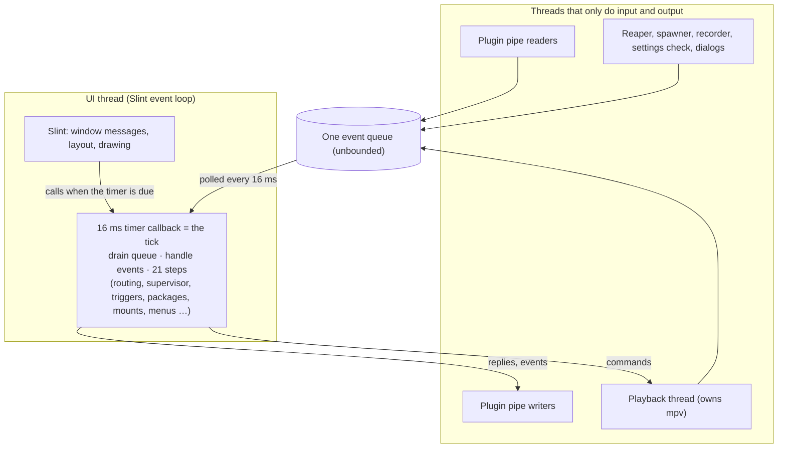
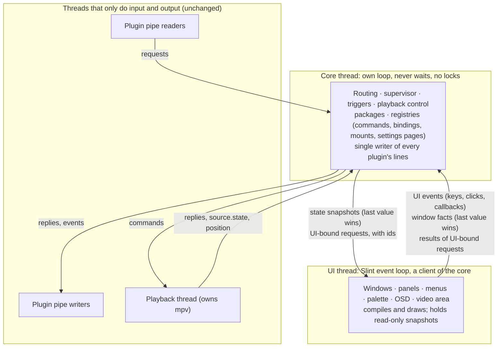

# The core thread (design)

**Status (2026-11-16): decided; partly built.** The split of `Host` on one thread is on main (plan steps S0–S2e: the `Core` struct, the messages, the UI-bound seam, one shared core turn); the "As built" notes below record it. The core does **not** run on its own thread yet: plan step S2f (the core's code leaves `Host`, [§5.3](#53-cross-access-inventory-after-s2)) comes first, then S3. Written 2026-11-15 by the API maintainer from the user's rulings of that day. Work starts when release A (SDK 1.10.0 / player 0.10.0) is on main. The execution plan is [core-thread-plan.md](../process/core-thread-plan.md). The source inventory behind the numbers is the study [core-loop-study.md](../process/research/core-loop-study.md) (called "the study" below). This file is the authority for the design; where the study recommends something else, this file wins.

**Process note (user ruling, 2026-11-15).** The work follows the pattern of SDK 1.10.0: this design and the plan are written by Fable; the implementation is by Opus 5.5; static review (diffs and source read against this design, no builds, no logs) is by Fable at medium effort; builds, test runs, `ci:local` and the V1/V2 verification are run by Opus, so that review tokens are not spent on build and test noise.

No code was written or built for this document. Measured values are quoted with where they were measured. Everything the study marked "(inferred)" is still inferred here.

**In one paragraph.** The host's core (plugin request routing, the supervisor, triggers, playback control, packages) is a single-threaded state machine that never waits. Today it runs inside a callback on Slint's UI thread, so it stops whenever anything else holds that thread: Slint compiling a window, Windows' own loop while a window is dragged, the graphics library waiting for the GPU. The decision is to give the core its own thread and make the UI thread one of its clients. A stalled interface then costs a frozen window, not stalled plugins, late triggers or lost playback control. No SDK change, no wire change, and the scheduling rules stay as they are.

**How to read it.** What was observed: [§1](#1-background-what-was-observed). How the core is driven today: [§2](#2-how-the-core-is-driven-today). What other projects do: [§3](#3-precedents). What was set aside: [§4](#4-options-considered). The rules: [§5](#5-the-decision); what still crosses the boundary in the code after stage S2: [§5.3](#53-cross-access-inventory-after-s2). What it buys: [§6](#6-what-a-ui-stall-costs-before-and-after). What can go wrong: [§7](#7-risks-and-open-points). How it is proven: [§8](#8-verification). Words: [§9](#9-glossary).

**How sources are written.** `P:` is the player repository, read on branch `evt-release-a` at `3100d94f` (release A before its last fixes); paths without a prefix directory are under `src/host/src/`. `L:` is local evidence on the development laptop, not in any repository.

## 1. Background: what was observed

### 1.1 The machine and the runs

The measurements are from the user's laptop on 2026-11-14 and 2026-11-15: internal panel driven by the AMD Radeon 780M, GPU rendering on the NVIDIA RTX 4070, so on the internal panel every presented frame crosses from one adapter to the other ("cross-adapter"). With an external screen driven by the NVIDIA adapter there is no crossing.

The user ran the portable builds of 0.7.6, 0.8.2 (the installed version), 0.8.4, 0.9.0 and the release A trial (0.10.0, `3100d94f`) by hand, each in an isolated profile with GPU rendering. All of them behave the same. **None of this is a regression of release A or of 0.9.0**; the installed 0.8.2 log shows the same lines for the days before.

| Evidence | Where |
| --- | --- |
| Host logs of each version, with the `ui stall:` lines | `L:C:\vestra\compare\profile-<version>\host.log`; the user's own 0.8.2 history in `L:C:\vestra\backup-profile-20261114-trial\Roaming-Vestra\logs\host.log` |
| Thread stacks taken automatically while the window did not answer (12 dumps, video playing) | `L:C:\vestra\compare\stacks-trial\` |
| The same with the video paused, ending in a lost device (6 dumps) | `L:C:\vestra\compare\stacks-trial-paused\` |
| The watcher that took them (asks the window every 0.2 s, dumps stacks after 1 s without an answer) | `L:C:\vestra\compare\watch.ps1`, started through `start.ps1` |
| Symbols for the trial build | `L:C:\vestra\compare\sym\` |

### 1.2 Three classes of stall

"Tick" is the host's 16 ms turn of work (§2). "UI thread" is the thread that runs Slint's event loop.

| Class | What holds the UI thread | Measured | Where the thread was |
| --- | --- | --- | --- |
| S1. Opening a tool window | Slint compiles the window's `.slint` file and creates it, synchronously, inside the request | 290–800 ms per open (Store 371–803 ms, About 257–453 ms, Workshop 430 ms); every open compiles again | `ui.open`: P:capabilities/ui_window.rs:78 → P:ui/view.rs:713 |
| S2. Dragging or resizing a window | Windows runs its own message loop inside `DefWindowProc` until the mouse button is released. Window messages still arrive, but winit's timers do not fire, so the tick does not run | "no tick" for 5–18 s in every version (for example 10,100 ms, 14,946 ms, 17,941 ms) | winit 0.30.13, the modal move/size loop |
| S3. Resizing on the cross-adapter path | The graphics library waits for the GPU on the UI thread | Three blocks of 5.6–5.9 s with identical stacks; with the video paused, repeated 1 s waits for 8.8 s, then `the GPU device was lost; restarting the player` | Slint `resize_event` → wgpu `Surface::configure` → `Device::maintain` (waits without a time limit for all submitted work) → `wgpu_hal::dx12::Device::wait`; and Slint draw → `Surface::get_current_texture` → `acquire_texture` (1 s timeout) |

Notes on S3:

- It appears only on the internal panel (cross-adapter). On the external screen the same code path returns quickly.
- It does not depend on video: it is worse with the video paused. The video render thread and the two fences shared with it are not the cause.
- wgpu has no 5 s constant. The likely release after about 5 s is Windows declaring the window hung after 5 s without message pumping ([IsHungAppWindow](https://learn.microsoft.com/en-us/windows/win32/api/winuser/nf-winuser-ishungappwindow)); that link in the chain is inferred, the stacks are not.
- Private memory rose from about 440 MB to about 1,750 MB across these stalls. No queue of ours is unbounded on that path (every per-frame post to the UI thread is coalesced); the likely cause is swap-chain buffers re-created on every size change and released only once the GPU queue drains (inferred).

### 1.3 What stops when the UI thread stalls

Everything the tick does, including work that has nothing to do with the interface:

| What stops | Seen as |
| --- | --- |
| Plugin requests (all 119 route entries) | `rpc player.audioDevices still waiting after 10 seconds`, `rpc ui.setMount still waiting after 10 seconds` in the plugin log during the 12–18 s gaps |
| Supervisor timers: standby after 30 s idle, start timeouts, wakes | Late by the length of the stall |
| Triggers: position reports and the `time` atom | Late; `on_demand_tick` runs the time atom from the tick (P:host/supervisor/mod.rs:1779) |
| Playback control from plugins and playback state to plugins | mpv itself is controlled off the UI thread (P:playback/backend.rs:1), but a plugin's command reaches the playback thread only through the tick, and `source.state` comes back only through the tick. Playback continues; plugins can neither control nor observe it |
| Video frames | The frame is handed to Slint and drawn on the UI thread (P:host/video.rs:433) |
| All windows | No repaint, no answer to clicks |

The core does not wait anywhere in this. It is held by the thread it lives on.

## 2. How the core is driven today

The host's state is one object, `Host` (P:host/mod.rs:338-598). It has two kinds of entry point: "handle one event" (`host.handle(event)`) and "do one periodic step" (the `*_tick` methods). Who calls them is outside the object, and there are two callers:

| Driver | Loop | Used for |
| --- | --- | --- |
| Windowed | Slint's event loop owns the thread. The host registers a repeating 16 ms `slint::Timer`; its callback drains the event queue (at least 128 events, then what a time budget allows) and runs 21 steps (P:main.rs:855-948) | Every real run |
| Headless | Our own loop: wait on the event queue for at most 10 ms, handle, run 8 steps (P:main.rs:676-730) | Offscreen tests |

Facts from the study (§0–§3 there, with file and line):

- `Host` has **130 fields** in 37 files: about 55 core, about 45 interface, about 30 used by both. Because some fields are Slint objects, the Rust compiler refuses to move the object to another thread (a type that may cross threads is called `Send`; one field that is not makes the whole object not `Send`, and the host forbids `unsafe`). The object has to be split before any part of it can run elsewhere.
- Everything reaches the host through **one queue** that the 16 ms timer polls. Nothing wakes the loop when an event arrives, so today a request waits 0–16 ms before it is handled even when nothing stalls.
- Every reply and event line to a plugin is produced on the UI thread. The only exceptions are request-limit refusals, written by the reader threads.
- The headless loop runs exactly the 8 core steps (activation, on-demand, power, diagnostics, packages, notifications, timeline, open files). It is the proof that the core runs without Slint's loop; the offscreen tests run it that way every day.

**The gap this document records.** Running the core on Slint's event loop was never a ruling. It was an early implementation choice: Slint objects can be touched only on Slint's thread, many plugin requests end in an interface change, so putting everything on that thread was the shortest path. It was never brought to the user as an architecture decision, and no architecture document states it as one. On 2026-11-15 the user called it a sword of Damocles: the core's "never waits" guarantee holds only for our own code, and any wait by Slint, the graphics library, a driver or the operating system on that thread voids it.

## 3. Precedents

Two research passes were made on 2026-11-15 (web and public source; the claims below are those the researcher could open and read).

### 3.1 Core logic on the UI loop, with one iron rule

| Project | What runs on the UI thread | The rule |
| --- | --- | --- |
| VS Code | Extensions run in a separate process, but the host-side RPC endpoint lives in the workbench, the renderer's UI thread ([extensionHostManager.ts](https://github.com/microsoft/vscode/blob/main/src/vs/workbench/services/extensions/common/extensionHostManager.ts), [extension host](https://code.visualstudio.com/api/advanced-topics/extension-host)). The closest analogue to today's Vestra | The peer is marked unresponsive after 3 s without an acknowledgement |
| Chromium | Service-worker lifecycle and timeout timers on the browser UI thread ([service_worker_version.cc](https://github.com/chromium/chromium/blob/main/content/browser/service_worker/service_worker_version.cc)); the extensions `ProcessManager` in the browser process | "Do not perform expensive computation or blocking IO on the main thread"; IPC arrives on a separate IO thread ([threading_and_tasks.md](https://chromium.googlesource.com/chromium/src/+/main/docs/threading_and_tasks.md)) |
| Zed | Foreground executor on the main thread, background executor elsewhere | "The main thread should never, ever block." ([blog](https://zed.dev/blog/zed-decoded-async-rust)) |
| Electron | The main process runs the UI thread | "Under no circumstances should you block this process and the UI thread" ([performance](https://www.electronjs.org/docs/latest/tutorial/performance)) |
| JetBrains IDEs | Writes only on the event dispatch thread, which "must be as fast as possible" ([threading model](https://plugins.jetbrains.com/docs/intellij/threading-model.html)) | A freeze watchdog runs off that thread and dumps stacks ([PerformanceWatcherImpl.kt](https://github.com/JetBrains/intellij-community/blob/master/platform/platform-impl/src/com/intellij/diagnostic/PerformanceWatcherImpl.kt)) |
| Kodi | The application thread is the GUI thread; other threads post messages to it ([ApplicationMessenger.cpp](https://github.com/xbmc/xbmc/blob/master/xbmc/messaging/ApplicationMessenger.cpp)) | A guard against waiting on itself |
| Celluloid | mpv events are processed on the GTK main loop ([celluloid-mpv.c](https://github.com/celluloid-player/celluloid/blob/master/src/celluloid-mpv.c)) | — |
| Figma | Plugins run on the main thread by design, for synchronous document access | The accepted cost: "When plugins freeze, it affects the perceived stability of Figma." ([blog](https://www.figma.com/blog/how-we-built-the-figma-plugin-system/)) |

So the design we have is common and defensible. Every project that keeps it enforces that nothing on that thread may wait. We cannot enforce that: the three stalls of §1.2 are in Slint, wgpu, the driver and Windows, not in our code.

### 3.2 Separated designs and what they cost

| Project | Structure | Cost they name |
| --- | --- | --- |
| mpv | The core is detached from any interface: "Not calling mpv_wait_event() will not stop playback". Synchronisation by two rules: property changes are coalesced ("only one event per changed property"), and commands are asynchronous with replies as events that "may be reordered" ([client.h](https://github.com/mpv-player/mpv/blob/master/include/mpv/client.h)) | A render thread waiting on a core API can "freeze the mpv core thread forever" (`render.h`) |
| mpv, 2014 | It hit our S2 exactly. Commit `97a82bcd` (2014-07-26), "win32: move window handling to a separate thread": "the message dispatcher won't return while the dragging is active, so mpv couldn't update the video at all." It moved the window message pump to its own thread and left the core and the renderer where they were; the dedicated GUI thread is still there (`video/out/w32_common.c`) | The author calls it "rough"; it needed a `WM_CLOSE` workaround |
| VLC | The Qt interface runs on its own thread, except on macOS where Cocoa forces the main thread ([qt.cpp](https://github.com/videolan/vlc/blob/master/modules/gui/qt/qt.cpp)) | A ready-barrier at start so the core does not start video before the window exists |
| IINA | A dedicated queue reads mpv events; processing hops to the main queue; queue overflow is a critical failure ([MPVController.swift](https://github.com/iina/iina/blob/develop/iina/MPVController.swift)) | — |
| Haruna / mpvqt | The mpv controller lives on a worker thread, driven by queued calls ([mpvabstractitem.cpp](https://github.com/KDE/mpvqt/blob/master/src/mpvabstractitem.cpp)) | — |

mpv's 2014 fix isolates the party that gets blocked (the window pump) instead of moving the core. We cannot do the same: Slint binds "receive window messages" and "draw the interface" to one thread. The equivalent for us is the reverse: leave Slint's thread to Slint and move what is not interface off it. Moving the core is this document; moving video is the independent video layer (§6.2). Both together give mpv's three threads: core, video, window.

### 3.3 Slint's own advice

"You should perform the minimum amount of work in the main thread and delegate the actual logic to another thread to avoid blocking animations", with `invoke_from_event_loop` to come back ([slint lib.rs, "Threading and Event-loop"](https://raw.githubusercontent.com/slint-ui/slint/master/api/rs/slint/lib.rs), [invoke_from_event_loop](https://docs.slint.dev/latest/docs/rust/slint/fn.invoke_from_event_loop)). By Slint's own documentation, today's structure is not the recommended use. No survey of larger open-source Slint applications was found.

### 3.4 Upstream state of the three stalls

| Stall | Upstream | State on 2026-11-15 |
| --- | --- | --- |
| S2 modal loop | winit [#3272](https://github.com/rust-windowing/winit/issues/3272) "`ControlFlow` is ignored while window is being resized on Windows", [#1484](https://github.com/rust-windowing/winit/issues/1484) (system menu / title bar freezes the event loop) | Both open. Slint [#5720](https://github.com/slint-ui/slint/issues/5720) open; [#5791](https://github.com/slint-ui/slint/issues/5791) closed as its duplicate, called "a bug in winit" |
| S3 configure wait | wgpu still calls `maintain(wait_indefinitely())` before configuring a surface | By design; no issue asks for its removal |
| S3 reconfigure on every resize event | Slint [#12730](https://github.com/slint-ui/slint/issues/12730) "Window resizing is laggy in release mode" (closed); [PR #12733](https://github.com/slint-ui/slint/pull/12733) "wgpu: defer swapchain reconfiguration to the next frame" | The PR was closed unmerged because it did not fix the Wayland case it was written for |
| S3 present mode | Slint [#8693](https://github.com/slint-ui/slint/issues/8693), where AutoVsync was hard-coded; a maintainer said "perhaps we can make it configurable" | Never done; no public setting |
| S3 `acquire_texture` 1 s waits | wgpu [PR #10511](https://github.com/gfx-rs/wgpu/pull/10511) "fix(dx12): fix 1 second hang for dropped `SurfaceTexture`s", merged 2026-11-14; [PR #10548](https://github.com/gfx-rs/wgpu/pull/10548) discards queued old-size frames after a resize | Merged, unreleased; reaches us only through a wgpu release and a Slint upgrade |

No report of the exact cross-adapter symptom was found in any project. A request to Slint is reasonable and was deferred by the user (2026-11-15: "the issue can wait, our problem is bigger").

## 4. Options considered

| Option | What it is | Why it was set aside |
| --- | --- | --- |
| A. Router thread | Only forwarding and keep-alive leave the UI thread | Little to gain. The shared runner's heartbeat already tolerates stalls. No request is a pure plugin-to-plugin forward: each of the 48 playback forwards touches host bookkeeping (standby accounting, activation tracking, `source.state` patching). A fast path would put a second writer on each plugin's pipe and break today's order. It ends up as a partial B (study §4.1) |
| **B. Core thread** | Supervisor, triggers, routing, playback control and packages on their own thread; the UI thread is a client | **Chosen** (§5). About 30–40 files and 5,000–10,000 changed lines, plus about 1,500 lines of messages (inferred) |
| C. Full split | All state on the core, the interface a thin mirror that applies diffs | 20,000–30,000 lines, a rewrite of the interface layer. Menu hover and palette typing would each take a round trip. No more resilient than B: a stalled interface cannot show anything in any design |
| Compile off-thread only | Compile `ui.open` and mount panels on a worker, as the settings check already does | Helps only S1. Does nothing for S2 and S3, the multi-second cases. Slint's compiled definitions hold `Rc` (single-thread reference counts), so only the check could move, not the result |
| Default adapter rule | At start, render on the adapter that drives the main window's screen, as mpv and Chromium effectively do; manual choice kept | A way around S3, not a fix: a user who selects the NVIDIA adapter on the internal panel still gets it, and the next cause of a wait on the UI thread is not covered. **Still planned as a separate item**, to keep the user's machine usable in the meantime |
| Keep-alive during the modal loop | A Win32 timer armed between `WM_ENTERSIZEMOVE` and `WM_EXITSIZEMOVE` posts the tick (branch `fix-modal-tick`, written, awaiting the user's manual check) | Removes S2 only. **Still planned as a separate item.** Under this design it stays useful for the interface side (content re-laid-out while dragging) |
| Per-plugin in-order queue | Keep today's order exactly: while a plugin has a UI-bound request unanswered, hold that plugin's later lines. Equivalent in effect to in-order delivery in selective-repeat ARQ or TCP: a resequencing buffer | Head-of-line blocking. One request stuck behind a frozen interface would hold every later request of that plugin, including those that never touch the interface. That brings back per plugin what the design removes globally. The study recommended it for the prototype (its §7 question 1); the user ruled against a queue |
| **Two independent streams** | As in QUIC: order inside a stream, none across streams, so one blocked stream does not hold the other | **Chosen** (rule R4). The order inside each stream comes for free from each thread handling its inbox in arrival order |

## 5. The decision

Rulings of the user, 2026-11-15, as numbered rules. "Core" is the new thread; "UI" is Slint's thread.

| No. | Rule |
| --- | --- |
| R1 | **The core has its own thread and its own loop.** It owns the plugin processes and the shared runner, the supervisor, triggers and conditions, request routing, playback control (the handle to the playback thread, `last_source`, the sequence), packages, timeline, session storage, power, and the notification bookkeeping. It stays single-threaded, lock-free and never waits |
| R2 | **The UI thread is a client of the core.** It owns the Slint objects and the windows: shell, views, panels, menus, palette, OSD timing, the video area, picture-in-picture, the settings window. It compiles, instantiates and draws. It decides nothing about plugins |
| R3 | **Two kinds of message cross between them, and nothing else.** (1) State snapshots: an immutable copy of a whole table or value; the receiver replaces what it had; several in a row collapse to the last ("last value wins"); no locks. (2) Requests and replies with ids, for work one side asks of the other |
| R4 | **Two streams per plugin, no ordering queue.** Requests that need the interface are carried out on the UI thread in arrival order. Requests that do not are carried out on the core in arrival order. There is no order between the two streams: the reply to a later UI-independent request may arrive before the reply to an earlier UI-bound one. Inside the UI-bound stream the order of execution is kept, not always the order of replies (§5.1, "Order inside the UI-bound stream") |
| R5 | **What a reply means (user ruling 2026-11-15).** For the UI-bound methods whose reply carries an interface result (10 in the ruling; 16 method names in the table of §5.1), the request is answered only when the UI thread has reported that result (after `ui.open` the view exists; after `ui.mount` the mount is ready; `ui.preparing` still precedes the `ui.mount` reply). For every other request that touches the interface (25 "reply independent" methods in the ruling; 22 method names in §5.1), a reply means the host has accepted and recorded the change; the interface shows it as soon as it can. This is what plugins could rely on before as well: a reply never meant the user had already seen the change. The move of `dialogs.open`, `dialogs.confirm`, `commands.run` (with a plan that asks) and `media.sources.locate` to the UI-bound set follows this rule's own definition (the reply carries an interface result: the user's answer); decided by the coordinator on 2026-11-15 and reported to the user. `layout.set` joins the UI-bound set for R13's reason (a read right after its reply must see the change; coordinator decision 2026-11-15, after the S2a review) |
| R6 | **Events and broadcasts keep the core's order.** The core is the single writer of every plugin's lines, as the UI thread is today. Side effects of a request are still sent before its reply; triggers that flip are still delivered before the state broadcast that flipped them |
| R7 | **A UI-independent request never waits for the UI.** This is the purpose of the change and a hard rule for every later addition: a new method that does not need the interface must not be routed through it |
| R8 | **The binding table and the command registry belong to the core.** The UI holds a read-only snapshot, replaced whole on every revision. Key callbacks on the UI thread look up the snapshot synchronously (Slint's key callback must answer "handled or not" at once and cannot wait for a round trip). Table updates and key events go through one queue on the UI side, so a key is never judged by a table older than the one that preceded it in that queue |
| R9 | **Facts the UI owns flow to the core as snapshots.** Window size, fullscreen, focus, layout and the menu state (`window_facts`) are sent by the UI when they change; the core evaluates conditions and triggers and broadcasts `window.state` from them |
| R10 | **Cadence in two steps.** First the core loop keeps today's fixed cadence, so that timing is unchanged and the differential checks can show zero difference. Then, as a separate merge, it handles each event when it arrives (the loop sleeps on its queue; a UI-independent request is answered in well under a millisecond instead of up to 16 ms). In the other direction the core wakes the UI with `invoke_from_event_loop`, not through the 16 ms timer |
| R11 | **No SDK change, no wire change, no change to the scheduling rules.** When a plugin starts, parks, wakes and is stopped is decided by the same supervisor rules ([supervisor.md](supervisor.md)); only the thread that runs them changes |
| R12 | **The readiness coupling is kept.** A plugin's run is ready only after its first `ui.open` / `ui.mount` was answered (P:host/dispatch.rs:118-144, P:host/supervisor/mod.rs:995-1030). A run that starts during an interface stall therefore becomes ready when the stall ends |
| R13 | **Handoff: state first, then the reply, then the broadcast** (from the plugin scan S0.3, 2026-11-15). For a UI-bound request, the core handles the UI's report in this order: (1) apply the state the report carries to the core's copy: the window facts snapshot (with the picture-in-picture `active` flag that `window.state` reports, host/state.rs:219, 225-228), the mount record and the tab order in the window facts; (2) send the reply; (3) broadcast what changed (`window.state`). A request the plugin sends after the reply therefore reads the new state. Facts reach the core both as snapshots and inside these reports, so they carry a sequence number from one counter on the UI side, and the core applies a facts value only when it is newer than the last one applied: coalescing a newer snapshot in place, ahead of an older report, never moves the core's copy backwards (`host/messages.rs`). The wire order (reply, then `window.state`) is today's: `window_tick` answers the video area (host/window.rs:301) before it replaces `window_facts` and broadcasts `window.state` (:308-311), so the differential checks stay equal. Only the core's copy is updated earlier than today, which no line on the wire shows. **Exception: `layout.set` (coordinator ruling 2026-11-15, from the S2d spec tests).** Today its `window.state` broadcast, already showing the change, goes out *before* its reply: the layout pass it runs before answering (capabilities/ui_mount.rs:888-889) measures the facts and broadcasts them in place. That order stays, in S2 and through S3a (no wire change); a read after the reply sees the change all the same |

**Evidence for R13**, all in code that awaits correctly:

1. The SDK's `plugin/view/panel.ts:52-63` calls `layout.state` right after `await ui.mount`: the core's mount and layout record must be updated before the `ui.mount` reply goes out.
2. `plugin/window.ts:137-138` reads `window.state` right after `await window.setVideoArea`; the Window plugin's Mini Size compares it (`window/size.ts:31-34, 92-96`).
3. `plugin/window.ts:158-159` does the same after `window.setPictureInPicture` (`window/pip.ts:62`).
4. (The exception to R13's wire order: see R13.) The SDK's `layout.js:100-101` reads `layout.state` right after `await layout.set`; today the host runs a layout pass before answering for exactly this (capabilities/ui_mount.rs:888-889). So `layout.set` is UI-bound (row 46): the UI applies it, runs the pass and reports the facts with the new tab order; the core applies them, then answers (added after the S2a review, coordinator decision 2026-11-15).

**The loop in R10's first step (decided for plan S3a, 2026-11-16).** "Today's fixed cadence" is not one thing: the windowed driver polls on a 16 ms timer, the headless driver waits on its queue for at most 10 ms. On two threads the windowed core loop runs on a fixed 16 ms period of its own and is not woken by events; the headless loop is unchanged (no interface, no second thread). The interface keeps its own 16 ms timer for its own steps and is woken for commands by `invoke_from_event_loop`. The two periods are not synchronised, so until R10's second step a UI-bound reply can leave up to one core period later than today (the core issues in one turn and answers in the next). That is measured in S3a; it is not a change of order.

**The 1 s timeout of `window.setVideoArea` (the S3a target; S2 keeps today's behaviour, see "As built in plan step S2d(1)" below).** The reply is due when the layout shows the size or when its deadline (request time + 1000 ms, host/state.rs:298) passes (:304). When the UI reports the fitted size, the core first checks the facts it already has: if they show the size already, it answers at once rather than waiting out the deadline. On the timeout path R13 holds for the state the core has, not for the size asked: the core applies the last window facts snapshot it received, then sends the reply (with the size the host computed, as today), and `window.state` reads that snapshot, which may still show the old size. That is today's behaviour too.

**As built in plan step S2d(1).** `window.setVideoArea`: the core checks the size and sends `WindowOp::VideoArea`; the interface fits the window and reports `UiReport::AreaFitted` (the core keeps the reply with its deadline, `Core::area_replies`) or the error as `UiReport::Answered`; each window tick reports the size its layout shows, after the bar, the columns and fullscreen changed it, as `UiReport::VideoArea` (last value wins), and the core answers the replies that size shows or whose second is up. The facts are not used for this: the window tick measures them before that layout, so answering from them would move each reply a tick later. Not checked at receipt either (today the reply waits for the next tick even when the size already shows); answering at once is S3a's choice. `UiReport::VideoArea` is sent before the tick's `WindowFacts`, so the reply still precedes `window.state`. The deadline runs on the interface's tick (`now` in the report), as today; on two threads S3a checks it on the core's own clock. `window.setPictureInPicture`: `WindowOp::Pip`, answered with `UiReport::Answered` **without a handoff**: `window.state` reads the interface's live PiP state on one thread, and a handoff carrying the new `active` flag would broadcast `window.state` with the reply, earlier than today's window tick. R13's handoff of the flag (the core's own copy, read by `window.state`) is S3a's. Offscreen runs have no native window and refuse both at once, so cases 2 and 3 and the timeout path are covered by unit tests of the seam (host/state.rs `seam_tests`), not by the offscreen spec tests.

**Open for S3a (from the S2d(1) review):** (1) answering `AreaFitted` at once when the core's copy already shows the size, as the paragraph above describes, is a wire timing change (the reply moves up to a tick earlier) and needs a ruling before it is built; (2) the deadline moves to the core's clock: receipt + 1000 ms measured on the interface's tick includes a UI stall, so on two threads the core checks it itself; (3) `UiReport::VideoArea` is sent every window tick, about 60 a second across the threads once they are two: send it only when the size changed or while a reply is pending; (4) the PiP `active` flag in `setPictureInPicture`'s handoff (R13 case 3), with `window.state` reading the core's copy. From the S2d(2) review: (5) a stale `UiReport::Batching(None)` from the previous window can clear the core's record after the next hand-over, so `Batching` needs a hand-over sequence number (or the interface alone asks for hand-overs); (6) a late `UiCommand::CancelMount` arriving after the window closed and the id 0 removal was applied needs a rule; (7) a failed batch puts its changes back with `push_front` into `Core::mount_queue` (host/mounts.rs, `prepare_mount_tick`), an interface write to core data.

**Test target (plan S2d on one thread, S3a on two):** for each of the four cases, the request followed at once by the read returns the post-change state, and the wire shows the reply before the `window.state` broadcast; for the timeout path, the reply and a read give the last reported state.

### 5.1 Which requests are in which stream

From the study's inventory of the 119 route entries (its §2.2, with every method named). The summary as the study had it; the method table below (plan S0.2) is the authority where they differ:

| Stream | Count | What |
| --- | --- | --- |
| UI-independent, forwarded to the playback thread | 48 | `source.*`, `playback.*`, `player.*`, `subtitles.*`, `processing.*`, `video.*`, `mpv.*`, `media.sources.*`, `snapshot.*`, `jobs.*`, `producer.*`, `sourceResolvers.*` |
| UI-independent, answered by the core | 36 | `triggers.*`, `events.*`, `timeline.*`, `sequence.*`, `storage.session.*`, `packages.*`, `secrets.*`, `system.*`, `rendering.*`, `commands.keys/list`, `drops.*`, `window.state`, `power.preventSleep`, and others |
| Touches the interface, but the reply does not depend on its result | 25 | `osd.*`, `appearance.set`, `commands.register/update/unregister`, `bindings.*`, `layout.*`, `ui.interaction`, `ui.menu`, `window.setAlwaysOnTop`, `palette.lead.*`, `commands.run`, `dialogs.*`, `host.run`, `app.system`, `clipboard.*` |
| **UI-bound: the reply depends on an interface result** | 10 | `ui.open`, `ui.set`, `ui.show`, `ui.close`, `ui.mount`, `ui.unmount`, `ui.setMount`, `settings.*`, `window.setVideoArea`, `window.setPictureInPicture` |

The reply-independent methods are answered by the core as soon as its own part is done (registry write, snapshot sent); the interface catches up when it can (R5, K13). Which of them stay there and which join the UI-bound stream is settled method by method in the table below.

#### The method table (plan S0.2)

Read on player 0.10.0 (tag `v0.10.0`, `c3f8ebea`). **Route count: 119**, the same as the study: 32 areas in `capabilities::ALL` (`capabilities/mod.rs:207-240`) with 107 names, plus 12 names of `capabilities/uncapable.rs:6-21`; 112 exact names and 7 `prefix.*` entries (`snapshot.*`, `jobs.*`, `media.sources.*`, `packages.*`, `sourceResolvers.*`, `subtitles.*`, `settings.*`). The router is `capabilities::lookup` (`mod.rs:300-308`), called from `Host::dispatch` (`host/dispatch.rs:149-196`) after the start-up gates of `host/handle.rs:68-105`. Files below are under `src/host/src/capabilities/` unless a directory is named. The table has one row per route entry, except the two prefix entries whose names differ in stream: `media.sources.*` (rows 65a–65e) and `settings.*` (rows 83a–83d) have one row per name. So it has **126 rows for the 119 entries**.

Columns. **Today**: F = forwarded to the playback worker, answered later by `Event::Reply`; C = core only; U = touches the interface, reply independent of it; R = the reply needs an interface result. **Stream** (rule R4): I = UI-independent, answered by the core (or the worker) without waiting for the UI; B = UI-bound. **UI work**: what the core sends to the UI under the design, as a `UiCommand` kind (names from study §4.2, regrouped in plan S2a), and when the reply leaves. "Snapshot" kinds are last-value-wins (R3). A dash: no UI work.

| # | Entry | Handler | Today | Stream | UI work (`UiCommand`) · reply |
| --- | --- | --- | --- | --- | --- |
| 1 | `producer.prepare` | producer_av.rs:31 | F | I | — · worker |
| 2 | `producer.state` | producer_av.rs:31 | F | I | — · worker |
| 3 | `producer.release` | producer_av.rs:31 | F | I | — · worker |
| 4 | `producer.ack` | producer_av.rs:31 | F | I | — · worker |
| 5 | `producer.declareInput` | producer_av.rs:31 | F | I | — · worker |
| 6 | `producer.ackInput` | producer_av.rs:31 | F | I | — · worker |
| 7 | `source.state` | playback_read.rs:37-40 | F | I | — · worker; sequence flags patched by the core (host/handle.rs:223-229) |
| 8 | `processing.state` | playback_read.rs:40 | F | I | — · worker |
| 9 | `playback.stats` | playback_read.rs:40 | F | I | — · worker |
| 10 | `player.chapters` | playback_read.rs:40 | F | I | — · worker |
| 11 | `player.audioDevices` | playback_read.rs:40 | F | I | — · worker |
| 12 | `timeline.marks` | playback_read.rs:33 | C | I | — · at once |
| 13 | `playback.set` | playback_control.rs:152 | F | I | — · worker |
| 14 | `source.submit` | playback_control.rs:152 | F | I | — · worker |
| 15 | `source.operation` | playback_control.rs:152 | F | I | — · worker |
| 16 | `audio.addTrack` | playback_control.rs:152 | F | I | — · worker |
| 17 | `audio.selectTrack` | playback_control.rs:152 | F | I | — · worker |
| 18 | `player.setLoop` | playback_control.rs:152 | F | I | — · worker |
| 19 | `player.setAudioDevice` | playback_control.rs:152 | F | I | — · worker |
| 20 | `player.step` | playback_control.rs:152 | F | I | — · worker |
| 21 | `player.setStepSeek` | playback_control.rs:55; host/actions.rs:206-219 | U | I | `Registry` snapshot when the step changes (the seek commands' titles are re-registered) · at once |
| 22 | `power.preventSleep` | playback_control.rs:72 | C | I | — · at once (`power` on the core, K10) |
| 23 | `sequence.set` | playback_control.rs:79 | C | I | `Osd` on a refusal (note 3) · at once; start-up gate (note 6) |
| 24 | `sequence.step` | playback_control.rs:109 | C | I | — · at once |
| 25 | `sourceResolvers.register` | source_resolve.rs:74 | F | I | `Osd` on a taken refusal (note 3) · worker; start-up gate (note 6) |
| 26 | `sourceResolvers.unregister` | source_resolve.rs:74 | F | I | — · worker; start-up gate (note 6) |
| 27 | `sourceResolvers.respond` | source_resolve.rs:69 | F | I | — · worker |
| 28 | `sourceResolvers.*` | source_resolve.rs:77 | C | I | — · at once (`unsupported`; note 2) |
| 29 | `events.subscribe` | events.rs:168 | C | I | — · at once |
| 30 | `events.unsubscribe` | events.rs:168 | C | I | — · at once |
| 31 | `commands.register` | commands.rs:120, 126 | U | I | `Registry`, `Bindings` snapshots · at once |
| 32 | `commands.update` | commands.rs:120, 126 | U | I | `Registry` snapshot · at once |
| 33 | `commands.unregister` | commands.rs:108 | U | I | `Registry`, `Bindings` snapshots (open menu refreshed from them) · at once |
| 34 | `host.run` | commands.rs:90; host/actions.rs:263 | U | I | `WindowOp::Fullscreen` (toggle) · at once; playback actions: worker, `Osd` from the result (note 4) |
| 35 | `commands.keys` | commands.rs:107 | C | I | — · at once |
| 36 | `ui.open` | ui_window.rs:37, 44 | R | B | `ViewOp::Open` · after the UI reports the view created or the compile error; readiness (note 5) |
| 37 | `ui.set` | ui_window.rs:38, 103 | R | B | `ViewOp::Set` · after the UI wrote it |
| 38 | `ui.show` | ui_window.rs:38, 103 | R | B | `ViewOp::Show` · after the UI showed it |
| 39 | `ui.close` | ui_window.rs:38, 103 | R | B | `ViewOp::Close` · after the UI closed it |
| 40 | `ui.mount` | ui_mount.rs:160, 281 | R | B | `MountChange` · after `MountApplied`, `ui.preparing` first; readiness and start-up gate (notes 5, 6); R13 |
| 41 | `ui.setMount` | ui_mount.rs:164, 538 | R | B | `SetMount` · after the UI wrote it |
| 42 | `ui.unmount` | ui_mount.rs:160, 281 | R | B | `MountChange` · after `MountApplied`; start-up gate (note 6) |
| 43 | `ui.interaction` | ui_mount.rs:165, 701 | U | I | `LayoutOp::Locks` (ordered; panel locks) · at once |
| 44 | `ui.menu` | ui_mount.rs:166, 735 | U | I | `PanelMenu` · at once; refusals judged on the last window facts; today's property error kept (note 7) |
| 45 | `layout.state` | ui_mount.rs:167; host/state.rs:322 | C | I | — · at once, from the window facts snapshot (note 1) |
| 46 | `layout.set` | ui_mount.rs:168, 819 | R | B | `LayoutOp::Set` (ordered) · after the UI applied it and reported the facts with the tab order (today: after a layout pass, ui_mount.rs:888-889); refusals the core can judge at once; R13, with its exception: today's `window.state` broadcast of the pass goes before the reply and stays there (R13) |
| 47 | `dialogs.open` | ui_dialog.rs:51, 167 | R | B | `Dialog` · on the user's choice (`DialogDone`); refusals at once (note 8) |
| 48 | `dialogs.confirm` | ui_dialog.rs:50, 60 | R | B | `Confirm` or `Review` · on the user's answer (`ConfirmDone`); refusals at once (note 8) |
| 49 | `packages.*` | plugins_manage.rs:25-31 | C | I | `RevokeOwner` when a plugin stops (K3) · at once, or from the operation / validation thread |
| 50 | `processing.replace` | processing_video.rs:45 | F | I | — · worker |
| 51 | `processing.operation` | processing_video.rs:49 | F | I | — · worker |
| 52 | `video.view.set` | processing_video.rs:72 | F | I | — · worker |
| 53 | `video.view.release` | processing_video.rs:72 | F | I | — · worker |
| 54 | `video.render.set` | processing_video.rs:59 | F | I | — · worker |
| 55 | `video.render.release` | processing_video.rs:68 | F | I | — · worker |
| 56 | `video.shaders.set` | processing_video.rs:50 | F | I | — · worker |
| 57 | `subtitles.state` | subtitles_read.rs:24 | F | I | — · worker |
| 58 | `subtitles.*` | subtitles_control.rs:26 | F | I | — · worker |
| 59 | `snapshot.state` | media_read.rs:24 | F | I | — · worker |
| 60 | `jobs.state` | media_read.rs:24 | F | I | — · worker |
| 61 | `jobs.operation` | media_read.rs:24 | F | I | — · worker |
| 62 | `snapshot.*` | media_control.rs:35-37 | F | I | — · worker |
| 63 | `jobs.*` | media_control.rs:35-37 | F | I | — · worker |
| 64 | `media.sources.open` | media_sources.rs:40-44 | F | I | — · worker |
| 65a | `media.sources.*`: `remember` | media_sources.rs:40-44 | F | I | — · worker |
| 65b | `media.sources.*`: `get` | media_sources.rs:40-44 | F | I | — · worker |
| 65c | `media.sources.*`: `locate` | media_sources.rs:40-44; playback/media_sources.rs:1176-1183 | R | B | `Dialog` · worker, after the user's choice (note 9) |
| 65d | `media.sources.*`: `forget` | media_sources.rs:40-44 | F | I | — · worker |
| 65e | `media.sources.*`: `list` | media_sources.rs:40-44 | F | I | — · worker |
| 66 | `osd.show` | ui_osd.rs:47, 54 | U | I | `Osd` · at once |
| 67 | `osd.panel` | ui_osd.rs:48 | U | I | `InfoPanels` snapshot · at once |
| 68 | `clipboard.readText` | clipboard.rs:27 | U | I | — · from a worker thread (note 10) |
| 69 | `clipboard.writeText` | clipboard.rs:27 | U | I | — · from a worker thread (note 10) |
| 70 | `clipboard.writeImage` | clipboard.rs:27 | U | I | — · from a worker thread (note 10) |
| 71 | `window.setVideoArea` | window_control.rs:50; host/state.rs:232-309 | R | B | `WindowOp::VideoArea` · when the window facts show the size, or after 1 s; R13 |
| 72 | `window.setAlwaysOnTop` | window_control.rs:54; host/state.rs:192 | U | I | `WindowOp::OnTop` · at once (errors are only logged today) |
| 73 | `window.setCursorAutoHide` | window_control.rs:66; host/window.rs:284-289 | U | I | cursor mode snapshot (the UI hides the pointer from it) · at once |
| 74 | `window.setPictureInPicture` | window_control.rs:65; host/video.rs:291 | R | B | `WindowOp::Pip` · from the PiP state machine; R13 |
| 75 | `bindings.list` | bindings_manage.rs:25; binding_manager.rs:94 | C | I | — · at once (note 1) |
| 76 | `bindings.set` | bindings_manage.rs:25; binding_manager.rs:95 | U | I | `Bindings` snapshot (open menu refreshed from it) · at once |
| 77 | `bindings.reset` | bindings_manage.rs:25; binding_manager.rs:113 | U | I | `Bindings` snapshot · at once |
| 78 | `timeline.set` | timeline_marks.rs:37 | C | I | — · at once |
| 79 | `timeline.setRanges` | timeline_marks.rs:37 | C | I | — · at once |
| 80 | `drops.provide` | ui_drop.rs:60 | C | I | — · at once |
| 81 | `drops.withdraw` | ui_drop.rs:60 | C | I | — · at once |
| 82 | `drops.listen` | ui_drop.rs:60 | C | I | — · at once |
| 83a | `settings.*`: `register` | ui_settings.rs:57; ui/settings_window.rs:557-599 | U | I | `SettingsOp` after the answer (open window updated) · after the `settings-check` thread (note 11) |
| 83b | `settings.*`: `unregister` | ui/settings_window.rs:600-629 | U | I | `SettingsOp` (open window rebuilt) · at once |
| 83c | `settings.*`: `set` | ui/settings_window.rs:630-705 | R | B | `SettingsOp` · after the UI wrote it into the open window (note 11) |
| 83d | `settings.*`: `show` | ui/settings_window.rs:706-721 | R | B | `SettingsOp` · after the UI opened the window |
| 84 | `appearance.set` | ui_theme.rs:25; ui/theme.rs:228 | U | I | `Theme` · at once |
| 85 | `appearance.setLanguage` | ui_theme.rs:26; ui/theme.rs:266 | C | I | — · at once |
| 86 | `secrets.get` | secrets.rs:24; system.rs:155 | C | I | — · from the `system-request` thread |
| 87 | `secrets.set` | secrets.rs:24; system.rs:155 | C | I | — · from the `system-request` thread |
| 88 | `secrets.delete` | secrets.rs:24; system.rs:155 | C | I | — · from the `system-request` thread |
| 89 | `rendering.setPreference` | rendering_manage.rs:26; host/rendering.rs:316 | C | I | — · at once |
| 90 | `rendering.restart` | rendering_manage.rs:26; host/rendering.rs:326 | C | I | `WindowOp::Quit` after the reply · at once. As built in plan step S2d(4): the host's own `quit` command sends `WindowOp::Quit` after the core stopped the handoffs and wrote the state file, so the state file is now written before the GPU waits are released (and the handoffs stop before that release too); `rendering.restart` keeps its own quit after the reply (`invoke_from_event_loop`, safe from any thread) |
| 91 | `video.upscaling.state` | video_upscaling.rs:34 | F | I | — · worker |
| 92 | `video.upscaling.set` | video_upscaling.rs:34 | F | I | — · worker |
| 93 | `video.motion.state` | video_motion.rs:33 | F | I | — · worker |
| 94 | `video.motion.set` | video_motion.rs:33 | F | I | — · worker |
| 95 | `commands.list` | commands_run.rs:911 | C | I | — · at once |
| 96 | `commands.run` | commands_run.rs:924, 701 | R | B | `Review` when the plan asks · `{ran:true}` at once when nothing asks, else on the user's answer (note 8) |
| 97 | `palette.lead.set` | palette_lead.rs:409 | U | I | `Lead` (palette row, strip) · at once |
| 98 | `palette.lead.clear` | palette_lead.rs:413 | U | I | `Lead` · at once |
| 99 | `palette.lead.done` | palette_lead.rs:416 | C | I | — · at once (note 1) |
| 100 | `mpv.command` | mpv.rs:74 | F | I | — · worker |
| 101 | `mpv.get` | mpv.rs:74 | F | I | — · worker |
| 102 | `mpv.set` | mpv.rs:74 | F | I | — · worker |
| 103 | `mpv.observe` | mpv.rs:74 | F | I | — · worker |
| 104 | `mpv.unobserve` | mpv.rs:74 | F | I | — · worker |
| 105 | `triggers.set` | triggers.rs:40 | C | I | — · at once |
| 106 | `triggers.off` | triggers.rs:57 | C | I | — · at once |
| 107 | `triggers.declare` | triggers.rs:67 | C | I | — · at once |
| 108 | `packages.list` | uncapable.rs:25 | C | I | — · at once |
| 109 | `window.state` | uncapable.rs:26; host/state.rs:213 | C | I | — · at once, from the window facts snapshot (R9) |
| 110 | `system.reveal` | uncapable.rs:37; system.rs:143 | C | I | — · from the `system-request` thread |
| 111 | `system.openPath` | uncapable.rs:37; system.rs:147 | C | I | — · from the `system-request` thread |
| 112 | `system.openUrl` | uncapable.rs:37; system.rs:151 | C | I | — · from the `system-request` thread |
| 113 | `app.system` | uncapable.rs:37; system.rs:186-203 | U | I | — · from the `system-request` thread, displays from a `Displays` report (note 10) |
| 114 | `ui.markdownScan` | uncapable.rs:27; ui/ui_markdown.rs:658 | C | I | — · at once |
| 115 | `storage.session.get` | uncapable.rs:29 | C | I | — · at once |
| 116 | `storage.session.set` | uncapable.rs:29 | C | I | — · at once |
| 117 | `storage.session.delete` | uncapable.rs:29 | C | I | — · at once |
| 118 | `storage.session.keys` | uncapable.rs:29 | C | I | — · at once |
| 119 | `rendering.state` | uncapable.rs:28 | C | I | — · at once |

**Totals.**

| Today | Count | Stream |
| --- | --- | --- |
| F, forwarded to the playback worker | 50 | I |
| C, core only | 38 | I |
| U, touches the interface, reply independent | 22 | I (answered by the core at once, R5 / K13) |
| R, reply needs an interface result | 16 | B |
| **All rows** | **126** | **110 I, 16 B** |

By route entry (119): 104 entries are wholly I, 13 wholly B (`ui.open`, `ui.set`, `ui.show`, `ui.close`, `ui.mount`, `ui.setMount`, `ui.unmount`, `layout.set`, `window.setVideoArea`, `window.setPictureInPicture`, `dialogs.open`, `dialogs.confirm`, `commands.run`), and 2 are split by name (`media.sources.*`: 4 names I, `locate` B; `settings.*`: `register` and `unregister` I, `set` and `show` B). Check: 104 + 13 + 2 = 119 entries; 104 + 13 + 5 + 4 = 126 rows.

The study had 48 / 36 / 25 / 10 over 119 entries. The differences, each from the source:

| Entry | Study | Here | Evidence |
| --- | --- | --- | --- |
| `sourceResolvers.*` | F | C | The prefix entry reaches only names other than `register`/`unregister`/`respond`, and those are refused `unsupported` at once (source_resolve.rs:77); nothing is forwarded |
| `layout.state`, `bindings.list`, `palette.lead.done` | U | C | Pure reads or bookkeeping: `layout_state` reads `window_facts`, the panel policy and mounts (host/state.rs:322-360); `bindings_list` reads the binding table (binding_manager.rs:142); `done` drops a ticket (commands_run.rs:202). None touches a Slint object |
| `dialogs.open`, `dialogs.confirm`, `commands.run` | U | R | The reply carries the user's answer, collected by an interface element (note 8) |
| `layout.set` | U | R | It runs a layout pass before answering so that a following `layout.state` sees the change (ui_mount.rs:888-889), and the SDK reads right after it (R13, evidence 4) |
| `media.sources.locate` | F | R | The reply waits for a file dialog's choice (note 9); the same criterion as `dialogs.open` |
| `settings.*` | R | split | `register` and `unregister` do not wait for the UI; `set` and `show` do (note 11) |
| `player.setStepSeek`, `window.setCursorAutoHide` | C | U | The first re-registers the host's seek commands, whose titles the menus show (host/actions.rs:206-219); the UI hides the pointer from the second (host/window.rs:284-289). Both answer at once |

**Notes.**

1. *Core-only reads of shared tables.* `layout.state`, `bindings.list` and `window.state` read tables the design gives to the core (R8) or mirrors the UI feeds (R9). They answer from the core's copy at once, as today they answer from the mirror.
2. *`sourceResolvers.*`.* The prefix entry exists in the area's list but its handler accepts only the three exact names, which are routed before the prefix. It answers every other name with a refusal on the core.
3. *OSD side effects of core refusals.* `sequence.set` refused as taken, and a `resolver-taken` reply rewritten in `respond` (the worker's refusal of `sourceResolvers.register`, playback/source_resolvers.rs:203), call `refuse_taken` → `show_osd` (host/dispatch.rs:55-71, 97-115). The reply does not wait for it: the core sends `Osd` and answers.
4. *`host.run`.* `fullscreen` is a window command: today `window_command` toggles the shell window and answers `true` if one exists (host/actions.rs:269-277, 531-543); under the design the core answers from "a shell exists" and sends `WindowOp::Fullscreen`. `previous`/`next` send `sequence.step` to the provider and answer at once (:286-298). The other 12 actions go to the worker as `host.action` and are answered from `Event::ActionDone`, which may also show an OSD (:308-342).
5. *Readiness coupling (R12).* For `ui.open` and `ui.mount` of a run whose activation is `Pending`, `handle.rs:68-87` calls `activation_ui_begin`/`activation_ui_wait` and `ui_begun`; `respond` takes it back (`activation_ui_take`, `activation_ui_finish`, host/dispatch.rs:118-131) and, after the reply line, calls `ui_finished` (:142-144) → `became_ready` (host/supervisor/mod.rs:1002-1030). **Mapping:** begin, wait, take, finish and `ui_finished` stay on the core with the supervisor; the UI's part is only the result (`UiReport` of the view, `MountApplied`). The core answers from that report in today's order: the reply, then `ui_finished`. During a UI stall the run stays `Pending` and becomes ready when the report arrives, as R12 says. Nothing of the supervisor moves to the UI.
6. *Start-up gate (held mounts).* On a windowed run, `ui.mount`, `ui.unmount`, `sequence.set`, `sourceResolvers.register` and `sourceResolvers.unregister` of a plugin that is not built-in are held while any built-in is still starting (`builtins_starting`: packages not started, a built-in's first run queued, or a built-in's activation `Pending`), and after that behind any earlier held request of the same plugin (host/handle.rs:88-105, ui/slot_claims.rs:73-75, packages/package_manager.rs:1308-1327). They are released in order by `release_held_mounts` (host/dispatch.rs:18-28). A built-in's `Pending` ends only when its first `ui.open`/`ui.mount` was answered (note 5), so during start-up **three UI-independent methods can wait, indirectly, for a built-in's interface result**. This is a scheduling rule (built-ins claim the sequence, resolvers and slots first), not a route through the interface: the gate stays on the core and reads core state. R7 is not broken, and R11 keeps the rule as it is. It is listed so the stall test does not count it as a violation at start-up.
7. *`ui.menu`.* Its refusals read `window_facts["slots"]`, the floating window's owners and the active tab (ui_mount.rs:784-806). Under the design they read the core's last window facts snapshot (R9), which can be a frame older than the UI. The UI drops a `PanelMenu` whose generation is gone, as `window_for(generation)` does today. Today's error path is kept: a failure to set `menu-origin-x`/`-y` on the window is the reply's error (ui_mount.rs:806-813). These are fixed properties of the host's own shell component, so the core decides it from the shell's compiled definition (a fact the UI reports once per shell generation, with the window facts) and answers at once with the same error; a failure of the write itself on the UI is logged.
8. *Replies that carry the user's answer (moved to B).* `dialogs.open` replies with the paths the user chose (`DialogDone`, host/handle.rs:512); `dialogs.confirm` with `{confirmed, checked}` (`ConfirmDone`, :470-475, or the sheet's answer); `commands.run`, when its plan asks, with the answer on the approval sheet (`CommandRunAnswered`, :466-469; commands_run.rs:747-772). These answers are interface results, so by R5's own definition the three are UI-bound. **No behaviour changes:** they are already answered by a later event today, and a later request of the same plugin is already answered before them. The core keeps the admission: the headless refusal, `dialog_busy`, `sheet_waiting`, the ticket and rate checks are core state and are refused at once; only the dialog or sheet and its answer are the UI's. `commands.run` with nothing to ask answers `{ran:true}` at once from the core.
    **As built in S2c(5).** `dialog_busy`, `confirm_open`, `origins` and `lead` are `Core` fields. The core admits `dialogs.open`, `dialogs.confirm`, `media.sources.locate` and `commands.run`, translates the texts and chooses the window; the interface creates the picker (`Dialog`), shows the system confirmation (`Confirm`, whose failure to show comes back as `UiReport::Answered` marked `confirm_failed` and clears both flags) or the sheet (`Review`, typed: the caller's options and request, or the plan's steps). A sheet's confirmation answers through `UiReport::Answered`; the user's acts reach the core as `UiReport::Acted`. The policy stays the interface's: it reports its tabs (the two columns' order and the bottom bar's panel) with the window facts, also when only they changed (`report_tabs`, at every change outside the window tick), and the core judges `ui.interaction`'s locks and `layout.set`'s refusals before any step took effect from that copy; a `layout.set` step refused after an earlier one took effect is answered by the interface, as before. Two orders inside the host changed and no line on the wire shows them: a system confirmation's flags are set, and the physical input is revoked for the dialog (`producer-audio`), before its owning tool window is raised (both were after). A confirmation that fails to show answers with `UiReport::Answered` marked `confirm_failed`, which alone clears the flags (not matched by reply: a plugin may repeat an id).

    **Carried forward to S2d/S3a.** Still read or written in place across the split: the sheet (`review`) stays the interface's, and the core reads `sheet_waiting` / `confirm_waiting` for admission and `Busy::Dialog` (S3a needs the sheet's open state as a UI fact, or the core's own record with a "sheet ended" report); the window choice of `dialogs.confirm` reads the interface's windows and the focus (`confirm_route`); `show_waiting_confirmation` and the `policy.activity()` of the dialog answers are interface work called from the core; `ui.interaction` reads `restarts.waiting`; `layout.set` and the Sidebar toggle write `Mount::visible` in the core's registry; the interface reads `Core::lead`, `Core::dialog_busy` and `Core::command_runs` for drawing.

9. *`media.sources.locate`.* One of the six names behind `media.sources.*` (media_sources.rs:21-28). The worker answers it by asking for the file dialog (`Event::SourceLocate`, playback/media_sources.rs:1176-1183); the dialog's choice goes back to the worker (`owner.sourceLocated`, host/handle.rs:476-510), which then replies. Under the design the core receives `SourceLocate`, sends `Dialog`, and forwards the choice to the worker. The reply carries the user's choice, as `dialogs.open`'s does, so `locate` is UI-bound (row 65c; coordinator decision 2026-11-15). The other four names behind the prefix, and `media.sources.open`, stay I.
10. *Replies made on the UI thread today, but not interface results.* `app.system` reads the displays from the live winit window, "on the UI thread, where the windows live" (system.rs:187-192; platform/windows.rs:1250-1270; on macOS `NSScreen` is main-thread only, platform/macos.rs:763-769). The `Displays` report of study §4.2 is a UI fact like those of R9: the UI sends it when it changes, and the core answers from its copy. `clipboard.*` runs `arboard` (Windows) or `NSPasteboard` (macOS) where it is called; the "called on the UI thread" of clipboard.rs:2 describes where it runs today, not a requirement of the Windows call (study: inferred). The reply carries the system call's result, not an interface result, so by R5/K13 the entries stay I on every platform (coordinator decision 2026-11-15): the calls run on **one serial clipboard thread**, not a thread per request as `system.*` does (system.rs:209-213), so that an unawaited write followed by a read stays ordered as today, where the call is synchronous (clipboard.rs:34). K10 is amended to match. Whether `NSPasteboard` may be used off the main thread on macOS is checked in plan S3a, with the fallback named there.
11. *`settings.*`.* One route entry with four names, split by name (rows 83a–83d). `settings.register` is answered after the `settings-check` thread compiled the page (ui/settings_window.rs:575-598), not after the UI (K7); a page registered again with the same files is answered at once, and its changes are written into an open options window (`settings_update`, :568-573), which under the design is a `SettingsOp` the core sends after its answer. `settings.unregister` changes the page registry and marks an open window for rebuilding (:600-629). Both are I. `settings.set` writes into the open options window, and conversion and reconcile errors there are the reply (:630-705); `settings.show` replies with the window's open error (:706-721). Both are B.

    **As built in S2c(4).** A recorded page registered again with the same files sends `SettingsOp::Updated` *before* the reply, not after it: the open window reports a value that no longer converts as `ui.error` lines, and today those lines precede the reply (R6), so delivering the op in place at today's point keeps the wire trace equal. S3a must choose one of two: the core waits for the UI's report before it answers (83a's re-register branch becomes UI-bound), or `ui.error` may follow the reply. The decision and the matching adjustment of the differential checks belong to S3a.

    **Carried forward to S3a.** In S2 the interface still reads and writes the core's registry in place; on two threads it cannot. (1) The UI keeps a mirror of the settings pages, fed by `SettingsOp::Added` / `Updated` / `Removed`; `Removed` and the owner-wide revoke and prune must carry enough data to keep the mirror in sync. (2) The values `settings.set` stores (whole values and row patches) flow back to the core with its `UiReport::Answered`. (3) `Busy::Settings` needs the options window's open state as a UI fact. (4) The lifecycle hooks (`rekey`, `revoke`, `prune`, which call the window's part in place) and `page_shown` (a shown page wakes its plugin) go through messages.

**Order inside the UI-bound stream (R4).** The UI carries out a plugin's UI-bound requests in arrival order; that is what the stream guarantees. The order of their replies is not guaranteed for the eight methods answered on a later UI fact or by the user: `ui.mount`, `ui.unmount` (after the mount batch), `window.setVideoArea` (when the window facts show the size, or after 1 s), `window.setPictureInPicture` (when the system window has opened or closed), `dialogs.open`, `dialogs.confirm`, `commands.run` with a plan that asks, and `media.sources.locate` (on the user's answer). A later UI-bound request of the same plugin can be answered before one of these, as today. The other eight names (`ui.open`, `ui.set`, `ui.show`, `ui.close`, `ui.setMount`, `layout.set`, `settings.set`, `settings.show`) are answered as soon as the UI has carried them out, so their replies keep the stream's order.

**`ui.setMount` and an earlier pending `ui.mount` (kept).** A `ui.setMount` applies to the plugin's mount that is ready when it arrives, else it is refused `missing` (ui_mount.rs:546-552). A `ui.mount` still waiting in the batching queue is not ready, so a `ui.setMount` sent after it without awaiting it can take effect (on the mount that was ready before) or be refused before that `ui.mount` is applied. This is today's behaviour (`ui.mount` waits in `mount_queue` for the 32 ms window, `ui.setMount` is handled at once) and it is kept. A spec test in plan S3a pins it.

**Check (R7).** No I entry is routed through the UI: every F entry goes from the core to the worker, every C and U entry is answered by the core (or the worker or a `system-request`-style thread) without waiting for a `UiReport`. The UI work of a U entry is a command or snapshot sent with no reply handle. The only wait of I rows on an interface result is the start-up gate (note 6), a scheduling rule kept by R11.

### 5.2 What the two streams change for a plugin

- A plugin that awaits each call before the next sees nothing: the second call is sent after the first reply.
- A plugin that sends several calls without waiting gets each reply on its own promise, matched by id, as today. Only the arrival order between a UI-bound and a UI-independent call can differ.
- Today's behaviour that goes away: "a request sent after a UI-bound request, without awaiting it, is handled after the interface change is in place". It holds today only because both are handled in the same tick. Whether any existing plugin depends on it is checked before the core moves (§7, K1).

### 5.3 Cross-access inventory after S2

From the static review at the end of stage S2 (2026-11-16, on main at S2e, `dee524e0`). S2a–S2e moved the core's fields into `Core`, defined the messages and put the UI-bound methods on the command/report seam. They did not move the core's **code**: about 388 methods are still `impl Host` against 108 in `impl Core` (`handle`, `dispatch`, `answer`, `respond`, `send`, `broadcast`, `stop_run`, the supervisor adapter, the triggers, `package_tick`, `notify_tick`, `core_events`, `core_steps`), every `Capability` method takes `&Host` or `&mut Host`, and the Slint-type check scans `impl Core` blocks only. The 26 UI-originated events are still handled in the one `Host::handle` match. On one thread nothing stops either side from reading or writing the other in place, and it does, in seven groups. Each group has an owner under R1–R3 and a plan step that removes it. "New" marks what earlier reviews had not listed.

| Group | What crosses in place today | Owner and form under R1–R3 | Removed in |
| --- | --- | --- | --- |
| A. Interface facts the core reads | `host_busy` (the sheet, the options window); `Busy::ShownTab` reading `policy.column_state` / `current_tab` (new); `layout.state` reading the shell generation and no-video (new); `ui.menu` reading `policy.active`, the floating window's owners and the menu-origin writes; `shell.is_some()` in `window_command` and `diagnostics_tick` (new); `UiOsd::record` reading `osd_actions` (new); `app.system` calling `platform::displays()` inside `impl Core`; `confirm_route`; `tool_window_focused`; the live picture-in-picture state | The interface owns them and reports them: with the window facts (one sequence number, R9, R13) or as a last-value-wins report (`UiReport::Displays`). The core reads its copy, which may be one report old | S2f(1); the PiP `active` flag in the handoff: S3a |
| B. Interface work the core calls | `commands.unregister`, `bindings.set`, `bindings.reset` calling `refresh_menu` / `report_menu` (new); `window.setAlwaysOnTop` → `apply_on_top`; `show_waiting_confirmation`; `policy.activity()` from the dialog answers | A `UiCommand` (one-way, or with a report where the core needs the result) | S2f(1) |
| C. Records with the wrong owner | The panel-restart record: `restarts.waiting` read by the core, `keep_panels` / `adopt_panels` / `restart_over` called from `stop_run`; `panel_restart_tick` reading `core.supervisor`, `core.plugins`, `core.mounts`, and `drop_panels` writing `core.mounts` and `core.mount_queue` (new); `power` and `last_frame` kept in `Host` because `power::Launcher` is not `Send` | The core owns the restart record and `power`; the interface gets `PanelsOp` commands and reports shown frames (`UiReport::FrameShown`). `Launcher` becomes `Send` through its test fake's pointer type (user ruling 2026-11-16, a named exception to the names-only rule) | S2f(2) |
| D. Core data the interface reads or writes | The settings registry; `mounts[key].properties`; `Mount::visible`; the image roots; `lead`, `dialog_busy`, `command_runs`; `apply_mounts` replacing `core.mounts` and calling `note_panel_plugins`, `clear_warning`, `core.plugins`, `on_demand.held`; the palette and the bar reading `plugin_names` / `on_demand.name_of` (new); about 40 places reading the `core.backend` frame, render, target and input handles; `core.now_ms`, `headless`, `events` (new) | The core owns them. The interface keeps **copies** fed by snapshots and ordered commands, and what it changes flows back in its reports (the stored values with `UiReport::Answered`, the mount record with `MountApplied`). The shared playback handles are cloned once into the interface at start (they are thread-safe already) | S3a (may be a first merge of its own, on one thread) |
| E. Core work done by interface code | `lead_event` minting `command_runs` tickets (new); the window tick calling `host_command_states` and `backdrop_cover_art`, and the bar writing the registry (new); `tab_demand` calling `tab_work` / `panel_shown` (new); `release_held_mounts` from `prepare_mount_tick` (new); about 25 direct `send` / `broadcast` of `ui.error`, `ui.callback`, `host.error` from interface code (new); a failed batch's `push_front` into the core's queue | The interface reports what happened; the core does the work and writes every plugin line (R6). The failed batch is retried from a queue of the interface's own | S2f(1) |
| F. Teardown on the UI thread | `main.rs:1093-1109`: `shutdown_plugins`, the state file's flush, `last_source`, `shader_guard.quit`; the drop order of the core against the windows | The core shuts the plugins down on its own deadline and exits its loop by itself; the UI joins it with a bound before the windows drop (K9) | S3a |
| G. Per-thread platform state | `platform/windows.rs` `WINDOWS`, `MAIN`, `CLOAKED`, `DIALOG_OWNER`; `host/stall.rs` `LOG`: a call from the core thread fails silently, it sees empty state | The interface's. No window call from core code (a grep gate); the core answers from reported facts (group A) | S3a |

**After S2f** the boundary is a type, not a convention: `Core::handle`, `Core::steps` and the `Capability` methods take `Core` only, the core's requests to the interface leave through an outbox the driver drains, and the Slint-type check covers all core code. What then still crosses in place is the interface reading core data (group D), which the compiler ends in S3a when `Core` moves to its thread.

**The 26 UI-originated events.** Each has an interface part and, where the core has work, a report. `InjectKey` and `ModifiersReleased` never leave the interface. `UiReport::Event`, `UiReport::Displays` and `UiReport::FrameShown` were defined in S2a and get their senders in S2f.

**As built in plan step S2f(1), first part (2026-11-16): the events, group B and group E.** `Host::handle` only routes: `UiEvent::new` sends the 26 UI-originated events to `Host::ui_event` (the interface's part, host/handle.rs) and every other event to `Host::core_event`. Where the core has work, the interface reports it in place at the point where that work ran before: the event itself as `UiReport::Event` (`PhysicalInput`, `MainClosed`, `ViewClosed` and `UiCallback`, whose `ui.closed` / `ui.callback` lines the core now writes, `CommandRunAnswered`), or what the interface derived from it as `UiReport::Input` (`UiInput`): a command the user ran from a menu, a key, the bar, an OSD button or the palette, with the window it came from (`origins::of_generation`, read by the interface; the core records it and executes the command, each path in its own file as before); the title strip's host commands; the palette lead request (`lead_event`: the core records the origin, mints the ticket and writes the line); a settings page or a tab of a parked plugin shown (`page_shown`, `panel_shown`) and the shown tab's work (`tab_work`); the menu reset's physical-input revoke; the window tick's fullscreen (`host_command_states`, `backdrop_cover_art`); the bar's column toggles (the core writes the registry); the start of the mount step (`release_held_mounts`); and the plugin lines interface code wrote itself (`PluginLine`: `ui.error` of panels, settings pages and the floating window, the docked panels' `ui.callback`, `host.error` of the menu bridge, the menu projection and the window policy), written by the core at the same wire position. Group B: `UiCommand::RefreshMenu` (`commands.unregister`, `bindings.set`/`.reset`), `WindowOp::ApplyOnTop`, `UiCommand::ShowWaiting`, `UiCommand::Activity` (the native dialogs' answers).

**Two orders inside the host changed** and no plugin line shows them in practice. (1) A command from a menu: the window it came from is recorded after `close_menu()`, not before (the core records it with the command, host/handle.rs); nothing in `close_menu` reads the origins. (2) A palette lead request that does not keep the palette open closes the menu after the core wrote the `palette.lead` line, not before. Only a failure of the shell's `close-menu` callback (a `host.error` `menu-bridge` line) would now follow that line instead of preceding it. If writing the line fails (a full pipe), `stop_run` of the holder now runs while the palette is still open: its `RevokeOwner` closes only a panel menu of that owner, and its `LeadOp::Clear` projects the open palette once more without the lead's row (`lead_changed`) before `close_menu` resets the palette and closes the menu; before, `lead_changed` found the menu closed. The end state is the same (menu closed, palette state reset, the strip following the lead); the failure path does one more palette projection. The backdrop's cover art is decided a few lines earlier in the window tick (with the fullscreen states), where nothing of the core changes in between.

**As built in plan step S2f(1), second part (2026-11-16): group A and the failed batch.**

- **The interface's facts** (`UiFacts`, `UiReport::UiFacts`, last value wins): the approval sheet (its request and whether it is a confirmation), the options window open, each column's policy tab, wanted state and remembered tab, the shell's generation while a shell exists and the generation counter, no video, the plugin whose OSD message has buttons. The interface sends them when they differ from the value sent last, checked at every point where it hands the turn to the core: the start of an event of the core (`core_event`), before every report (`ui_report`), after every command (`ui_command`) and before the core's steps (`core_steps`). Core code reads the core's copy: `host_busy` (`Busy::Dialog`, `Busy::Settings`, `Busy::ShownTab` through `Core::current_tab`, which judges the remembered tab from the core's mounts and start-up record), the `busy` refusals of `dialogs.confirm` and `commands.run` (`Core::sheet_waiting`, `Core::confirm_waiting`, the plan's run judged from the core's `command_runs`), the sheet route's "a shell exists", `window_command`, `diagnostics_tick`, `layout.state` (the generation, the backdrop's `effective`) and `UiOsd::record`. Debug builds check at each read that the copy is the interface's (`Host::check_ui_facts`, as `check_panel_tabs`), and the offscreen tests run with it.
- **Displays.** `platform::displays()` needed the UI thread only to reach winit through a live host window (the thread-local `WINDOWS`); winit's monitor calls work from any thread. The platform keeps the same windows process-wide for that use alone (`DISPLAY_WINDOWS`, written by `set_up`, read by `displays`), so `app.system` reads the displays wherever it is answered, as before and with the same result, without a report and without polling. `UiReport::Displays` therefore still has no sender. **For S3a:** on macOS `NSScreen` is main-thread only (`platform::macos::displays`); the core then needs a UI-reported copy kept on screen-change notifications. A transient strong reference taken off the UI thread can drop a window there if Slint drops it at the same moment; S3a takes the window handle under that rule or reports the list.
- **The failed batch** puts its other changes back through `UiInput::MountRetry`: the core pushes them to the front of its queue, in their order and marked announced, at the same point. A queue of the interface's own was not built: core code pushes the host's removals to the front of the same queue (host/lifecycle.rs, capabilities/ui_mount.rs, host/panel_restart.rs), replaces or drops queued changes by key and by owner, finds queued changes and reads whether the queue is empty (start-up settled, open_files.rs). A second queue would change that order or need all of it mirrored. The interface no longer writes the core's queue.

**As built in plan step S2f(2) (2026-11-16): group C.**

- **The panel-restart record is the core's** (`Core::restarts`). Reasons: what it decides is core work (whether a run restarts, read from the supervisor; which run the panels belong to; when a restarted run is too late; the removal changes it queues into `Core::mounts` and `Core::mount_queue`), and the core's `ui.mount`, `ui.setMount`, `ui.interaction` and `ui.menu` checks read it. The interface only draws a line over each waiting panel and drops the stale callbacks. So `keep_panels`, `adopt_panels`, `restart_over`, `give_up_panels`, `drop_panels` and `panel_restart_tick` are core code on core data; `panel_restart_tick` is still called at its point of the windowed tick, between the mount step and the window tick, so the order inside the turn is today's. The interface keeps a copy of the waiting panels with their lines (`Host::restart_lines`), sent whole as `PanelsOp::Restarting` at every change of the record, in place (`back`: a panel mounted again, whose line had the keys, gives them back to the video; `redraw`: the lines are written at once, where `sync_restart_lines` ran before; otherwise at the next `sync_panels`, as before). The interface reads its copy where it read the record (the batch's "mounted again" check, the panels' callbacks, `ui.setMount`'s write); debug builds check it against the record there. A batch that mounted a waiting panel again reports it (`UiInput::PanelBack`) where it ended the wait before. The images of kept panels that go are released by the interface (`PanelsOp::ImagesReleased`), in one command after the record dropped them instead of one call each between (interface-only; no plugin line). `ui.menu`'s one read of the record is the core's now; its other inputs (the policy's tab, the floating window, the menu-origin writes) are the interface's and stay listed below.
- **`power` and `last_frame` are the core's.** `power::Assertion` is `Send` (a supertrait) and `power::Launcher` a `Send` closure; the platform launchers already were. The test fake's log changed from `Rc<RefCell<…>>` to a newtype over `Arc<Mutex<…>>` with `borrow`/`borrow_mut` (user ruling 2026-11-16, the named exception): no assertion line, expected value or test name changed. The interface reports each shown frame as `UiReport::FrameShown` (last value wins) where it set `last_frame`; `Core::power_tick` reads the core's copy. `Power` is dropped with the core (its assertion ends with it), not as a `Host` field.

**Not moved, with reason (for S2f(3)/S3a).** `ui.menu`'s refusals (the policy's tab, the floating window's owners) and the menu-origin writes, whose failure is the reply's error with Slint's text (its restart-record read is the core's since S2f(2)); `dialogs.confirm`'s route (`confirm_route`: the caller's tool windows and their visibility) and `platform::tool_window_focused` (the focus, read at the request; a copy taken earlier could differ); the live picture-in-picture state that `window.state` reads (pinned by the source test of host/state.rs; R13's handoff of the flag is S3a's).

**For S3a (two threads).** `UiInput::WindowTick`, `ColumnCommands`, `MountTick` and `TabWork` are sent every window tick as ordered reports that never collapse; across the threads they must become change-only or last-value-wins. `UiCommand::Activity` reads the clock when the interface applies it, not when the core sent it. `UiFacts` is checked at every hand-over; on two threads the interface sends it when it changed after its own steps, and the core's judgements from it may be one report old (risk 3 of the S3a brief). Its cost on one thread: `ui_facts_now` runs at every hand-over (each core event, report and command) and clones both columns' remembered slots (`column_memory`, with their tab orders) to read the remembered tab; on two threads, compute it only where the interface changed something, or read the remembered tab without the clone.

**Grep gate.** No plugin line is written by interface code: `report_refused` (host/mounts.rs) is called only from core code (`ui.mount` at the request, `settings.register` and its checked page), and the `ui.error` in host/rpc.rs is a unit test's expected value. Lines from the interface's own threads (`PluginMessage`, `Broadcast` from the settings window's and views' callbacks) already reach the core through the event queue.

## 6. What a UI stall costs, before and after

### 6.1 The table

| While the UI thread is held | Today | With the core thread | With the independent video layer as well |
| --- | --- | --- | --- |
| Windows repaint, clicks answered | No | No | No |
| Plugin requests that do not need the interface | Stop; time out after 10 s in the SDK's log | Continue | Continue |
| Playback control from plugins; `source.state` to plugins | Stop | Continue | Continue |
| Triggers, the `time` atom, wakes, standby timers | Late | On time | On time |
| Package operations, shared runner heartbeat | Stop (the heartbeat tolerates it) | Continue | Continue |
| Requests that need the interface (`ui.*`, settings, video area) | Wait | Wait | Wait |
| Video picture | Frozen | Frozen | Continues |
| After the stall | The backlog is worked through at 128 events or 4 ms per tick | The interface jumps to the latest state | Same |

The design does not make the interface stall less. It limits what a stall takes with it. Making the interface stall less is a separate, open-ended list (keep-alive, default adapter, upstream fixes, compile cache); each item removes one known cause, and new causes can always appear. This design is what makes a new cause cost a frozen window instead of a broken session.

### 6.2 The independent video layer

The same idea applied to video: video gets its own swap chain and render thread and is composed under the interface (DirectComposition on Windows), so a held UI thread no longer freezes the picture. It is a separate project with its own unknowns (whether the Slint interface can be a transparent layer; platform equivalents on macOS and Linux) and its own synchronisation concern: on a resize, or when a panel pushes the video area, the video layer and the interface layer are resized by different threads and can differ for a frame or two. It is not part of this design and not needed for it.

## 7. Risks and open points

| No. | Risk or open point | How it is handled |
| --- | --- | --- |
| K1 | A plugin sends a UI-bound request without awaiting it and then depends on it having taken effect (for example a read of state that the interface change produces) | A read-only scan of all built-in plugins and the plugin repository before the core moves (plan S0). Each finding is fixed in the plugin, or the pair is brought to the user  **Scan result (S0.3, 2026-11-15):** no K1 case in the 14 built-in plugins, the 8 store plugins and the 11 SDK examples; the SDK awaits every UI-bound reply. The scan's three read-after-await cases became rule R13 (handoff)  **User ruling (2026-11-15):** findings are fixed in the plugins; no ordering exception is kept for them. Third-party authors are told in the SDK docs (order across the two kinds is not guaranteed; await the first reply when order matters). TestHost is changed to model the two streams only after the core thread work is finished and stable, as a later SDK release; nothing in the SDK changes during S0–S3 |
| K2 | The 16 UI-bound method names (§5.1) need a round trip; their replies no longer leave in the same turn as the request | They get an explicit request/reply seam while still on one thread (plan S2d), so the move itself changes only the thread |
| K3 | `stop_run` (stopping a plugin) reaches the interface: views, mounts, OSD buttons, the floating window, shell properties (P:host/lifecycle.rs:282-445) | Splits into a registry part on the core and a "revoke this owner" message to the UI. During a stall the interface part is late; the process is stopped on time. **As built in S2d(3).** `stop_run` keeps every core step in its order; the interface's part goes as two commands right after the sequence's `source.state` rebroadcast: `PanelsOp::Gone` (the run's gone panels with their slots: the floating window, the panel policy and the tabs report, the shell's slot properties) and `RevokeOwner` (the input slots, the OSD buttons, the owner's panel menu, `images.release_owner`, `pip.remove_owner`, the tool windows). They were interleaved with core steps before; none of those steps reads them and none of them writes a plugin line (but a failed menu close's `host.error`), so the wire is unchanged. One interface-visible exception (S2d(3) review): if the `source.state` rebroadcast stops another plugin (its queue full) that shares a tabbed column with the stopping run, the outer stop now reads the column after that stop and hides the slot at once, where before it read it first and left the slot shown until the queued shell rebuild; no plugin line changes. `drop_panels` (a restart that never came) sends the same `PanelsOp::Gone`. The capabilities' interface parts go where they ran: `ui.mount`'s placeholder removal (`PanelsOp::PlaceholderGone`) and rekey (`PanelsOp::Rekeyed`, with the moved keys), `ui.settings`'s revoke, prune and rekey (`SettingsOp::OwnerGone`, `SettingsOp::Rekeyed`), `ui.dialog`'s waiting sheet (`DropConfirm`). `RekeyOwner` is not sent: each rekey carries what it moves. **Left in place:** the panel-restart record (`Host::restarts`: `keep_panels`, `restart_over`, `adopt_panels`, read by the core's `ui.mount` checks) is the interface's and is read and written from the core in place; it becomes the core's in plan step S2f(2) (§5.3, group C) |
| K4 | The `time` trigger atom runs from the 16 ms UI tick | It moves with `on_demand_tick` to the core. [events-and-triggers.md §4.4](events-and-triggers.md) says "later only while the UI thread is busy"; that sentence is updated when S3 merges |
| K5 | `window_facts` is written by the interface and read by conditions, triggers and `window.state` | Rule R9. `window.state` is then broadcast once per snapshot received instead of once per tick |
| K6 | `mounts` is needed by the core (standby recording, rekey, revoke, replay) and by the interface (building panels) | The registry is core data; the interface gets mount changes as messages and reports `MountApplied`. The 32 ms batching window and the compile stay on the UI side. **As built in S2c(3).** The registry and the queue (`mounts`, `mount_queue`, `held_mounts`) are `Core` fields, and there is one registry, not a core registry plus an interface copy. The hand-over is a **pull**, not a push: the interface takes the next change from the core at its batching point (`core.mount_command()`), and takes the table snapshots the same way (`sync_tables`). When a batch is applied, the interface's `apply_mounts` writes the result into `Core::mounts` itself (and calls `note_panel_plugins` and `clear_warning`, and reads `core.plugins` and `on_demand.held`), with one `MountApplied` per change. All of it is in place on one thread. On two threads (S3a) the pulls become pushes at the end of a core turn, the interface keeps its own copy of the registry, and `MountApplied` carries the record the core stores (§5.3, group D). **As built in S2d(2).** The core no longer reads the batching window: it records the change it hands over (`Core::handed`: owner, id, key, slot, the call a recording keeps), and the interface reports the change its window holds whenever that changes (`UiReport::Batching`, last value wins: opened, closed, a failed batch's first change taken again, one dropped). The core's checks (a change of the panel pending, the bottom bar's and the backdrop's occupant, the waiting mounts of a recording, the restart's pending panel, start-up settled) read the record. Where the core cancels a held change (a plugin's own mount replacing the host's id 0 removal of its panel; a stopped plugin) it clears its record and sends `UiCommand::CancelMount`. `startup_panels` is decided by the core (`Core::startup_panels`) and reaches the interface's columns as `UiSnapshot::StartupSettled` |
| K7 | `settings`: the registry of pages is core, the open options window is interface; `settings.register` is answered after a compile check | The check thread already exists; its result goes to the core; the open window is updated by message |
| K8 | `input`, `ui_state`, `images`, `policy`, `drops` are used by both sides | Split one at a time (plan S2c). `ui_state` is one file with a window part and a core part; one writer keeps writing it, fed by both  **As built in S2c(6) (`images`).** All of `ui_image::Images` stays the interface's: the decoded images and their cache, the 64 MB per-plugin and 32 MB per-view budgets, the Markdown documents, and the write records of each property (the last `seq`, the parts of a whole write held until its last part, the rows' images and costs). The plan's "patch sequence to the core" is not followed, for four reasons: the `stale` check and the write it guards are one step, already carried out on the interface's side of `SetMount` and `SettingsOp::Set` since S2c(3)/(4) (and of `ui.set` from S2d); no request the core answers reads the records (R13 needs nothing of them); the S3a direction recorded for settings (note 11, carried forward item 2) is that the interface keeps its own copy of the stored values, with the values flowing back to the core, and a patch's `base` names a write to that copy; and a check on the core would, on two threads, judge a patch sent without awaiting the previous write before the interface applied that write. What the core started in place now reaches the interface as a message: `UiCommand::ResetWrites` (ordered) from `ui.mount` at the request and from `settings.register`. No image bytes cross: commands carry the wire value (paths), and the interface reads and decodes each file itself. **Carried forward to S2d/S3a:** `ResetWrites` must stay in the same ordered stream as `SetMount`, `SettingsOp::Set` and `ViewOp`, so that a write is judged against the records a reset before it left; `write_mount`, `patched_mount` and `patch_mount` read and write the core's `mounts[key].properties` in place (capabilities/ui_mount.rs:652-654, 663-675, 691-697), so S3a needs the same as settings' item 2: an interface copy of a mount's stored values, with the values flowing back to the core on `UiReport::Answered`; `Host::image_roots` (ui/ui_image.rs:455) reads only core data (the running plugins and the parked origins) and is also used by capabilities/processing_video.rs:103, 142, so it moves to `impl Core` in S2d/S3a and the interface gets a per-owner snapshot of the roots; `stop_run` releases the owner's images in place (part of `RevokeOwner`, K3); `ui.open`, `ui.set` and `ui.close` reset and release a window's records inside their in-place handlers (S2d's `ViewOp`)  **As built in S2c(7) (the rest).** `ui_state`: the core is the file's one writer (`Core::ui_state`), because its own parts must not depend on the interface being alive: the trust that Ask Again and an uninstall clear is written at once inside the request, and the restart after a lost device writes the file from the core (K9); the interface's parts are facts like R9's. The core owns the binding overlay and its migrations, the appearance and the trusted plugins; the interface keeps its part (`ui_state::Interface`: window frame and maximized state, the columns, the palette's recents, the options window's last page) and reports it whole as `UiReport::Remembered` (last value wins) at every point where it marked the file due before, with that time, so the debounced write is due at the same millisecond. The debounced write stays at the end of the window tick (`Core::ui_state.save_if_due`, a core call from the UI tick until S2e). The palette reaches the interface as `UiSnapshot::Theme` where `appearance.set` showed it before; `window.state`, the conditions and `appearance.changed` read the core's. `drops`: split; the registry (providers, listening panels, recorded providers) is the core's, the drop being collected and the hit test under the pointer stay the interface's, and a complete drop reaches the core as `UiReport::Drop`. `info_panels`, `on_top`, `cursor_playing`, `cover_art_off`: the core's; the interface keeps copies (`UiSnapshot::InfoPanels` where the panels were shown before; `WindowOp::OnTop` and `UiSnapshot::CursorAutoHide`, taken where they are read, as the tables are, only when the value in effect changed). `last_source` (R1): the interface keeps a copy (`UiSnapshot::LastSource`), replaced in place where the core replaces its own (`source.state` received, `rebroadcast_source`); the empty phase and no video, the title, the pointer's auto-hide, picture-in-picture's playback and the first draws' crash guard read the copy. **Not moved, with reason:** `area_replies` is answered from the size the window tick's layout shows, on that tick's clock, so moving it needs the explicit pair of S2d (`WindowOp::VideoArea`, `UiReport::AreaFitted`, answered from the facts); `startup_panels` is decided in a core step from the interface's batching window and read by the interface (S2d's third coupling); `power` and `last_frame` stay together in `Host`, because `power::Launcher` and its assertion are not `Send` and changing that bound would change `power`'s unit test, so they were left for S3a (K10; `UiReport::FrameShown`). **User ruling (2026-11-16):** `Launcher` may be made `Send` by changing its test fake's shared pointer to a thread-safe type, with no assertion changed (a named exception to the names-only rule); `power` and `last_frame` move into `Core` in plan step S2f(2) |
| K9 | Device loss and the restart path (P:host/restart.rs): the UI thread may be stuck in teardown while the core is alive | The restart decision and the plugin shutdown deadline move with the core; the existing "exit now" backstop stays. Re-checked in plan S3a against [supervisor.md §9](supervisor.md#9-quit-and-device-loss). **State after S2 (review, 2026-11-16):** the teardown still runs on the UI thread (§5.3, group F). In S3a the core runs the plugin shutdown on its own deadline and ends its loop by itself, also when the UI never asks; the UI joins the core with a bound before any window is dropped, and the "exit now" backstop covers a join that times out  **User ruling (2026-11-15):** this work keeps the whole-player restart. Once the core thread is stable, the coordinator verifies whether the interface alone can be rebuilt after a device loss (windows closed, new device, windows reopened, core, plugins and playback untouched). If the verification shows the work is small and contained, it goes ahead without asking; if it would need another round of core changes, it is dropped and reported |
| K10 | Thread-affine system calls | `power` (`SetThreadExecutionState` is per calling thread) moves to the core thread and stays there. File dialogs and the confirmation dialog stay on the UI side. The clipboard leaves it (coordinator decision 2026-11-15, §5.1 note 10): `clipboard.*` runs on one serial clipboard thread on every platform, so its replies never wait for the UI and an unawaited write followed by a read keeps its order. Plan S3a checks on macOS that `NSPasteboard` works off the main thread; if it does not, the fallback is that `clipboard.*` is UI-bound on macOS only |
| K11 | Snapshot cost | The command registry and binding table are cloned per revision (hundreds of entries, changed at start, on plugin load and on user edits). Measured in plan S2; if it shows in a profile, the snapshot becomes shared and immutable (`Arc`) instead of copied |
| K12 | macOS and Linux | The design is platform-neutral. On macOS the UI thread must be the process's main thread (winit's rule), which this design already satisfies: the core is the thread that is created. The stall classes differ per platform; the stall test (§8) is platform-neutral because it stalls the UI thread artificially |
| K13 | The 22 "touches the interface, reply independent" method names (§5.1) answer before the interface has caught up | Already true today across processes for the plugin's own view of time; stated in the method table of §5.1 when S0 fixes it  **User ruling (2026-11-15):** the core answers these at once (R5); they never wait for the interface |
| K14 | Faster replies after R10's second step could expose a timing assumption in a plugin | It is a separate merge with its own measurement, and can be reverted alone |

## 8. Verification

| Check | What it proves | Notes |
| --- | --- | --- |
| V1 static gates | No test or golden trace was changed to pass | `src/scripts/verify-gates.mjs`, as in the events plan |
| V2 runtime differential | Registries, standby classification and parking, recordings, console output are identical | `src/scripts/verify-runtime.mjs`, four offscreen scenarios. It does **not** see request or event order, or timing (study §4.4) |
| Wire trace (new) | Order and content of every line between the host and each plugin | A test-only host switch that logs each line with a per-plugin sequence; a diff tool compares two runs per plugin with ids and times normalised. From S3 on the tool knows three classes of line per plugin: core lines, which keep their order; replies of UI-bound requests, which may move against core lines (R4); and lines the core writes because of a `UiReport` (`window.state`, `ui.preparing`, `ui.callback`, `ui.closed`, `ui.error`, `drops.*`, `host.error` of an interface failure), which keep their order among themselves and their place relative to their reply (R5, R13) and may move against other core lines (R9, K5: they follow the interface's reports, not the core's turn). Every allowed move is reported; any other difference fails. Not a wire change |
| UI stall test (new) | Rules R1 and R7, and §6.1's middle column | Offscreen. A test-only switch makes the UI turn sleep for N seconds while a test plugin calls `source.state` every 50 ms, a plugin with a short idle time is due to park, and a `time` trigger is due. Asserts: request latency p99 under 100 ms during the stall, the park on time, the trigger within one core turn. 100 ms, not 50: today's 16 ms cadence already gives a p99 of about 65 ms without any stall (a `source.state` request waits for one turn, the worker's reply for another; 66 ms measured on a debug build, 2026-11-15), and S3a keeps that cadence (R10); S3b may lower it. **Expected to fail on today's code**; recorded as the baseline, marked "expected to change" |
| Names-only rule | Stage S2 (split on one thread) changes structure and nothing else | Any difference in V2, the wire trace or `ci:local` fails the merge; no test or test host is edited to pass |
| `Send` check | The core part really is free of interface objects | When the core struct is not `Send`, the compiler rejects moving it to a thread. A compile-time assertion is added in S2 so the boundary is checked before S3. It proves the fields, not the code |
| No `Host` in the core turn (plan S2f(3)) | The core's code, not only its fields, is free of the interface | `Core::handle`, `Core::steps` and the `Capability` methods take `Core` only, so the compiler rejects a core path that reaches interface state; the Slint-type grep (`check-core-slint.mjs`) then covers all core code, not `impl Core` blocks only. From S3a a grep gate: no `platform::` window call and no `slint::` call but `invoke_from_event_loop` in core code |
| `ci:local` | Everything else | At the end of each stage |
| Real windows | That the visible behaviour is right on a real desktop | Done by the user by hand, with `watch.ps1` recording stalls and stacks. Scripted mouse input cannot reproduce fast human dragging and is not used |

## 9. Glossary

| Word | Meaning here |
| --- | --- |
| Core | The host's state machine for everything that is not interface: routing, supervisor, triggers, playback control, packages, registries |
| UI thread | The thread that runs Slint's event loop and owns the windows |
| Tick | Today: one run of the 16 ms timer callback. After the change: one turn of the core loop |
| Stall | A period in which the UI thread runs none of our code because something else holds it |
| UI-bound request | A request whose reply depends on a result from the interface (the 16 B rows of §5.1) |
| UI-independent request | Any other request |
| Stream | The sequence of one plugin's requests of one kind; order is kept inside a stream only |
| Snapshot | An immutable copy of a table or value, sent whole; the receiver replaces what it had |
| Last value wins | Of several snapshots waiting, only the newest is applied |
| Cross-adapter | Rendering on one GPU and showing on a screen driven by another |
| Head-of-line blocking | One stuck item at the front of an ordered queue holding back everything behind it |
| `Send` | Rust's marker for a type that may move to another thread; checked by the compiler |
