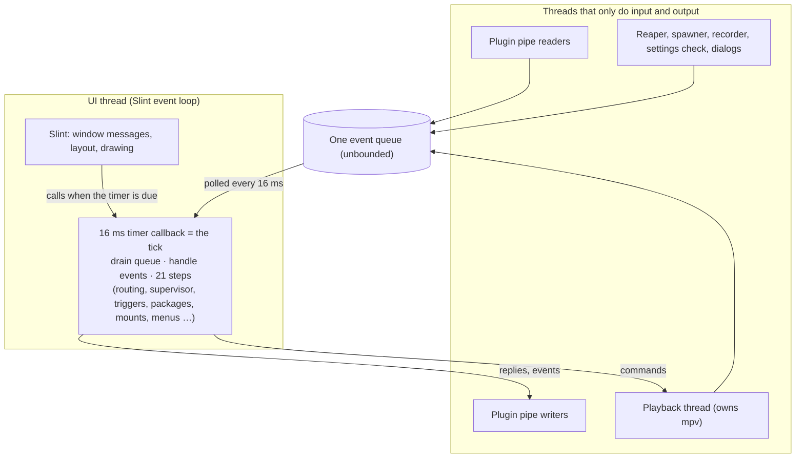
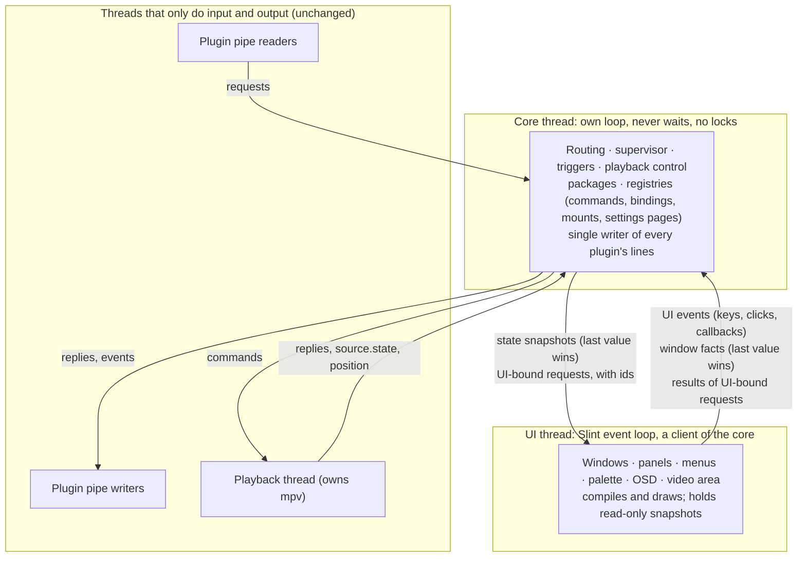

# The core thread (design)

**Status: decided, not implemented.** Written 2026-11-15 by the API maintainer from the user's rulings of that day. Work starts when release A (SDK 1.10.0 / player 0.10.0) is on main. The execution plan is [core-thread-plan.md](../process/core-thread-plan.md). The source inventory behind the numbers is the study [core-loop-study.md](../process/research/core-loop-study.md) (called "the study" below). This file is the authority for the design; where the study recommends something else, this file wins.

**Process note (user ruling, 2026-11-15).** The work follows the pattern of SDK 1.10.0: this design and the plan are written by Fable; the implementation is by Opus 5.5; static review (diffs and source read against this design, no builds, no logs) is by Fable at medium effort; builds, test runs, `ci:local` and the V1/V2 verification are run by Opus, so that review tokens are not spent on build and test noise.

No code was written or built for this document. Measured values are quoted with where they were measured. Everything the study marked "(inferred)" is still inferred here.

**In one paragraph.** The host's core (plugin request routing, the supervisor, triggers, playback control, packages) is a single-threaded state machine that never waits. Today it runs inside a callback on Slint's UI thread, so it stops whenever anything else holds that thread: Slint compiling a window, Windows' own loop while a window is dragged, the graphics library waiting for the GPU. The decision is to give the core its own thread and make the UI thread one of its clients. A stalled interface then costs a frozen window, not stalled plugins, late triggers or lost playback control. No SDK change, no wire change, and the scheduling rules stay as they are.

**How to read it.** What was observed: [§1](#1-background-what-was-observed). How the core is driven today: [§2](#2-how-the-core-is-driven-today). What other projects do: [§3](#3-precedents). What was set aside: [§4](#4-options-considered). The rules: [§5](#5-the-decision). What it buys: [§6](#6-what-a-ui-stall-costs-before-and-after). What can go wrong: [§7](#7-risks-and-open-points). How it is proven: [§8](#8-verification). Words: [§9](#9-glossary).

**How sources are written.** `P:` is the player repository, read on branch `evt-release-a` at `3100d94f` (release A before its last fixes); paths without a prefix directory are under `src/host/src/`. `L:` is local evidence on the development laptop, not in any repository.

## 1. Background: what was observed

### 1.1 The machine and the runs

The measurements are from the user's laptop on 2026-11-14 and 2026-11-15: internal panel driven by the AMD Radeon 780M, GPU rendering on the NVIDIA RTX 4070, so on the internal panel every presented frame crosses from one adapter to the other ("cross-adapter"). With an external screen driven by the NVIDIA adapter there is no crossing.

The user ran the portable builds of 0.7.6, 0.8.2 (the installed version), 0.8.4, 0.9.0 and the release A trial (0.10.0, `3100d94f`) by hand, each in an isolated profile with GPU rendering. All of them behave the same. **None of this is a regression of release A or of 0.9.0**; the installed 0.8.2 log shows the same lines for the days before.

| Evidence | Where |
| --- | --- |
| Host logs of each version, with the `ui stall:` lines | `L:C:\vestra\compare\profile-<version>\host.log`; the user's own 0.8.2 history in `L:C:\vestra\backup-profile-20261114-trial\Roaming-Vestra\logs\host.log` |
| Thread stacks taken automatically while the window did not answer (12 dumps, video playing) | `L:C:\vestra\compare\stacks-trial\` |
| The same with the video paused, ending in a lost device (6 dumps) | `L:C:\vestra\compare\stacks-trial-paused\` |
| The watcher that took them (asks the window every 0.2 s, dumps stacks after 1 s without an answer) | `L:C:\vestra\compare\watch.ps1`, started through `start.ps1` |
| Symbols for the trial build | `L:C:\vestra\compare\sym\` |

### 1.2 Three classes of stall

"Tick" is the host's 16 ms turn of work (§2). "UI thread" is the thread that runs Slint's event loop.

| Class | What holds the UI thread | Measured | Where the thread was |
| --- | --- | --- | --- |
| S1. Opening a tool window | Slint compiles the window's `.slint` file and creates it, synchronously, inside the request | 290–800 ms per open (Store 371–803 ms, About 257–453 ms, Workshop 430 ms); every open compiles again | `ui.open`: P:capabilities/ui_window.rs:78 → P:ui/view.rs:713 |
| S2. Dragging or resizing a window | Windows runs its own message loop inside `DefWindowProc` until the mouse button is released. Window messages still arrive, but winit's timers do not fire, so the tick does not run | "no tick" for 5–18 s in every version (for example 10,100 ms, 14,946 ms, 17,941 ms) | winit 0.30.13, the modal move/size loop |
| S3. Resizing on the cross-adapter path | The graphics library waits for the GPU on the UI thread | Three blocks of 5.6–5.9 s with identical stacks; with the video paused, repeated 1 s waits for 8.8 s, then `the GPU device was lost; restarting the player` | Slint `resize_event` → wgpu `Surface::configure` → `Device::maintain` (waits without a time limit for all submitted work) → `wgpu_hal::dx12::Device::wait`; and Slint draw → `Surface::get_current_texture` → `acquire_texture` (1 s timeout) |

Notes on S3:

- It appears only on the internal panel (cross-adapter). On the external screen the same code path returns quickly.
- It does not depend on video: it is worse with the video paused. The video render thread and the two fences shared with it are not the cause.
- wgpu has no 5 s constant. The likely release after about 5 s is Windows declaring the window hung after 5 s without message pumping ([IsHungAppWindow](https://learn.microsoft.com/en-us/windows/win32/api/winuser/nf-winuser-ishungappwindow)); that link in the chain is inferred, the stacks are not.
- Private memory rose from about 440 MB to about 1,750 MB across these stalls. No queue of ours is unbounded on that path (every per-frame post to the UI thread is coalesced); the likely cause is swap-chain buffers re-created on every size change and released only once the GPU queue drains (inferred).

### 1.3 What stops when the UI thread stalls

Everything the tick does, including work that has nothing to do with the interface:

| What stops | Seen as |
| --- | --- |
| Plugin requests (all 119 route entries) | `rpc player.audioDevices still waiting after 10 seconds`, `rpc ui.setMount still waiting after 10 seconds` in the plugin log during the 12–18 s gaps |
| Supervisor timers: standby after 30 s idle, start timeouts, wakes | Late by the length of the stall |
| Triggers: position reports and the `time` atom | Late; `on_demand_tick` runs the time atom from the tick (P:host/supervisor/mod.rs:1779) |
| Playback control from plugins and playback state to plugins | mpv itself is controlled off the UI thread (P:playback/backend.rs:1), but a plugin's command reaches the playback thread only through the tick, and `source.state` comes back only through the tick. Playback continues; plugins can neither control nor observe it |
| Video frames | The frame is handed to Slint and drawn on the UI thread (P:host/video.rs:433) |
| All windows | No repaint, no answer to clicks |

The core does not wait anywhere in this. It is held by the thread it lives on.

## 2. How the core is driven today

The host's state is one object, `Host` (P:host/mod.rs:338-598). It has two kinds of entry point: "handle one event" (`host.handle(event)`) and "do one periodic step" (the `*_tick` methods). Who calls them is outside the object, and there are two callers:

| Driver | Loop | Used for |
| --- | --- | --- |
| Windowed | Slint's event loop owns the thread. The host registers a repeating 16 ms `slint::Timer`; its callback drains the event queue (at least 128 events, then what a time budget allows) and runs 21 steps (P:main.rs:855-948) | Every real run |
| Headless | Our own loop: wait on the event queue for at most 10 ms, handle, run 8 steps (P:main.rs:676-730) | Offscreen tests |

Facts from the study (§0–§3 there, with file and line):

- `Host` has **130 fields** in 37 files: about 55 core, about 45 interface, about 30 used by both. Because some fields are Slint objects, the Rust compiler refuses to move the object to another thread (a type that may cross threads is called `Send`; one field that is not makes the whole object not `Send`, and the host forbids `unsafe`). The object has to be split before any part of it can run elsewhere.
- Everything reaches the host through **one queue** that the 16 ms timer polls. Nothing wakes the loop when an event arrives, so today a request waits 0–16 ms before it is handled even when nothing stalls.
- Every reply and event line to a plugin is produced on the UI thread. The only exceptions are request-limit refusals, written by the reader threads.
- The headless loop runs exactly the 8 core steps (activation, on-demand, power, diagnostics, packages, notifications, timeline, open files). It is the proof that the core runs without Slint's loop; the offscreen tests run it that way every day.

**The gap this document records.** Running the core on Slint's event loop was never a ruling. It was an early implementation choice: Slint objects can be touched only on Slint's thread, many plugin requests end in an interface change, so putting everything on that thread was the shortest path. It was never brought to the user as an architecture decision, and no architecture document states it as one. On 2026-11-15 the user called it a sword of Damocles: the core's "never waits" guarantee holds only for our own code, and any wait by Slint, the graphics library, a driver or the operating system on that thread voids it.

## 3. Precedents

Two research passes were made on 2026-11-15 (web and public source; the claims below are those the researcher could open and read).

### 3.1 Core logic on the UI loop, with one iron rule

| Project | What runs on the UI thread | The rule |
| --- | --- | --- |
| VS Code | Extensions run in a separate process, but the host-side RPC endpoint lives in the workbench, the renderer's UI thread ([extensionHostManager.ts](https://github.com/microsoft/vscode/blob/main/src/vs/workbench/services/extensions/common/extensionHostManager.ts), [extension host](https://code.visualstudio.com/api/advanced-topics/extension-host)). The closest analogue to today's Vestra | The peer is marked unresponsive after 3 s without an acknowledgement |
| Chromium | Service-worker lifecycle and timeout timers on the browser UI thread ([service_worker_version.cc](https://github.com/chromium/chromium/blob/main/content/browser/service_worker/service_worker_version.cc)); the extensions `ProcessManager` in the browser process | "Do not perform expensive computation or blocking IO on the main thread"; IPC arrives on a separate IO thread ([threading_and_tasks.md](https://chromium.googlesource.com/chromium/src/+/main/docs/threading_and_tasks.md)) |
| Zed | Foreground executor on the main thread, background executor elsewhere | "The main thread should never, ever block." ([blog](https://zed.dev/blog/zed-decoded-async-rust)) |
| Electron | The main process runs the UI thread | "Under no circumstances should you block this process and the UI thread" ([performance](https://www.electronjs.org/docs/latest/tutorial/performance)) |
| JetBrains IDEs | Writes only on the event dispatch thread, which "must be as fast as possible" ([threading model](https://plugins.jetbrains.com/docs/intellij/threading-model.html)) | A freeze watchdog runs off that thread and dumps stacks ([PerformanceWatcherImpl.kt](https://github.com/JetBrains/intellij-community/blob/master/platform/platform-impl/src/com/intellij/diagnostic/PerformanceWatcherImpl.kt)) |
| Kodi | The application thread is the GUI thread; other threads post messages to it ([ApplicationMessenger.cpp](https://github.com/xbmc/xbmc/blob/master/xbmc/messaging/ApplicationMessenger.cpp)) | A guard against waiting on itself |
| Celluloid | mpv events are processed on the GTK main loop ([celluloid-mpv.c](https://github.com/celluloid-player/celluloid/blob/master/src/celluloid-mpv.c)) | — |
| Figma | Plugins run on the main thread by design, for synchronous document access | The accepted cost: "When plugins freeze, it affects the perceived stability of Figma." ([blog](https://www.figma.com/blog/how-we-built-the-figma-plugin-system/)) |

So the design we have is common and defensible. Every project that keeps it enforces that nothing on that thread may wait. We cannot enforce that: the three stalls of §1.2 are in Slint, wgpu, the driver and Windows, not in our code.

### 3.2 Separated designs and what they cost

| Project | Structure | Cost they name |
| --- | --- | --- |
| mpv | The core is detached from any interface: "Not calling mpv_wait_event() will not stop playback". Synchronisation by two rules: property changes are coalesced ("only one event per changed property"), and commands are asynchronous with replies as events that "may be reordered" ([client.h](https://github.com/mpv-player/mpv/blob/master/include/mpv/client.h)) | A render thread waiting on a core API can "freeze the mpv core thread forever" (`render.h`) |
| mpv, 2014 | It hit our S2 exactly. Commit `97a82bcd` (2014-07-26), "win32: move window handling to a separate thread": "the message dispatcher won't return while the dragging is active, so mpv couldn't update the video at all." It moved the window message pump to its own thread and left the core and the renderer where they were; the dedicated GUI thread is still there (`video/out/w32_common.c`) | The author calls it "rough"; it needed a `WM_CLOSE` workaround |
| VLC | The Qt interface runs on its own thread, except on macOS where Cocoa forces the main thread ([qt.cpp](https://github.com/videolan/vlc/blob/master/modules/gui/qt/qt.cpp)) | A ready-barrier at start so the core does not start video before the window exists |
| IINA | A dedicated queue reads mpv events; processing hops to the main queue; queue overflow is a critical failure ([MPVController.swift](https://github.com/iina/iina/blob/develop/iina/MPVController.swift)) | — |
| Haruna / mpvqt | The mpv controller lives on a worker thread, driven by queued calls ([mpvabstractitem.cpp](https://github.com/KDE/mpvqt/blob/master/src/mpvabstractitem.cpp)) | — |

mpv's 2014 fix isolates the party that gets blocked (the window pump) instead of moving the core. We cannot do the same: Slint binds "receive window messages" and "draw the interface" to one thread. The equivalent for us is the reverse: leave Slint's thread to Slint and move what is not interface off it. Moving the core is this document; moving video is the independent video layer (§6.2). Both together give mpv's three threads: core, video, window.

### 3.3 Slint's own advice

"You should perform the minimum amount of work in the main thread and delegate the actual logic to another thread to avoid blocking animations", with `invoke_from_event_loop` to come back ([slint lib.rs, "Threading and Event-loop"](https://raw.githubusercontent.com/slint-ui/slint/master/api/rs/slint/lib.rs), [invoke_from_event_loop](https://docs.slint.dev/latest/docs/rust/slint/fn.invoke_from_event_loop)). By Slint's own documentation, today's structure is not the recommended use. No survey of larger open-source Slint applications was found.

### 3.4 Upstream state of the three stalls

| Stall | Upstream | State on 2026-11-15 |
| --- | --- | --- |
| S2 modal loop | winit [#3272](https://github.com/rust-windowing/winit/issues/3272) "`ControlFlow` is ignored while window is being resized on Windows", [#1484](https://github.com/rust-windowing/winit/issues/1484) (system menu / title bar freezes the event loop) | Both open. Slint [#5720](https://github.com/slint-ui/slint/issues/5720) open; [#5791](https://github.com/slint-ui/slint/issues/5791) closed as its duplicate, called "a bug in winit" |
| S3 configure wait | wgpu still calls `maintain(wait_indefinitely())` before configuring a surface | By design; no issue asks for its removal |
| S3 reconfigure on every resize event | Slint [#12730](https://github.com/slint-ui/slint/issues/12730) "Window resizing is laggy in release mode" (closed); [PR #12733](https://github.com/slint-ui/slint/pull/12733) "wgpu: defer swapchain reconfiguration to the next frame" | The PR was closed unmerged because it did not fix the Wayland case it was written for |
| S3 present mode | Slint [#8693](https://github.com/slint-ui/slint/issues/8693), where AutoVsync was hard-coded; a maintainer said "perhaps we can make it configurable" | Never done; no public setting |
| S3 `acquire_texture` 1 s waits | wgpu [PR #10511](https://github.com/gfx-rs/wgpu/pull/10511) "fix(dx12): fix 1 second hang for dropped `SurfaceTexture`s", merged 2026-11-14; [PR #10548](https://github.com/gfx-rs/wgpu/pull/10548) discards queued old-size frames after a resize | Merged, unreleased; reaches us only through a wgpu release and a Slint upgrade |

No report of the exact cross-adapter symptom was found in any project. A request to Slint is reasonable and was deferred by the user (2026-11-15: "the issue can wait, our problem is bigger").

## 4. Options considered

| Option | What it is | Why it was set aside |
| --- | --- | --- |
| A. Router thread | Only forwarding and keep-alive leave the UI thread | Little to gain. The shared runner's heartbeat already tolerates stalls. No request is a pure plugin-to-plugin forward: each of the 48 playback forwards touches host bookkeeping (standby accounting, activation tracking, `source.state` patching). A fast path would put a second writer on each plugin's pipe and break today's order. It ends up as a partial B (study §4.1) |
| **B. Core thread** | Supervisor, triggers, routing, playback control and packages on their own thread; the UI thread is a client | **Chosen** (§5). About 30–40 files and 5,000–10,000 changed lines, plus about 1,500 lines of messages (inferred) |
| C. Full split | All state on the core, the interface a thin mirror that applies diffs | 20,000–30,000 lines, a rewrite of the interface layer. Menu hover and palette typing would each take a round trip. No more resilient than B: a stalled interface cannot show anything in any design |
| Compile off-thread only | Compile `ui.open` and mount panels on a worker, as the settings check already does | Helps only S1. Does nothing for S2 and S3, the multi-second cases. Slint's compiled definitions hold `Rc` (single-thread reference counts), so only the check could move, not the result |
| Default adapter rule | At start, render on the adapter that drives the main window's screen, as mpv and Chromium effectively do; manual choice kept | A way around S3, not a fix: a user who selects the NVIDIA adapter on the internal panel still gets it, and the next cause of a wait on the UI thread is not covered. **Still planned as a separate item**, to keep the user's machine usable in the meantime |
| Keep-alive during the modal loop | A Win32 timer armed between `WM_ENTERSIZEMOVE` and `WM_EXITSIZEMOVE` posts the tick (branch `fix-modal-tick`, written, awaiting the user's manual check) | Removes S2 only. **Still planned as a separate item.** Under this design it stays useful for the interface side (content re-laid-out while dragging) |
| Per-plugin in-order queue | Keep today's order exactly: while a plugin has a UI-bound request unanswered, hold that plugin's later lines. Equivalent in effect to in-order delivery in selective-repeat ARQ or TCP: a resequencing buffer | Head-of-line blocking. One request stuck behind a frozen interface would hold every later request of that plugin, including those that never touch the interface. That brings back per plugin what the design removes globally. The study recommended it for the prototype (its §7 question 1); the user ruled against a queue |
| **Two independent streams** | As in QUIC: order inside a stream, none across streams, so one blocked stream does not hold the other | **Chosen** (rule R4). The order inside each stream comes for free from each thread handling its inbox in arrival order |

## 5. The decision

Rulings of the user, 2026-11-15, as numbered rules. "Core" is the new thread; "UI" is Slint's thread.

| No. | Rule |
| --- | --- |
| R1 | **The core has its own thread and its own loop.** It owns the plugin processes and the shared runner, the supervisor, triggers and conditions, request routing, playback control (the handle to the playback thread, `last_source`, the sequence), packages, timeline, session storage, power, and the notification bookkeeping. It stays single-threaded, lock-free and never waits |
| R2 | **The UI thread is a client of the core.** It owns the Slint objects and the windows: shell, views, panels, menus, palette, OSD timing, the video area, picture-in-picture, the settings window. It compiles, instantiates and draws. It decides nothing about plugins |
| R3 | **Two kinds of message cross between them, and nothing else.** (1) State snapshots: an immutable copy of a whole table or value; the receiver replaces what it had; several in a row collapse to the last ("last value wins"); no locks. (2) Requests and replies with ids, for work one side asks of the other |
| R4 | **Two streams per plugin, no ordering queue.** Requests that need the interface are carried out on the UI thread in arrival order. Requests that do not are carried out on the core in arrival order. There is no order between the two streams: the reply to a later UI-independent request may arrive before the reply to an earlier UI-bound one |
| R5 | **What a reply means (user ruling 2026-11-15).** For the 10 UI-bound methods whose reply carries an interface result, the request is answered only when the UI thread has reported that result (after `ui.open` the view exists; after `ui.mount` the mount is ready; `ui.preparing` still precedes the `ui.mount` reply). For every other request that touches the interface (the 25 "reply independent" methods), a reply means the host has accepted and recorded the change; the interface shows it as soon as it can. This is what plugins could rely on before as well: a reply never meant the user had already seen the change |
| R6 | **Events and broadcasts keep the core's order.** The core is the single writer of every plugin's lines, as the UI thread is today. Side effects of a request are still sent before its reply; triggers that flip are still delivered before the state broadcast that flipped them |
| R7 | **A UI-independent request never waits for the UI.** This is the purpose of the change and a hard rule for every later addition: a new method that does not need the interface must not be routed through it |
| R8 | **The binding table and the command registry belong to the core.** The UI holds a read-only snapshot, replaced whole on every revision. Key callbacks on the UI thread look up the snapshot synchronously (Slint's key callback must answer "handled or not" at once and cannot wait for a round trip). Table updates and key events go through one queue on the UI side, so a key is never judged by a table older than the one that preceded it in that queue |
| R9 | **Facts the UI owns flow to the core as snapshots.** Window size, fullscreen, focus, layout and the menu state (`window_facts`) are sent by the UI when they change; the core evaluates conditions and triggers and broadcasts `window.state` from them |
| R10 | **Cadence in two steps.** First the core loop keeps today's fixed cadence, so that timing is unchanged and the differential checks can show zero difference. Then, as a separate merge, it handles each event when it arrives (the loop sleeps on its queue; a UI-independent request is answered in well under a millisecond instead of up to 16 ms). In the other direction the core wakes the UI with `invoke_from_event_loop`, not through the 16 ms timer |
| R11 | **No SDK change, no wire change, no change to the scheduling rules.** When a plugin starts, parks, wakes and is stopped is decided by the same supervisor rules ([supervisor.md](supervisor.md)); only the thread that runs them changes |
| R12 | **The readiness coupling is kept.** A plugin's run is ready only after its first `ui.open` / `ui.mount` was answered (P:host/dispatch.rs:118-144, P:host/supervisor/mod.rs:995-1030). A run that starts during an interface stall therefore becomes ready when the stall ends |

### 5.1 Which requests are in which stream

From the study's inventory of the 119 route entries (its §2.2, with every method named):

| Stream | Count | What |
| --- | --- | --- |
| UI-independent, forwarded to the playback thread | 48 | `source.*`, `playback.*`, `player.*`, `subtitles.*`, `processing.*`, `video.*`, `mpv.*`, `media.sources.*`, `snapshot.*`, `jobs.*`, `producer.*`, `sourceResolvers.*` |
| UI-independent, answered by the core | 36 | `triggers.*`, `events.*`, `timeline.*`, `sequence.*`, `storage.session.*`, `packages.*`, `secrets.*`, `system.*`, `rendering.*`, `commands.keys/list`, `drops.*`, `window.state`, `power.preventSleep`, and others |
| Touches the interface, but the reply does not depend on its result | 25 | `osd.*`, `appearance.set`, `commands.register/update/unregister`, `bindings.*`, `layout.*`, `ui.interaction`, `ui.menu`, `window.setAlwaysOnTop`, `palette.lead.*`, `commands.run`, `dialogs.*`, `host.run`, `app.system`, `clipboard.*` |
| **UI-bound: the reply depends on an interface result** | 10 | `ui.open`, `ui.set`, `ui.show`, `ui.close`, `ui.mount`, `ui.unmount`, `ui.setMount`, `settings.*`, `window.setVideoArea`, `window.setPictureInPicture` |

The 25 of the third row are answered by the core as soon as its own part is done (registry write, snapshot sent); the interface catches up when it can. Which of them stay there and which join the UI-bound stream is settled method by method in plan step S0, as a table added to this section; the default is the study's classification.

### 5.2 What the two streams change for a plugin

- A plugin that awaits each call before the next sees nothing: the second call is sent after the first reply.
- A plugin that sends several calls without waiting gets each reply on its own promise, matched by id, as today. Only the arrival order between a UI-bound and a UI-independent call can differ.
- Today's behaviour that goes away: "a request sent after a UI-bound request, without awaiting it, is handled after the interface change is in place". It holds today only because both are handled in the same tick. Whether any existing plugin depends on it is checked before the core moves (§7, K1).

## 6. What a UI stall costs, before and after

### 6.1 The table

| While the UI thread is held | Today | With the core thread | With the independent video layer as well |
| --- | --- | --- | --- |
| Windows repaint, clicks answered | No | No | No |
| Plugin requests that do not need the interface | Stop; time out after 10 s in the SDK's log | Continue | Continue |
| Playback control from plugins; `source.state` to plugins | Stop | Continue | Continue |
| Triggers, the `time` atom, wakes, standby timers | Late | On time | On time |
| Package operations, shared runner heartbeat | Stop (the heartbeat tolerates it) | Continue | Continue |
| Requests that need the interface (`ui.*`, settings, video area) | Wait | Wait | Wait |
| Video picture | Frozen | Frozen | Continues |
| After the stall | The backlog is worked through at 128 events or 4 ms per tick | The interface jumps to the latest state | Same |

The design does not make the interface stall less. It limits what a stall takes with it. Making the interface stall less is a separate, open-ended list (keep-alive, default adapter, upstream fixes, compile cache); each item removes one known cause, and new causes can always appear. This design is what makes a new cause cost a frozen window instead of a broken session.

### 6.2 The independent video layer

The same idea applied to video: video gets its own swap chain and render thread and is composed under the interface (DirectComposition on Windows), so a held UI thread no longer freezes the picture. It is a separate project with its own unknowns (whether the Slint interface can be a transparent layer; platform equivalents on macOS and Linux) and its own synchronisation concern: on a resize, or when a panel pushes the video area, the video layer and the interface layer are resized by different threads and can differ for a frame or two. It is not part of this design and not needed for it.

## 7. Risks and open points

| No. | Risk or open point | How it is handled |
| --- | --- | --- |
| K1 | A plugin sends a UI-bound request without awaiting it and then depends on it having taken effect (for example a read of state that the interface change produces) | A read-only scan of all built-in plugins and the plugin repository before the core moves (plan S0). Each finding is fixed in the plugin, or the pair is brought to the user  **User ruling (2026-11-15):** findings are fixed in the plugins; no ordering exception is kept for them. Third-party authors are told in the SDK docs (order across the two kinds is not guaranteed; await the first reply when order matters). TestHost is changed to model the two streams only after the core thread work is finished and stable, as a later SDK release; nothing in the SDK changes during S0–S3 |
| K2 | The 10 UI-bound methods need a round trip; their replies no longer leave in the same turn as the request | They get an explicit request/reply seam while still on one thread (plan S2d), so the move itself changes only the thread |
| K3 | `stop_run` (stopping a plugin) reaches the interface: views, mounts, OSD buttons, the floating window, shell properties (P:host/lifecycle.rs:282-445) | Splits into a registry part on the core and a "revoke this owner" message to the UI. During a stall the interface part is late; the process is stopped on time |
| K4 | The `time` trigger atom runs from the 16 ms UI tick | It moves with `on_demand_tick` to the core. [events-and-triggers.md §4.4](events-and-triggers.md) says "later only while the UI thread is busy"; that sentence is updated when S3 merges |
| K5 | `window_facts` is written by the interface and read by conditions, triggers and `window.state` | Rule R9. `window.state` is then broadcast once per snapshot received instead of once per tick |
| K6 | `mounts` is needed by the core (standby recording, rekey, revoke, replay) and by the interface (building panels) | The registry is core data; the interface gets mount changes as messages and reports `MountApplied`. The 32 ms batching window and the compile stay on the UI side |
| K7 | `settings`: the registry of pages is core, the open options window is interface; `settings.register` is answered after a compile check | The check thread already exists; its result goes to the core; the open window is updated by message |
| K8 | `input`, `ui_state`, `images`, `policy`, `drops` are used by both sides | Split one at a time (plan S2c). `ui_state` is one file with a window part and a core part; one writer keeps writing it, fed by both |
| K9 | Device loss and the restart path (P:host/restart.rs): the UI thread may be stuck in teardown while the core is alive | The restart decision and the plugin shutdown deadline move with the core; the existing "exit now" backstop stays. Re-checked in plan S3a against [supervisor.md §9](supervisor.md#9-quit-and-device-loss)  **User ruling (2026-11-15):** this work keeps the whole-player restart. Once the core thread is stable, the coordinator verifies whether the interface alone can be rebuilt after a device loss (windows closed, new device, windows reopened, core, plugins and playback untouched). If the verification shows the work is small and contained, it goes ahead without asking; if it would need another round of core changes, it is dropped and reported |
| K10 | Thread-affine system calls | `power` (`SetThreadExecutionState` is per calling thread) moves to the core thread and stays there. Clipboard, file dialogs and the confirmation dialog stay on the UI side |
| K11 | Snapshot cost | The command registry and binding table are cloned per revision (hundreds of entries, changed at start, on plugin load and on user edits). Measured in plan S2; if it shows in a profile, the snapshot becomes shared and immutable (`Arc`) instead of copied |
| K12 | macOS and Linux | The design is platform-neutral. On macOS the UI thread must be the process's main thread (winit's rule), which this design already satisfies: the core is the thread that is created. The stall classes differ per platform; the stall test (§8) is platform-neutral because it stalls the UI thread artificially |
| K13 | The 25 "touches the interface, reply independent" methods answer before the interface has caught up | Already true today across processes for the plugin's own view of time; stated in the method table of §5.1 when S0 fixes it  **User ruling (2026-11-15):** the core answers these at once (R5); they never wait for the interface |
| K14 | Faster replies after R10's second step could expose a timing assumption in a plugin | It is a separate merge with its own measurement, and can be reverted alone |

## 8. Verification

| Check | What it proves | Notes |
| --- | --- | --- |
| V1 static gates | No test or golden trace was changed to pass | `src/scripts/verify-gates.mjs`, as in the events plan |
| V2 runtime differential | Registries, standby classification and parking, recordings, console output are identical | `src/scripts/verify-runtime.mjs`, four offscreen scenarios. It does **not** see request or event order, or timing (study §4.4) |
| Wire trace (new) | Order and content of every line between the host and each plugin | A test-only host switch that logs each line with a per-plugin sequence; a diff tool compares two runs per plugin with ids and times normalised. From S3 on the tool knows rule R4: a reorder between the two streams of one plugin is allowed and reported; any other difference fails. Not a wire change |
| UI stall test (new) | Rules R1 and R7, and §6.1's middle column | Offscreen. A test-only switch makes the UI turn sleep for N seconds while a test plugin calls `source.state` every 50 ms, a plugin with a short idle time is due to park, and a `time` trigger is due. Asserts: request latency p99 under 50 ms during the stall, the park on time, the trigger within one core turn. **Expected to fail on today's code**; recorded as the baseline, marked "expected to change" |
| Names-only rule | Stage S2 (split on one thread) changes structure and nothing else | Any difference in V2, the wire trace or `ci:local` fails the merge; no test or test host is edited to pass |
| `Send` check | The core part really is free of interface objects | When the core struct is not `Send`, the compiler rejects moving it to a thread. A compile-time assertion is added in S2 so the boundary is checked before S3 |
| `ci:local` | Everything else | At the end of each stage |
| Real windows | That the visible behaviour is right on a real desktop | Done by the user by hand, with `watch.ps1` recording stalls and stacks. Scripted mouse input cannot reproduce fast human dragging and is not used |

## 9. Glossary

| Word | Meaning here |
| --- | --- |
| Core | The host's state machine for everything that is not interface: routing, supervisor, triggers, playback control, packages, registries |
| UI thread | The thread that runs Slint's event loop and owns the windows |
| Tick | Today: one run of the 16 ms timer callback. After the change: one turn of the core loop |
| Stall | A period in which the UI thread runs none of our code because something else holds it |
| UI-bound request | A request whose reply depends on a result from the interface (the 10 of §5.1) |
| UI-independent request | Any other request |
| Stream | The sequence of one plugin's requests of one kind; order is kept inside a stream only |
| Snapshot | An immutable copy of a table or value, sent whole; the receiver replaces what it had |
| Last value wins | Of several snapshots waiting, only the newest is applied |
| Cross-adapter | Rendering on one GPU and showing on a screen driven by another |
| Head-of-line blocking | One stuck item at the front of an ordered queue holding back everything behind it |
| `Send` | Rust's marker for a type that may move to another thread; checked by the compiler |
