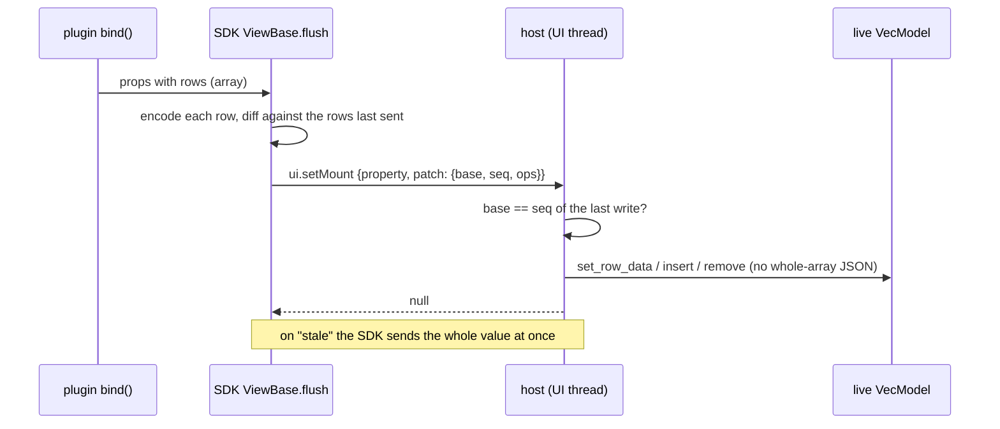

# Large lists and incremental row updates in plugin views

Status: P1 implemented (player 0.6.0, SDK 1.5.44); P2 implemented (SDK 1.5.45, pending release); P3 host part implemented (player 0.6.0, SDK 1.5.46), the playlist migration in progress. Author: API maintainer. Date: 2026-11-01.
Baseline: player `release-0.6.0` (host 0.6.0, Slint 1.18.1), SDK 1.5.43.

This replaces the earlier draft that proposed sparse lists (`plugin.ui.list`, on-demand rows, placeholders). The user simplified the plan on 2026-10-31: no sparse or on-demand rows, no placeholders, no `plugin.ui.list`, and no new plugin API at all. What remains is three steps that make the existing plain-array properties cheap:

| Phase | What | Where | Plugin change |
|---|---|---|---|
| P1 | Keyed incremental row updates: the SDK diffs a bound array against what it last sent and sends row operations; the host applies them to the live model. | SDK and host | none |
| P2 | Precise invalidation: after a host state event the SDK re-runs only the binders and command states that read the changed state. | SDK only | none |
| P3 | Higher row limits, so a plugin hands the whole list (about 20,000 rows) to the host once; the playlist and VestraTube draw it with Slint's `ListView` over the model. | host, then the two plugins | playlist, VestraTube |

---

## 1. Problem (measured)

| What | Where | Cost |
|---|---|---|
| One row of a 200-row window changes (selection) | host UI thread, `ui_values::reconcile_settled` | ~2.5 ms per write (`biglist_bench.rs` scenario D) |
| The 200-row window shifts (scroll far) | host UI thread, every row differs | ~22 ms per write (scenario F) |
| Every SDK update pass | plugin process, `ViewBase.flush` | `JSON.stringify` of every property value, the whole `rows` array included, on every pass (`playlist_pass_bench.ts`) |
| Every SDK update pass | plugin process, `Runtime.invalidate` | all binders of all views and all command states re-run on any invalidation (a 100 ms `source.state` tick included); the playlist's `list.bind` is O(n) in the list (`queue.visible()`, the duration sum, the filter index map) |

The host costs are O(n) because `reconcile_settled` converts both the current model and the new value back to JSON (`to_json`), compares them whole, and only then writes the changed rows. `has_documents` also scans every row before that.

The limits `MAX_ARRAY = 4096` rows and `MAX_NODES = 16384` values per write (`ui_values.rs`) bound the cost of one write. They also force any long list to be windowed by hand. The playlist (up to `ROW_LIMIT = 20_000`, `queue.ts`) sends `WINDOW_ROWS = 200` rows (`scroll.ts`), placed with `first-row` and `row-count`, re-centred by `windowStart`, and drawn with a hand-written `for` inside a `ScrollView` (`sidebar.slint`). So:

- 200 row elements stay instantiated in the item tree, and AccessKit sees them all.
- A window shift rewrites all 200 rows (the ~22 ms case).
- Each plugin re-implements this. VestraTube pads its array to 200 rows to dodge an old host behaviour (obsolete since host 0.5.2) and avoids `ListView`.

User rules this design follows:

- Use Slint's own mechanisms: a long list is a `ListView` over a model (P3).
- The UI hits display rate even on CPU rendering.
- SDK changes are additions only; here there are none visible to plugins.

Precedent followed:

- Keyed reconciliation as in React, Vue and Svelte: keys when rows have an identity, prefix/suffix trimming, longest increasing subsequence for moves.
- Qt's `QAbstractItemModel` notifications (`dataChanged`, `rowsInserted`, `rowsRemoved`, `rowsMoved`) and Slint's own `ModelNotify` (`row_changed`, `row_added`, `row_removed`): the host's model gets exactly these.
- Optimistic concurrency with a base version (HTTP `If-Match`, CouchDB revisions): a patch names the write it applies on; a mismatch is answered "stale" and the whole value is sent.
- Signals and fine-grained tracking as in Solid, Preact and the TC39 proposal (P2), applied inside the SDK only.

---

## 2. P1: keyed incremental row updates

### 2.1 Overview



Nothing changes for plugins. A plugin that binds or sets an array gets patches automatically on a player that supports them; on an older player, or with an older SDK, whole values are sent as before.

### 2.2 Wire

The three existing property writes (`ui.setMount`, `ui.set`, `settings.set`) take either `value` (a whole value, as before) or `patch`:

```jsonc
// whole value (unchanged; `seq` only to players that advertise "ui.patch")
{"method":"ui.setMount","params":{"property":"rows","value":[…],"seq":41}}
// patch
{"method":"ui.setMount","params":{"property":"rows","patch":{
  "base": 41,            // the write this patch applies on (0: the initial properties)
  "seq": 42,             // this write
  "ops":[
    {"op":"remove","at":9,"count":2},
    {"op":"move","from":5,"count":1,"to":0},
    {"op":"insert","at":3,"rows":[{…},{…}]},
    {"op":"set","at":17,"row":{…}}
  ]}}}
// reply: null | error code "stale" (send the whole value) | "limit" | "invalid" | "missing" | "ui"
```

- Ops apply in order, each to the result of the one before. `move` takes `count` rows out at `from` and puts them back at `to`, an index of the list without them.
- At most `MAX_PATCH_OPS` = 1,024 ops per patch; the rows a patch carries share one value budget (`MAX_NODES`, `MAX_TEXT_BYTES`, depth counted as for rows of the whole value), and the result may have at most `MAX_ARRAY` rows.
- The player advertises the feature in `plugin.app`'s start-up data: `"features": ["ui.patch"]` (`process::set_app_info`, `main.rs`). The SDK reads it from the handshake (`Runtime.features`); it is not part of the plugin API. No `apiVersion` change, no new method, no new capability: the writes keep their capability (`ui.mount`, `ui.window`, `ui.settings`) and lazy-activation behaviour.

### 2.3 Base and sequence numbers

- Each SDK view numbers its writes (`seq` ≥ 1). The host records, per (owner, view, property), the `seq` of the last write it applied (`Images::written`, released with the view or the owner like the view's images). A property with no recorded write is at 0, which is the initial properties of `ui.mount`, `ui.open` and `settings.register`; those calls reset the record.
- A patch whose `base` differs from the record is answered `stale` and changes nothing. The SDK then sends the whole value with a new `seq`. This covers whatever the SDK cannot know, and costs one whole write.
- A failed write leaves the record unchanged. The SDK forgets its baseline after any failure, so its next write of that property is whole.
- The view's own Slint code must not write rows into the array (Slint allows `rows[i].field = …` on a writable model). Today's whole-value comparison would repair such a row on the next write; a patch touches only the rows it names. No plugin does this; the SDK documentation's guidance is that plugin data flows in through properties and out through callbacks.

### 2.4 Host

Code: `src/host/src/ui/ui_patch.rs` (parsing, application, the per-view flows), `ui_values.rs` (`from_json_rows_with`, `fits`), `ui_image.rs` (per-row image keys and write records).

- **Parse and check first.** The ops are validated against the current length (indices, counts, `MAX_PATCH_OPS`, final length ≤ `MAX_ARRAY`), the carried rows are converted with one budget (images loaded through the same hook as whole values), the patched array's totals (`MAX_NODES` values, `MAX_TEXT_BYTES` of text) are checked with the rows it keeps (each row's `Cost` is recorded with its image keys, so kept rows are not converted again), and the view's image budget (32 MB of decoded pixels) is checked on the result. Successive patches therefore cannot grow a stored value past what a rebuild converts. Only then is anything changed. A patch applies whole or not at all.
- **Live model.** The patch applies in place when the live value is a host-owned `VecModel<Value>` of the expected length whose first row the new rows `fit` (the same rule as rows appended by `reconcile`), and no row holds a Markdown document. Each op is one model operation with one notification (P3: `ui_rows::Rows`, range `insert_rows`/`remove_rows`; a `move` is a remove and an insert), so Slint updates only the affected row instances. There is no `to_json` of the old or new array and no row comparison.
- **Stored JSON.** Panels and settings pages keep their properties as JSON for rebuilds (`Mount.properties`, `Page.properties`). The patch applies to that array too: O(changed rows) plus a `Vec` memmove. Rebuilds (a shell rebuild, the floating pop-out, reopening the Options window) convert the stored value as before.
- **Where the live model cannot take the patch** (another row type, an empty model whose row type is unknown, Markdown rows, a property that a rebuild refused): panels and open settings pages write the patched stored value whole through the usual path (`prop_value`, `reconcile`), so there is no round trip. A tool window keeps no stored value: it converts the shown rows back (`to_json`), applies the ops and writes the result whole the same way; rows holding images do not convert back and are answered `stale`. A window's ops apply on the rows its last write recorded, and only while its model still shows that many rows; otherwise (the write never reached the model) the answer is `stale`, not an index error. A closed settings page patches only its stored value, checking the patched whole value against the value limits as a closed page's whole write does.
- **Images in rows.** The host keeps, per property, the image keys each row shows (`Written.rows`, recorded by every whole conversion of an array and kept in step by every patch). A patch updates them with the same ops, so the view's 32 MB budget and the cache's "shown" set stay exact. A property whose value holds Markdown documents keeps no row keys and is never patched in place.
- **Several instances.** A panel shown both docked and in the floating pop-out is checked in both before either changes.

### 2.5 SDK

Code: `src/plugin/patch.ts` (diff), `src/plugin/ui.ts` (`ViewBase.flush`), `src/plugin/testing.ts` (TestHost).

1. **Cheaper unchanged check.** A primitive value (string, number, boolean, null) is compared with what was sent by value, without `JSON.stringify`. An array is encoded row by row (the same total work as one `JSON.stringify` of the array) and compared row by row. Other values are stringified as before. Identity is not trusted: a binder may mutate and return the same object (that is P2's business).
2. **Key detection.** If every row is a plain object with a `key`, `id`, `rowId` or `row-id` field (the first of these that every row has) whose values are strings or numbers, unique in the new rows, and the rows last sent used the same field, rows are matched by that field. Otherwise they are matched by index. Detection is an optimisation only: a wrong guess produces more ops, never wrong output.
3. **Diff.** The common prefix and suffix are trimmed. Keyed: keys only in the old rows become `remove` (high to low), the kept keys that are out of order become `move` (all but a longest increasing subsequence, so a row moved from the end to the top is one op), keys only in the new rows become `insert` (low to high), and kept rows whose encoding changed become `set`. By index: the overlapping middle becomes `set`, and a length difference one `insert` or `remove` at the end of the middle. That covers append, truncate, one row inserted or removed, and in-place changes. The SDK replays the ops on its copy of the encodings and checks that the result equals the new rows; any mismatch sends the whole value (a guard against its own bugs).
4. **Whole value instead** when the player does not advertise `ui.patch`; nothing was successfully sent yet for the property, or the last write failed; the rows last sent were empty (the player cannot type new rows); a row holds a Markdown document; the ops would exceed 1,024; or the new array is over the value limits (counted per row incrementally, so the player's refusal with `limit` stays exactly as before; an image or document handle is one value, any other object with `toJSON` counts as what it returns). A released image is refused in any row, also in rows a patch keeps, as in a whole write. Holes in a sparse array are `null` everywhere, as `JSON.stringify` writes them; an unchanged array costs its encoding alone (keys are read only for a write).
5. **Stale.** On `stale` the SDK sends the whole value at once (in the same flush). After two `stale` answers in a row for a property, it sends that property whole until the view shows its initial properties again (reopened, remounted). Other failures are handled as for whole writes (report once, back-off for `set()` values).
6. **TestHost** applies patches to its JSON copy, so `panel.props.rows`, `window.props` and page props stay whole arrays and existing plugin tests pass unchanged. It enforces the same checks (base, ops, the value limits on the patched whole value, which the player also checks through the recorded row costs) and answers `stale` like the player. `scripts/ui-record.mjs` (player) records the whole value after a patch, so `ui_types.rs` keeps type-checking every value the tests produced.

### 2.6 Compatibility

| SDK | Player | Behaviour |
|---|---|---|
| ≤ 1.5.43 | any | whole values, as before |
| 1.5.44 | before 0.6.0 (no `features`) | whole values, as before; no `seq` sent |
| 1.5.44 | 0.6.0 | patches |

### 2.7 Measurements

Windows laptop (Ryzen 9 7940HS, Radeon 780M), 2026-10-31. Host: `biglist_bench.rs`, release build, the playlist sidebar and playback bar composition drawn by femtovg on Direct3D 12 offscreen at scale 1.5, a 200-row window, 60 writes per scenario; "write" is the UI-thread time of the property write, "frame" the layout and draw of the next frame (p50, ms). SDK: `playlist_pass_bench.ts`, the playlist with 1,000 rows on the TestHost, before with SDK 1.5.41 (the same `flush` as 1.5.43), after with 1.5.44 (p50 per update pass, and the bytes of the `ui.setMount` writes per pass).

| Scenario | Before (whole value) | After (patch) |
|---|---|---|
| Host: one row changes (D; patch: two `set`s, old and new selection) | write 2.22 ms (p95 2.81); frame layout 0.27, draw 10.4 | write 0.054 ms (p95 0.069); layout 0.26, draw 9.9 |
| Host: same rows re-sent (E) | write 2.52 ms (p95 3.23) | nothing is sent (the SDK's diff is empty) |
| Host: the window shifts by 7 rows (F; patch: one `remove`, one `insert` of 7) | write 3.39 ms (p95 4.61); layout 1.39, draw 26.9 | write 0.70 ms (p95 0.82); layout 1.71, draw 11.0 |
| SDK: select a row | pass 1.78 ms (p95 2.41); 53.1 KiB written | pass 1.21 ms (p95 2.03); 0.6 KiB written |
| SDK: scroll far (window moves) | pass 0.96 ms (p95 1.64); 149 KiB written | pass 1.13 ms (p95 2.24); 19 KiB written |
| SDK: `source.state` tick (position) | pass 0.87 ms; nothing written | pass 0.98 ms; nothing written |

- The window shift's draw drops from 26.9 to 11.0 ms because the 193 kept rows keep their row elements; a whole write rewrote every row (every label carries its number), so every row was re-laid out and redrawn.
- The SDK pass times are within run-to-run noise: the pass still evaluates every binder (P2's subject) and encodes every row, as before. The gain on the plugin side is the bytes on the pipe; the gain on the UI thread is above.

---

## 3. P2: precise invalidation (SDK only, planned)

Today `Runtime.invalidate()` re-runs every binding (one per view, which evaluates all of the view's binders, and one per command) on any cause, including a `source.state` mirror update every 100 ms. Read tracking already exists (`#reads`, `held`) but only tells the player which events are listened to (lazy activation).

Plan, with no API change:

- **Field-level read tracking for host state mirrors.** `plugin.player.state` and the other mirrors record which fields a binder or command state read (`position` versus `paused`). A host state event computes the changed fields and re-runs only the binders and command states that read one of them.
- **A full pass** after any plugin code the SDK invokes (a command's `run`, a window callback handler, an event listener) and after `plugin.update()`: plugin state may have changed in ways the SDK cannot see, so every binder runs, as today.
- **A 1 s safety full pass** while anything is bound, for state changed outside SDK-invoked code (a timer that does not call `plugin.update()`).
- Effect for the playlist: a position tick no longer re-runs the O(n) `list.bind`, while every user action still does.

---

## 4. P3: whole lists and Slint `ListView`

Host part: player 0.6.0 (`ui_rows.rs`, `ui_values.rs`, `ui_patch.rs`, `ui_image.rs`, `process/mod.rs`); SDK 1.5.46 (`patch.ts`, `ui.ts`, `values.ts`). The playlist (0.2.0, a `ListView` over the whole list) and VestraTube follow in their own changes.

### 4.1 Limits

| Limit | Before | Player 0.6.0 | Why |
|---|---|---|---|
| `MAX_ARRAY` (rows of one array) | 4,096 | 100,000 | at least 50,000 playlist rows, with room |
| `MAX_NODES` (values) | 16,384 | 1,048,576 | 50,000 rows of 14 values (playlist 0.2.0's `PlaylistRow`) and their array are 700,001 |
| `MAX_TEXT_BYTES` (strings and field names) | 1 MiB | 32 MiB | a local-file row is about 330 bytes of text (389 bytes of JSON, measured by the playlist author): 50,000 rows are about 16.5 MB |
| `MAX_STRING_BYTES`, `MAX_DEPTH` | 64 KiB, 8 | unchanged | |
| `MAX_PATCH_OPS` | 1,024 | unchanged | |
| `MAX_MESSAGE_BYTES` (protocol line) | 1 MiB | unchanged | see §4.2 |

What the totals bound now is memory, not UI-thread time (§4.3): a value at the totals holds at most 32 MiB of text and a million values (about 100 bytes each as plain rows, §4.4). The guards stay: one value is checked whole against all limits (a patch against the patched array's totals, through the recorded row costs, as in P1), every line is at most 1 MiB, and a view's images stay within 32 MB of decoded pixels.

### 4.2 Larger than one line: split writes (SDK 1.5.46)

The protocol line stays 1 MiB. A value larger than one request is sent in parts by the SDK, with the P1 wire and nothing new:

- **A whole array** of more than `CHUNK_BYTES` (512 KiB) of rows: a whole write of its first rows (`seq` n), then `insert` patches of the rest at the end, each applying on the one before (`base` n, `seq` n+1, and so on). The player shows the list growing for a few frames.
- **A patch** carrying more than 512 KiB of rows (a new list loaded is a `remove` and a large `insert`): several patches, each applying on the one before; an `insert` too large for one is split into consecutive runs.
- **Initial properties** (`ui.mount`, `ui.open`, `settings.register`): the arrays of one request carry at most 512 KiB of rows together; the rest follows as patches on the first flush (base 0). A remembered 20,000-row playlist mounts at once.
- An array over the value limits is refused by the SDK before any part is sent, with the player's message (`limit`; an initial property of a panel or settings page is left out and reported, a window's `show` rejects), as the player refused it whole before.
- A failure part-way (a code other than `stale`) leaves no base: the next write of the property is whole, in parts again. `stale` on the first part sends the whole value, as in P1.

Why not a longer line: the built-ins share one reader thread (the shared runner); one 8 MB line is about 80 ms of reading and parsing during which no other built-in's request (the playback bar's) is read. Parts of 512 KiB interleave with the other plugins' lines, keep each read buffer at 1 MiB, and cost the UI thread under 1 ms each (§4.4).

### 4.3 Plain rows, converted off the UI thread

- **`ui_rows::Plain`**: a JSON value as Slint will see it (canonical field names, finite numbers, within the limits), without Markdown documents; `Send`; field names shared per conversion; images as references (`ImageRef`: path and `maxSide`). `ui_values::plain_rows` converts an array's rows with exactly the budget and refusals of `from_json` (tested against it) and records each row's `Cost` and image references.
- **Reader thread**: `process::request` runs `ui_values::prepare_request` on every line of `ui.setMount`, `ui.set` and `settings.set`: a whole array of at least 256 rows, or a patch carrying as many, is converted there (`Event::Prepared`). A whole value is moved out of the request (its `params.value` is then null; the handler takes it from `Host::take_prepared`), so the JSON is neither deserialized again nor copied on the UI thread (at 20,000 rows those cost 29 ms and 41 ms). A patch's carried rows are copied there for the stored properties. A plugin's lines are handled in order on one thread, so a patch sent after a large write reaches the UI thread after it: nothing is ever in flight on the UI thread and no ordering state is needed. Smaller arrays are converted the same way on the UI thread.
- **`ui_rows::Rows`** replaces `VecModel<Value>` for every array the host converts (`from_json`, `prop_value`, patches, menus): a row is a Slint value, or a plain value converted when Slint reads it. A `ListView` reads only the rows it shows; nothing else reads every row. `insert_rows` and `remove_rows` are one `row_added` or `row_removed` per range, `set_rows` and `take_rows` one `reset`.
- **Install**: Slint checks the type of every row of a model it is given (`check_and_coerce` copies each row: about 20 ms at 20,000 rows). `ui_values::set` gives it the model with its first row and adds the rest in one range once Slint accepted it, when every row has the first row's shape (`Plain::fits`); otherwise Slint checks the whole model and a refusal names the row as before.
- **Whole writes into a live model** (`reconcile_rows`): plain rows are compared by value without converting either side; changed rows are written, rows added or removed at the end are one range, and more than 64 changed rows that are over half of the shared rows are one `reset`; a row of another shape returns false (the caller installs the value and Slint checks it). A row the view wrote itself (`set_row_data`) compares by its wire form.
- **Images in rows**: each distinct reference is loaded once (`Images::load_refs`) into the model's picture table; per-row keys and the 32 MB budget are recorded as in P1; `shown` slots are per distinct image (20,000 rows with one placeholder are one slot). A whole write where a file changed on disk rewrites the rows that show it (`Rows::changed_images`). `Key.path` is shared (`Arc<Path>`), so recording 20,000 rows' keys copies no paths.
- **`null` in a row is an empty image** (no Slint type takes `null`, so nothing that worked before changes): rows without a thumbnail need no placeholder reference (about 90 bytes a row for the playlist).
- **Stored JSON** (panels' and settings pages' properties, for rebuilds) stays; a rebuild converts it to plain rows on the UI thread.

### 4.4 Measurements

Windows laptop (Ryzen 9 7940HS), release, 2026-11-01. `p3_bench.rs` (investigation code, not merged): playlist 0.2.0 rows (13 fields, about 300 bytes of JSON, `thumb` null), a `ListView` of 60 px rows (thumbnail and two lines of text) drawn by Slint's software renderer (CPU mode) at 400×860 logical, scale 1.5. Memory is the process's private bytes.

| Whole write of n rows as one value | 1,000 | 5,000 | 20,000 | 50,000 |
|---|---|---|---|---|
| Wire | 0.30 MiB | 1.51 MiB | 6.09 MiB | 15.3 MiB |
| Reader thread: parse (as before) | 5.7 ms | 16.7 ms | 74 ms | 201 ms |
| Reader thread: `prepare_request` (new) | 2.4 ms | 17.3 ms | 65 ms | 163 ms |
| UI thread: install (prepared rows, `set` or `reconcile`) | 0.31 ms | 1.16 ms | 5.5 ms | 13.1 ms |
| Next frame | 11.6 ms | 9.0 ms | 7.6 ms | 5.2 ms |
| Model memory (plain rows) | 3.0 KiB/row | 1.5 KiB/row | 1.3 KiB/row | 1.3 KiB/row |
| Before P3: `from_json` (a Slint struct per row) on the UI thread | 7.0 ms, 3.0 KiB/row | 35 ms, 3.0 KiB/row | 156 ms, 3.0 KiB/row | 340 ms, 3.0 KiB/row |

With SDK 1.5.46 no write carries more than 512 KiB of rows: the 20,000-row list arrives as 16 parts of 1,300 rows, **0.41 ms of UI-thread time per part at p50, 0.92 ms at most, 6.9 ms in all** (6.9 ms per part on the reader thread). The stored JSON adds about 1 KiB per row.

| At 20,000 rows | UI thread (p50 / p95) | Next frame (p50) |
|---|---|---|
| Patch: 1 row set (selection) | 0.20 / 0.47 ms | 2.4 ms |
| Patch: 50 rows moved | 0.37 / 0.89 ms | 2.2 ms |
| Patch: 1,000 rows inserted, then removed (converted on the reader thread: 2.3 ms there) | 1.95 / 5.0 ms | 2.5 ms |
| `ListView` scrolling, jumps across the list | | 2.1 ms (p95 3.8) |
| `ListView` scrolling, 15 px a frame | | 2.2 ms (p95 3.8) |

A patch costs the UI thread O(rows) of bookkeeping only (the recorded rows' costs and keys: a copy and a sum), no conversions; the model work is O(changed rows) with one notification per range.

### 4.5 Remaining

- The playlist (0.2.0, branch `playlist-listview`) passes its 4,000- and 20,000-row tests with SDK 1.5.46 (run with their skip conditions lifted locally; all 125 of its tests pass). Their skip conditions (`MESSAGE_LIMIT` of 4 or 8 MiB) and the 4,000-row test's "one write" must follow the split writes.
- VestraTube drops its padding to 200 rows and uses a `ListView`.
- The `ListView` risks of the plan (a gesture on a row that scrolls out, an approximate scrollbar with varying row heights, no viewport anchoring when rows are inserted above) are the plugins' spike.
- A closed settings page still applies a patch to a copy of its stored array and checks it whole (P1; O(n) per patch on the UI thread). No settings page holds a large list.
- Rebuilds (a shell rebuild, the floating pop-out, reopening the Options window) convert stored arrays on the UI thread (as plain rows: about 3 ms per 1,000 playlist rows).

---

## 5. Testing

- Host (`ui_patch.rs` tests): op parsing and limits; set/insert/remove/move on a live model checked against the same ops on the JSON array (model identity kept, rows the patch does not name untouched); a patch the model cannot take (another row type or field set, another length, an empty model) is refused before anything changes; successive patches checked against the patched array's totals (text and values, at both limits), and row costs agreeing with a whole check; tool-window patches (no record or a model that does not show the recorded rows: `stale`; rows the model cannot take: the patched whole value); write records (`seq`) start at 0 and go with the view or owner; images in rows (per-row keys moved with the rows, a removed row's image no longer shown, failed files as empty images, a malformed reference refused, the view budget enforced before anything is recorded; Markdown rows and unknown rows not patched). The request flows in `ui_mount.rs` and `settings_window.rs` (base check, stored JSON, the whole-value fallback) and the whole write of a window's fallback have no unit test: the host has no test harness for a `Host`; they are covered by the SDK's TestHost tests and need a check in the real player.
- SDK (`test/row-patches.test.ts`): key detection (each candidate field, duplicates, mixed, non-objects); keyed diff (move to top, swap, remove and insert, window shift) and index fallback (append, truncate, middle insert, in-place change), each checked by replaying the ops; TestHost fidelity (props stay whole, `stale` resends whole, two stales send whole until the view reopens, limits counted on the patched whole, settings and windows); row counts (handles, other `toJSON` objects, holes); sparse arrays; released images in kept rows; keys read for writes only; an old player (no `features`) gets whole values.
- Player `src/tests/sdk/host-agreement.test.ts`: the op limit and the feature name agree between host and SDK.
- Benches (investigation code, not merged): `biglist_bench.rs` with patch scenarios next to D/E/F, and `playlist_pass_bench.ts` (§2.7), run on the Windows laptop (CI budget paused); macOS checks go on the Mac test list.
- P3, host (`ui_rows.rs` tests): one notification per range; `plain_rows` accepts and refuses as `from_json` does (costs agree; `null` in a row an empty image); whole writes of plain rows (only changed rows written, ranges at the end, a reset for a new list, another row type refused before anything changes, a row the view wrote); a 20,000-row model installed in a compiled component after its first row is checked (refusals still named); images in a 5,000-row list (each file loaded once, a missing file, a changed file rewrites only its rows, a patch moves keys and pictures); the reader thread converts large writes in line order (whole value moved out, a small patch after it applied after it, a 1,000-row patch converted there and inserted in one range). The limit tests of `ui_values.rs`, `ui_patch.rs`, `ui_markdown_rows.rs` and `rpc.rs` follow the new totals. SDK (`test/big-writes.test.ts`): `chunkOps` parts within the budget give the same result; a 20,000-row list as parts within `MESSAGE_LIMIT`, each on the one before, then ordinary patches; a new 20,000-row list as several patches; initial properties within one request; `test/ui-limits.test.ts` follows the new limits. Bench: `p3_bench.rs` (§4.4).

## 6. Versioning

| Phase | Player | SDK |
|---|---|---|
| P1 | 0.6.0 (`features: ["ui.patch"]`) | 1.5.44 ("Who must change: nobody") |
| P2 | none needed | a later patch release |
| P3 | 0.6.0 (the higher limits, plain rows off the UI thread, range notifications; `minPlayerVersion` of the migrated playlist follows it) | 1.5.46 (`UI_VALUE_LIMITS` follow; split writes) |

## 7. Risks

- **R1. Two sources of truth** (the SDK's last-sent rows, the host's model and stored JSON). Mitigation: `base`/`seq`, `stale` → whole write; the SDK replays its ops before sending; whole conversions on rebuild.
- **R2. Image accounting under patches.** Mitigation: per-row keys with dedicated tests; the budget is checked before anything changes.
- **R3. A view writing into its own array rows** diverges from the plugin's data (§2.3). Mitigation: documented; no known plugin does it.
- **R4. P3 `ListView` instance churn** (gestures, row heights, anchoring): a spike before the playlist rewrite.

## 8. Alternatives considered

1. **Sparse lists with on-demand rows** (`plugin.ui.list`, placeholders, prefetch; the earlier draft). Rejected by the user on 2026-10-31 in favour of whole lists plus patches: no new API, no placeholders.
2. **Diff in the host** (keyed comparison on the UI thread). Conversion and comparison stay O(n) on the UI thread. Rejected: the diff belongs in the plugin process.
3. **Generic JSON Patch (RFC 6902)** paths on any value. Deep paths would require walking Slint structs and complicate images and documents. The row ops are the array subset of that idea.
4. **Version-number gating** instead of an advertised feature. Development builds and the TestHost report arbitrary versions; a feature list is exact.
