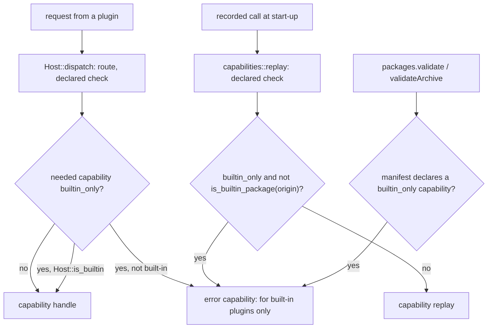

# Palette lead, `commands.run` and built-in-only capabilities (maintainers)

Host side of Ask Vestra (design: `C:\vestra\design\ask-astra\PROPOSAL.md`, user decisions of
2026-11-11). Ask Vestra itself is the built-in Vestra Player AI plugin's (`src/plugins/workshop`);
the host adds three general pieces that plugin is built from. Names are by what they do, not by
Ask Vestra, so a calculator, a library search or a jump-to-time row can use them later (PROPOSAL
§10).

## 1. Built-in-only capabilities

`Info::builtin_only` (`capabilities/mod.rs`, exported as `builtinOnly` in
`src/host/capabilities.json` and the SDK's `CAPABILITY_INFO`) marks a capability only built-in
plugins may use. Built-in means **by provenance**: `Host::is_builtin` (listed in `builtin.json`,
running from that directory, recorded built-in in the store). A manifest field or a load mode never
makes a plugin built-in, so a development load of a built-in's id is refused too (PROPOSAL Q10 A).

Where it is checked:

`packages.validate` (`package_validate.rs`) validates only third-party packages (built-in ids are
refused before), so a store or file install of a package declaring one fails there with
`capability`. `vestra-plugin check` gets the same rule from the SDK's `CAPABILITY_INFO`.

## 2. `commands.run` (risky, built-in only, residency none)

`capabilities/commands_run.rs`. Store label "Run any player or plugin command".

| Method | Params | Result | Errors |
| --- | --- | --- | --- |
| `commands.list` | `{}` | `{ revision, commands: [{ id, label, labelSource, title, category, path, place, keys, plugin, builtin, enabled, reason?, checkable, checked?, radio, group, busy, dangerous }] }` | — |
| `commands.run` | `{ id, ticket, step?, of? }` | `{ ran: true }` or `{ ran: false, declined: true }` | `missing`, `disabled` (with `reason`), `busy`, `invalid` (the palette's own command, bad `step`/`of`), `ticket`, `limit` |

- The list is the palette's (`Host::palette_items`, `ui/command_palette.rs` `items`): the same
  commands, labels and places. `id` is the global id `<manifest>/<local>` (`host/<id>` for the
  player's). `revision` is the registry revision. `keys` are every active key label
  (`bindings::Table::labels`). `builtin` says whether the command's plugin is built-in.
- **Personal data**: the host cannot tell which commands a plugin generated from the user's data
  (a Recently Played item titled with a file name), so the rows carry no such mark. A caller that
  must keep personal data from a model recognises them by owner and place: it leaves out the rows
  whose `path`/`place` is a plugin's list of files (Recently Played, a playlist) and the rows of
  plugins it does not know, and sends the rest. A general mark (`CommandOptions.personal`) would be
  a later addition once a second user needs it.
- A run follows `PaletteAction::Run`: the same `enabled` and `busy` checks, the palette's own
  command refused, then `Host::execute_command`. It does not touch the palette's recent list.
- **Tickets** (`CommandRuns`): minted only by a user's activation of the palette lead (§3), bound
  to the lead's holder, one live ticket per plugin (a newer request ends the older). A ticket ends
  on `palette.lead.done`, when its plugin stops or parks, or 120 s after it was minted or last ran a
  command. A parked holder woken by the lead event keeps it (`rekey`).
- **Rates**: 4 runs a second per ticket, 30 per ticket, 120 a minute per plugin (`limit`). A run
  counts when it passes the command checks, before any confirmation.
- **Confirmation** (`dangerous`): the host's own alert (`platform::confirm`, not destructive
  style: no icon on Windows, so no system sound): the question "Run “<command>”?" as its title, then
  "<caller> asks, for your request “<request>”." and, for a plugin that is not built in, that the
  player cannot tell what its command does;
  "Run" / "Don't Run". It comes before a command
  marked `CommandOptions.destructive`, the player's own Close (`host/stop`) and Quit (the host's
  list names only the player's commands), anything under the built-in `@settings` and `@reset`
  menus, and every command of a plugin that is not built-in (PROPOSAL Q3 A). The core never lists
  plugin commands: **plugins mark their destructive commands with `CommandOptions.destructive`**, and
  the built-in plugins mark theirs (Remove All, Clear History, Delete, …) before any caller uses
  `commands.run` (a gate the coordinator records).
  The caller cannot answer or skip it. "Don't Run" answers `{ ran: false, declined: true }`. The
  ticket and the command are checked again after the answer. Headless there is no alert:
  `VESTRA_TEST_CONFIRM=run` answers Run (tests), anything else Don't Run.
- **OSD**: each run shows "<plugin> · <command label>" (or "<plugin> · i/n · <label>" with
  `step`/`of`) before the command runs, and logs `commands.run: <id> ran <global>`.

`CommandOptions.destructive` (`commands::Declaration::destructive`, optional, absent = false) is
the general part: any plugin may mark a command, and other places (the bar's `»` menu) may ask
before running such a command later.

## 3. `palette.lead` (built-in only, residency recordable)

`capabilities/palette_lead.rs`, `host/palette.rs`, `ui/command_palette.rs`,
`ui/command-palette.slint`. Store label "Add the first row of the command palette".

| Method / event | Params | Notes |
| --- | --- | --- |
| `palette.lead.set` | `{ title (1–40), icon, placeholder? (≤60), empty? (≤80), note? (≤40), status?: { text (1–80), note? (≤40) } \| null }` | Texts are strings (translated with the plugin's catalog) or text values; `icon` is a name of the icon set (`BUTTON_ICONS`) or a `plugin.ui.image`. One holder: another plugin's `set` fails `conflict` with `reason: "lead-taken"` (the slot refusals' form; PROPOSAL said `taken`). Recorded and replayed. |
| `palette.lead.clear` | `{}` | The row and its placeholder go. |
| `palette.lead.done` | `{ ticket }` | Ends the ticket. |
| event `palette.lead` | `{ query, keep, ticket, status }` | Sent to the holder on Enter, Shift+Enter (`keep`) or a click on the row; `status` when the row showed its status. A trigger (`TRIGGERS` in `host/supervisor/mod.rs`): it wakes a parked holder. |

The palette with a lead (nothing changes without one):

- Row 0 is the lead, drawn above the command rows and never scrolled away: the icon in the check
  column (accent), "title: query" in semibold and plain (the title alone and `empty` dimmed for an
  empty query), `note` on the right; while the query is empty and a `status` is set, the status
  text and note instead. It takes one of the 12 slots; `Results: N` counts commands only; "No
  matching commands" moves to row 1; the field shows `placeholder`.
- The cursor (`command_palette::aim`): on the first command the query names (its title or full
  label equals the query, or its title continues the query from a word start for 3 or more
  characters, case ignored, category not part of the title: "pause" goes to Playback:
  Play/Pause), else on the lead. With an empty query it is on the first command (the most recent,
  so Enter repeats the last command as before), or on the lead while it shows a status. It is
  placed again after opening, typing, and when the lead comes or goes.
- `PaletteState::cursor` counts the lead as row 0; `Run(slot)` from the view uses the same slots
  (the lead's is 0), so the command rows' slot is `i + 1`.
- The bottom bar's palette cell shows `search-ai` (a speech bubble with the AI sparkle breaking out at its
  top right, design B) and the tip "Command Palette… and <title>" while a lead is set; `search` otherwise.
- Headless tests activate the row with `VESTRA_TEST_EXECUTE=lead:<query>@<ms>`
  (`host/supervisor/probe.rs`), as Enter would.

Why both stay built-in only for now (PROPOSAL §10): one lead slot, the palette's most valuable
row, and a third-party lead would see every query; running any plugin's command is a wider
boundary than any other capability, and plugin processes are not sandboxed, so the boundary is the
player's (tickets, rates, confirmation, the OSD line). Opening either needs the user's ruling.

## 4. Tests

- Unit: `capabilities/commands_run.rs` (tickets, idle end, rates, revoke and rekey, which commands
  ask first, `step`/`of`), `capabilities/palette_lead.rs` (parameters, the capability's flags),
  `capabilities/mod.rs` (built-in-only refusal for live requests and replays, the JSON field),
  `ui/command_palette.rs` (`names`, `aim`, no change without a lead), `host/supervisor/probe.rs`.
- Integration, ignored by default (`npm run ci:local`): `src/host/tests/palette_lead.rs`, the
  vertical slice with the real host headless: a built-in fixture sets the lead, gets the query and
  a ticket, runs its own command (OSD line), a destructive one after the confirmation, hits the
  rate limit and the ended ticket; a development load is refused both capabilities; a parked
  holder is woken by the row and its ticket works in the woken run; Don't Run declines.
- `package_manager.rs`: a development load of a built-in's id (even of the installation's
  directory) is not built-in (`builtin_provenance`: the run must use the built-in instance's data
  key).
