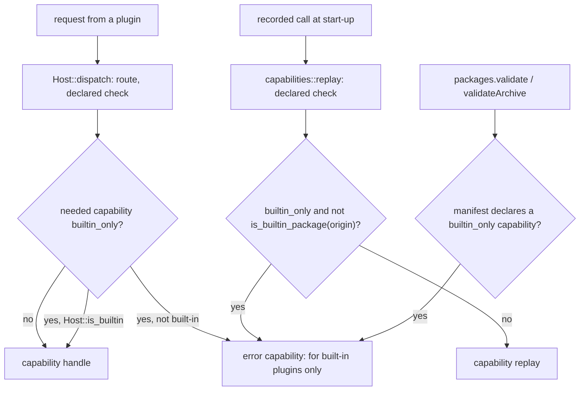

# Palette lead, `commands.run` and built-in-only capabilities (maintainers)

Host side of Ask Vestra (design: `C:\vestra\design\ask-astra\PROPOSAL.md`, user decisions of
2026-11-11). Ask Vestra itself is the built-in Vestra Player AI plugin's (`src/plugins/workshop`);
the host adds three general pieces that plugin is built from. Names are by what they do, not by
Ask Vestra, so a calculator, a library search or a jump-to-time row can use them later (PROPOSAL
§10).

## 1. Built-in-only capabilities

`Info::builtin_only` (`capabilities/mod.rs`, exported as `builtinOnly` in
`src/host/capabilities.json` and the SDK's `CAPABILITY_INFO`) marks a capability only built-in
plugins may use. Built-in means **by provenance**: `Host::is_builtin` (listed in `builtin.json`,
running from that directory, recorded built-in in the store). A manifest field or a load mode never
makes a plugin built-in, so a development load of a built-in's id is refused too (PROPOSAL Q10 A).

Where it is checked:

`packages.validate` (`package_validate.rs`) validates only third-party packages (built-in ids are
refused before), so a store or file install of a package declaring one fails there with
`capability`. `vestra-plugin check` gets the same rule from the SDK's `CAPABILITY_INFO`.

## 2. `commands.run` (risky, built-in only, residency none)

`capabilities/commands_run.rs`. Store label "Run any player or plugin command".

| Method | Params | Result | Errors |
| --- | --- | --- | --- |
| `commands.list` | `{}` | `{ revision, commands: [{ id, label, labelSource, title, category, path, place, keys, plugin, builtin, enabled, reason?, checkable, checked?, radio, group, busy, dangerous }] }` | — |
| `commands.run` | `{ id, ticket, step?, of?, then? }` | `{ ran: true }` or `{ ran: false, declined: true }` | `missing` (also an unknown `then` id, with `detail.id`), `disabled` (with `reason`), `busy`, `invalid` (the palette's own command, also in `then`; bad `step`/`of`/`then`), `ticket`, `limit` |

- The list is the palette's (`Host::palette_items`, `ui/command_palette.rs` `items`): the same
  commands, labels and places. `id` is the global id `<manifest>/<local>` (`host/<id>` for the
  player's). `revision` is the registry revision. `keys` are every active key label
  (`bindings::Table::labels`). `builtin` says whether the command's plugin is built-in.
- **Personal data**: the host cannot tell which commands a plugin generated from the user's data
  (a Recently Played item titled with a file name), so the rows carry no such mark. A caller that
  must keep personal data from a model recognises them by owner and place: it leaves out the rows
  whose `path`/`place` is a plugin's list of files (Recently Played, a playlist) and the rows of
  plugins it does not know, and sends the rest. A general mark (`CommandOptions.personal`) would be
  a later addition once a second user needs it.
- A run follows `PaletteAction::Run`: the same `enabled` and `busy` checks, the palette's own
  command refused, then `Host::execute_command`. It does not touch the palette's recent list.
- **Tickets** (`CommandRuns`): minted only by a user's activation of the palette lead (§3), bound
  to the lead's holder, one live ticket per plugin (a newer request ends the older). A ticket ends
  on `palette.lead.done`, when its plugin stops or parks, or 120 s after it was minted or last ran a
  command. A parked holder woken by the lead event keeps it (`rekey`).
- **Rates**: 4 runs a second per ticket, 30 per ticket, 120 a minute per plugin (`limit`). A run
  counts when it passes the command checks, before any confirmation.
- **Which commands ask** (`dangerous`): a command marked `CommandOptions.destructive`, the
  player's own Close (`host/stop`) and Quit (the host's list names only the player's commands),
  anything under the built-in `@settings` and `@reset` menus (judged on the whole path normalized,
  `commands::normalize`: an old root "设置" with items below it is Settings), and every command of
  a plugin that is not built-in (PROPOSAL Q3 A). The core never lists plugin commands: **plugins mark their
  destructive commands with `CommandOptions.destructive`**, and the built-in plugins mark theirs
  (Remove All, Clear History, Delete, …) before any caller uses `commands.run` (a gate the
  coordinator records).
- **Plans** (`then`, SDK 1.7.16; the SDK's TestHost has the same rules and messages): the global
  ids the same ticket runs next, in order. Checked in this order: the ticket given, `step`/`of`,
  `then`'s shape, the command, `then`'s ids, then the ticket and the rates (`count`); a refused
  call is not counted. Absent or null names no new plan; `[]` is a new plan of this command
  alone (it drops the rest of the old one and asks only if this command asks). Shape errors are
  `invalid`:
  "then is an array of command ids" (not an array), "then has at most 7 command ids" (with the
  run's own at most `PLAN_STEPS`, 8: the sheet's rows and `COMMAND_RUN_LIMITS.plan`), "then has
  command ids: non-empty strings". Each id must name a listed command (`missing`, "no command
  <id>", `detail.id`) other than the palette's own (`invalid`); repeats are allowed; its state
  (enabled, busy) is checked only when it runs, as an earlier step may change it.
- **Asked once, before the first step** (§2.1): a call with `then` drops what is left of the
  ticket's earlier plan. When any command of `[id, ...then]` asks, the host shows the approval
  sheet for the whole plan before anything runs; Run runs `id` and keeps `then` as the ticket's
  plan (repeats counted); Don't Run runs nothing, keeps no plan and answers
  `{ ran: false, declined: true }` (the caller ends the request). When none asks there is no sheet
  and no plan is kept. A call without `then` whose id is in the plan uses up its first occurrence
  and runs without asking, even a destructive command (`CommandRuns::take_planned`); any other
  command asks as it would alone (a sheet of one step), so a used-up plan entry asks again. The
  plan lives as long as the ticket (done, a new request, the plugin stopping or parking, 120 s
  unused). The caller cannot answer, skip or word the sheet. The ticket and the command are
  checked again after the answer. One sheet at a time, whoever asks: a run that would ask while any
  sheet waits fails `busy` ("another command is waiting for the user's answer"), decided before
  it is counted or touches the plan (`CommandRuns::admit`); the waiting sheet is the user's open
  question, so a later caller neither replaces it nor answers it in the user's place;
  an open native dialog no longer refuses a run (PROPOSAL F4): the sheet waits for it. Headless
  there is no sheet: `VESTRA_TEST_CONFIRM=run` answers Run for the whole sheet (tests), `always`
  Run too (and, from step 4, remember), anything else Don't Run; `commands.run: <id> asks to run
  <global>, <global>, … (headless: <answer>)` goes to stderr.
- **Where the run is named**: when the caller holds the palette lead (its ticket is the lead's),
  the step goes to the status strip (§3.1): "i/n · <command label>" with `step`/`of`, the label
  alone without, the line filled to i/n (full for a lone command). Any other caller (none yet: both
  capabilities are built-in only and only the lead mints tickets) gets the OSD line
  "<plugin> · <command label>" (or "<plugin> · i/n · <label>"). Either way the line shows before
  the command runs, and `commands.run: <id> ran <global> (strip: …)` (or `(osd: …)`) goes to
  stderr and `commands.run: <id> ran <global>` (with ` (step i/n)`) to the host log: ids only,
  never the label or the line, which may name the user's file (README §4.3, Host log).

`CommandOptions.destructive` (`commands::Declaration::destructive`, optional, absent = false) is
the general part: any plugin may mark a command, and other places (the bar's `»` menu) may ask
before running such a command later.

### 2.1 The approval sheet

Design: `C:\vestra\design\ask-vestra-ux\PROPOSAL.md` §4.3, §4.6, §4.7 (user rulings of
2026-11-12; step 3: H3, H7). `host/review_sheet.rs`, `ui/review-sheet.slint`, `ui/host.slint`,
`capabilities/commands_run.rs` (`ask`, `reason`).

A menu-layer mode beside the palette (`MenuMode::Review`) in the main window, drawn by the host from
its own data: where the palette and the status strip are (centred, y 16, below the fullscreen
title strip while it is out), on the palette's plate at its width (520px, at most the window less
16px); the status strip yields to it as to any menu. No system dialog, so no system sound; it
follows the theme. From the top:

| Part | Content |
| --- | --- |
| Request box (the palette field's box, read-only) | the lead's icon, its title and a colon in semibold (13px, `text`), the request the ticket was minted for (`text-list`, elided) |
| Question (28px, 12px semibold) | "Run this command?" / "Run these {n} commands?" |
| Steps (28px each, 8 fixed slots) | number (11px `text-dim`), palette label (12px; `text` for a step that asks, `text-list` for one that does not), the plugin's shown name (11px `text-dim`), a reason (11px `text-dim`) |
| Note (11px `text-dim`, wraps), only when a step's plugin is not built in | "The player cannot tell what commands of plugins that are not built in will do." |
| Footer (the palette's separator; 44px) | right: [Run `Enter`] [Don't Run `Esc`] (the library Button's plate with a `KeyHint`; confirm first, as `UrlInputRow`). The left is kept for "Don't ask again" (step 4, H4). |

Reasons are facts only (H7; user ruling 2 of 2026-11-12): "Not built in" for a command of a plugin
that is not built in, "Closes the video" for the player's Close, "Quits the player" for its Quit;
none for a destructive command (no "Cannot be undone") nor for a step that does not ask.

Input (§4.6): it takes the keyboard focus; Enter runs, Esc does not; held-down repeats count for
nothing (the Enter that sent the request); Run and Don't Run by pointer; a press outside it is Don't
Run. Nothing counts within 500 ms of it showing (`review_sheet::GUARD_MS`, Chromium's rule for
sensitive UI), each time it shows. Bindings pause while it shows (it is the menu layer), and the
palette and other menus do not open over it.

Edge cases (§4.7): while a native dialog is open (`dialog_busy`) it waits, and steps aside if one
opens over it; it shows again when something else closed the menu layer (a rebuilt shell, another
menu); it stays when the window is not active and takes no focus from another program. Only an
answer, the end of the ticket (120 s unused, `palette.lead.done`: answered Don't Run) or the end of
the caller (it stopped: the sheet just goes) removes it (`review_tick`, every window tick). The
answer goes the usual way, `Event::CommandRunAnswered`. stderr gets the number of steps asked
about, never the labels or the request.

Offline renders: `widgets_tests::render_review_sheet_states` (ignored; `VESTRA_SHEET_SHOTS=<dir>`,
`VESTRA_SHEET_LANG=en|zh-Hans`, `VESTRA_SHEET_BACKDROP=<png>`): a plan of three steps with one not
built in, one destructive step, one step not built in, Close, eight steps; both palettes, 2×.

## 3. `palette.lead` (built-in only, residency recordable)

`capabilities/palette_lead.rs`, `host/palette.rs`, `ui/command_palette.rs`,
`ui/command-palette.slint`. Store label "Add the first row of the command palette".

| Method / event | Params | Notes |
| --- | --- | --- |
| `palette.lead.set` | `{ title (1–40), icon, placeholder? (≤60), empty? (≤80), note? (≤40), status?: { text (1–80), note? (≤40), state? } \| null }` | Texts are strings (translated with the plugin's catalog) or text values; `icon` is a name of the icon set (`BUTTON_ICONS`) or a `plugin.ui.image`. One holder: another plugin's `set` fails `conflict` with `reason: "lead-taken"` (the slot refusals' form; PROPOSAL said `taken`). Recorded and replayed, less an end-state `status` (§3.1). |
| `palette.lead.clear` | `{}` | The row and its placeholder go. |
| `palette.lead.done` | `{ ticket }` | Ends the ticket. |
| event `palette.lead` | `{ query, keep, ticket, status }` | Sent to the holder on Enter, Shift+Enter (`keep`) or a click on the row; `status` when the row showed its status. A trigger (`TRIGGERS` in `host/supervisor/mod.rs`): it wakes a parked holder. |

The palette with a lead (nothing changes without one):

- Row 0 is the lead, drawn above the command rows and never scrolled away: the icon in the check
  column (accent), "title: query" in semibold and plain (the title alone and `empty` dimmed for an
  empty query), `note` on the right; while a working `status` is set and the query is empty, the
  status text and note instead (`command_palette::lead_shows_status`). The event's `status`
  follows the same rule. Shift+Enter on the row clears the field after sending (`run_lead`;
  PROPOSAL F1, Ask Vestra UX H6), so the row shows the status of the request just sent and a
  second Enter stops it instead of sending it again: the cursor stays on the lead row, and until
  that request's status has come and gone (or something is typed, or it is stopped) Enter there
  with nothing typed sends `status: true`, also before the status arrives (a parked holder takes
  a moment to wake; `PaletteState::sent`). Typing another query is another request. It
  takes one of the 12 slots; `Results: N` counts commands only; "No matching commands" moves to
  row 1; the field shows `placeholder`.
- The cursor (`command_palette::aim`): on the first command the query names (its title or full
  label equals the query, or its title continues the query from a word start for 3 or more
  characters, case ignored, category not part of the title: "pause" goes to Playback:
  Play/Pause), else on the lead. With an empty query it is on the first command (the most recent,
  so Enter repeats the last command as before), or on the lead while it shows a status. It is
  placed again after opening, typing, when the lead comes or goes, and when its status comes or
  goes while nothing is typed (the status arrives after Shift+Enter cleared the field); not by
  Shift+Enter itself, which leaves it on the lead row.
- `PaletteState::cursor` counts the lead as row 0; `Run(slot)` from the view uses the same slots
  (the lead's is 0), so the command rows' slot is `i + 1`.
- The bottom bar's palette cell shows `search-ai` (a speech bubble with the AI sparkle breaking out at its
  top right, design B) and the tip "Command Palette… and <title>" while a lead is set; `search` otherwise.
- Headless tests activate the row with `VESTRA_TEST_EXECUTE=lead:<query>@<ms>`
  (`host/supervisor/probe.rs`), as Enter would.

### 3.1 `status.state` and the status strip

Design: `C:\vestra\design\ask-vestra-ux\PROPOSAL.md` §4.2 (user rulings of 2026-11-12, step 2:
H1, H2, H6; SDK 1.7.15 `PaletteLeadStatus.state`). `capabilities/palette_lead.rs` (`LeadStatus`,
`StatusState`), `host/lead_strip.rs`, `ui/lead-strip.slint`, `ui/host.slint`.

`status.state` is `"working"` (absent or null: the default), `"done"`, `"failed"` or `"note"`; any
other value fails `invalid` ("status.state is one of working, done, failed, note"), as the SDK's
TestHost does. A working status is the row's status (above) and the strip's text. An end state
(done, failed, note) is shown **once** in the strip and never on the row: `set` takes it off the
row and out of the recorded call (`Lead::sent`), so a parked or restarted holder is never shown it
again, and the row goes back to its usual form at once. The same end status sent again by the next
`set` (an update of other fields: the SDK's `update` sends them all) is not shown again
(`Lead::ended`); a new request (a new ticket) forgets it, so the same failure twice in a row shows
twice. The holder needs no timer and may call `palette.lead.done` right away.

The strip is where the palette was: centred, y 16 (below the fullscreen title strip while it is
out), above the video, the OSD and the title strip, below the menu layer; the palette's plate
(`bg-panel`, 1px `line`, 8px corners, the menu shadow), 12px text, 32px high (an end state up to
two lines, 48px), 168–420px wide (an end state up to 520px), at most the window's width less
16px. It takes no keyboard focus. What it shows (`lead_strip::project`, first match wins):

| Source | Icon | Line (2px `accent-fill`, 8px in from each side) | Stop | Time |
| --- | --- | --- | --- | --- |
| An end state: done / failed / note | `menu-check` accent / `failed` danger / `ai` accent | full / full `danger` / none | no | 2 s / 6 s / 4 s + 50 ms a character, at most 10 s; held while the active pointer is on it (the OSD's hold, at most 30 s); then a 300 ms fade |
| The step `commands.run` last ran for the holder with a live ticket | `ai` accent | filled to step/of, 150 ms per change | yes | until the ticket ends (done, a new request, 120 s idle, the holder stops or parks), an end state or `status: null` |
| The holder's working status | `ai` accent | a 36% segment sweeps left to right, 1.4 s a pass, easing in and out, its ends fading into the plate | yes | while it is set |

From the first step on, a working text the holder sends changes only the palette's status row,
not the strip. A working status that arrives while an end state shows, with no step, replaces it
(a new request). The strip yields to any open menu or the palette (the palette's first row shows
the working status then) and comes back when it closes, its time running on. Presses: Stop sends
the `palette.lead` event with `status: true` and an empty query, as Enter on the status row does
(a new ticket; the holder stops its request); a press elsewhere opens the palette, or on an end
state removes it at once; nothing while it fades out. Every element stays (`visible` and widths
change); the host writes the `lead-strip` struct only when it changes, and again into a rebuilt
shell (`write_strip`). While it shows, the OSD message's text ends 8px left of it.

**Motion and frame rate.** The sweep is the only lasting animation: the segment's `x` reads
`animation-tick()` only while the strip shows and works, so nothing else asks for frames (a step,
an end state, a hidden strip: none; `widgets_tests::the_lead_strip_animates_only_while_it_sweeps`).
`widgets_tests::lead_strip_sweep_frame_cost` (ignored, `VESTRA_STRIP_BENCH=1`) draws the window
over a video still with Slint's software renderer at 60 Hz pacing and prints the draw times, whole
frame and changed region. Not done yet: a system setting without animations (Windows "Show
animations") does not stop the sweep (`LeadStripView.still` is there for it).

Offline renders: `widgets_tests::render_lead_strip_states` (ignored; `VESTRA_STRIP_SHOTS=<dir>`,
`VESTRA_STRIP_LANG=en|zh-Hans`, `VESTRA_STRIP_BACKDROP=<png>`) draws each state at 2×, both
palettes, as the spec's `proposed/detail-*.png` do.

Why both stay built-in only for now (PROPOSAL §10): one lead slot, the palette's most valuable
row, and a third-party lead would see every query; running any plugin's command is a wider
boundary than any other capability, and plugin processes are not sandboxed, so the boundary is the
player's (tickets, rates, confirmation, the line naming each run). Opening either needs the user's ruling.

## 4. Tests

- Unit: `capabilities/commands_run.rs` (tickets, idle end, rates, revoke and rekey, which commands
  ask first, `step`/`of`, `then`, plan approvals, the sheet's reasons), `host/review_sheet.rs` (the
  guard, the question, the sheet's value), `capabilities/palette_lead.rs` (parameters, the capability's flags),
  `capabilities/mod.rs` (built-in-only refusal for live requests and replays, the JSON field),
  `capabilities/palette_lead.rs` (`status.state`), `host/lead_strip.rs` (what the strip shows, end
  states' times, the shell value), `ui/command_palette.rs` (`names`, `aim`, `lead_shows_status`, no
  change without a lead), `ui/widgets_tests.rs` (the strip's sizes, presses, fade and animation; the sheet's size, keys,
  repeats and buttons),
  `host/supervisor/probe.rs`. `src/tests/sdk/host-agreement.test.ts`: TestHost accepts the
  player's `StatusState::NAMES` and refuses another with the player's code and message (skipped
  before SDK 1.7.15).
- Integration, ignored by default (`npm run ci:local`): `src/host/tests/palette_lead.rs`, the
  vertical slice with the real host headless: a built-in fixture sets the lead, gets the query and
  a ticket, runs its own command (the strip's line), a destructive one after the confirmation, hits
  the rate limit, an unknown `status.state` and an end state, and the ended ticket; a development load is refused both capabilities; a parked
  holder is woken by the row and its ticket works in the woken run; Don't Run declines; a plan
  (`then`) is refused when malformed, asked once before its first step, its approved steps run
  without asking and a step outside it asks again; Don't Run on a plan runs nothing.
- `package_manager.rs`: a development load of a built-in's id (even of the installation's
  directory) is not built-in (`builtin_provenance`: the run must use the built-in instance's data
  key).
