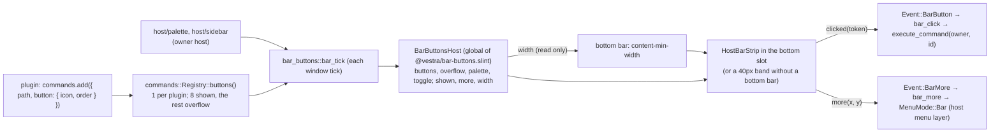

# Panel slot sharing (sidebar tabs)

2026-10-24. User ruling: **option A, sidebar tabs**. The bottom bar and the backdrop stay exclusive.

## Problem

There are only 3 slots (`Slot::Bottom`, `Slot::Sidebar`, `Slot::Backdrop`, in `composition.rs`), and each slot can hold only one panel:

- `shell_source` bails when two panels are in the same slot;
- `bottom`/`sidebar` in `window_state::Policy` are `Option<Attachment>`;
- `InputShared.sidebar` records only one owner;
- `layout.set`, `sync_floating` and `floating_source` are all written for "one owner per slot".

A sidebar or bottom-bar conflict is only discovered at compile time, reported as `ui-prepare`; and a mount failure during `activate` makes the whole activation fail. The result is that the plugin mounted later (for example the built-in playlist) fails entirely, "Playlist F6" disappears, and the user sees no message at all.

## Step 0: failures must be visible (branch `fix/slot-conflict`)

- `ui.mount` checks right at the entry whether the sidebar or bottom bar is already taken (including queued and preparing mounts); if taken, it returns `conflict`, with the occupying plugin's id in the message.
- A slot conflict no longer fails activation: the plugin becomes ready as usual, with a `slot-occupied` warning that is shown in the plugin manager.
- Built-in plugins mount first.
- `ui-prepare` is used only for real compile errors and bridge errors.

## Step 1: sidebar tabs

Status: implemented in the host and SDK 1.5.2 (2026-10-24); the playlist is one of the sidebar's tabs. Trade-offs made during implementation:

- The tab list is in `PanelSlot.panels` (not in `SlotState`), so `deepEqual` on `state` in plugin tests does not fail because of a new field; on the wire it is still `LayoutSlot.panels`.
- `"otherTab"` only appears in `Panel.state.reason`; `SlotState.reason` is for the whole sidebar and is unchanged.
- The sidebar held at most 8 tabs (a 9th was refused with `conflict`); since 2026-11-03 it takes any number, with an overflow menu, and only the front tabs are compiled: see [sidebar-tabs.md](sidebar-tabs.md).
- The tab strip has no close button (user ruling 2026-11-07: right below the window's own close button, a missed click closed the player); the bottom bar's sidebar button, F6 and the menus hide the sidebar. Inactive tab text uses `text-dim`, and hovering shows a rounded `hover-bg` background; when tabs do not fit at 105px they narrow equally and the text is elided.
- Drop coordinates are measured from below the tab strip (the panel component's own coordinate system).
- Switching tabs with Ctrl+Tab is not done.

```
┌──────────── video ────────────┬[Playlist][Example List]     ⧉┐
│                               │  1. a.mkv                     │
└──────────── bottom bar ───────┴───────────────────────────────┘
```

- **Tab strip**: not drawn when there is only one sidebar panel, so the UI is exactly as it is now; with two or more, the host draws a 31px tab strip in the style of the playlist tabs in ui-spec §5. The detach button sits at the right end of the tab strip and acts on the whole slot (no close button since 2026-11-07).
- **Host**
  - composition: generates one `if` branch per compiled sidebar panel (since 2026-11-03 `if root.sidebar-shown == <owner>: Owner<owner>View`, for the front tabs only, [sidebar-tabs.md](sidebar-tabs.md)); switching between compiled tabs only changes a property and does not recompile the shell.
  - `floating_source` takes several specs, and the floating window has the same tab strip.
  - `Policy.sidebar` becomes `{ panels, active, preferred, detached }`: visibility and detachment are per slot.
  - `InputShared.sidebar` takes the owner of the active tab; only the active tab receives panel keys.
  - `layout.set` gains `active`.
  - `ui_state` gains `sidebarSlot { visible, detached, active, order }`; the old `panels[*]` are migrated into it.
- **SDK**: additive only (`vestra/1`, patch version).
  - `LayoutSlot.owner` now means the owner of the active tab.
  - New `LayoutSlot.panels?`; `reason` gains `"otherTab"`.
  - `Panel` gains `state` / `onChange` / `show()` / `toggle()`; `PanelSlot` gains `activate(plugin)`.
  - `ready` of a second sidebar panel resolves as usual; `showMenu` called on a background tab is refused with `unavailable`.
  - Old plugins need no changes.
- **Playlist**
  - F6 becomes `list.toggle()`; its checked state = sidebar visible and the active tab is the playlist.
  - When the host has a tab strip, it hides its own tab strip.
  - On an old host it falls back to `sidebar.toggle()`.
- **Shortcuts**: plugins can bind keys to their own `toggle()`; optionally Ctrl+Tab (limited to `focus:"panel"`) switches tabs; check menus.md for conflicts before adding it.
- **Detach, fullscreen, drag and drop**: the whole sidebar is detached, and the floating window has tabs too; the fullscreen pop-up shows the active tab; drops go to the active tab.
- **Not in the first version**: closing a single tab, reordering by dragging. Tabs are ordered by installation order, with the playlist fixed first.

## What a plugin gets when it cannot get a slot

A background tab (`reason: "otherTab"`) or a taken exclusive slot (`conflict`, `slot-occupied`) never fails activation; what the plugin sees is on the SDK site: [Panel](https://vestrasys.github.io/vestra-player-sdk/documents/Windows,_panels,_settings_pages,_dialogs_and_the_OSD.html#panel).

## Tests

- Unit tests: composition generates several branches and compiles; falling back from the active tab in window_state; ui_state migration; `ui.mount` returning `conflict`, `active` in `layout.set`; the SDK fake host; the playlist's F6.
- Real machine: load the panel-menu example and the playlist together, and check:
  - switching tabs;
  - F6;
  - F6 closing the sidebar while focus is in the list;
  - detach / attach;
  - the fullscreen pop-up;
  - drag and drop;
  - restoring the active tab after a restart;
  - a narrow window.
- When done, remove the sentence "do not load together with the playlist" from the panel-menu README.

No new system-specific code: the floating window keeps using the existing `platform::` calls.

## Bottom-bar command buttons (player 0.5.10; host-placed from 0.7.6)

2026-10-27, user-approved design. The bottom bar stays exclusive (one panel), yet other plugins need a one-click entry point in it (the plugin store, the AI workshop). Rejected: a general `commands.run("<plugin>/<command>")` (the bar would hard-code other plugins), core actions for them (plugin-specific logic in the core), a host strip composed over the bar without its cooperation (the host does not know the bar's geometry).

**Menu redesign step 3a (player 0.7.6, SDK 1.6.7): the host places the strip.** The 0.5.10 design let the bar place `BarButtons` because the host did not know the bar's geometry; that made every button vanish with a bar that does not place it, and the limits left buttons out silently. Now the bar reports one number instead (`content-min-width`) and the host draws the strip itself (`HostBarStrip`, `ui/bar-strip.slint`), aligned with a 40px button row at the bottom of the slot.



- **Contributor API**: `CommandOptions.button` (SDK 1.5.29). The registry validates it (`commands::button_valid`: a menu path, order 0–999, an icon of `BUTTON_ICONS` or an image the `commands` capability located in the plugin's directories). `Registry::buttons` keeps each owner's first declared button (the others are `dropped`; their commands and menu entries stay), ranks them by (order, manifest id, sequence) and gives the strip the 8 lowest (`shown`); the rest are `overflow`, always in `»`. Lower `order` stays in the strip longest. Nothing is left out for the total; the remaining log lines (`dropped`, `overflow`) are debug only (`VESTRA_DEBUG_BAR=1`).
- **Layout**: `[plugin buttons…][»][Command Palette][Toggle Sidebar]`, 41×40 cells, the Adjust cell of step 3b to go between the palette and the toggle. The numbers live in the global, so the bar reads the same width: `fixed` (the cells a bar must leave free: the host's own, plus the `»` cell whenever any plugin button exists, reserved even while `»` is not drawn; it never depends on `room`), `free = floor(room / 41px) − own`, `shown` (all of `buttons` when nothing overflows and they fit, else `free − 1` to leave a cell for `»`), `more`, `width`. The host's own cells always show, even past `room`.
- **Room**: the shell gives the strip `max(0, bar width − content-min-width − 4px)`; `content-min-width` is read when the mounted component has a public `length` property of that name, its own or inherited (`composition::bar_reports_min`: the bar's file compiled alone, `ComponentDefinition::properties`, cached per file, component and modification time). Without it the room is the whole bar. The strip publishes the room to the global (`changed room`), which computes `width`; `content-min-width` must not depend on `width`.
- **No bottom bar**: a 40px `bg-bar` band with a 1px `line` on top holds the strip under the video (hidden in fullscreen), so the buttons never vanish.
- **Transition**: a bar that still places the deprecated `BarButtons` sets `placed`; the host strip then hides and its `width` is 0 (no second strip). That strip shows `buttons` with its own rules (lowest order lost first) and no palette cell or `»`. `vestra-plugin check` no longer warns about a bar without `BarButtons`.
- **`»`** opens the host menu layer like the sidebar tabs' `»` (`MenuMode::Bar`, `menu::bar_level`): the strip's buttons from `shown` on, then `overflow`, in strip order, each with its icon (`MenuRow.icon`; none for a plugin image), title, key and check state, opening above the `»` cell. A row runs its command like its menu item.
- **One shared global.** The bar imports `@vestra/bar-buttons.slint`; the shell and the floating window export `BarButtonsHost` from the same library file, so the bar reads the global the host fills (Slint globals are per instance, shared by every component in it). The cells are persistent elements shown with `visible:`; nothing is created on hover or resize (the AccessKit rule of `menu-view.slint`).
- **The command palette cell** is the host command `host/palette` (the `search` magnifier, tooltip "Command Palette (Ctrl+Shift+P)"), always enabled.
- **The sidebar toggle** is the host command `host/sidebar` (Toggle Sidebar, outside the menu, no default key; F6 stays the playlist's): enabled while a panel is in the sidebar, checked while the sidebar is wanted, the cell dimmed (G-18) while wanted but hidden for room. Running it toggles the sidebar slot's preference, as `panels.sidebar.toggle()` does.
- **Older players** build the `plugin` object with their own SDK, which does not send `button`: no button, no error. `Declaration` keeps `deny_unknown_fields`; `button` is read apart before it.
- **Tests**: `commands::button_tests` (validation, limits, order and overflow, removal; `BUTTON_ICONS` is the icon set), `bar_buttons::tests` (labels, tooltips, tokens, what `»` lists), `ui::view::tests::bar_buttons_share_the_shell_global_and_drop_the_lowest_order_first` (a real shell with a bar placing `BarButtons`: `placed`, its cells at several rooms, no second strip), `ui::view::tests::host_strip_overflows_by_width_and_keeps_its_own_cells` and `without_a_bottom_bar_a_band_holds_the_strip`, `menu::tests::the_bar_overflow_menu_has_icons_and_opens_above_the_strip`, `composition` (both windows export the global; where `content-min-width` is read; the band), `composition` (both windows export the global), `tests/sdk/host-agreement.test.ts` (`BAR_BUTTON_ICONS`, `BAR_BUTTON_LIMITS`, `host/sidebar` in `BUILTIN_COMMANDS`).
- **Clicks.** A click sends the cell's token; the host runs it only when the token is in the strip's list (the plugins' buttons, the palette and the toggle). A cell hidden for want of room is not clickable at all: its TouchArea is disabled and its accessibility action guarded.
- **Cost per tick.** `bar_tick` runs on every window tick but compares `bar_buttons::Inputs` first (the registry and binding revisions, the sidebar's state, the language, the window generations) and rebuilds only when it changed (UI frame-rate rule; `bar_buttons::tests::an_unchanged_tick_does_not_rebuild`).
- **Images** are decoded when the strip is rebuilt (at most 64 px); one that cannot be loaded shows the icon set's `failed` icon instead of an empty cell, and stays clickable.
- **Standby.** The `button` is part of the recorded command declaration: the button of a plugin in standby stays in the strip from the recording, and a click starts the plugin like its menu item does ([supervisor §4](supervisor.md#4-standby-and-wake)); checked on hardware.
