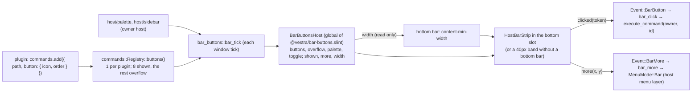

# Panel slot sharing (sidebar tabs)

2026-10-24. User ruling: **option A, sidebar tabs**. The bottom bar and the backdrop stay exclusive.

## Problem

There are only 3 slots (`Slot::Bottom`, `Slot::Sidebar`, `Slot::Backdrop`, in `composition.rs`), and each slot can hold only one panel:

- `shell_source` bails when two panels are in the same slot;
- `bottom`/`sidebar` in `window_state::Policy` are `Option<Attachment>`;
- `InputShared.sidebar` records only one owner;
- `layout.set`, `sync_floating` and `floating_source` are all written for "one owner per slot".

A sidebar or bottom-bar conflict is only discovered at compile time, reported as `ui-prepare`; and a mount failure during `activate` makes the whole activation fail. The result is that the plugin mounted later (for example the built-in playlist) fails entirely, "Playlist F6" disappears, and the user sees no message at all.

## Step 0: failures must be visible (branch `fix/slot-conflict`)

- `ui.mount` checks right at the entry whether the sidebar or bottom bar is already taken (including queued and preparing mounts); if taken, it returns `conflict`, with the occupying plugin's id in the message.
- A slot conflict no longer fails activation: the plugin becomes ready as usual, with a `slot-occupied` warning that is shown in the plugin manager.
- Built-in plugins mount first.
- `ui-prepare` is used only for real compile errors and bridge errors.

## Step 1: sidebar tabs

Status: implemented in the host and SDK 1.5.2 (2026-10-24); the playlist is one of the sidebar's tabs. Trade-offs made during implementation:

- The tab list is in `PanelSlot.panels` (not in `SlotState`), so `deepEqual` on `state` in plugin tests does not fail because of a new field; on the wire it is still `LayoutSlot.panels`.
- `"otherTab"` only appears in `Panel.state.reason`; `SlotState.reason` is for the whole sidebar and is unchanged.
- The sidebar held at most 8 tabs (a 9th was refused with `conflict`); since 2026-11-03 it takes any number, with an overflow menu, and only the front tabs are compiled: see [sidebar-tabs.md](sidebar-tabs.md).
- The tab strip has no close button (user ruling 2026-11-07: right below the window's own close button, a missed click closed the player); the bottom bar's sidebar button, F6 and the menus hide the sidebar. Inactive tab text uses `text-dim`, and hovering shows a rounded `hover-bg` background; when tabs do not fit at 105px they narrow equally and the text is elided.
- Drop coordinates are measured from below the tab strip (the panel component's own coordinate system).
- Switching tabs with Ctrl+Tab is not done.

```
┌──────────── video ────────────┬[Playlist][Example List]     ⧉┐
│                               │  1. a.mkv                     │
└──────────── bottom bar ───────┴───────────────────────────────┘
```

- **Tab strip**: not drawn when there is only one sidebar panel, so the UI is exactly as it is now; with two or more, the host draws a 31px tab strip in the style of the playlist tabs in ui-spec §5. The detach button sits at the right end of the tab strip and acts on the whole slot (no close button since 2026-11-07).
- **Host**
  - composition: generates one `if` branch per compiled sidebar panel (since 2026-11-03 `if root.sidebar-shown == <owner>: Owner<owner>View`, for the front tabs only, [sidebar-tabs.md](sidebar-tabs.md)); switching between compiled tabs only changes a property and does not recompile the shell. Since player 0.9.0 the column is one container and each tab compiles on its own when first shown ([Per-panel compilation](#per-panel-compilation)).
  - `floating_source` takes several specs, and the floating window has the same tab strip.
  - `Policy.sidebar` becomes `{ panels, active, preferred, detached }`: visibility and detachment are per slot.
  - `InputShared.sidebar` takes the owner of the active tab; only the active tab receives panel keys.
  - `layout.set` gains `active`.
  - `ui_state` gains `sidebarSlot { visible, detached, active, order }`; the old `panels[*]` are migrated into it.
- **SDK**: additive only (`vestra/1`, patch version).
  - `LayoutSlot.owner` now means the owner of the active tab.
  - New `LayoutSlot.panels?`; `reason` gains `"otherTab"`.
  - `Panel` gains `state` / `onChange` / `show()` / `toggle()`; `PanelSlot` gains `activate(plugin)`.
  - `ready` of a second sidebar panel resolves as usual; `showMenu` called on a background tab is refused with `unavailable`.
  - Old plugins need no changes.
- **Playlist**
  - F6 becomes `list.toggle()`; its checked state = sidebar visible and the active tab is the playlist.
  - When the host has a tab strip, it hides its own tab strip.
  - On an old host it falls back to `sidebar.toggle()`.
- **Shortcuts**: plugins can bind keys to their own `toggle()`; optionally Ctrl+Tab (limited to `focus:"panel"`) switches tabs; check menus.md for conflicts before adding it.
- **Detach, fullscreen, drag and drop**: the whole sidebar is detached, and the floating window has tabs too; the fullscreen pop-up shows the active tab; drops go to the active tab.
- **Not in the first version**: closing a single tab, reordering by dragging. Tabs are ordered by installation order, with the playlist fixed first.

## What a plugin gets when it cannot get a slot

A background tab (`reason: "otherTab"`) or a taken exclusive slot (`conflict`, `slot-occupied`) never fails activation; what the plugin sees is on the SDK site: [Panel](https://vestrasys.github.io/vestra-player-sdk/interfaces/_vestra-player_sdk.Panel.html).

## Tests

- Unit tests: composition generates several branches and compiles; falling back from the active tab in window_state; ui_state migration; `ui.mount` returning `conflict`, `active` in `layout.set`; the SDK fake host; the playlist's F6.
- Real machine: load the panel-menu example and the playlist together, and check:
  - switching tabs;
  - F6;
  - F6 closing the sidebar while focus is in the list;
  - detach / attach;
  - the fullscreen pop-up;
  - drag and drop;
  - restoring the active tab after a restart;
  - a narrow window.
- When done, remove the sentence "do not load together with the playlist" from the panel-menu README.

No new system-specific code: the floating window keeps using the existing `platform::` calls.

## Bottom-bar command buttons (player 0.5.10; host-placed from 0.7.6)

2026-10-27, user-approved design. The bottom bar stays exclusive (one panel), yet other plugins need a one-click entry point in it (the plugin store, the AI workshop). Rejected: a general `commands.run("<plugin>/<command>")` (the bar would hard-code other plugins), core actions for them (plugin-specific logic in the core), a host strip composed over the bar without its cooperation (the host does not know the bar's geometry).

**Menu redesign step 3a (player 0.7.6, SDK 1.6.8): the host places the strip.** The 0.5.10 design let the bar place `BarButtons` because the host did not know the bar's geometry; that made every button vanish with a bar that does not place it, and the limits left buttons out silently. Now the bar reports one number instead (`content-min-width`) and the host draws the strip itself (`HostBarStrip`, `ui/bar-strip.slint`), aligned with a 40px button row at the bottom of the slot.



- **Contributor API**: `CommandOptions.button` (SDK 1.5.29). The registry validates it (`commands::button_valid`: a menu path, order 0–999, an icon of `BUTTON_ICONS` or an image the `commands` capability located in the plugin's directories). `Registry::buttons` keeps each owner's first declared button (the others are `dropped`; their commands and menu entries stay), ranks them by (order, manifest id, sequence) and gives the strip the 8 lowest (`shown`); the rest are `overflow`, always in `»`. Lower `order` stays in the strip longest. Nothing is left out for the total; the remaining log lines (`dropped`, `overflow`) are debug only (`VESTRA_DEBUG_BAR=1`).
- **Layout**: `[plugin buttons…][»][Command Palette][Toggle Sidebar]`, 41×40 cells, the Adjust cell of step 3b to go between the palette and the toggle. The numbers live in the global, as pure functions of a room (`shown-in`, `more-in`, `width-in`) and as properties at the published `room`, so the bar reads the same width: `fixed` (the cells a bar must leave free: the host's own, plus the `»` cell whenever any plugin button exists, reserved even while `»` is not drawn; it never depends on `room`), `free = floor(room / 41px) − own`, `shown` (all of `buttons` when nothing overflows and they fit, else `free − 1` to leave a cell for `»`), `more`, `width`. The host's own cells always show, even past `room`.
- **Room**: the shell gives the strip `max(0, bar width − content-full-width − 4px)`, where `content-full-width` is the bar's row with every one of its controls shown (coordinator ruling after the GUI check of 3a: plugin buttons get only the room beyond everything the bar can show, so they all go to `»` before the bar drops a control of its own, and narrowing the window never brings a button back; the bar's own drops keep reserving `fixed` cells). A bar that reports only `content-min-width` gets the room beyond that (the 3a rule, which is not monotonic when a drop frees more than a cell). Each is read when the mounted component has a public `length` property of that name, its own or inherited from a base component in another file (`composition::bar_reports_min`). `ComponentDefinition::properties()` cannot answer that: in Slint 1.18.1 it lists only the root's own declarations. So the host compiles a probe that reads the property from an instance of the bar into a `length` property; it compiles exactly when the property exists, is public and is a length. The answer is kept for the bar's run (owner generation, file, component): generations are never reused and a plugin's files change only between runs (install, update and reload restart it), so a changed base component or import is probed again at the next run. Without either the room is the whole bar; neither may depend on `width`.
- **No frame behind a resize**: the strip draws from `shown-in`, `more-in` and `width-in` at its own `room`, a plain binding to the shell's layout. It also publishes `room` to the global (`changed room`) for the global's properties, which the host reads at a `»` click and a bar may read; those follow a frame later. A two-way binding of the strip's `room` to the global's would make the global's properties declarative too, but the shell gives `room` a binding at the instance, and the pure functions make the drawn strip exact without relying on that.
- **No bottom bar**: a 40px `bg-bar` band with a 1px `line` on top holds the strip under the video (hidden in fullscreen), so the buttons never vanish.
- **Transition**: a bar that still places the deprecated `BarButtons` sets `placed`; the host strip then hides and its `width` is 0 (no second strip). That strip shows `buttons` with its own rules (lowest order lost first) and no palette cell or `»`. `vestra-plugin check` no longer warns about a bar without `BarButtons`.
- **`»`** opens the host menu layer like the sidebar tabs' `»` (`MenuMode::Bar`, `menu::bar_level`): the strip's buttons from `shown` on, then `overflow`, in strip order, each with its icon (`MenuRow.icon`; none for a plugin image), title, key and check state, opening above the `»` cell. A row runs its command like its menu item.
- **One shared global.** The bar imports `@vestra/bar-buttons.slint`; the shell and the floating window export `BarButtonsHost` from the same library file, so the bar reads the global the host fills (Slint globals are per instance, shared by every component in it). The cells are persistent elements shown with `visible:`; nothing is created on hover or resize (the no-churn rule of `menu-view.slint`).
- **The command palette cell** is the host command `host/palette` (the `search` magnifier, tooltip "Command Palette (Ctrl+Shift+P)" with its current key), enabled and busy as the command is (the host registers it enabled), always shown.
- **The sidebar toggle** is the host command `host/sidebar` (Sidebar, titled Toggle Sidebar and outside the menu until the user ruling of 2026-11-08, now a top-level menu item at 800; no default key; F6 stays the playlist's): enabled while a panel is in the sidebar, checked while the sidebar is wanted, the cell dimmed (G-18) while wanted but hidden for room. Running it toggles the sidebar slot's preference, as `panels.sidebar.toggle()` does.
- **Older players** build the `plugin` object with their own SDK, which does not send `button`: no button, no error. `Declaration` keeps `deny_unknown_fields`; `button` is read apart before it.
- **Tests**: `commands::button_tests` (validation, limits, order and overflow, removal; `BUTTON_ICONS` is the icon set), `bar_buttons::tests` (labels, tooltips, tokens, what `»` lists), `ui::view::tests::bar_buttons_share_the_shell_global_and_drop_the_lowest_order_first` (a real shell with a bar placing `BarButtons`: `placed`, its cells at several rooms, no second strip), `ui::view::tests::host_strip_overflows_by_width_and_keeps_its_own_cells`, `overflow_follows_a_narrowing_window_monotonically` (a width sweep) and `without_a_bottom_bar_a_band_holds_the_strip`, `menu::tests::the_bar_overflow_menu_has_icons_and_opens_above_the_strip`, `composition` (both windows export the global; where `content-min-width` is read, also from a base component; a new run probes again; the band), `tests/sdk/host-agreement.test.ts` (`BAR_BUTTON_ICONS`, `BAR_BUTTON_LIMITS`, `host/sidebar` in `BUILTIN_COMMANDS`).
- **Clicks.** A click sends the cell's token; the host runs it only when the token is in the strip's list (the plugins' buttons, the palette and the toggle). A cell hidden for want of room is not clickable at all: its TouchArea is disabled and its accessibility action guarded.
- **Cost per tick.** `bar_tick` runs on every window tick but compares `bar_buttons::Inputs` first (the registry and binding revisions, the sidebar's state, the language, the window generations) and rebuilds only when it changed (UI frame-rate rule; `bar_buttons::tests::an_unchanged_tick_does_not_rebuild`).
- **Images** are decoded when the strip is rebuilt (at most 64 px); one that cannot be loaded shows the icon set's `failed` icon instead of an empty cell, and stays clickable.
- **Standby.** The `button` is part of the recorded command declaration: the button of a plugin in standby stays in the strip from the recording, and a click starts the plugin like its menu item does ([supervisor §4](supervisor.md#4-standby-and-wake)); checked on hardware.

## One panel per slot per plugin (SDK 1.6.15)

2026-11-08. Until SDK 1.6.14 a plugin held at most one panel. Now it may hold one panel **per slot**: a bottom bar and a backdrop (each exclusive across plugins, R-U3), a sidebar tab and an adjust-column tab. Two panels of the same plugin in the same slot are refused with `conflict`; exclusivity between plugins is unchanged.

**Panel keys.** Everything that knows a panel (`ui/panels.rs`'s panel store and the containers it fills, `window_state::Policy`, `host.mounts`, the restart bookkeeping; before player 0.9.0 also the shell's `if` branches, `Owner<key>Bridge` and `shell_compiled`) knows it by its key, `panel_key(owner, slot) = owner × 4 + slot` (`host/mod.rs`); `panel_plugin(key) = key / 4` gives the plugin back. `Mount.spec.owner` is the key, `Mount.plugin` the plugin's owner generation. Everything addressed to the plugin (messages, commands, its process, images) uses the plugin's owner. Owner generations count up from 1 and stay below the wire's 2^53, far below `u64::MAX / 4`; `panel_key` checks that bound in debug builds. A woken plugin moves its keys with it (`UiMount::rekey`, `Panels::rekey`).

**Per-slot views.** Images and row patches of a panel live under `mount_view(slot)`: `$mount` (bottom bar), `$mount:sidebar`, `$mount:adjust`, `$mount:backdrop`, so two panels of one plugin never share a model.

**Wire (`vestra/1`, additive).**

| Method | `slot` |
|---|---|
| `ui.mount` | required, as before |
| `ui.setMount`, `ui.interaction`, `ui.menu` | optional; without it the plugin's only panel, or `invalid` ("name the slot") when it has several |
| `ui.unmount` | optional; without it every panel of the plugin |
| `ui.callback`, `ui.preparing` (host → plugin) | the panel's slot; `ui.callback` keeps `view: "$mount"` |

The SDK sends `slot` only while the plugin has panels in more than one slot, so one-panel plugins put exactly the 1.6.14 bytes on the wire and older hosts keep working. Its runtime routes a `$mount` callback to the `panel:<slot>` view (falling back to the only panel view when `slot` is missing, i.e. an older host).

**Lifecycle.** A plugin that stops for good loses all its panels; its mounts still queued, replayed placeholder tabs among them, are dropped from `mount_queue` too, also when another of its panels is already applied, so no placeholder stays without its plugin (`ui_mount::forget_queued`). Its queued unmounts stay, since they remove what is applied. A plugin that parks keeps its recorded panels as placeholders ([sidebar-tabs.md](sidebar-tabs.md), [supervisor §4](supervisor.md#4-standby-and-wake)).

**SDK.** `PanelHandle` is per slot; `TestHost.panels` maps slot → `FakePanel`, `TestHost.mounted(slot?)` names one, `TestHost.panel` is the last mounted.

**Core actions.** With the same change, the host's frame step, seek and speed actions (7 rows) left Playback ▸ Seek and Playback ▸ Speed and are reachable from the command palette only; the groups themselves stay player-owned (`host_group_label`).

**Tests.** `host::mounts` (`each_panel_of_a_plugin_has_its_own_key`), `capabilities::ui_mount::tests` (a plugin gone for good leaves no queued placeholder), `tests/lazy_activation.rs`, `tests/sdk/host-agreement.test.ts` (palette rows, host groups); in the SDK, `test/multi-panel.test.ts` (wire shape with one and several panels, callback routing, `TestHost.panels`).

## A crash and its restart

2026-11-10 (user ruling, option A; since player 0.9.0 without the shell compiles, [Per-panel compilation](#per-panel-compilation)). Every compile of the shell stalled the UI thread for 0.3 to 0.6 s. A crashed plugin with a panel used to cost two per crash: the removal of its panels when its run stopped, and their compile again when its restart mounted them, for up to five restarts. Now the panels of a run that the supervisor restarts by itself ([supervisor §7](supervisor.md#7-faults-restart-and-backoff): a built-in or Resident crash, a shared-runner restart; `Host::auto_restarting`: the unit deactivates after a failure to land inactive with a start waiting) stay in the shell (`host/panel_restart.rs`, `Restarts`):

- **During the pause** the panel shows its last content dimmed, with one host line on the OSD's plate, "*name* is restarting…" (`ui/panel-restarting.slint`, one `<slot>-restarting` string property per place in the shell and in the detached sidebar's window, showing the line of the panel the place shows; translated in the six locales). The line takes the pointer and the wheel. It never takes the keys by itself (they stay on the video, the command palette or another panel); a click on it gives them to its invisible key scope, from which keys go on to the player's shortcuts, never to the panel's controls, and only then are they given back to the video when the line goes (`<slot>-restarting-focused`, `panel_back`); callbacks from the panel are dropped (`mount_callbacks`), never held for the next run; `ui.setMount`, `ui.interaction` and `ui.menu` treat the panel as missing, as they did with no panel; the restarted run's `ui.unmount` (of its slot, or of all its panels) removes it at once. The bottom bar's host button strip stays live.
- **The restart** takes the kept panels over at its spawn (`started_now`, or at its first `ui.mount`): they move to its keys (`ui_mount::rekey_panels`, as a woken plugin's tabs do, the panel store with them; the kept instances' callbacks still name the old keys and are dropped). Its `ui.mount` makes a new panel from the cached compiled file (no compile while none of its files changed) with its initial properties, the line goes, and its first `ui.setMount` restores the rest.
- **No restart** (the start limit hit, a disable or uninstall, standby; `panel_restart_tick` reads the unit each tick), or a restarted run that has not mounted a kept panel 5 s after its activation (`REMOUNT_LIMIT`): the panels go as a stopped plugin's do (`drop_panels`; no compile); the start-limit notice and the failure in Settings ▸ Plugins are unchanged. A run that parks keeps its tabs as placeholders, as before. A reload during the pause is a start like the restart (the unit has no process): its mount takes the kept panels over the same way; a reload of a running plugin is not an automatic restart and removes its panels as before.

The slot claims are unaffected: a kept panel holds its slot during the pause, as its plugin's.

**Tests.** `host::panel_restart::tests` (the bookkeeping: keep, move to the restart, done, give up; the unit states read as a restart that runs, is due or does not come), `ui::view::tests::a_restart_line_takes_the_keys_only_when_clicked`, and the crash loop in `tests/startup_compiles.rs` (third-party `Crashing`, a background tab: at most one compile, none during four restarts that each mount it again, none at its removal at the start limit).

## Per-panel compilation

Player 0.9.0 (SDK 1.9 plan, C1; prototype and measurements: `design/sdk-1.8a/CC-EXPERIMENT.md`). The shell used to be one Slint compilation with every shown panel in it, so each mount change compiled the whole shell again (0.3 to 1 s on the UI thread, and a new tree in the window). Now the shell and the detached sidebar's window are compiled once a run and name no panel; each panel is compiled on its own and embedded through Slint's `ComponentContainer` (`ui/panels.rs`, `composition::shell_source`):

- **Containers.** Every slot is a container with a `<slot>-factory` property: the bottom bar, the backdrop, and each column in its docked place and its fullscreen overlay (the sidebar also in the floating window). The host sets the factory of the panel the place shows (`Host::sync_panels`, every window tick and after each mount change); Slint asks it for an instance when the container exists. Each container is placed at (0, 0) with its place's size, so a panel's size constraints do not feed the layouts around it: they can depend on the size the container gives the panel (the visualizer's scenes take the backdrop's size), and Slint reads them while it creates the panel inside that layout, which ended the player with "Recursion detected" before the containers were placed. The bottom bar's height is still read from the bar's constraints (the slot is as high as the bar wants): a bar whose own height constraints depend on its height would hit the same recursion at run time, so the bar's own compilation lays it out as the shell does in a branch never created (`panels::BAR_CHECK`) and refuses it with `ui-prepare`, as the single shell did. The other slots need no such check: their containers are placed, never in a layout, and a panel whose constraints follow its own size (either direction, its own or a child layout's) runs there docked, in the overlays and in the floating window (`ui::panels::tests::panels_whose_constraints_follow_their_size_run_in_the_other_slots`; the same test with the container put in a layout ends in "Recursion detected").
- **Lazy.** A panel's file is compiled when the panel is first shown, not when it is mounted. A mount that shows at once (the bottom bar, the backdrop, the current tab of a column that is wanted shown) is compiled before anything changes (and the compiled file held for its panel, `Panels::precompile`), so a broken file fails its `ui.mount` with `ui-prepare` as before; a tab mounted in the background compiles nothing. A tab whose file does not compile when it is first shown is left out until its plugin mounts it again and its plugin gets `ui.error` (`ui-prepare`), as before for a tab joining the compiled set. A closed column compiles nothing. **The adjust column's opening** is the exception (user ruling 2026-11-11, kept): while the column is wanted shown, all its front tabs (the first 3 and the current one, else the 4th: `sidebar_tabs::front`, never more than the 4 a column keeps loaded) have their files compiled (`Host::preload_front`, `Panels::load`), so its first opening in a run (at start-up when it was left open) compiles them in the same tick, a tab mounted into the front while it is open compiles right after its mount, and a switch among them only creates or hands back an instance; one that does not compile there is left out and reported as at its showing. The sidebar stays lazy. One log line per compile: `panel: compile [<id>:<slot>] in N ms at +T ms (ready|failed)` (`tests/startup_compiles.rs` counts them).
- **Instances stay.** A panel hands each container the instance it made for it before (`Panels::show`, `Kept`), so a switch to a tab shown before creates nothing (about 1 ms) and each tab keeps its own state (scroll positions, open sections, text being typed). A new container (a column closed and opened, the fullscreen overlay, the floating window) gets a new instance with what its plugin set and what the panel's own code wrote to its bridge.
- **What the shell gave every panel** is given to each instance as it is created: the palette and fonts (and every later palette change), the bridge's callbacks (tagged with the window's generation and the panel's key), `VestraFocus.release`, `tabbed`, and every value its plugin has set. The panel keeps those values in Slint form; an array is one model shared by the panel's instances, so a row patch applies once. A value a new instance cannot take is reported to its plugin (`ui.error`), never a failure of the panel.
- **Own globals.** A panel compiled on its own has its own globals: two panels never share a global by importing the same file, and the palette, `VestraFocus` and `BarButtonsHost` are per panel.
- **Bottom bar.** The bar's wrapper reads its width property (`content-full-width`, else `content-min-width`, else none: whichever compiles), publishes the strip's room to the bar's own `BarButtonsHost`, and reports the width and whether the bar places the deprecated `BarButtons`; the host copies both to the shell's strip (`bottom-reserve`, `BarButtonsHost.placed`; one tick later at most) and fills the bar's `BarButtonsHost` as the windows' (`bar_buttons.rs`). The property probe of the single-shell era is gone: the bar's own compile answers.
- **Bounded.** At most 4 panels per column keep a compiled definition and instances; beyond that the least recently shown one that no container shows is unloaded (`Panels::evict`; it compiles again, from the cache when its files did not change, when it is shown again). Compiled files are cached by file, component, global and slot, checked against the modification time of every file the compile read (`CompilationResult::watch_paths`: an edited imported file is seen), and at most 2 that no panel uses are kept.
- **Restart line per place.** The "*name* is restarting…" overlay is one per place (`<slot>-restarting`, `<slot>-restarting-focused`), showing the line of the panel the place shows (`Host::sync_restart_lines`).
- **Experimental API, the shell's only.** `ComponentContainer` and `component-factory` are enabled on the compiler configuration for the shell and the floating window (`composition::build_shell`), never for a plugin's file or the Options window (`composition::build`, `build_panel`); `slint::ComponentFactory` and `ComponentDefinition::create_embedded` are hidden Slint 1.18.1 API, pinned with `i-slint-core` (recheck on every Slint upgrade; `ui::panels::tests` fail if the behaviour changes).
- **Start-up.** With no shell compile to batch, the start-up gate that waited up to 5 s for every plugin declaring `ui.mount` (`startup_mount_expected`, `STARTUP_MOUNT_LIMIT`) is gone; mounts that arrive together are still applied as one change (32 ms). A file given at launch waits for the plugins started at launch to activate and for their mounts to be applied (`open_files_tick`), since each panel shown at once still compiles on the UI thread; a plugin whose start waits behind the built-ins is not waited for (a panel of it costs its own compile only). Until then a column whose remembered current tab has not mounted yet shows nothing rather than the tab that is current meanwhile (`awaits_remembered`: no flash of another tab, no compile for it).

What a plugin sees is unchanged (no API change): `ui.mount` answers `ready` with the same `shellGeneration` for the run.

**Tests.** `ui::panels::tests` (lazy compile, a panel loaded without being shown, kept instances, a new container, callbacks and refused values, a failing panel alone, the cache checked against imported files and bounded, the bar's width and strip global, the plugin file refused experimental syntax, a panel whose size constraints follow its own size running in the sidebar, the adjust column and the backdrop, docked, in the overlays and the floating window, as against the bar's compile-time refusal), `ui::sidebar_tabs::tests` (the front tabs), `ui::composition::tests` (the shell's containers and places), the ported `ui::view` tests (keys, focus, the strip in the bar), `tests/startup_compiles.rs`.
