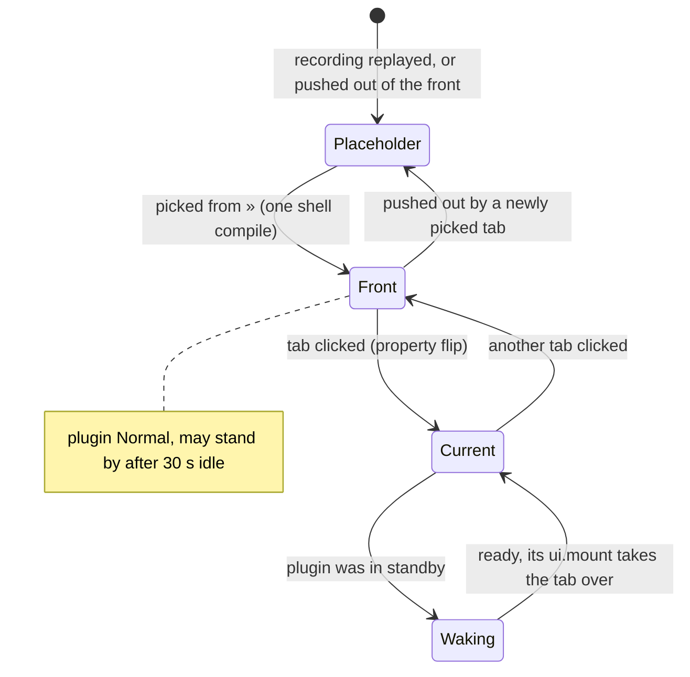

# Sidebar tabs without a cap (design note)

2026-11-03. Status: **implemented** (option B; see [Implementation](#implementation-2026-11-03) for where it differs from the proposal below). User ruling 2026-11-03: **only the foreground sidebar tab keeps its plugin active; background tabs do not keep plugins running**, so they stand by after idle like any Normal plugin and wake when their tab is shown (the MV3-style idle-stop ruling applied to panels). Builds on [panel-slots.md](panel-slots.md) (step 1, sidebar tabs) and [supervisor.md](supervisor.md) (standby and wake).

Since 2026-11-07 (menu redesign step 3b) the same rules run per column: the adjust column has its own tabs, front set and current tab ([adjust-column.md](adjust-column.md)); the code below is parameterised by `sidebar_tabs::Column`.

## Problem

The user wants any number of plugins to be able to add a sidebar panel, with VS Code-style overflow: the strip shows the tabs that fit (about 3 at the normal width) and a `»` menu lists all of them. Memory must stay bounded.

Three things stand in the way today:

- `slot_claims::MAX_SIDEBAR_TABS = 8`. A 9th `ui.mount("sidebar")` is refused with `conflict`.
- Every sidebar panel is compiled into the main window shell. `composition::sidebar_content` generates one `if root.sidebar-active == N` branch per tab, so the shell compile grows with every tab (measured below).
- A mounted panel counts as "something live": `UiMount::record` returns `Live("a panel")`. Its plugin is therefore **Resident** and never stands by. With 100 sidebar plugins, that is 100 Node processes of about 85 MB each, none of them limited by the process budget.

## Proposal

1. **Strip and overflow.** The strip shows as many tabs as fit at a minimum readable width (72 px, which fits 3 at the 317 px default width; tabs shrink evenly from 105 px). The rest go into a `»` button at the right end, before detach (the strip has had no close button since 2026-11-07). `»` opens the host's menu layer (`MenuView`, the same one the context menu uses). It lists every tab and checks the current one. The current tab is always visible: if it would overflow, it takes the last visible place. Order: the playlist, then the other built-ins, then the user's order. That order is already saved in `ui_state.sidebarSlot.order`. Picking a tab from `»` moves it to the last visible place and saves the new order, as VS Code does. Drag-to-reorder and pinning are left out of the first version.
2. **Only the first tabs are compiled.** The shell compiles the panels of the **front tabs**: the first 3 in strip order, plus the current tab. Every other tab is a **placeholder**: a title, with no Slint component in the shell and no process needed. Switching between front tabs stays a property flip. Picking a placeholder promotes it to the front, which costs one shell compile. The front set changes only when the user picks from `»` or a tab is added or removed, never on resize.
> Superseded in the implementation: no sidebar tab is live, current or not; the current tab keeps its plugin running as declared work. See [Implementation](#implementation-2026-11-03).

3. **A background tab is not live.** If a plugin's sidebar tab is not the current one, `UiMount::record` returns the `ui.mount` call itself (`Recorded::Calls`) instead of `Live`. This holds whether the tab is compiled or a placeholder. The current tab, the bottom bar, the backdrop and a queued mount stay `Live`. A plugin whose only live thing was a background tab is therefore **Normal**: it stands by after 30 s idle, counts in the process budget, and memory pressure can stop it.
4. **Placeholders come from the recording.** A plugin in standby keeps its tab because its recording replays the `ui.mount` call (slot, file, component, global, title), as it already does for commands and settings pages. Replaying adds the tab and compiles nothing.
5. **Showing the tab of a plugin in standby wakes it.** This is an interactive trigger, the same mechanism a shown settings page uses (`page_shown`, here `panel_shown`). The plugin starts in about 0.2 s; "Starting *name*…" appears after 400 ms. Its activation mounts the panel again; the host treats that mount as taking over the tab (same file and component: no recompile when the tab is already compiled). The recorded entry is pruned at its ready. A click inside a compiled tab whose plugin is in standby wakes it through `ui.callback`, which is already an interactive trigger (`TRIGGERS`). The mount callback path has to route it through the supervisor.

### Where the placeholder data lives: the recording, not the manifest

| | Recording (`ui.mount` as a recorded call) | Manifest (a new `sidebar: { title, icon }`) |
| --- | --- | --- |
| Plugins to change | none | every sidebar plugin, plus `vestra-plugin check` and packaging |
| Title | what the plugin passed, translated by its catalog (the catalog is kept during standby, `standby.rs`) | fixed; cannot follow a computed title |
| A plugin that mounts only sometimes | correct: no mount on its last run, no tab | wrong: a tab that never mounts |
| Before the first run | no tab until the plugin has run once (it starts once at install anyway) | the tab appears at once |
| Recording format | unchanged: `calls` is already a list of calls, so `checkpoint.rs` stays as it is | – |

**Recommendation: the recording.** It needs no SDK or manifest change, and it is right for plugins that mount only some of the time. Its one gap, no tab before the first run, does not happen in practice, because every plugin runs once after install. The `»` menu can show the manifest's existing `icon` without a new field. The strip stays text-only, as it is now.

## Compile cost (measured)

How it was measured: a temporary `#[ignore]` test in a release build, headless (software window), median of 7 runs, Ryzen 9 7940HS; the test is deleted. The shell contains the real playback bar and visualizer backdrop. *Heavy* tabs are copies of the playlist panel (779 lines, `ListView`, the largest sidebar panel) in separate files; *light* tabs are the 16-line `tests/fixtures/mount/tab.slint`. "Compile" is `composition::build` (`build_from_source`). "Whole" is `compile_json` plus show and layout, which is what a mount change costs on the UI thread. Repeated runs vary by about 15 ms.

| Sidebar tabs compiled | 0 | 1 | 2 | 3 | 8 |
| --- | --- | --- | --- | --- | --- |
| Heavy: compile | 150 ms | 175 ms | 189 ms | 214 ms | 383 ms |
| Heavy: whole | 138 ms | 169 ms | 174 ms | 204 ms | 361 ms |
| Light: compile | 120 ms | 119 ms | 123 ms | 131 ms | 135 ms |
| Tab switch today (property flip, heavy) | – | – | 1.0 ms | 1.5 ms | 1.4 ms |

- The fixed shell costs 120–150 ms. A heavy panel adds about 25–30 ms per tab; a light one about 2 ms.
- Today every install, uninstall, wake or mount change recompiles the shell with all tabs: about 0.4 s with 8 heavy tabs, and it would keep growing without the cap.
- Compiling only the current tab makes every tab switch a 170 ms UI-thread stall instead of 1 ms. That is why the proposal keeps the 3 front tabs compiled: about 210 ms per compile, at most 4 heavy panels whatever the number of plugins, and instant switching between the tabs the user can see.

### `ComponentContainer` (Slint 1.18.1)

Checked in the same test. Without `SLINT_ENABLE_EXPERIMENTAL_FEATURES` the compiler rejects it ("Unknown element 'ComponentContainer'", "Unknown type 'component-factory'"). With the variable set it works: a shell made of a container alone compiles in 3 ms, the playlist panel compiled alone takes 75 ms, and embedding it (`ComponentDefinition::create_embedded` behind a `slint::ComponentFactory`) and showing it takes 1 ms. The embedded panel's bridge global can be read and written.

It would let the shell compile once and each panel compile once (75 ms, then cached). The risks are why it is not recommended now:

- It is an experimental, undocumented API (`#[doc(hidden)]`, the `internal` feature, an environment variable or `CompilerConfiguration` field to enable it). It must be rechecked at every Slint upgrade, and it would carry the main window.
- Each panel is a separate compilation, so its globals are its own. The theme (`VestraPalette`), `BarButtonsHost` and translations would have to be written into every panel instance rather than once in the shell.
- Key forwarding, focus, popups and accessibility across the container boundary are untested here.
- `technical-decisions.md` §5 already declined it.

## Options

| | A. All tabs compiled (today, cap removed) | B. Front tabs compiled, the rest placeholders (recommended) | C. `ComponentContainer` per panel |
| --- | --- | --- | --- |
| Shell compile (start-up, install, wake) | grows by 25–30 ms per heavy tab, without bound | bounded: at most 4 panels, about 210 ms | 3 ms shell + 75 ms per new panel |
| Tab switch | 1 ms | 1 ms between front tabs; about 210 ms when picked from `»` | 1 ms, 75 ms the first time |
| Processes | one per sidebar plugin, all Resident | only the current tab's plugin must run | as B |
| Memory | unbounded | bounded by the process budget | as B |
| Risk | none new | low: the existing recompile path (`replace_shell`) | experimental API on the main window; per-panel globals |
| Host work | small | medium | large |

Option A does not meet "memory must stay bounded". **Recommendation: B.** Option C stays a later optimisation, for when `ComponentContainer` becomes stable.

## API impact

The answer differs between the two cases.

**1. The plugin keeps running and its tab is unmounted (pushed out of the front).** This can be fully transparent, with no SDK change:

- The host keeps the plugin's `Mount` while its tab is a placeholder: the spec, the title, and the latest value of every property. Those values are already updated by every `ui.setMount` and every row patch. When the tab is compiled again, the host writes them into the new shell, as every shell recompile already does (`mount_values`).
- `ui.setMount` on a placeholder updates the stored value instead of answering `missing`. Nothing is drawn.
- `Panel.state` stays as it is today: `active: false`, `effective: false`, `reason: "otherTab"` while in the background, `active: true` when shown. `Panel.ready` stays resolved, and host-initiated compiles send no `ui.preparing`.
- The panel loses what it already loses today when its tab is left. The `if` branch already destroys the panel's element tree, so scroll position, focus and unsent text are gone. One loss is new: values the panel's own Slint code wrote into an `in-out` property of its bridge global. Today these survive in the shell until the next recompile, which any other plugin's install already triggers.
- Callbacks from an old shell generation are dropped, as now.

**2. The plugin stands by while its tab is in the background.** This is a behaviour change; the user approved it on 2026-11-03 (see the status line):

- Today a plugin with a sidebar panel never receives `runtime.stop` with reason `idle`. After the change it does, 30 s after its tab went to the background, if it holds nothing else live. Its process then exits.
- When the user shows its tab again, the plugin starts afresh. `activate` runs, its `ui.mount` resolves `Panel.ready` again, and it must restore its view from storage; `plugin.storage.session` survives standby. Anything it kept only in memory is gone.
- While it is in standby, its commands and keys wake it like those of any Normal plugin. Its tab is not brought to the front unless the command calls `panel.show()`.
- A plugin that must keep working in the background, for example a list fed by playback events, stays Resident because of those listeners, as today. Only "has a sidebar panel" stops counting.

This follows the existing rulings: lazy activation with MV3-style idle stop, with session storage keeping state. It also matches VS Code's webview views, which are destroyed when hidden unless they opt into `retainContextWhenHidden`. The ruling asked for, and given: **"a background sidebar tab does not keep its plugin running"**.

SDK documentation changes (patch release, no new API): `Panels.mount` (no `conflict` at 8 tabs), the remarks on `Panel.state` (a background tab may be unmounted and its plugin may stand by), and the plugin-lifetime page's list of what keeps a plugin running.

## Implementation (2026-11-03)

Where the code differs from the proposal above:

- **Strip.** Tabs are at least 72 px wide (80 px fitted only 2 at the 317 px default width), so the default sidebar shows 3 tabs and `»`. The strip shows at most 4 tabs however wide it is (more tabs go into `»`): the first three and the current one, which are exactly the panels the shell compiles (`sidebar_tabs::front`; when the current tab is among the first three, the fourth). So a tab in the strip always has its panel compiled, at any width. Picking a tab from `»` does **not** reorder the tabs: the strip shows the first tabs and the current one in its last place, and the shell compiles the first 3 and the current one. The order is the playlist, the built-ins, then `ui_state.sidebarSlot.order` (now up to 512 ids). Pinning and dragging were left out (not cheap: the strip would need drag handling and a pinned set in `ui_state`).
- **`»` menu.** `MenuMode::Tabs` in the host's menu layer (`menu::tabs_level`): every tab in tab order, the current one checked (radio), row tokens `t:<owner>`. It works in the shell and in the floating window.
- **Compiled set.** `sidebar_tabs::compiled`: the front tabs (first 3 and the current one or else the 4th, at most `MAX_COMPILED` = 4) whose panel can be drawn. A placeholder replayed from a recording is never compiled. A plugin parked while its tab was compiled keeps that branch, with its last values: showing it is instant, and its plugin wakes. `apply_mounts` compiles the shell only when the compiled specs or the presence of the strip change. A tab coming or going outside the compiled set only updates the strip's titles.
- **Branches.** The shell has `sidebar-shown` (the owner whose branch is drawn, -1 for none) beside `sidebar-active` (the strip's index). A tab without a compiled panel shows the list background until it is compiled.
- **Switching** to a running plugin's tab outside the compiled set sets `shell_refresh`, and the next tick compiles the shell (`prepare_mount_tick`). A compile that fails is not retried for that tab until another tab becomes current. Switching to a placeholder calls `panel_shown` once (the `page_shown` trigger). The woken plugin is rekeyed (`UiMount::rekey`, `Policy::rekey`), and its `ui.mount` takes the tab over (a mount over a `recorded` one is allowed). At its ready, a placeholder it did not mount again is pruned.
- **Recording and class.** `UiMount::record` returns `ui.mount` with slot, file, component, global, title and the plugin's name, without the initial properties, for every sidebar tab, current or not (`sidebar_tabs::live` is false for the sidebar). A sidebar plugin is therefore always Normal and never checkpointed as resident. The current tab keeps its plugin running through declared work, `Busy::ShownTab` (`host_busy`). Every window tick, `tab_demand` registers it for the current tab's running plugin (`tab_work`, a map lookup once registered), so it also holds for a plugin that woke under a new owner after its tab was shown, and neither the process budget nor memory pressure stops it meanwhile. It ends at the next 250 ms poll after a switch away. A mount change still waiting at the classification makes the plugin Resident only for the bottom bar or the backdrop (`sidebar_tabs::pending_live`): a woken run's queued placeholder prune, or a sidebar mount still queued (a late or raw-protocol mount, whose call the recording then keeps), does not. So the plugin is not parked while its tab is shown and idles out 30 s after another tab is current. The first version made the current tab live, so a plugin woken by its tab reached its ready while current, was classified Resident and checkpointed `resident_at_ready`. Opening tabs 4 to 20 from `»` then left 17 processes running, and they started eagerly at the next launch (review 2026-11-04). `checkpoint.rs` is unchanged.
- **Parking** a plugin with a sidebar tab keeps its `Mount` (marked `recorded`), its place in the policy and the floating window (`Host::stop_run`). Disabling or uninstalling it removes the placeholder (`UiMount::revoke`). Placeholders replayed at start-up do not count against the mount queue's limit of 8.
- **Floating window.** It compiles the same panels as the shell, each under the owner its shell branch was compiled under (`compiled_tabs`, `shell_compiled`), and opens again only when that set changes. A woken plugin's rekey therefore does not reopen it; its new mount does, once.
- **Failures stay with their panel.** A value a panel cannot take (an undeclared property, a wrong type, possibly stored unchecked while its tab was not compiled) is logged and reported to its plugin (`ui.error`), in the shell and the floating window alike; it never fails the compile (`report_value_failures`). A compile that fails with a sidebar panel added without a mount of its own in the batch (a switch to its tab, a tab moving into the front) is compiled again without it. That panel is marked failed (`tabs_failed`, left out of `compiled` until its plugin mounts again) and its plugin gets `ui.error` `ui-prepare` (`sidebar_tabs::blamed`). Another plugin's mount, unmount, install or uninstall therefore never fails because of it. A batch's own mount that fails is answered with the error, as before.
- **Same panel again.** An unmount and a mount of the same panel in one batch leave the compiled set unchanged. The batch owners' compiled panels then get their new values and fresh interaction locks without a compile.
- **Mount after ready.** A placeholder pruned at its plugin's ready is removed by a host unmount (id 0). A `ui.mount` of that plugin replaces that queued unmount instead of being refused `busy`, so a plugin that mounts a little after its ready keeps its tab.
- **Removing the current tab.** The next current tab is decided before the compile, from the policy after the leaving tabs are gone, so the shell compiles once. A placeholder that would take over is passed over for the first running plugin's tab (`sidebar_tabs::next_active`), so closing a tab never wakes a neighbour unasked. A plugin that mounts into another slot leaves no tab behind.
- **Order cap.** Past 512 ids, the remembered order drops the oldest ids without a tab (`SidebarSlot::remember_among`), uninstalled plugins among them, before any that has one.
- **Not done here.** The SDK side: its test host still refuses a 9th tab, and its copy of the player's Chinese texts still has "The sidebar holds at most {} tabs", which the player no longer has (`npm run test:sdk` fails on that one entry until the SDK patch). The SDK documentation patch listed under API impact.

### Switch cost (measured)

Release build, headless, median of 7 runs, Ryzen 9 7940HS. The shell has the real playback bar and visualizer backdrop, and copies of the playlist panel as the compiled tabs. Twenty tabs in the strip.

| Switch | Cost |
| --- | --- |
| Between compiled tabs (the front tabs and the current one) | 1.0–1.3 ms (a property change) |
| From `»` to a running plugin's tab outside the strip (every tab in the strip is compiled) | one shell compile: 212–248 ms with 4 compiled panels (137 ms with 1) |
| To a placeholder (plugin in standby) | the plugin's start (about 0.2 s), then the same compile when its mount arrives |

### Files

| File (`src/host/`) | Change |
| --- | --- |
| `src/ui/sidebar_tabs.rs` (new) | tab order, front and compiled sets, `live`, `shown_tab`, `need`, `blamed`, `next_active`, the recorded call; tests (20 tabs → 4 compiled, no sidebar tab live, order persistence, wake vs compile, a broken panel left out, a placeholder neighbour passed over) |
| `src/host/mounts.rs` | `apply_mounts` / `compile_shell`: compile only when the compiled set changes; `shell_refresh`; per-property value failures; a broken added panel left out; batch owners' values rewritten; the next current tab decided first |
| `src/host/window.rs` | `tab_order` via `sidebar_tabs`, `tab_demand` (wake or compile the current tab), `sidebar-shown`, floating window with the compiled set, `sidebar-overflow` |
| `src/capabilities/ui_mount.rs` | no cap; `record`, `rekey`, `revoke`, `prune`, `replay`; take-over of a placeholder; `setMount` on an uncompiled tab stores only |
| `src/host/lifecycle.rs`, `src/host/rpc.rs`, `src/ui/slot_claims.rs` | parked tabs kept; `sidebar_full` and `MAX_SIDEBAR_TABS` removed |
| `src/host/supervisor/mod.rs` | `panel_shown` |
| `src/host/menus.rs`, `src/host/handle.rs`, `src/host/events.rs`, `src/ui/menu.rs` | the `»` menu (`MenuMode::Tabs`, `Token::Tab`, `SidebarOverflow`) |
| `src/ui/composition.rs` | branches by owner, `*_tabbed` sources (strip and column with no compiled panel) |
| `ui/sidebar-tabs.slint` | 72 px minimum, `»` button, current tab in the last place |
| `src/ui/window_state.rs`, `src/ui/ui_state.rs` | `Policy::rekey`; order limit 512 |
| `locales/*` | "All tabs" replaces "The sidebar holds at most {} tabs" |
| `src/host/supervisor/mod.rs` | `Busy::ShownTab`, `tab_work` |
| `src/supervisor/tests/transitions.rs` | twenty sidebar-tab plugins: none Resident, the current one kept running by declared work, nineteen in standby; a plugin woken by its tab stays Normal while shown and stands by after a switch away |

Not covered by an automated test: the host-level path end to end (park, replay, wake by a tab, take-over, the values rewritten for an unmount and mount in one batch, a mount replacing the queued prune), because headless hosts refuse mounts and these tests do not open the player GUI. A hardware check is still needed: switching, `»`, waking from standby, detach, the fullscreen overlay, and 20 dummy sidebar plugins under the process budget.
