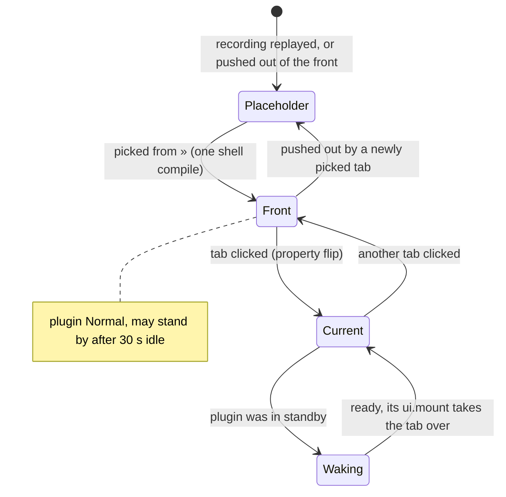

# Sidebar tabs without a cap (design note)

2026-11-03. Status: **proposal**, not implemented. Builds on [panel-slots.md](panel-slots.md) (step 1, sidebar tabs) and [supervisor.md](supervisor.md) (standby and wake).

## Problem

The user wants any number of plugins to be able to add a sidebar panel, with VS Code-style overflow: the strip shows the tabs that fit (about 3 at the normal width) and a `»` menu lists all of them. Memory must stay bounded.

Three things stand in the way today:

- `slot_claims::MAX_SIDEBAR_TABS = 8`. A 9th `ui.mount("sidebar")` is refused with `conflict`.
- Every sidebar panel is compiled into the main window shell. `composition::sidebar_content` generates one `if root.sidebar-active == N` branch per tab, so the shell compile grows with every tab (measured below).
- A mounted panel counts as "something live": `UiMount::record` returns `Live("a panel")`. Its plugin is therefore **Resident** and never stands by. With 100 sidebar plugins, that is 100 Node processes of about 85 MB each, none of them limited by the process budget.

## Proposal

1. **Strip and overflow.** The strip shows as many tabs as fit at a minimum readable width (80 px; today tabs shrink evenly from 105 px). The rest go into a `»` button at the right end, before detach and close. `»` opens the host's menu layer (`MenuView`, the same one the context menu uses). It lists every tab and checks the current one. The current tab is always visible: if it would overflow, it takes the last visible place. Order: the playlist, then the other built-ins, then the user's order. That order is already saved in `ui_state.sidebarSlot.order`. Picking a tab from `»` moves it to the last visible place and saves the new order, as VS Code does. Drag-to-reorder and pinning are left out of the first version.
2. **Only the first tabs are compiled.** The shell compiles the panels of the **front tabs**: the first 3 in strip order, plus the current tab. Every other tab is a **placeholder**: a title, with no Slint component in the shell and no process needed. Switching between front tabs stays a property flip. Picking a placeholder promotes it to the front, which costs one shell compile. The front set changes only when the user picks from `»` or a tab is added or removed, never on resize.
3. **A background tab is not live.** If a plugin's sidebar tab is not the current one, `UiMount::record` returns the `ui.mount` call itself (`Recorded::Calls`) instead of `Live`. This holds whether the tab is compiled or a placeholder. The current tab, the bottom bar, the backdrop and a queued mount stay `Live`. A plugin whose only live thing was a background tab is therefore **Normal**: it stands by after 30 s idle, counts in the process budget, and memory pressure can stop it.
4. **Placeholders come from the recording.** A plugin in standby keeps its tab because its recording replays the `ui.mount` call (slot, file, component, global, title), as it already does for commands and settings pages. Replaying adds the tab and compiles nothing.
5. **Showing the tab of a plugin in standby wakes it.** This is an interactive trigger, the same mechanism a shown settings page uses (`page_shown`, here `panel_shown`). The plugin starts in about 0.2 s; "Starting *name*…" appears after 400 ms. Its activation mounts the panel again; the host treats that mount as taking over the tab (same file and component: no recompile when the tab is already compiled). The recorded entry is pruned at its ready. A click inside a compiled tab whose plugin is in standby wakes it through `ui.callback`, which is already an interactive trigger (`TRIGGERS`). The mount callback path has to route it through the supervisor.

### Where the placeholder data lives: the recording, not the manifest

| | Recording (`ui.mount` as a recorded call) | Manifest (a new `sidebar: { title, icon }`) |
| --- | --- | --- |
| Plugins to change | none | every sidebar plugin, plus `vestra-plugin check` and packaging |
| Title | what the plugin passed, translated by its catalog (the catalog is kept during standby, `standby.rs`) | fixed; cannot follow a computed title |
| A plugin that mounts only sometimes | correct: no mount on its last run, no tab | wrong: a tab that never mounts |
| Before the first run | no tab until the plugin has run once (it starts once at install anyway) | the tab appears at once |
| Recording format | unchanged: `calls` is already a list of calls, so `checkpoint.rs` stays as it is | – |

**Recommendation: the recording.** It needs no SDK or manifest change, and it is right for plugins that mount only some of the time. Its one gap, no tab before the first run, does not happen in practice, because every plugin runs once after install. The `»` menu can show the manifest's existing `icon` without a new field. The strip stays text-only, as it is now.

## Compile cost (measured)

How it was measured: a temporary `#[ignore]` test in a release build, headless (software window), median of 7 runs, Ryzen 9 7940HS; the test is deleted. The shell contains the real playback bar and visualizer backdrop. *Heavy* tabs are copies of the playlist panel (779 lines, `ListView`, the largest sidebar panel) in separate files; *light* tabs are the 16-line `tests/fixtures/mount/tab.slint`. "Compile" is `composition::build` (`build_from_source`). "Whole" is `compile_json` plus show and layout, which is what a mount change costs on the UI thread. Repeated runs vary by about 15 ms.

| Sidebar tabs compiled | 0 | 1 | 2 | 3 | 8 |
| --- | --- | --- | --- | --- | --- |
| Heavy: compile | 150 ms | 175 ms | 189 ms | 214 ms | 383 ms |
| Heavy: whole | 138 ms | 169 ms | 174 ms | 204 ms | 361 ms |
| Light: compile | 120 ms | 119 ms | 123 ms | 131 ms | 135 ms |
| Tab switch today (property flip, heavy) | – | – | 1.0 ms | 1.5 ms | 1.4 ms |

- The fixed shell costs 120–150 ms. A heavy panel adds about 25–30 ms per tab; a light one about 2 ms.
- Today every install, uninstall, wake or mount change recompiles the shell with all tabs: about 0.4 s with 8 heavy tabs, and it would keep growing without the cap.
- Compiling only the current tab makes every tab switch a 170 ms UI-thread stall instead of 1 ms. That is why the proposal keeps the 3 front tabs compiled: about 210 ms per compile, at most 4 heavy panels whatever the number of plugins, and instant switching between the tabs the user can see.

### `ComponentContainer` (Slint 1.18.1)

Checked in the same test. Without `SLINT_ENABLE_EXPERIMENTAL_FEATURES` the compiler rejects it ("Unknown element 'ComponentContainer'", "Unknown type 'component-factory'"). With the variable set it works: a shell made of a container alone compiles in 3 ms, the playlist panel compiled alone takes 75 ms, and embedding it (`ComponentDefinition::create_embedded` behind a `slint::ComponentFactory`) and showing it takes 1 ms. The embedded panel's bridge global can be read and written.

It would let the shell compile once and each panel compile once (75 ms, then cached). The risks are why it is not recommended now:

- It is an experimental, undocumented API (`#[doc(hidden)]`, the `internal` feature, an environment variable or `CompilerConfiguration` field to enable it). It must be rechecked at every Slint upgrade, and it would carry the main window.
- Each panel is a separate compilation, so its globals are its own. The theme (`VestraPalette`), `BarButtonsHost` and translations would have to be written into every panel instance rather than once in the shell.
- Key forwarding, focus, popups and accessibility across the container boundary are untested here.
- `technical-decisions.md` §5 already declined it.

## Options

| | A. All tabs compiled (today, cap removed) | B. Front tabs compiled, the rest placeholders (recommended) | C. `ComponentContainer` per panel |
| --- | --- | --- | --- |
| Shell compile (start-up, install, wake) | grows by 25–30 ms per heavy tab, without bound | bounded: at most 4 panels, about 210 ms | 3 ms shell + 75 ms per new panel |
| Tab switch | 1 ms | 1 ms between front tabs; about 210 ms when picked from `»` | 1 ms, 75 ms the first time |
| Processes | one per sidebar plugin, all Resident | only the current tab's plugin must run | as B |
| Memory | unbounded | bounded by the process budget | as B |
| Risk | none new | low: the existing recompile path (`replace_shell`) | experimental API on the main window; per-panel globals |
| Host work | small | medium | large |

Option A does not meet "memory must stay bounded". **Recommendation: B.** Option C stays a later optimisation, for when `ComponentContainer` becomes stable.

## API impact

The answer differs between the two cases.

**1. The plugin keeps running and its tab is unmounted (pushed out of the front).** This can be fully transparent, with no SDK change:

- The host keeps the plugin's `Mount` while its tab is a placeholder: the spec, the title, and the latest value of every property. Those values are already updated by every `ui.setMount` and every row patch. When the tab is compiled again, the host writes them into the new shell, as every shell recompile already does (`mount_values`).
- `ui.setMount` on a placeholder updates the stored value instead of answering `missing`. Nothing is drawn.
- `Panel.state` stays as it is today: `active: false`, `effective: false`, `reason: "otherTab"` while in the background, `active: true` when shown. `Panel.ready` stays resolved, and host-initiated compiles send no `ui.preparing`.
- The panel loses what it already loses today when its tab is left. The `if` branch already destroys the panel's element tree, so scroll position, focus and unsent text are gone. One loss is new: values the panel's own Slint code wrote into an `in-out` property of its bridge global. Today these survive in the shell until the next recompile, which any other plugin's install already triggers.
- Callbacks from an old shell generation are dropped, as now.

**2. The plugin stands by while its tab is in the background.** This is a behaviour change and needs a user ruling:

- Today a plugin with a sidebar panel never receives `runtime.stop` with reason `idle`. After the change it does, 30 s after its tab went to the background, if it holds nothing else live. Its process then exits.
- When the user shows its tab again, the plugin starts afresh. `activate` runs, its `ui.mount` resolves `Panel.ready` again, and it must restore its view from storage; `plugin.storage.session` survives standby. Anything it kept only in memory is gone.
- While it is in standby, its commands and keys wake it like those of any Normal plugin. Its tab is not brought to the front unless the command calls `panel.show()`.
- A plugin that must keep working in the background, for example a list fed by playback events, stays Resident because of those listeners, as today. Only "has a sidebar panel" stops counting.

This follows the existing rulings: lazy activation with MV3-style idle stop, with session storage keeping state. It also matches VS Code's webview views, which are destroyed when hidden unless they opt into `retainContextWhenHidden`. The ruling to ask for: **"a background sidebar tab does not keep its plugin running"**. If the user declines, case 1 still bounds the shell compile and fixes the strip, but the number of processes is not bounded.

SDK documentation changes (patch release, no new API): `Panels.mount` (no `conflict` at 8 tabs), the remarks on `Panel.state` (a background tab may be unmounted and its plugin may stand by), and the plugin-lifetime page's list of what keeps a plugin running.

## Files that would change

| File (`src/host/`) | Change |
| --- | --- |
| `src/ui/slot_claims.rs`, `src/host/rpc.rs`, `src/host/lifecycle.rs` | remove `MAX_SIDEBAR_TABS` and `sidebar_full`; keep one panel each for the bottom bar and the backdrop |
| `src/capabilities/ui_mount.rs` | no cap; `record` returns the call for a background tab; `replay`, `rekey` and `prune` for placeholders; a woken run's mount takes over its tab; `setMount` on a placeholder |
| `src/host/mounts.rs` | compile the front set only; placeholders kept as a `Mount` without a compiled branch |
| `src/host/window.rs` | `tab_order` over mounted and recorded tabs; the front set; picking a tab → promote, or `panel_shown` |
| `src/host/supervisor/mod.rs` | `panel_shown(owner)`, modelled on `page_shown` |
| `src/ui/composition.rs` | `sidebar_content` takes the front set and maps each branch to its index among all tabs; the floating window likewise |
| `ui/sidebar-tabs.slint` | minimum width, number of tabs that fit, `»` button |
| `src/ui/window_state.rs`, `src/ui/ui_state.rs` | placeholders in `Policy.sidebar`; the order saved for every tab |
| docs | `panel-slots.md`, `supervisor.md` §2 ("something live"), the SDK pages above |

Not changed: `host/supervisor/checkpoint.rs` (its format), the supervisor core, and the wire protocol.

**Estimate:** about 700–1000 lines of host code and tests, 3–4 days for one maintainer. On top of that: a hardware check (switching, `»`, waking from standby, detach, the fullscreen overlay, 20 dummy sidebar plugins under the process budget) and an SDK documentation patch. All of it ships in one host release.
