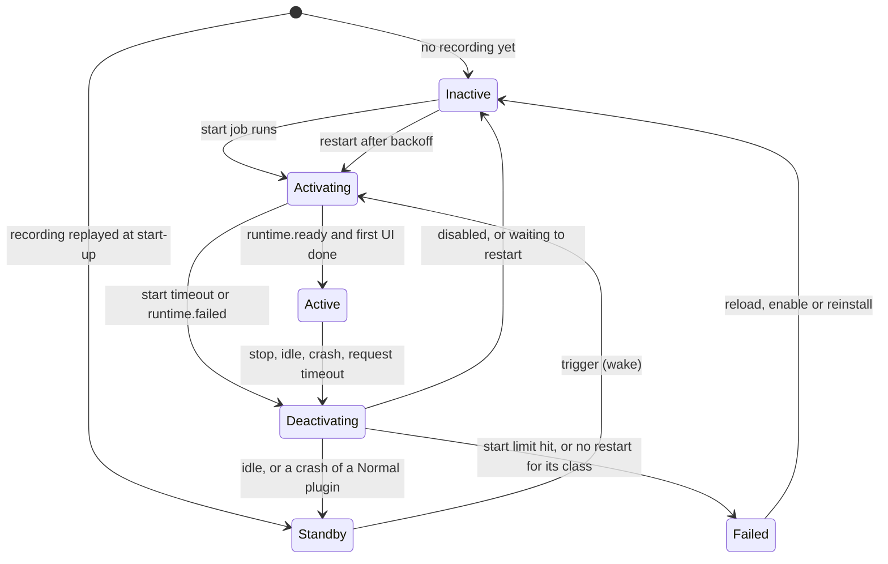

# Plugin process supervisor

The supervisor decides **when each plugin's Node process should exist**: when it starts, when it stops, when it is restarted after a fault, when it rests in standby, and how many run at once. It does not schedule CPU time; the operating system does that. Plugins see none of it on the wire beyond what they always saw: `runtime.ready`, `runtime.stop` with a reason, and the same `packages.list` states.

Plugin authors' view of the same rules (timings, stop reasons, what keeps a plugin running) is on the SDK site: [Keep a command's state without keeping the plugin running](https://vestrasys.github.io/vestra-player-sdk/documents/Keep_a_command_s_state_without_keeping_the_plugin_running.html). Process placement (the shared runner for built-ins, an own process for every other plugin) is in the [architecture overview](README.md#2-loading-and-stopping-plugins).

## 1. Core and adapter

| Part | Where | What it does |
| --- | --- | --- |
| Core | `src/host/src/supervisor/` | Pure decision logic: it takes events (a process was created, became ready, exited, was reaped; a trigger arrived; a timer is due; the memory level changed) and returns a list of actions (create a process, deliver a message, stop, kill, write a recording, show a notice, …). It does no I/O itself: no files, no processes, no environment, no clock (the time is passed in as milliseconds), and randomness comes from a seeded generator. So the same inputs always give the same actions, and the whole core is tested by deterministic simulations. It contains no `unsafe` code. |
| Adapter | `src/host/src/host/supervisor/` | Runs on the UI thread. Feeds the core the host's events and executes its actions with the rest of the host: the process layer (`src/host/src/process/`), the capability registries, the playback worker, notices, `packages.changed`. Also safe code only. |
| Platform | `src/host/src/platform/` | Physical memory size and the memory pressure level, per operating system. |

Three helper threads keep slow work off the UI thread: `plugin-spawner` creates own processes (about 30 ms each on Windows), `plugin-recorder` writes standby recordings in order, and `plugin-reaper` waits for every stopped process and kills it at its deadline.

## 2. Units and classes

A **unit** is one plugin (one manifest id). It exists from start-up, install or a `--plugin` development load until uninstall or unload. Each run of its process gets a new **owner generation**: the number used on the wire and in every registry, so a late message from an old run is never taken for the new one.

| Class | Which plugins | Stands by when idle | After a crash | Counted in the process budget |
| --- | --- | --- | --- | --- |
| Built-in | the player's own plugins (`vestra.*`) | yes, unless it holds something live | restarted after a pause | no |
| Resident | a third-party plugin that holds something live at its ready | never | restarted after a pause | yes, never put in standby by the budget |
| Normal | every other installed third-party plugin | yes | waits in standby, starts again on its next use | yes |
| Development | a `--plugin` load | never | listed failed | no |

"Something live" is what only the plugin's process can serve: a panel in the bottom bar or the backdrop, an open window, a playback or other high-frequency event listener, a filter chain, a stream. The class is decided again at every ready (see §4), so a plugin that stops holding something live becomes Normal on its next run, and the reverse. A sidebar tab is never live (user ruling 2026-11-03, [sidebar-tabs.md](sidebar-tabs.md)): its `ui.mount` is recorded, so its plugin is Normal; the current tab keeps it running as declared work (§4), and a background tab stays as a placeholder while the plugin stands by. Showing a placeholder wakes its plugin.

## 3. States

| State | Process | Entry points (menus, keys, settings pages, drop targets, resolvers) |
| --- | --- | --- |
| `Inactive` | none | none; a disabled plugin stays here |
| `Activating` | being created, or up and not ready yet; also the pause before an automatic restart | live |
| `Active` | running | live |
| `Deactivating` | told to stop, inside its grace, or killed and not yet reaped | removed at once, or kept when it is going to standby |
| `Standby` | none | **kept** from the plugin's recording; a use starts it |
| `Failed` | none | removed; Settings ▸ Plugins shows why |

A unit leaves `Deactivating` only when its process is reaped **and** the playback worker has cleaned up what it owned. Only then may a new process of the same plugin start: there is never more than one process per data directory. A start that waits for this gives up after 20 s, counted from its own request, with "the previous process did not stop within 20 s".

## 4. Standby and wake

**First run.** A plugin without a recording is started once. At its ready the host checks, within 5 s, whether it holds something live. If it does, it is Resident and keeps running. If not, once it has been idle for **1 s** (counted as the idle time below: any use or work starts it again), the host asks the playback worker once more, writes a **recording** of everything it registered (commands in registration order, bindings, settings pages, drop targets, resolvers, wake-event subscriptions, a background sidebar tab) and stops it with reason `idle`. The quiet second is for what a first run takes up just after its ready (a saved effect it restores after a timer or a round trip): that request reaches the playback worker while the run is still up and makes it Resident (below); a stop at the ready would have dropped it and left a lazy recording that never restores the effect. Chrome stops an extension service worker the same way, after an idle period counted from its last event or API call, never right at its start. From then on, start-up replays the recording: the entry points appear without a process.

**Taking up something live later.** A run's class comes from what it holds at its ready, but a plugin may take up something afterwards (shaders, a filter chain, the video view, once the user turns them on, or a first run that applies its saved settings just after its ready). After each request a run that may still go to standby sends to the playback worker, the host asks the worker again what the run holds there (one ask at a time, queued behind the request, so the answer counts it); until the answer comes the run is busy, so a lazy first run is not parked before it. The worker's answer splits what it holds: **held** is what the plugin's next activation takes up again from its own settings (shaders, a processing chain, render options, a subtitle style, the video view, upscaling it turned on); the rest is work in flight (a source resolution, a snapshot or job, a producer stream or the audio device, a subtitle track of the current media, an upscaling request waiting). Only something held makes the run Resident from then on, exactly as if it had been classified so at its ready: no idle standby, and its recording says resident, so the next start launches it and its activation takes the resource up again instead of only replaying its entry points. Work in flight only keeps the run up while it lasts, as before, and the run is asked again after another idle period. The next ready classifies it again as usual. A classification whose answer came back with nothing held while a request of the run reached the worker after the question is asked again (within the same 5 s). At quit, a lazy run whose last answer names something held, or whose ask is still unanswered, is recorded resident too (the safe side, as a classification without an answer).

**Wake.** A trigger on an entry point of a plugin in standby starts its process. The trigger waits in the unit's queue (its **backlog**) until the new process is ready, then is delivered in order.

| Trigger | Kind | If it cannot be delivered |
| --- | --- | --- |
| `commands.execute` (menu item, key, bar button) | interactive | notice "*name* is busy" / "… could not start" / "… is disabled" |
| `source.resolveRequest` | interactive | the open fails at once with that text |
| `drops.drop`, `ui.callback`, a settings page shown, a sidebar tab shown | interactive | dropped, with a diagnostic line |
| `packages.changed`, `bindings.changed`, `commands.keys` (only to the plugin whose own command keys changed, player 0.7.6), `appearance.changed`, `resolvers.fileTypes` (wake events) | event | dropped silently: a woken plugin reads the current state anyway |

Other events (`source.state`, `window.state`, playback events, …) never wake a plugin: they come too often, and a listener of one makes its plugin Resident. Wake events merge by name (the newest wins); a backlog holds at most 64 triggers. Wake events wake nothing during start-up and for 1 s after it settles. A start that takes longer than 400 ms shows "Starting *name*…".

**Idle.** An Active Built-in or Normal unit with no job and no work in flight for **30 s** gets a standby job: the host asks the playback worker whether the plugin still holds a live resource, writes its recording, and stops it with reason `idle` and the usual 5 s grace. If it is busy, it is asked again after another idle period. **Work in flight** is of two kinds. A **request** is a `source.resolveRequest` sent to the plugin and not yet answered (`sourceResolvers.respond`) or canceled; it is the only kind capped, at 5 min (see §7). **Declared work** has no cap: the host itself sees the plugin as busy while one of its commands is marked busy, one of its settings pages is compiling or shown, a host dialog is open, a package RPC on it is in progress, a source state request of it waits for the playback worker, its activation or classification is not over, its standby recording could not be written, or its sidebar tab is the current one. Idle time counts from the end of the last work.

A plugin in standby is listed in `packages.list` as `running` with `process: "idle"`; going to standby and waking never send `packages.changed`. Its session storage survives standby, crashes, reloads and upgrades; it is cleared when the user switches the plugin off or uninstalls it.

## 5. Jobs

Nothing changes a unit's state except a **job**, and a unit has at most one. A new request merges with the installed job or replaces it, so conflicting requests never race.

| Job | Does | Asked by |
| --- | --- | --- |
| Start | brings the unit to Active | start-up, a first run, a trigger, an enable, an automatic restart |
| Stop | stops the process; then Inactive, Failed or removed | disable, uninstall, a fault |
| Restart | stops, waits for the old process, starts (optionally dropping the recording, or starting a different package version) | reload, install, upgrade, cancel of an install, a runner restart |
| Standby | stops the process and keeps the entry points | the idle timer, the process budget, memory pressure |

How a new request merges with the installed job:

| Installed | New request | Result |
| --- | --- | --- |
| Start | Start | one Start; the higher priority is kept, triggers add up in the backlog |
| Start | Stop | the Stop wins; held triggers are answered (for example "*name* is disabled") |
| Stop (still stopping) | Start | becomes a Restart: the start waits for the old process |
| Stop for disable or uninstall | Start from a trigger | refused: a trigger never re-enables a plugin |
| Restart | Stop | the Stop wins |
| Restart | Restart | one Restart (recording dropped if either asked) |
| Standby (still asking) | Start | the Standby is canceled; the trigger is delivered now |
| Standby (stopping) | Start | the Start waits for the process to go, then starts from standby |
| any | Stop for uninstall | the Stop for uninstall wins |

A package request (`packages.setEnabled`, `packages.reload`, install, upgrade, uninstall) made while a reload, install, upgrade or uninstall of the same plugin is still in progress is refused with `busy` ("the package is being installed or reloaded"). A pending enable or disable never makes a later request busy.

### Start order and limits

| Rule | Value |
| --- | --- |
| Built-ins | start first, in a fixed order, outside every limit |
| Development loads | start at once, outside every limit |
| Third-party priority | interactive triggers, then wake events, then background starts (first runs, automatic restarts); first come first served within one priority |
| Third-party starts in flight | `min(4, max(2, cores / 2))`, plus 1 more for an interactive trigger, plus 1 overrun for an interactive trigger (not under critical memory pressure) |
| Background starts | wait while any built-in is still starting |
| Waiting third-party starts | at most 256; one past that is answered (§4) |

A start waiting for a slot has no deadline of its own: the slots free up within the start timeout.

## 6. Timings

| What | Value |
| --- | --- |
| Idle time before standby | 30 s (`VESTRA_IDLE_MS` overrides it, for tests) |
| Start timeout (process created → ready) | 60 s; a development load 1–120 s, from `--plugin` |
| Retry of a process that could not be created | 3 tries, after 250, 500 and 1000 ms (each up to 10 % longer, random) |
| Retry of a start that timed out | none: the unit follows its class's crash rule (§7), and a click waiting for it is answered "*name* could not start" |
| Digest check of a built-in before its start | 3 s, then it starts in its own process instead of the shared runner |
| Classification at a first run's ready | 5 s |
| A lazy first run's idle time before standby | 1 s (never longer than the idle time) |
| Stop grace (disable, reload, uninstall, upgrade, standby) | 5 s, then killed |
| Stop grace after a fault | 300 ms |
| Player quit | 1 s for all plugins together; 300 ms after a lost graphics device |
| Wait for the previous process before a new start | 20 s from the start's own request |
| Unanswered `source.resolveRequest` | 5 min, then treated as a fault; declared work has no cap; not for development loads |
| "Starting *name*…" notice | after 400 ms |
| Wake events after start-up settles | muted for 1 s |
| Shared runner without members | exits after the idle time, at least 30 s |
| Shared runner heartbeat | every 2 s; 5 missed in a row = hung (a hello or pong counts when the runner's reader thread sees it, not when the UI thread handles it) |
| Memory pressure reading | every 5 s |

## 7. Faults, restart and backoff

| How a process ended | Detected by | Next |
| --- | --- | --- |
| It exited | its stdout closed | the class's crash rule |
| Fault | an uncaught exception, a malformed or oversized line | the class's crash rule |
| Out of memory | V8's "JavaScript heap out of memory" on stderr **and** exit code 134 | the class's crash rule; notice "*name* ran out of memory" |
| Start timeout | 60 s without ready | the class's crash rule, no retry |
| Request timeout | a `source.resolveRequest` unanswered for 5 min | stopped (300 ms grace), then the class's crash rule |
| Transport | a full input queue (1024 messages) | own process: listed failed; shared-runner member: the runner restarts. A message to a process whose pipe already closed is dropped, not a transport failure: the exit (or the failed write, a fault) that closed it follows the class's crash rule |
| Refused | the plugin sent `runtime.failed` | listed failed, never retried |

The crash rule per class:

| Class | Rule | Pause before the next start | Start limit |
| --- | --- | --- | --- |
| Built-in | restarted by the supervisor | 3 s, doubling each time (6, 12, …), no cap | 5 crashes in 10 min → failed |
| Resident | restarted by the supervisor | 1 s, doubling, at most 60 s | 5 in 10 min → failed |
| Normal (with a recording) | goes to standby with its entry points; the next use starts it, not before the pause ends | 1 s, doubling, at most 60 s | 5 in 10 min → failed |
| Normal (no recording yet) | listed failed | – | – |
| Development | listed failed | – | – |

The doubling starts over once the plugin has run for 60 s. During a Normal plugin's pause its menu items show disabled with the reason; a click is answered at once ("*name* stopped after a fault; try again in a moment") and is not held, while wake events are held for the start after the pause. A plugin that hit the start limit shows "*name* stopped after repeated faults", and Settings ▸ Plugins says why; a reload, enable or reinstall clears it. Crash notices: "*name* stopped unexpectedly", "*name* ran out of memory". A process that ended by itself gets no `runtime.stop`: the host only cleans up after it.

**Panels over a restart** (user ruling 2026-11-10). When the supervisor restarts a plugin by itself (a built-in or Resident crash, a shared-runner restart), the plugin's mounted panels stay in the shell during the pause instead of being removed, dimmed under one host line "*name* is restarting…"; they take no pointer, and their callbacks are dropped, not held for the next run. The restarted run's `ui.mount` of the same panel (same file, component, bridge global and slot) takes the kept panel over without compiling the shell; its initial properties and its first `ui.setMount` writes replace the old content. A different panel compiles once, as any mount. A reload during the pause starts the plugin at once, and its mount takes the kept panels over the same way (a reload of a running plugin removes its panels as before). A restart that does not come (the start limit, a disable, an uninstall, standby) removes the panels as before (one compile; the notices above are unchanged), and so does a restarted run that has not mounted a kept panel again 5 s after its activation. Details: [panel-slots.md](panel-slots.md#a-crash-and-its-restart).

### Shared runner

The built-ins share one Node process. An uncaught exception the runner traces to one member stops that member only, which then runs in its own process for the rest of the session. Anything that affects the whole runner restarts every member: a hang (5 missed heartbeats; the reader thread records each `runner.hello` and `runner.pong` as it reads them, so a queue on the UI thread, such as another plugin's burst of requests, is not taken for a hang: stress measurement 2026-11-11, where a third-party plugin's 100 000 requests held the queue for 21 s and the answering runner was restarted twice), a fault no member owns, the runner exiting, a member's full input queue (1024 messages). The runner is killed, its members get no stop message, and each gets a Restart job: the first runner restart is immediate (panels back in about 1.3 s), later ones wait 3 s, doubling, with the count starting over after 60 s of stable running. On the third runner restart within 60 s every built-in runs in its own process until the player quits ("fail-open"). Members that have a recording go back to standby from it instead of starting.

### Request limits

A plugin may have at most 320 request lines and 4 MiB of request bytes unanswered (user ruling 2026-11-11, after measuring the built-ins; `process/unanswered.rs`). The SDK keeps at most 256 requests in flight per plugin and queues the rest itself without an error, so a plugin on the SDK never reaches the host's limit; it is the backstop for a client that writes the protocol itself. The time-budgeted drain (README.md §4.2, `ticks`) keeps a flood from stalling input and the other plugins; this limit keeps it from growing the UI thread's queue without bound.

- **Counted per plugin**: an own process, or one member of the shared runner (not the runner). A request counts from the reader thread that read its line (whole line, newline included; a member's with the runner's `"g"` envelope) until the host answers it (`Host::respond`). A repeated id counts each line. A stopped plugin's counter goes with it, and a restart (a new generation) starts at zero.
- **Past either limit**, the reader thread answers the request at once with `limit` ("too many unanswered requests"): it is not forwarded, so nothing on the UI thread handles it, the other plugins and members are not held behind it, and the plugin is not stopped. The answer goes on the plugin's own write queue (the runner's for a member); at most 256 refusals of one plugin wait there to be written, and past that a request is dropped unanswered, so a client that floods without reading its input cannot fill the queue its answers and events share (a full one would stop it, or restart the runner).
- **Logged** once per burst in host.log (`logged!`): the plugin id and its counts when the first request is refused; the burst ends once nothing of it is unanswered.
- **Notifications** (lines without an `id`) do not count: there is no answer to free them and no id to refuse with, and the protocol has two per run (`runtime.ready`, `runtime.failed`).

## 8. Memory

**Heap cap.** An own plugin process runs with `--max-old-space-size=512` (512 MB of JavaScript heap). The shared runner has 1024 MB for all built-ins together. Development loads have no cap. A plugin that passes its cap ends with V8's abort and is treated as a crash (§7) with the out-of-memory notice; it does not slow the computer down first.

**Process budget.** At most `clamp(physMiB / 2 × 0.30 / 85, 3, 16)` third-party processes (Resident and Normal) run at once: of half the physical memory, 30 % for plugins, at about 85 MB per process; at least 3, at most 16 (16 from about 9 GB). Built-ins and development loads are not counted. When a start that is not a wake event brings the count over the budget, idle Normal plugins go to standby through the usual Standby job. A candidate must be Active with a recording, have no job, no work in flight and nothing held, and not be being classified. Plugins not used in the last 60 s go first, then the longest unused. A Resident or busy plugin never goes, so the budget may be passed when nobody qualifies. The start-up log shows the start slots and the budget computed for the machine.

**Memory pressure.**

| System | Low | Critical |
| --- | --- | --- |
| Windows | available physical memory under 1000 MiB (under 500 MiB below 4 GiB installed) | under 400 MiB (200 MiB), or the system's low-memory notification is signalled |
| Linux | PSI: some task stalled on memory ≥ 20 % of the last 10 s | PSI: all tasks stalled ≥ 70 % |
| macOS | not read yet (the budget still applies) | – |

When the level becomes Low or Critical, every candidate (as for the budget) goes to standby. Under Critical an interactive trigger also loses its overrun slot. There is no hysteresis: each change into Low or Critical puts the idle plugins in standby again. `VESTRA_TEST_PHYS_MIB` and `VESTRA_TEST_PRESSURE=<none|low|critical>@<ms>[,…]` simulate both.

## 9. Quit and device loss

At quit the host first writes the recordings it owes (a run classified this session), then sends every process its stop at once (the shared runner one `runner.stop` for all members), and kills whatever is left at one deadline: 1 s at quit, 300 ms when the player restarts after a lost graphics device. A process still left over from a stop that got stuck is killed at once.

## 10. `packages.list`

| Unit | `state` | `process` |
| --- | --- | --- |
| waiting to start, starting, or stopping before a restart | `starting` | – |
| starting because a trigger woke it | `running` | `running` |
| Active | `running` | `running` |
| Standby, or pausing before an automatic restart | `running` | `idle` |
| Failed | `failed` (with the reason) | – |
| disabled | `disabled` | – |
| Inactive, no start asked | `stopped` | – |

`packages.changed` compares lists without `process`, so standby and wake send nothing.

## 11. File map

Core, `src/host/src/supervisor/`:

| File | Contents |
| --- | --- |
| `mod.rs` | The supervisor: unit table, public API (requests, event inputs, `run_jobs`, `shutdown`), the transitions |
| `unit.rs` | A unit: identity, class, placement, state, recording flags |
| `identity.rs` | Owner generations and the indexes by plugin id and by generation |
| `activation.rs` | The ready barrier of one run: `runtime.ready` plus every initial UI request |
| `job.rs` | Jobs and the merge rules (§5) |
| `queue.rs` | The start lanes and their order |
| `trigger.rs` | Held triggers, merging, answers |
| `work.rs` | Work in flight and the request deadline |
| `timers.rs` | Deadline heap: each tick costs only what is due, never a scan of all units |
| `kill.rs` | Which stop grace applies |
| `reap.rs` | Waiting for the reap and the cleanup; the 20 s stop wait |
| `exit.rs` | Exit causes and their texts |
| `restart.rs` | Backoff, start limits, the runner's fail-open count, the seeded random generator |
| `limits.rs` | The per-class policies and every value in §6–§8 |
| `pressure.rs` | Standby candidates and their order |
| `sim.rs`, `tests/` | Deterministic simulations; spec tests named after the rows of the original design tables (that text is in git history) |

Adapter, `src/host/src/host/supervisor/`:

| File | Contents |
| --- | --- |
| `mod.rs` | Builds the supervisor for this machine; feeds it events; the idle and classification questions to the playback worker |
| `actions.rs` | Executes the core's actions (spawn, replay, rekey, revoke, deliver, answer, notices) |
| `checkpoint.rs` | Recordings: format, read, write, remove, the `plugin-recorder` thread |
| `standby.rs` | What the host keeps for a plugin in standby (catalog, image roots, data directory) |
| `worker.rs` | The `plugin-spawner` thread |
| `memory.rs` | Physical memory and the pressure poll |
| `shutdown.rs` | Quit and device loss with one deadline |
| `probe.rs` | Test switches (`VESTRA_TEST_*`) |
