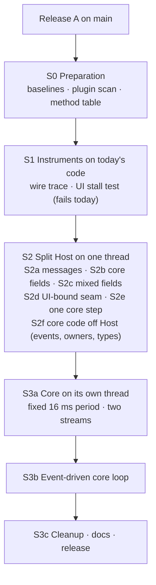

# The core thread: execution plan

**Status (2026-11-16): S0, S1 and S2a–S2e are merged; S2f is next (added on 2026-11-16 from the S2 stage-end review, user ruling); S3 is not started.** Written 2026-11-15 from the user's rulings of that day. The design is [core-thread.md](../architecture/core-thread.md) (called "the design" below; its rules are R1–R13, its risks K1–K14); it is the authority for what is built. The inventory with file and line is the study, [core-loop-study.md](research/core-loop-study.md). This file says in what order, by whom, and how each step is known to be done. The running state is in the blackboard, [rounds/history.md](rounds/history.md).

**Start condition.** Release A (SDK 1.10.0 / player 0.10.0) is on main. The user ruled that the work then starts at once, without a further go, and that this plan need not be read first.

## 1. Goal, done criteria, authority

| Item | Content |
| --- | --- |
| Goal | The host's core runs on its own thread; the UI thread is its client (design §5). A stalled interface no longer stops plugin requests, playback control, triggers or supervisor timers |
| Done when | S3c is merged and released: the UI stall test passes; V2 shows no difference; the wire trace shows only the reorders the S3a row allows (rule R4, and lines that follow an interface report); `ci:local` is green; the transitional switch of §6 is gone; the architecture documents describe the new structure |
| The loop may stop | When the done criteria hold, or when everything left waits on the user (§8, §9) |
| The coordinator decides alone | Step order inside a stage; splitting a step into smaller merges; details with an established practice; fixes of defects found on the way that are inside the step's files; patch releases |
| Stops for the user | Any plugin-visible behaviour difference beyond rule R4; any SDK or wire change; any new duty for the host; a change to a scheduling rule of [supervisor.md](../architecture/supervisor.md); a finding of the plugin scan (S0.3) that cannot be fixed inside the plugin; a stage that would exceed its size estimate by more than half |
| Resources | One cargo build at a time (`C:\vestra\build.lock`). About 20 GB of free disk: one target directory per worktree, removed at every merge; at most two target directories at once. No paid services. Pushes and patch releases without asking; no force pushes |
| Outward steps | None besides the release in S3c |

## 2. How the work is run

| Item | Rule |
| --- | --- |
| Workflow | [agentic-workflow.md](../../agentic-workflow/agentic-workflow.md) §5 (top-down refactor), run under [agentic-workflow-loop.md](../../agentic-workflow/agentic-workflow-loop.md) |
| Agents | One role per agent. Sub-agents never commit, never start agents, never open a player window and never send mouse or keyboard input. The coordinator makes every commit |
| Models (user ruling, 2026-11-15) | The same working pattern as SDK 1.10.0. **Fable** writes the design and this plan and does the static reviews; **Opus 5.5** implements and does everything that has to read console output: builds, test runs, `ci:local`, V1 and V2. Reason: review tokens are not spent on build and test noise |
| Implementing agents | The API maintainer: **Opus 5.5** |
| Static review | **Fable, medium effort.** Reads the design, this plan, the diff and the code; no builds, no logs. Judges whether the implementer understood the design and implemented that |
| Build/test verification | **Opus 5.5.** Re-runs the checks of the stage itself (builds, tests, V1, V2, wire trace, stall test, `ci:local`) and reports numbers. The static reviewer never runs or reads them |
| When reviews happen | At stage boundaries (S1, S2a, S2b, … each merge is a boundary). After fixes, a brief re-read of the changed parts |
| Re-review bar | Blocking: a regression, data loss, two writers on one resource, stuck forever. Anything below it becomes a follow-up item, not another fix round |
| Fixes | Go back to the agent that wrote the code |
| One change, one merge | Each step below is one branch and one merge to main. No batch branches |
| Tests | Offline first: unit tests, the offscreen integration tests, V2, the wire trace, the stall test. No scripted desktop input. Real-window checks are the user's, by hand (§5) |
| `ci:local` | At the end of each stage (S1, S2, S3), not on every merge |
| Spec tests | For S2d and S3a, a separate spec-test author writes tests from the design's rules (R4–R8, R12, R13) without reading the implementation. The S2d set (R5, R6, R12, R13: `src/host/tests/ui_bound_spec.rs`) is on branch `origin/core-spec-tests` and is **merged with S2f(1)**: that branch is brought onto main first (the test file only; its R12 stall case stays marked as waiting for S3a), so every S2f merge runs it. The S3a set is written before S3a starts and merged with S3a |
| Open points | The implementing agent decides open design items and gives its reasons (§7). Coupling, a new host duty or bloat goes to the user before the merge |

## 3. Stages

Files named below are under `src/host/src/` unless they start with `src/` or `doc/`. "Stay out of" lists what the step must not change; the SDK repository, the plugin repositories and `supervisor/` (the pure supervisor core) are out of bounds for every step unless the step says otherwise.

### S0 Preparation

| Step | Content | Owner | Done when |
| --- | --- | --- | --- |
| S0.1 Baselines | On main after release A: `ci:local`, V1, and the V2 run of the staged 0.10.0 with the store plugins | Build/test verification | `ci:local` green and its commit recorded; V2's `normalised.json` and `summary.txt` saved, their folder named in the blackboard |
| S0.2 Method table | From study §2.2: every one of the 119 route entries with its stream (UI-independent or UI-bound) and, for the 25 "touches the interface, reply independent" methods, whether the core answers at once or the method joins the UI-bound stream. Default: the study's classification. Added to design §5.1 as a table | Maintainer writes; coordinator commits | The table is on main; the static review agrees that no UI-independent method is routed through the interface (R7) |
| S0.3 Plugin scan (K1) | Read-only scan of all built-in plugins (`src/plugins/`) and the plugin repository for a UI-bound call that is not awaited and is followed by something that depends on its effect. Uses the method table of S0.2 | Researcher (read-only) | A list with file and line, or "none found" with the patterns searched. Each finding is fixed in the plugin (its author) before S3a, or brought to the user |
| S0.4 Archive | The design, this plan and the study are on main and linked from `doc/architecture/README.md`; the blackboard records the rulings of 2026-11-15 and points here | Coordinator | Files on main; the blackboard entry exists |

### S1 Instruments on today's code

Nothing in the product changes. Both instruments are test switches inside the host.

| Step | Content | Files | Done when |
| --- | --- | --- | --- |
| S1.1 Wire trace | A host switch, off by default (`VESTRA_TEST_WIRE_TRACE=<file>`): every line the host reads from or writes to a plugin is logged with the plugin's installed id, a per-plugin sequence number and a direction. A diff tool (`src/scripts/verify-wire.mjs`) compares two runs per plugin with request ids and times normalised, and prints the first difference per plugin. It has an "allowed reorders" mode that is unused until S3a | `process/` (reader and writer threads), `host/lifecycle.rs`, `host/dispatch.rs`, a new script, its tests. Stay out of: handling logic | Two runs of the same build over V2's four scenarios compare equal (the tool's own noise floor is zero or its normalisations are listed); a run with one line reordered by hand is caught; unit tests of the tool |
| S1.2 UI stall test | A test-only switch (`VESTRA_TEST_UI_STALL=<start ms>,<length ms>`) that makes the windowed tick's UI part sleep on the offscreen platform. A new offscreen integration test (`src/host/tests/ui_stall.rs`) with three test plugins: one calls `source.state` every 50 ms, one has a short idle time and is due to park during the stall, one has a `time` trigger due during the stall. It records request latency, the park time and the trigger time | `main.rs` (the switch), `src/host/tests/`, test plugins under the tests' fixtures. Stay out of: everything else | On today's code the three stall assertions **fail** and the numbers are recorded as the baseline (latency about the stall length; park and trigger late by about the stall length). The test is marked "expected to change in S3a" and does not fail `ci:local` until then; outside the stall window its assertions pass |
| S1.3 Baselines | Wire traces of main over V2's four scenarios, saved next to the V2 baseline | Build/test verification | Folder named in the blackboard |

Stage end: static review, build/test verification, `ci:local`.

### S2 Split `Host` into a core part and a UI part, on one thread

A structural refactor under the names-only rule: **zero difference** in V2, the wire trace and `ci:local` after every merge, and no test or test host edited to pass. Messages are executed in place at today's points, so order and timing are unchanged. The UI stall test still fails, as expected.

| Step | Content | Main files (study §1, §4.2) | Done when |
| --- | --- | --- | --- |
| S2a Message types | The two message kinds of rule R3 as types, unused: `UiCommand` (core → UI: snapshots and UI-bound requests) and `UiReport` (UI → core: results, window facts, the existing UI-originated events). The lists in study §4.2 are the starting point; the maintainer may rename and regroup | New module under `host/`; `host/events.rs` | Compiles; unit tests construct and match every variant; no caller yet; V2 and wire trace: no difference |
| S2b Core fields | A `Core` struct inside `Host` takes the pure-core fields: processes and supervisor, playback, registries, notification bookkeeping, misc (study §1.1, the five CORE rows). `Host` keeps the rest and holds `Core`. Methods that touch only core fields move to `impl Core`. A compile-time assertion that `Core` is `Send` is added and must pass by the end of S2c | `host/mod.rs` and the `impl Host` files that are core-only (`host/supervisor/`, `host/triggers.rs`, `host/dispatch.rs` in part, `capabilities/` for the 84 UI-independent entries) | Zero difference; the assertion compiles for the fields moved so far; line counts before and after reported |
| S2c Mixed fields, one merge each | In this order, smallest coupling first: (1) `window_facts` (UI writes, core reads: becomes a `UiReport` snapshot applied at today's point, rule R9); (2) the binding table in `input` and the command registry (core-owned, UI reads a snapshot: rule R8); (3) `mounts`, `mount_queue`, `held_mounts` (registry to the core, batching and compile stay UI: K6); (4) `settings` (registry to the core, open window stays UI: K7); (5) `policy`, `origins`, `review`, `lead`, `dialog_busy`, `confirm_open` (the policy stays UI-written and reaches the core as the tab order in the window facts; the core pre-judges `ui.interaction`'s and `layout.set`'s `Docked` and `MissingOwner` refusals from its own copy, capabilities/ui_mount.rs:726-729, 855-874, and the UI's handler of `LayoutOp::Locks` also calls `policy.activity()`, :724); (6) `images` (Slint images and the write records stay UI; the core's in-place resets become `UiCommand::ResetWrites`, design K8), `drops`, `info_panels`, `on_top`, `cursor_playing`, `area_replies`, `last_frame`, `startup_panels`, `cover_art_off`; (7) `ui_state` (one writer, fed by both: K8) | `host/window.rs`, `host/input.rs`, `binding_manager.rs`, `capabilities/commands.rs`, `host/mounts.rs`, `capabilities/ui_mount.rs`, `ui/settings_window.rs`, `ui/window_state.rs`, `ui/ui_image.rs`, `ui/drops.rs`, `ui/ui_state.rs` | After each: zero difference; the snapshot cost of (2) measured and reported (K11); after (7) the `Send` assertion on `Core` passes with no exceptions |
| S2d UI-bound seam | The UI-bound methods (design §5.1: 16 method names) and the three couplings of the same shape (activation gating, `area_replies` and the picture-in-picture reply, `startup_panels`) go through an explicit pair: the core issues a `UiCommand` with the reply handle, the UI part performs it and returns a `UiReport`, the core answers from the report. Still executed in place, in the same turn. `stop_run` splits into a core part and a "revoke owner" `UiCommand` (K3); `show_osd` and the `source.state` display (no-video, title) become `UiCommand`s. **Split by the implementer (2026-11-15), one merge each:** S2d(1) the remaining UI-bound methods (`ui.open`/`set`/`show`/`close` as `ViewOp`, `window.setVideoArea` with `AreaFitted` and the layout's `VideoArea`, `window.setPictureInPicture`), `area_replies` and `image_roots` in `Core`, the Slint-type check (`C:\vestra\core-baselines\check-core-slint.mjs`); S2d(2) `startup_panels` in `Core`, the core's record of the change the batching window holds (`Core::handed`, `UiReport::Batching`) instead of reading the window, the core-side mount cancellation as `UiCommand::CancelMount`; S2d(3) `stop_run` into a core part and `RevokeOwner`/`RekeyOwner` (K3), with the interface parts of the capabilities' `revoke`/`rekey`; S2d(4) `show_osd` → `Osd`, the `source.state` display → `UiSnapshot::Source`, and the one-way commands still in place (`PanelMenu`, `Fullscreen`, `Raise`, `Quit`, `OpenPalette`). **Carried to S3a:** the interface's copy of the image roots; the core's PiP `active`/`supported` copy in the PiP handoff, read by `window.state`; the video-area deadline on the core's clock, `VideoArea` only on change or while a reply waits, and the ruling on answering `AreaFitted` at once (design §5); `UiWindow::record` and `pip.holds` read interface state; the interface's own event sender for `view::open`; and the S2c(3)–(5) items (mount registry copy, layout judgements, the sheet, `ask`) | `capabilities/ui_window.rs`, `capabilities/ui_mount.rs`, `host/mounts.rs`, `ui/settings_window.rs`, `host/state.rs`, `host/video.rs`, `host/lifecycle.rs`, `host/actions.rs`, `host/handle.rs`, `host/dispatch.rs` | Zero difference; spec tests written from rules R5, R6, R12 and R13 pass (R13: the four read-after-await cases of design §5 and the 1 s timeout path); no core method takes a Slint type as a parameter or returns one (a grep check named in the brief) |
| S2e One core step | The windowed and the headless driver call the same function for the core's turn (drain, handle, the 8 core steps); the windowed driver adds the UI steps around it | `main.rs`, `host/events.rs` | Zero difference in both drivers; the headless loop contains no step list of its own. **As built (2026-11-15):** two halves, `Host::core_events` (the drain and the handling, with a hook for the headless evidence and the windowed tick's event timings) and `Host::core_steps` (the 8 steps in their order); the windowed tick runs its interface steps between them (the UI stall switch, the crash guard, mounts, panel restarts, the window tick, tool windows) and after them (drops, the options window, the theme, the tables, the menu, the frame). The binding table's disabled set and the state file's debounced write moved into `core_steps`, with a window only (a headless run never ran them). Internal differences, no plugin line: a complete file drop now reaches the core after the turn's files to open instead of before them; the disabled set follows before the options window and the theme instead of after; the state file is written in the turn's core steps (also on a tick whose window tick returned early, before the shell was measured) instead of at the end of the window tick |

#### S2f The core's code leaves `Host` (added 2026-11-16)

**Why.** The S2 stage-end static review found that S2a–S2e moved the core's *fields* and the *messages*, but not the core's *code*: about 388 methods are still `impl Host` against 108 in `impl Core`, every `Capability` method takes `&Host` or `&mut Host`, the 26 UI-originated events are handled in the one `Host::handle` match, and the Slint-type check scans `impl Core` blocks only. The compiler therefore cannot yet say what S3a needs to know: that a core turn touches nothing of the interface. The cross-access the review found is listed in design §5.3 (groups A–G). S2f removes groups A, B, C and E on one thread and makes the boundary a type; groups D, F and G go with the thread in S3a.

**User rulings (2026-11-16).** (1) S2f is added before S3a, although stage S2 then exceeds its size estimate by more than half (the stop of §1 is lifted for this). (2) `power::Launcher` may be made `Send` by changing its test fake's shared pointer to a thread-safe type, with no assertion changed: a **named exception** to the names-only rule, for S2f(2) only.

The rules of S2 hold: one thread, messages executed in place at today's points, **zero difference** in V2, the wire trace and the tests after every merge, no test or test host edited to pass (but the two exceptions named in the rows). One merge per sub-step, in this order.

| Step | Content | Main files | Done when |
| --- | --- | --- | --- |
| S2f(1) Per-event split; facts and reports of groups A, B, E | **Events.** Each of the 26 UI-originated events of `Host::handle` gets two parts: the interface's part (`Host`, reads and writes interface state only) and, where the core has work, a `UiReport` the core handles (`UiReport::Event` and the kinds it needs; in place, at today's point). `InjectKey` and `ModifiersReleased` are interface-only and send nothing. After it, `Host::handle` only routes: interface events to the interface part, everything else to the core. **Group A (facts).** What the core reads from the interface in place becomes a fact the interface reports (with the window facts and their sequence number, or a last-value-wins report of its own): the sheet and the options window being open (`host_busy`, `Busy::Dialog`, `Busy::Settings`), the shown tab and column state (`Busy::ShownTab`), the shell generation and no-video for `layout.state`, the active tab, the floating window's owners and the menu-origin result for `ui.menu`, "a shell exists" (`window_command`, `diagnostics_tick`), the OSD actions `UiOsd::record` reads, the focus and the windows `confirm_route` and `tool_window_focused` read, the live picture-in-picture state, and the displays (`UiReport::Displays`, sent at start and when the window tick sees a change; `app.system` reads the core's copy and `impl Core` no longer calls `platform::displays()`). **Group B (commands with reports).** Interface work the core calls in place becomes a `UiCommand`: the menu refresh after `commands.unregister`, `bindings.set` and `bindings.reset` (`refresh_menu`, `report_menu`), `apply_on_top` from `window.setAlwaysOnTop`, `show_waiting_confirmation`, and the `policy.activity()` of the dialog answers. **Group E (core work done by interface code).** It moves to the core behind a report: `lead_event` minting `command_runs` tickets, the window tick calling `host_command_states` and `backdrop_cover_art` and the bar writing the registry, `tab_demand` calling `tab_work` and `panel_shown`, `release_held_mounts` called from `prepare_mount_tick`, the failed batch's `push_front` into `Core::mount_queue` (the interface keeps its own retry queue and reports), and the about 25 places where interface code writes a plugin line itself (`ui.error`, `ui.callback`, `host.error`): the interface reports, the core writes the line (R6: one writer). The spec tests of `origin/core-spec-tests` are merged first (§2) | `host/handle.rs`, `host/messages.rs`, `host/events.rs`, `host/state.rs`, `host/window.rs`, `host/actions.rs`, `host/mounts.rs`, `host/dispatch.rs`, `capabilities/ui_mount.rs`, `ui_osd.rs`, `ui_dialog.rs`, `commands.rs`, `commands_run.rs`, `bindings_manage.rs`, `binding_manager.rs`, `window_control.rs`, `palette_lead.rs`, `uncapable.rs`, `system.rs`, the `ui/` files of the events. Stay out of: `supervisor/`, `power`, the restart record (S2f(2)), signatures of `Capability` (S2f(3)) | Zero difference: V2, wire trace (plain mode, both drivers), the offscreen tests, `ui_stall` (still failing as recorded, unchanged numbers outside noise), the spec tests. The report lists every event with its interface part and its report, every new fact with where it is sent, and every plugin line that moved from interface code to the core with its position on the wire before and after (equal). A grep in the brief finds no `send`/`broadcast` to a plugin outside core code. `UiReport::Event` and `UiReport::Displays` have senders |
| S2f(2) Owners of group C | **The panel-restart record** (`Host::restarts`) becomes the core's: `restarts.waiting` (read by the core's `ui.mount` and `ui.interaction` checks), `keep_panels`, `adopt_panels` and `restart_over` (called from `stop_run`) are core code on core data; `panel_restart_tick` (reads `core.supervisor`, `core.plugins`, `core.mounts`) and `drop_panels` (writes `core.mounts`, `core.mount_queue`) become a core step that sends the interface its part as the existing `PanelsOp` commands. The step is still called at today's point of the turn (between the two halves of S2e), so the order inside the turn does not change. **`power` and `last_frame`** move into `Core`: `power::Launcher` becomes `Send` by the ruled exception (the test fake's shared pointer, and the cell it guards if the compiler asks for it, change to thread-safe types; no assertion, no expected value and no test name changes); the interface reports shown frames as `UiReport::FrameShown` (last value wins) and `power_tick` reads the core's copy | `host/panel_restart.rs` and its callers (`host/lifecycle.rs`, `host/mounts.rs`, `capabilities/ui_mount.rs`), `power.rs` and its test fake, `host/video.rs`, `host/mod.rs`. Stay out of: `host/restart.rs` (the device-loss path, S3a) | Zero difference as in S2f(1); `power`'s unit tests pass with a diff of the fake limited to the pointer and cell types (the reviewer reads that diff line by line); the `Send` assertion on `Core` still passes with `power`, `last_frame` and the restart record inside; no `Host` field is read by core code any more for group C (grep in the brief); `UiReport::FrameShown` has a sender |
| S2f(3) The boundary as a type | `Core::handle(event)`, `Core::STEPS` (the two halves of S2e) and every `Capability` method take `&mut Core` or `&Core`, never `Host`. The methods that are core code move from `impl Host` to `impl Core` with their names kept (the implementer reports how many of the 388). What the core asks of the interface goes into an **outbox** in `Core` (a FIFO of `UiCommand`s); the driver drains it into the interface and feeds the interface's reports back to the core. To keep today's points, the driver drains after every handled event and after every core step, and handles the reports that drain produced before the next event, repeating until both are empty. Where today an interface effect produces a plugin line *before* a later core line of the same handler (known: `SettingsOp::Updated`'s `ui.error` lines before the `settings.register` reply, design §5.1 note 11), the core's later line rides with the command and is written when its report returns, as the UI-bound methods do since S2d; the implementer lists every such site. The interface may still *read* core data in place (group D); that ends in S3a. The Slint-type check is widened from `impl Core` blocks to all core code (the modules S2f(3) leaves without `Host` in any signature) | `host/mod.rs`, `host/handle.rs`, `host/dispatch.rs`, `host/events.rs`, `capabilities/mod.rs` and every capability, `host/supervisor/`, `host/triggers.rs`, `host/lifecycle.rs`, `main.rs` (the drivers), `C:\vestra\core-baselines\check-core-slint.mjs`. Source-text tests that locate code by file and text (`host/origins.rs:565-649`, `host/state.rs:976-1006`) may be **re-pointed** when their code is re-homed: the file named and the anchor text change, the asserted property does not; each is listed in the report. Any other test edit fails the merge | Zero difference as in S2f(1), in both drivers. **"The core turn takes no `Host`" is checked by the compiler**: `Core::handle`, `Core::STEPS` and the `Capability` trait compile with no `Host` in scope (the core modules do not import it; a grep in the brief confirms no `Host` in their signatures), and a unit test runs a core turn on a `Core` built without a `Host`. The widened Slint check passes on all core code. Line counts of `impl Host` and `impl Core` before and after are reported, and stage S2's total against the estimate |

Size (inferred, to be replaced by the reported numbers): S2f(1) 2,000–3,500 changed lines, S2f(2) 500–1,000, S2f(3) 3,000–5,000, most of it signatures and moved methods.

**If zero difference cannot be reached** for an event, a fact or a line of S2f: that item stays in place, is reported with the behaviour that would change, and is added to S3a's list; the others go on (§9).

Stage end (after S2f(3)): static review of the whole split against the design and against design §5.3 (groups A, B, C, E gone; D, F, G listed for S3a), build/test verification, `ci:local`. The stage's total size is reported against the estimate (5,000–10,000 changed lines); the first stage-end review (2026-11-16, after S2e) is what added S2f, and the user accepted that the stage exceeds the estimate by more than half.

### S3 Move the core to its own thread

| Step | Content | Done when |
| --- | --- | --- |
| S3a Core thread, fixed 16 ms period, two streams | The core runs its turn (`Core::handle`, `Core::STEPS` of S2f(3)) on its own thread (`vestra-core`). The interface becomes a client: it receives `UiCommand`s from one queue and sends `UiReport`s into the core's event queue; nothing else crosses (group D of design §5.3 is replaced by interface copies, groups F and G by the rules below). Rule R4: a UI-bound request waits only for the UI; the core goes on with the next event. The loop form, the queues, the ordering guarantees, the six risks and the tests are in **"S3a brief"** below and are part of this row. The restart and device-loss path is re-checked against [supervisor.md §9](../architecture/supervisor.md#9-quit-and-device-loss) (K9); `power` runs on the core thread (K10, already core data since S2f(2)). The transitional switch of §6 runs the same queues with the core's turn called from the UI thread. The coordinator may merge group D's interface copies first, on one thread, as a merge of its own (zero difference) | **The UI stall test passes** with `STALL_ASSERTIONS_HOLD` flipped to `true` (latency p99 under 100 ms during the stall, park on time, trigger within one core turn; design §8). V2: no difference. **Wire trace, three classes per plugin:** (1) core lines keep the baseline's order; (2) replies of UI-bound requests may move against core lines (R4); (3) lines caused by a `UiReport` (`window.state`, `ui.preparing`, `ui.callback`, `ui.closed`, `ui.error`, `drops.*`, and `host.error` of an interface failure) keep their order among themselves and their place relative to the reply they belong to (R5, R13 and its `layout.set` exception), and may move against other core lines; every move of class 2 or 3 is counted and reported, anything else fails. The **grep gate** passes: in core code no `platform::` window call and no `slint::` call other than `invoke_from_event_loop`. Measured and reported against main: `ui.set` and `ui.setMount` round trips (p50, p95; expected at most one core period more, removed by S3b), the core→UI queue's peak length in the stall test, V3 frame rate (no regression). Spec tests for R4, R7, R8, R12 (stall) and R13 and the tests listed in the brief pass. macOS: `clipboard.*` from the serial clipboard thread works (design §5.1 note 10; else the fallback named there, with the design table updated). The offscreen integration tests pass in both arrangements of the switch; `ci:local` |
| S3b Event-driven core loop | Rule R10, second step: the core loop sleeps on its queue and handles each event when it arrives; periodic steps keep their own deadlines. A separate merge so that it can be reverted alone (K14) | V2: no difference; wire trace: no difference from S3a beyond what R4 allows; request latency without a stall measured before and after (expected: up to 16 ms sooner) and reported; idle CPU use of the host measured before and after and not higher; V3 frame rate shows no regression |
| S3c Cleanup, documents, release | The transitional switch and anything else marked transitional are removed (each names this step as its remover; the brief carries a grep check). Documents: `doc/architecture/README.md` (thread table, the platform table), [supervisor.md](../architecture/supervisor.md) (which thread runs it), [events-and-triggers.md §4.4](../architecture/events-and-triggers.md) (the `time` atom no longer depends on the UI thread, K4), the design's status line. Release of the player | The grep for the switch returns nothing; documents on main; the release has its assets; `target-wt-*` folders of merged worktrees removed; the blackboard round folded into history |

#### S3a brief (from the S2 stage-end review, 2026-11-16)

**Loop form (decided here; R10's first step).** "Today's cadence" is two different things: the windowed driver polls on a 16 ms timer, the headless driver waits on the queue for at most 10 ms. In S3a:

| Run | Core loop | Interface |
| --- | --- | --- |
| Windowed | Own thread; a fixed 16 ms period on a deadline (sleep to the next deadline, drain as today: at least 128 events, then the time budget; then the steps). An arriving event does **not** wake it (that is S3b) | Keeps its 16 ms timer for its own steps (mount batching, window tick, tool windows, drops, menu, frame). `UiCommand`s are drained when the core wakes it with `invoke_from_event_loop`, not on the timer (R10) |
| Headless | Unchanged: the same loop function on the main thread, waiting up to 10 ms on the queue; there is no interface and no second thread | — |

The two 16 ms loops are not synchronised, so a UI-bound request costs: core turn (issue) → UI wake (perform) → **next** core turn (answer). That is up to one core period more than today's same-tick answer, until S3b. It is accepted for S3a, measured (`ui.set`, `ui.setMount` round trips) and reported. If the measured p95 grows by more than one period, or V3 regresses, the step stops (§9); the fallback to bring to the user is "a `UiReport` wakes the core, which then handles reports only, no steps".

**Queues.**

| Direction | Design |
| --- | --- |
| Core → UI | **One FIFO** for everything. Snapshots (last value wins) are coalesced **in place**: a newer snapshot of the same kind replaces the waiting one at its position; ordered commands are never coalesced or passed. A **guarded wake**: at most one `invoke_from_event_loop` pending at a time (a flag set by the core, cleared by the UI before it drains) |
| UI → core | Into the core's **one event queue**, with the plugin readers and the playback thread. Last-value-wins reports may be coalesced by the sender. The facts keep their sequence number from the one UI-side counter (R13): the core applies a facts value only if it is newer |
| `VESTRA_CORE_ON_UI=1` | The same queues and the same messages; only the thread that calls the core's turn differs (the UI thread's timer). It is not the in-place arrangement of S2 |

**Ordering guarantees the implementation must state and keep.**

| Guarantee | Rule |
| --- | --- |
| The core is the single writer of every plugin line; side effects before the reply, triggers before the broadcast that flipped them | R6 |
| Per report: apply the state, then the reply, then the broadcast | R13 (with the `layout.set` exception) |
| `ResetWrites`, `SetMount`, `SettingsOp::Set` and `ViewOp` travel in one ordered stream, so a write is judged against the records the reset before it left | Design K8 |
| On the UI side both table snapshots (bindings, registry) waiting in the queue are applied before any key event behind them is judged | R8 |
| `InjectKey` and `ModifiersReleased` are handled on the UI side and never cross | S2f(1) |
| A plugin's UI-bound requests are carried out in arrival order | R4 |

**Risks to close in the step.**

| No. | Risk | Required |
| --- | --- | --- |
| 1 | The wire-trace rule knew two classes; lines caused by a `UiReport` can move against core lines | The third class of the row above in `verify-wire.mjs`'s "allowed reorders" mode, with unit tests of the tool; counts per class in the report |
| 2 | A core-thread call into window code silently sees nothing: `platform/windows.rs` keeps `WINDOWS`, `MAIN`, `CLOAKED`, `DIALOG_OWNER` per thread, `host/stall.rs` keeps `LOG` per thread (group G) | The grep gate of the row; the stall log gets a core-side owner or becomes process-wide; `app.system` answers from the `Displays` copy |
| 3 | Stale state across the threads | `UiReport::Batching` carries the hand-over sequence number (a stale `Batching(None)` must not clear a newer record); a rule for a `UiCommand::CancelMount` that arrives after the window closed; the core's tab copy and `Busy::ShownTab` may be one report old: each judgement made from them is listed with what a stale value costs, and a test covers `Busy::ShownTab` across a stall |
| 4 | "Fixed cadence" was ambiguous; two unsynchronised loops delay UI-bound replies | The loop form above; the measurements of the row |
| 5 | Quit and device loss (group F): `main.rs:1093-1109` runs `shutdown_plugins`, the state file's flush, `last_source` and `shader_guard.quit` on the UI thread, and the drop order of the core against the windows is implicit | The core has its **own deadline and exit**: it runs the plugin shutdown within the budget of supervisor.md §9, writes the state file and ends its loop, also when the UI never asks (a UI stuck in teardown after a device loss). The UI **joins the core with a bound** (the budget plus a margin the implementer names) before any window is dropped; on a timeout the existing "exit now" backstop applies. The restart after a device loss is started from the core |
| 6 | The core→UI queue grows while the UI is stalled: snapshots coalesce, one-way ordered commands (`Osd`, `PanelMenu`, `LayoutOp::Locks`, …) do not | The implementer lists each one-way ordered command with either a coalescing rule that provably shows the same final interface, or the bound its rate has (the request limits). The stall test records the queue's peak length while a plugin calls `osd.show` at the limit. No command is dropped by a cap without a ruling |

**Carried into S3a from earlier steps** (design §5 "Open for S3a", §5.1 notes 8 and 11, K8): answering `AreaFitted` at once (needs a ruling: a wire timing change), the video-area deadline on the core's clock, `VideoArea` only on change or while a reply waits, the PiP `active` flag in the handoff, the choice for `SettingsOp::Updated` (S2f(3) keeps "report, then reply"), the interface's mirrors of the settings pages and of a mount's stored values.

**Tests to add** (spec-test author for the rule tests; the implementer for the rest):

| Test | Proves |
| --- | --- |
| A UI-independent request sent after a stalled UI-bound one is answered first | R4 |
| No UI-independent method waits during a stall (every I row of the method table that can be called offscreen, outside the start-up gate of note 6) | R7 |
| Register a binding, inject the key behind it on the UI side (a **UI-side key injection hook**, test-only), expect the new command | R8 |
| A run that starts during a stall is ready after it (the case waiting in `ui_bound_spec.rs`) | R12 |
| `ui.setMount` sent before a pending `ui.mount` was applied: today's outcome, pinned | Design §5.1 |
| `app.system` returns non-empty displays when answered on the core thread | Groups A, G |
| The plugin shutdown deadline holds with the UI stalled | K9, risk 5 |
| `Busy::ShownTab` across a stall | Risk 3 |
| `STALL_ASSERTIONS_HOLD` flipped to `true` in `ui_stall.rs` | R1, R7 |

Source-text tests may be re-pointed under the rule of S2f(3).

## 4. Verification matrix

| Rule or property | Proven by | From |
| --- | --- | --- |
| Nothing but structure changed (S2) | V1, V2, wire trace, `ci:local`: zero difference | S2a |
| R1, R7: the core does not wait for the interface | UI stall test | S3a |
| R3: only snapshots and id-carrying requests cross | Static review; `Send` assertion on `Core`; grep check for Slint types in core signatures (`node src/scripts/check-core-slint.mjs`, in the repository since the S2f(3) review, with a negative self-test). **The grep covers `impl Core` blocks only until S2f(3)**, where it is widened to all core code and to `Host`, and the compiler checks that the core turn takes no `Host`; from S3a the grep gate on `platform::` and `slint::` calls | S2c, S2d; complete from S2f(3) |
| R4: two streams, no queue | Wire trace in "allowed reorders" mode (three classes, S3a row); spec test: a UI-independent request sent after a stalled UI-bound one is answered first | S3a |
| R5: a reply means done, including the interface part | Spec tests: after `ui.open`'s reply the view exists; `ui.preparing` precedes the `ui.mount` reply | S2d, S3a |
| R6: events and broadcasts keep core order | Wire trace: per plugin, no reorder inside the core's lines, and none inside the lines caused by a `UiReport`; from S2f(1) no plugin line is written by interface code (grep) | S2f(1), S3a |
| R8: keys never judged by an older table | Spec test: register a binding, inject the key behind it in the same queue, expect the new command | S3a |
| R9: window facts reach conditions and triggers | Existing condition tests; a test that a `window.state` change during a core-only turn is seen at the next snapshot | S2c |
| R10: timing unchanged first, faster second | S3a: wire trace timings within noise; S3b: measured latency | S3a, S3b |
| R11: scheduling rules unchanged | V2 (standby classification, parking, recordings); the supervisor's own tests untouched | every merge |
| R12: readiness coupling kept | `lazy_activation` tests; spec test: a run that starts during a stall is ready after it | S3a |
| R13: state, then the reply, then the broadcast | Spec tests (`ui_bound_spec.rs`): the four read-after-await cases and the 1 s timeout path; unit tests of the seam (`host/state.rs` `seam_tests`); on two threads the facts sequence number and the `Batching` sequence number | S2d (on main with S2f(1)), S3a |
| The core turn takes no `Host` | The compiler: signatures of `Core::handle`, `Core::STEPS` and `Capability`; a unit test running a turn on a `Core` without a `Host` (`host/core_turn.rs`); `node src/scripts/check-core-slint.mjs`: no core signature and no field of `Core`, `Out` or `Then` names `Host` or a Slint type | S2f(3) |
| Design §5.3: no cross-access left | Static review against the inventory: A, B, C, E after S2f; D, F, G after S3a | S2f, S3a |
| K9: device loss and quit | `lifecycle_baseline` tests; a test that the plugin shutdown deadline holds while the UI part is stalled; the UI joins the core with a bound before the windows drop | S3a |
| No frame-rate regression | V3 (frame log, CPU rendering included) | S3a, S3b |

## 5. Needs the user

Collected here so that nothing waits silently. None of these blocks a merge except the first.

| Item | When |
| --- | --- |
| A finding of the plugin scan that cannot be fixed inside the plugin (K1) | Before S3a |
| Manual real-window check of S3a's build: on the internal panel and on the external screen, play a video, open the Store and About, drag and resize quickly, toggle fullscreen; started with `C:\vestra\compare\watch.ps1` so that stalls and stacks are recorded. Expected: the window may still freeze as before (S2 and S3 of the design's §1.2 are not removed by this work), but plugins keep working: no `still waiting after 10 seconds` lines in the plugin log during the freezes | After S3a, before S3c's release |
| Manual check of the keep-alive build (branch `fix-modal-tick`), independent of this plan | When the user has time |

## 6. Rollback

- Every merge is revertible on its own; S2's merges are structural and S3b is deliberately separate from S3a.
- A transitional runtime switch, `VESTRA_CORE_ON_UI=1`, is introduced in S3a: with it the core's turn is called from the UI thread's timer instead of the core thread. The queues and the messages are the same in both arrangements; only the calling thread differs (it is not the in-place delivery of S2, which comes back only by reverting the merge). The offscreen tests run in both arrangements while it exists. **It is removed in S3c**; it is not a supported setting and is not documented for users.
- If S3a's wire trace shows a reorder that R4 does not allow and it cannot be fixed in the step, the merge does not happen and the finding goes to the user with the trace.

## 7. Open decisions

**The implementing agent decides, with reasons in its report:**

- Names of the types, modules and the core thread.
- How `UiCommand`s are grouped, and whether last-value-wins snapshots share one slot per kind or a small coalescing queue.
- Whether the registry and binding snapshots are copied or shared immutable (`Arc`), from the measurement in S2c.
- Which side writes the `ui_state` file, as long as there is one writer.
- The exact period constant in S3a (the loop form is fixed in the S3a brief), as long as timing stays within the wire trace's noise; the margin of the UI's bounded join at quit.
- In S2f: the names and grouping of the new facts and reports; which facts ride with the window facts and which are reports of their own; how many of the `impl Host` methods are core code.
- Settled in S0.2 (design §5.1 method table, 2026-11-15): which of the study's 25 "touches the interface, reply independent" methods answer from the core at once and which join the UI-bound stream (126 rows: 111 UI-independent, 15 UI-bound; after the S2a review `layout.set` moved to the UI-bound stream: 110 and 16).

**Goes to the user:**

- Anything in §1 "Stops for the user".
- Dropping or weakening one of R1–R13.
- Any exception to the names-only rule other than the two written into S2f (the `power` test fake, ruled; re-pointing source-text tests).
- Answering `AreaFitted` at once (S3a brief), and the fallback loop form if the fixed period costs more than one period on UI-bound replies.
- A UI-bound method that turns out to need a result the core cannot wait for without breaking R7.

## 8. Out of scope

| Item | State |
| --- | --- |
| Independent video layer (own swap chain and render thread) | Separate project; a Windows-only prototype was discussed, not scheduled |
| Default adapter rule (render on the adapter that drives the main window's screen) | Separate item, awaiting the user's decision |
| Keep-alive timer for the modal move/size loop | Written on branch `fix-modal-tick`; awaits the user's manual check |
| Upstream request to Slint (present mode, reconfigure once per frame, newer wgpu) | Deferred by the user |
| Tool-window compile cache | Awaits a memory measurement and the user's decision (ruling of 2026-11-03) |
| Second batch of events, removal of `subscribe()` / `onChange()` (release B of the events plan) | Its own plan; ordered after this work or beside it by the coordinator, on disjoint files |

## 9. Stop points

- S0.3 finds a plugin that depends on today's same-tick order and cannot be changed: stop before S3a.
- S2 cannot reach zero difference for a field without a behaviour change: stop that field, report which behaviour, continue with the others.
- `Core` cannot be made `Send` without `unsafe` or a lock on a hot path: stop and bring the field to the user.
- S2f cannot reach zero difference for an event, a fact or a moved line: that item stays in place and is reported; the others go on. If S2f(3) cannot compile the core turn without `Host` because of such an item: stop and report it.
- S3a's stall test passes but V3 shows a frame-rate regression, or the `ui.set` / `ui.setMount` round trip grows by more than one core period: stop before the merge.

## 10. After S3 (user rulings 2026-11-15)

These start only when S3c is merged and the core thread has been stable in use.

| Item | What | Authority |
| --- | --- | --- |
| F1 | **Interface-only recovery after a device loss.** First a verification: can Slint close every window, take a new device and reopen them in the same process while the core, the plugins and playback keep running? Measure the size of the change | If small and contained: implement without asking. If it needs another round of core changes: drop it and report |
| F2 | **TestHost models the two streams**, so a plugin test shows a dependence on order across the two kinds of request. This changes TestHost behaviour and ships as an SDK release of its own | Decided: after the core thread work is done, not during it |
| F3 | **SDK docs** state the ordering rule (R4, R5) for plugin authors | May be written at any time |

Not planned (user, 2026-11-15): the default adapter rule ("render on the adapter that drives the main window's screen"). It stays on the blackboard as a possible stopgap only.
