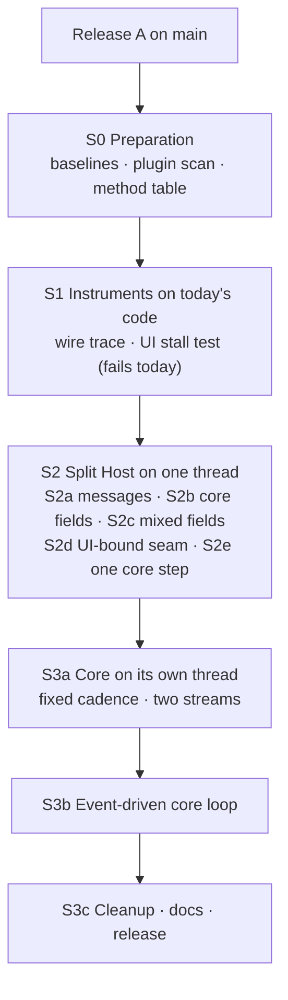

# The core thread: execution plan

**Status: plan, nothing started.** Written 2026-11-15 from the user's rulings of that day. The design is [core-thread.md](../architecture/core-thread.md) (called "the design" below; its rules are R1–R12, its risks K1–K14); it is the authority for what is built. The inventory with file and line is the study, [core-loop-study.md](research/core-loop-study.md). This file says in what order, by whom, and how each step is known to be done. The running state is in the blackboard, [rounds/history.md](rounds/history.md).

**Start condition.** Release A (SDK 1.10.0 / player 0.10.0) is on main. The user ruled that the work then starts at once, without a further go, and that this plan need not be read first.

## 1. Goal, done criteria, authority

| Item | Content |
| --- | --- |
| Goal | The host's core runs on its own thread; the UI thread is its client (design §5). A stalled interface no longer stops plugin requests, playback control, triggers or supervisor timers |
| Done when | S3c is merged and released: the UI stall test passes; V2 shows no difference; the wire trace shows only the reorders rule R4 allows; `ci:local` is green; the transitional switch of §6 is gone; the architecture documents describe the new structure |
| The loop may stop | When the done criteria hold, or when everything left waits on the user (§8, §9) |
| The coordinator decides alone | Step order inside a stage; splitting a step into smaller merges; details with an established practice; fixes of defects found on the way that are inside the step's files; patch releases |
| Stops for the user | Any plugin-visible behaviour difference beyond rule R4; any SDK or wire change; any new duty for the host; a change to a scheduling rule of [supervisor.md](../architecture/supervisor.md); a finding of the plugin scan (S0.3) that cannot be fixed inside the plugin; a stage that would exceed its size estimate by more than half |
| Resources | One cargo build at a time (`C:\vestra\build.lock`). About 20 GB of free disk: one target directory per worktree, removed at every merge; at most two target directories at once. No paid services. Pushes and patch releases without asking; no force pushes |
| Outward steps | None besides the release in S3c |

## 2. How the work is run

| Item | Rule |
| --- | --- |
| Workflow | [agentic-workflow.md](../../agentic-workflow/agentic-workflow.md) §5 (top-down refactor), run under [agentic-workflow-loop.md](../../agentic-workflow/agentic-workflow-loop.md) |
| Agents | One role per agent. Sub-agents never commit, never start agents, never open a player window and never send mouse or keyboard input. The coordinator makes every commit |
| Models (user ruling, 2026-11-15) | The same working pattern as SDK 1.10.0. **Fable** writes the design and this plan and does the static reviews; **Opus 5.5** implements and does everything that has to read console output: builds, test runs, `ci:local`, V1 and V2. Reason: review tokens are not spent on build and test noise |
| Implementing agents | The API maintainer: **Opus 5.5** |
| Static review | **Fable, medium effort.** Reads the design, this plan, the diff and the code; no builds, no logs. Judges whether the implementer understood the design and implemented that |
| Build/test verification | **Opus 5.5.** Re-runs the checks of the stage itself (builds, tests, V1, V2, wire trace, stall test, `ci:local`) and reports numbers. The static reviewer never runs or reads them |
| When reviews happen | At stage boundaries (S1, S2a, S2b, … each merge is a boundary). After fixes, a brief re-read of the changed parts |
| Re-review bar | Blocking: a regression, data loss, two writers on one resource, stuck forever. Anything below it becomes a follow-up item, not another fix round |
| Fixes | Go back to the agent that wrote the code |
| One change, one merge | Each step below is one branch and one merge to main. No batch branches |
| Tests | Offline first: unit tests, the offscreen integration tests, V2, the wire trace, the stall test. No scripted desktop input. Real-window checks are the user's, by hand (§5) |
| `ci:local` | At the end of each stage (S1, S2, S3), not on every merge |
| Spec tests | For S2d and S3a, a separate spec-test author writes tests from the design's rules (R4–R8, R12) without reading the implementation |
| Open points | The implementing agent decides open design items and gives its reasons (§7). Coupling, a new host duty or bloat goes to the user before the merge |

## 3. Stages

Files named below are under `src/host/src/` unless they start with `src/` or `doc/`. "Stay out of" lists what the step must not change; the SDK repository, the plugin repositories and `supervisor/` (the pure supervisor core) are out of bounds for every step unless the step says otherwise.

### S0 Preparation

| Step | Content | Owner | Done when |
| --- | --- | --- | --- |
| S0.1 Baselines | On main after release A: `ci:local`, V1, and the V2 run of the staged 0.10.0 with the store plugins | Build/test verification | `ci:local` green and its commit recorded; V2's `normalised.json` and `summary.txt` saved, their folder named in the blackboard |
| S0.2 Method table | From study §2.2: every one of the 119 route entries with its stream (UI-independent or UI-bound) and, for the 25 "touches the interface, reply independent" methods, whether the core answers at once or the method joins the UI-bound stream. Default: the study's classification. Added to design §5.1 as a table | Maintainer writes; coordinator commits | The table is on main; the static review agrees that no UI-independent method is routed through the interface (R7) |
| S0.3 Plugin scan (K1) | Read-only scan of all built-in plugins (`src/plugins/`) and the plugin repository for a UI-bound call that is not awaited and is followed by something that depends on its effect. Uses the method table of S0.2 | Researcher (read-only) | A list with file and line, or "none found" with the patterns searched. Each finding is fixed in the plugin (its author) before S3a, or brought to the user |
| S0.4 Archive | The design, this plan and the study are on main and linked from `doc/architecture/README.md`; the blackboard records the rulings of 2026-11-15 and points here | Coordinator | Files on main; the blackboard entry exists |

### S1 Instruments on today's code

Nothing in the product changes. Both instruments are test switches inside the host.

| Step | Content | Files | Done when |
| --- | --- | --- | --- |
| S1.1 Wire trace | A host switch, off by default (`VESTRA_TEST_WIRE_TRACE=<file>`): every line the host reads from or writes to a plugin is logged with the plugin's installed id, a per-plugin sequence number and a direction. A diff tool (`src/scripts/verify-wire.mjs`) compares two runs per plugin with request ids and times normalised, and prints the first difference per plugin. It has an "allowed reorders" mode that is unused until S3a | `process/` (reader and writer threads), `host/lifecycle.rs`, `host/dispatch.rs`, a new script, its tests. Stay out of: handling logic | Two runs of the same build over V2's four scenarios compare equal (the tool's own noise floor is zero or its normalisations are listed); a run with one line reordered by hand is caught; unit tests of the tool |
| S1.2 UI stall test | A test-only switch (`VESTRA_TEST_UI_STALL=<start ms>,<length ms>`) that makes the windowed tick's UI part sleep on the offscreen platform. A new offscreen integration test (`src/host/tests/ui_stall.rs`) with three test plugins: one calls `source.state` every 50 ms, one has a short idle time and is due to park during the stall, one has a `time` trigger due during the stall. It records request latency, the park time and the trigger time | `main.rs` (the switch), `src/host/tests/`, test plugins under the tests' fixtures. Stay out of: everything else | On today's code the three stall assertions **fail** and the numbers are recorded as the baseline (latency about the stall length; park and trigger late by about the stall length). The test is marked "expected to change in S3a" and does not fail `ci:local` until then; outside the stall window its assertions pass |
| S1.3 Baselines | Wire traces of main over V2's four scenarios, saved next to the V2 baseline | Build/test verification | Folder named in the blackboard |

Stage end: static review, build/test verification, `ci:local`.

### S2 Split `Host` into a core part and a UI part, on one thread

A structural refactor under the names-only rule: **zero difference** in V2, the wire trace and `ci:local` after every merge, and no test or test host edited to pass. Messages are executed in place at today's points, so order and timing are unchanged. The UI stall test still fails, as expected.

| Step | Content | Main files (study §1, §4.2) | Done when |
| --- | --- | --- | --- |
| S2a Message types | The two message kinds of rule R3 as types, unused: `UiCommand` (core → UI: snapshots and UI-bound requests) and `UiReport` (UI → core: results, window facts, the existing UI-originated events). The lists in study §4.2 are the starting point; the maintainer may rename and regroup | New module under `host/`; `host/events.rs` | Compiles; unit tests construct and match every variant; no caller yet; V2 and wire trace: no difference |
| S2b Core fields | A `Core` struct inside `Host` takes the pure-core fields: processes and supervisor, playback, registries, notification bookkeeping, misc (study §1.1, the five CORE rows). `Host` keeps the rest and holds `Core`. Methods that touch only core fields move to `impl Core`. A compile-time assertion that `Core` is `Send` is added and must pass by the end of S2c | `host/mod.rs` and the `impl Host` files that are core-only (`host/supervisor/`, `host/triggers.rs`, `host/dispatch.rs` in part, `capabilities/` for the 84 UI-independent entries) | Zero difference; the assertion compiles for the fields moved so far; line counts before and after reported |
| S2c Mixed fields, one merge each | In this order, smallest coupling first: (1) `window_facts` (UI writes, core reads: becomes a `UiReport` snapshot applied at today's point, rule R9); (2) the binding table in `input` and the command registry (core-owned, UI reads a snapshot: rule R8); (3) `mounts`, `mount_queue`, `held_mounts` (registry to the core, batching and compile stay UI: K6); (4) `settings` (registry to the core, open window stays UI: K7); (5) `policy`, `origins`, `review`, `lead`, `dialog_busy`, `confirm_open`; (6) `images` (Slint images stay UI, patch sequence to the core), `drops`, `info_panels`, `on_top`, `cursor_playing`, `area_replies`, `last_frame`, `startup_panels`, `cover_art_off`; (7) `ui_state` (one writer, fed by both: K8) | `host/window.rs`, `host/input.rs`, `binding_manager.rs`, `capabilities/commands.rs`, `host/mounts.rs`, `capabilities/ui_mount.rs`, `ui/settings_window.rs`, `ui/window_state.rs`, `ui/ui_image.rs`, `ui/drops.rs`, `ui/ui_state.rs` | After each: zero difference; the snapshot cost of (2) measured and reported (K11); after (7) the `Send` assertion on `Core` passes with no exceptions |
| S2d UI-bound seam | The UI-bound methods (design §5.1: 15 method names) and the three couplings of the same shape (activation gating, `area_replies` and the picture-in-picture reply, `startup_panels`) go through an explicit pair: the core issues a `UiCommand` with the reply handle, the UI part performs it and returns a `UiReport`, the core answers from the report. Still executed in place, in the same turn. `stop_run` splits into a core part and a "revoke owner" `UiCommand` (K3); `show_osd` and the `source.state` display (no-video, title) become `UiCommand`s | `capabilities/ui_window.rs`, `capabilities/ui_mount.rs`, `host/mounts.rs`, `ui/settings_window.rs`, `host/state.rs`, `host/video.rs`, `host/lifecycle.rs`, `host/actions.rs`, `host/handle.rs`, `host/dispatch.rs` | Zero difference; spec tests written from rules R5, R6, R12 and R13 pass (R13: the three read-after-await cases of design §5 and the 1 s timeout path); no core method takes a Slint type as a parameter or returns one (a grep check named in the brief) |
| S2e One core step | The windowed and the headless driver call the same function for the core's turn (drain, handle, the 8 core steps); the windowed driver adds the UI steps around it | `main.rs`, `host/events.rs` | Zero difference in both drivers; the headless loop contains no step list of its own |

Stage end: static review of the whole split against the design, build/test verification, `ci:local`. The stage's total size is reported against the estimate (5,000–10,000 changed lines).

### S3 Move the core to its own thread

| Step | Content | Done when |
| --- | --- | --- |
| S3a Core thread, fixed cadence, two streams | The core runs the loop of S2e on its own thread (`vestra-core`) at today's cadence (rule R10, first step). The UI thread drains `UiCommand`s (woken by `invoke_from_event_loop`) and sends `UiReport`s. Rule R4: a UI-bound request waits only for the UI; the core goes on with the next event. Rule R8: table snapshots and key events share one queue on the UI side. The restart and device-loss path is re-checked against [supervisor.md §9](../architecture/supervisor.md#9-quit-and-device-loss) (K9); `power` runs on the core thread (K10). The transitional switch of §6 selects the old arrangement | **The UI stall test passes** (latency p99 under 50 ms during the stall, park on time, trigger within one core turn); V2: no difference; wire trace: only reorders between a plugin's two streams, each reported; spec tests for R4, R7, R8 and R13 pass; on macOS, `clipboard.*` read and written from the serial clipboard thread works (design §5.1 note 10; if `NSPasteboard` must stay on the main thread, the fallback is `clipboard.*` UI-bound on macOS only, routed through the UI as a `UiCommand` with a reply, and the design table updated); the offscreen integration tests pass in both arrangements of the switch; `ci:local` |
| S3b Event-driven core loop | Rule R10, second step: the core loop sleeps on its queue and handles each event when it arrives; periodic steps keep their own deadlines. A separate merge so that it can be reverted alone (K14) | V2: no difference; wire trace: no difference from S3a beyond what R4 allows; request latency without a stall measured before and after (expected: up to 16 ms sooner) and reported; idle CPU use of the host measured before and after and not higher; V3 frame rate shows no regression |
| S3c Cleanup, documents, release | The transitional switch and anything else marked transitional are removed (each names this step as its remover; the brief carries a grep check). Documents: `doc/architecture/README.md` (thread table, the platform table), [supervisor.md](../architecture/supervisor.md) (which thread runs it), [events-and-triggers.md §4.4](../architecture/events-and-triggers.md) (the `time` atom no longer depends on the UI thread, K4), the design's status line. Release of the player | The grep for the switch returns nothing; documents on main; the release has its assets; `target-wt-*` folders of merged worktrees removed; the blackboard round folded into history |

## 4. Verification matrix

| Rule or property | Proven by | From |
| --- | --- | --- |
| Nothing but structure changed (S2) | V1, V2, wire trace, `ci:local`: zero difference | S2a |
| R1, R7: the core does not wait for the interface | UI stall test | S3a |
| R3: only snapshots and id-carrying requests cross | Static review; `Send` assertion on `Core`; grep check for Slint types in core signatures | S2c, S2d |
| R4: two streams, no queue | Wire trace in "allowed reorders" mode; spec test: a UI-independent request sent after a stalled UI-bound one is answered first | S3a |
| R5: a reply means done, including the interface part | Spec tests: after `ui.open`'s reply the view exists; `ui.preparing` precedes the `ui.mount` reply | S2d, S3a |
| R6: events and broadcasts keep core order | Wire trace: per plugin, no reorder inside the core's lines | S3a |
| R8: keys never judged by an older table | Spec test: register a binding, inject the key behind it in the same queue, expect the new command | S3a |
| R9: window facts reach conditions and triggers | Existing condition tests; a test that a `window.state` change during a core-only turn is seen at the next snapshot | S2c |
| R10: timing unchanged first, faster second | S3a: wire trace timings within noise; S3b: measured latency | S3a, S3b |
| R11: scheduling rules unchanged | V2 (standby classification, parking, recordings); the supervisor's own tests untouched | every merge |
| R12: readiness coupling kept | `lazy_activation` tests; spec test: a run that starts during a stall is ready after it | S3a |
| K9: device loss and quit | `lifecycle_baseline` tests; a test that the plugin shutdown deadline holds while the UI part is stalled | S3a |
| No frame-rate regression | V3 (frame log, CPU rendering included) | S3a, S3b |

## 5. Needs the user

Collected here so that nothing waits silently. None of these blocks a merge except the first.

| Item | When |
| --- | --- |
| A finding of the plugin scan that cannot be fixed inside the plugin (K1) | Before S3a |
| Manual real-window check of S3a's build: on the internal panel and on the external screen, play a video, open the Store and About, drag and resize quickly, toggle fullscreen; started with `C:\vestra\compare\watch.ps1` so that stalls and stacks are recorded. Expected: the window may still freeze as before (S2 and S3 of the design's §1.2 are not removed by this work), but plugins keep working: no `still waiting after 10 seconds` lines in the plugin log during the freezes | After S3a, before S3c's release |
| Manual check of the keep-alive build (branch `fix-modal-tick`), independent of this plan | When the user has time |

## 6. Rollback

- Every merge is revertible on its own; S2's merges are structural and S3b is deliberately separate from S3a.
- A transitional runtime switch, `VESTRA_CORE_ON_UI=1`, is introduced in S3a: with it the core's turn runs on the UI thread as before S3a (the arrangement of S2e). The offscreen tests run in both arrangements while it exists. **It is removed in S3c**; it is not a supported setting and is not documented for users.
- If S3a's wire trace shows a reorder that R4 does not allow and it cannot be fixed in the step, the merge does not happen and the finding goes to the user with the trace.

## 7. Open decisions

**The implementing agent decides, with reasons in its report:**

- Names of the types, modules and the core thread.
- How `UiCommand`s are grouped, and whether last-value-wins snapshots share one slot per kind or a small coalescing queue.
- Whether the registry and binding snapshots are copied or shared immutable (`Arc`), from the measurement in S2c.
- Which side writes the `ui_state` file, as long as there is one writer.
- The exact cadence constant in S3a, as long as timing stays within the wire trace's noise.
- Settled in S0.2 (design §5.1 method table, 2026-11-15): which of the study's 25 "touches the interface, reply independent" methods answer from the core at once and which join the UI-bound stream (126 rows: 111 UI-independent, 15 UI-bound).

**Goes to the user:**

- Anything in §1 "Stops for the user".
- Dropping or weakening one of R1–R12.
- A UI-bound method that turns out to need a result the core cannot wait for without breaking R7.

## 8. Out of scope

| Item | State |
| --- | --- |
| Independent video layer (own swap chain and render thread) | Separate project; a Windows-only prototype was discussed, not scheduled |
| Default adapter rule (render on the adapter that drives the main window's screen) | Separate item, awaiting the user's decision |
| Keep-alive timer for the modal move/size loop | Written on branch `fix-modal-tick`; awaits the user's manual check |
| Upstream request to Slint (present mode, reconfigure once per frame, newer wgpu) | Deferred by the user |
| Tool-window compile cache | Awaits a memory measurement and the user's decision (ruling of 2026-11-03) |
| Second batch of events, removal of `subscribe()` / `onChange()` (release B of the events plan) | Its own plan; ordered after this work or beside it by the coordinator, on disjoint files |

## 9. Stop points

- S0.3 finds a plugin that depends on today's same-tick order and cannot be changed: stop before S3a.
- S2 cannot reach zero difference for a field without a behaviour change: stop that field, report which behaviour, continue with the others.
- `Core` cannot be made `Send` without `unsafe` or a lock on a hot path: stop and bring the field to the user.
- S3a's stall test passes but V3 shows a frame-rate regression: stop before the merge.

## 10. After S3 (user rulings 2026-11-15)

These start only when S3c is merged and the core thread has been stable in use.

| Item | What | Authority |
| --- | --- | --- |
| F1 | **Interface-only recovery after a device loss.** First a verification: can Slint close every window, take a new device and reopen them in the same process while the core, the plugins and playback keep running? Measure the size of the change | If small and contained: implement without asking. If it needs another round of core changes: drop it and report |
| F2 | **TestHost models the two streams**, so a plugin test shows a dependence on order across the two kinds of request. This changes TestHost behaviour and ships as an SDK release of its own | Decided: after the core thread work is done, not during it |
| F3 | **SDK docs** state the ordering rule (R4, R5) for plugin authors | May be written at any time |

Not planned (user, 2026-11-15): the default adapter rule ("render on the adapter that drives the main window's screen"). It stays on the blackboard as a possible stopgap only.
