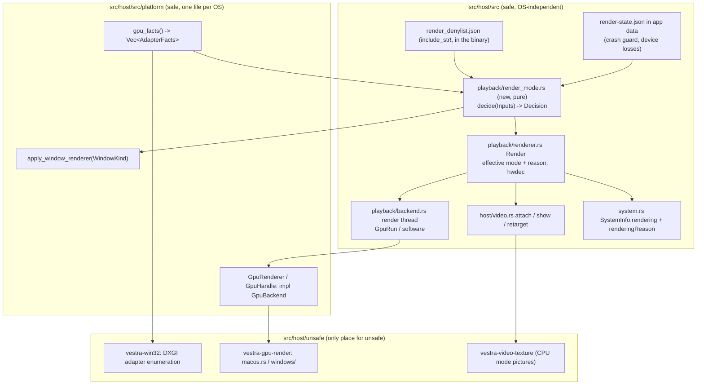

# Render modes: CPU and GPU behind one decision, with a driver check

API maintainer, 2026-10-28. Design proposal only: no code was changed. Main = `C:\PROJECT\vestra-player` at 692e631; branch = `windows-wgpu-render-2` (`C:\vestra\wt-wgpu-port`, f4cf5e7); `host-followups` for `SystemInfo.rendering` (0.5.12).

**Binding rulings this design keeps:** Windows GPU rendering stays off main until the user decides (`2026-10-windows-render.md` §E, `2026-10-windows-wgpu.md` header); macOS GPU rendering is unchanged; on hybrid laptops the GPU follows Windows' per-app order (`2026-10-windows-wgpu.md` §18); the UI hits the display rate in CPU mode too; OS-specific code only in platform modules, and `unsafe` only in `src/host/unsafe/*` (`agentic-workflow.md` §1.5, §1).

Terms: **CPU mode** = libmpv's software renderer (`RenderContext::new_software`, hardware decoding with copy-back) shown in a window. **GPU mode** = libmpv renders on the GPU and the window shows its texture (macOS: OpenGL into IOSurfaces; branch: Direct3D 11 into shared Direct3D 12 textures). The mode is a *pair*: the video renderer **and** Slint's window renderer.

## 1. Today

### 1.1 Who decides, per OS

| Step | Main (macOS GPU, Windows CPU) | Branch (Windows GPU) |
| --- | --- | --- |
| Wanted? | `renderer::wanted` = `platform::GPU_RENDER && !headless && !VESTRA_SOFTWARE_RENDER` (`playback/renderer.rs:101-104`); `GPU_RENDER` is `true` on macOS (`platform/macos.rs:579`), `false` elsewhere (`platform/mod.rs:321`) | same, plus `GPU_RENDER = true` on Windows (`platform/windows.rs:681`) |
| Window renderer | `main.rs:166-191`: femtovg (OpenGL) if GPU wanted, else Slint's default; femtovg failure → software video | `platform/windows.rs:764-861` `select_window_renderer`: `VESTRA_WINDOW_RENDERER`, DXGI adapter (`VESTRA_GPU_ADAPTER`, `unsafe/render/src/windows/d3d.rs:111-160`), software-adapter check (vendor `0x1414`), wgpu → GL → Slint software ladder; installs the device-lost hook; one `render:` line |
| Video renderer start | render thread: `GpuRun::run` → `platform::gpu_start`, refusal → software (`playback/backend.rs:110-126`, `:685-718`) | same, plus `platform::gpu_failed` (render thread died) |
| Runtime fallback | `Render::fall_back` once, GPU → software, never back (`renderer.rs:64-69`); window cannot show GPU frames (`host/video.rs:46-51`); hwdec switched to copy-back on the control worker (`backend.rs:544-556`) | same, plus a lost window device restarts the player; a second loss in a row restarts with GL windows (`host/restart.rs:30-70`, `main.rs:202-231`, `:613-621`) |
| Reported as | `render:` diag lines; `stats().backend` (`renderer.rs:16-21`); `SystemInfo.rendering` = `gpu`/`software` (host-followups `system.rs:117-124`, `:188`) | the same, the adapter line names how the GPU was chosen (§17.1) |

### 1.2 What is duplicated or tangled

1. **The decision is spread over 4 places** (env in `renderer.rs`, window renderer in `main.rs` or `platform/windows.rs`, GPU start in `backend.rs`, runtime fallback in `Render`). None records *why*; the reason exists only in a `diag!` string.
2. **Policy inside a platform module** (branch): `select_window_renderer` mixes env parsing, adapter choice, the software-adapter rule, device-loss restart and a test switch (`VESTRA_TEST_REMOVE_DEVICE`) in one 100-line function. A driver denylist added there would make it worse, and would be Windows-only by construction.
3. **The window/video pair is implicit.** On the branch "CPU" can mean three window renderers (wgpu, GL, Slint software). `VESTRA_SOFTWARE_RENDER=1` keeps the wgpu windows, which measured 21-26 presented fps on the 780M (`2026-10-windows-wgpu.md` §8): so "force CPU" today would not escape a bad GPU driver.
4. **The GPU backend contract is duck-typed.** `platform::GpuHandle` on macOS (`vestra-gpu-render`), on Windows (branch) and the inert `no_gpu` stub (`platform/mod.rs:313-371`) must expose the same method names; nothing but compilation on each OS checks it. Host code tests `render.gpu().is_some()` at ~10 sites (`host/video.rs:24,118,171,308,332,341,367`, `host/window.rs:84`, `backend.rs:243,420,437,546,728`).
5. **No memory across starts**, except the restart counter passed as an argument: a driver that crashes during GPU init crashes every start.

What is *not* tangled and stays: frame pacing (by OS clock, `frame_pacing.rs:531`, `platform::VBLANK_CLOCK`), the software path (`render_target.rs`, `vestra-video-texture`), snapshots and exports (offline FFmpeg, `media_jobs.rs`; renderer-independent), PiP (macOS; GPU frames when GPU, else the software picture, `host/video.rs:305-345`).

## 2. Target architecture



### 2.1 The decision module (`playback/render_mode.rs`, new, `forbid(unsafe_code)`, no OS calls)

```rust
pub struct Inputs<'a> {
    pub headless: bool,
    pub gpu_backend: bool,            // platform::GPU_RENDER (compile-time per OS)
    pub env: Overrides,               // VESTRA_RENDER=cpu|gpu|auto (VESTRA_SOFTWARE_RENDER=1 kept as cpu),
                                      // VESTRA_GPU_ADAPTER, VESTRA_WINDOW_RENDERER (test only)
    pub preference: Preference,       // the user's setting: Auto | Cpu | Gpu
    pub os: &'a OsFacts,              // platform::os_facts(): os, version, build
    pub adapter: Option<AdapterFacts>,// the adapter GPU mode would use (Windows' order, or VESTRA_GPU_ADAPTER)
    pub denylist: &'a Denylist,       // built-in merged with the local override
    pub state: &'a RenderState,       // crash guard and device losses from earlier runs
    pub now: SystemTime,
}
pub enum Mode { Cpu, Gpu { adapter: Option<AdapterId> } }   // macOS: adapter None
pub struct Decision { pub mode: Mode, pub windows: WindowKind, pub reason: Reason, pub warnings: Vec<Note> }
pub enum Reason { Default, Headless, NoGpuBackend, User, Env, Denylist { rule: String }, SoftwareAdapter,
                  PreviousCrash { until: SystemTime }, DeviceLost, InitFailed, WindowFallback }
pub fn decide(inputs: &Inputs) -> Decision
```

- **Order** (first match wins): headless → `NoGpuBackend` (no GPU backend in this build/OS) → env (`Env`) → user `Cpu`/`Gpu` (`User`) → sticky crash guard (`PreviousCrash`) → no adapter or software adapter (`SoftwareAdapter`, today's `0x1414`/DXGI software flag rule moved out of `windows.rs`) → denylist rule with action `cpu` (`Denylist`) → `Gpu` (`Default`). A user/env `Gpu` that overrides a denylist rule or the guard keeps a warning (Chromium's `--ignore-gpu-blocklist`, Firefox's `force-enabled` prefs).
- **`WindowKind` follows the mode**, so CPU mode is one well-tested pair: `Cpu` → `Gl` (Windows and macOS: femtovg on OpenGL, today's main path) with Slint software as the last rung; `Gpu` → the OS's GPU windows (`Wgpu` on Windows, `Gl` on macOS). **CPU mode never creates a Direct3D 12 device**, so it also avoids the 780M's UI draw stalls (§14), which are in the window draw, not in mpv.
- **Pure and table-tested**: one test row per reason; no env reads inside (`main.rs` reads them, as `renderer::wanted` does today).
- After start the decision is the *intended* mode; `Render` (`renderer.rs`) holds the *effective* mode and the reason of its last change (`InitFailed`, `WindowFallback`, `DeviceLost`). The one-way GPU → CPU rule stays.

### 2.2 The two backends and the narrow interface

The host calls the same five operations in both modes. The CPU backend is the existing software path (always compiled, no trait needed); the GPU backend gets a trait in shared code that each OS's platform module implements for its handle, statically dispatched (no `dyn`), replacing the duck-typed contract of §1.2 item 4. The `no_gpu` stub implements it too, so a missing method fails to compile on every OS.

| Host operation | CPU backend | GPU backend (`trait GpuBackend` in `playback/renderer.rs`) |
| --- | --- | --- |
| start (render thread) | `RenderContext::new_software`, `BufferRing` | `platform::gpu_start(mpv, size, publish)` → `GpuRenderer` |
| attach to a window | `count_draws` + `vestra_video_texture::attach`/`direct` (`host/video.rs:59-110`) | `attach(component, show, failed, drawn)` |
| show a frame | `FrameSlot` → `show_frame` (`host/video.rs:125-175`) | `on_frame` / `latest` / `reshow`, through the frame gate (branch §17) |
| resize | `render_target` size to the render thread | `set_size` |
| retarget on shell swap | `video_target` replaced (`host/video.rs:116-122`) | `retarget(component)` |
| failure | — | `failed()` / device loss → `Render::fall_back(Reason)` |

Consumers ask `Render`, never the decision:

- **Frame pacing**: unchanged; keyed by OS (`VBLANK_CLOCK`). The branch's no-notifier rule (`window_notifiers()`, `platform/windows.rs:881-885`) becomes `WindowKind::Wgpu`.
- **PiP**: unchanged (`pip_gpu_frames` = GPU active and no generated stream).
- **Snapshots, exports**: offline FFmpeg; not affected.
- **Render options** (`processing.video` → `video.render.set`): `unsupported` in CPU mode as today (`backend.rs:420-424`); the message adds the reason code, e.g. "render options need GPU rendering; the player renders in software (denylist: amd-780m-stall)".
- **hwdec**: `renderer::hwdec(env, software)` from the effective mode, unchanged.

**macOS** fits as is: `gpu_backend = true`, `adapter = None`, `WindowKind::Gl` in both modes, the denylist matches `os.build` only (no rule needed today). Linux: `NoGpuBackend`.

## 3. Driver check

### 3.1 Where the facts come from

`platform::gpu_facts()` (safe; Windows implementation calls a new function in `unsafe/win32`, which already links the `windows` crate). It runs before any window or device exists, costs one DXGI factory, and **lands on main without any GPU rendering code**:

- `IDXGIFactory1::EnumAdapters1` in Windows' order (the ruling) → `IDXGIAdapter1::GetDesc1`: `VendorId`, `DeviceId`, `SubSysId`, `Revision`, `AdapterLuid`, `Description`, `Flags` (software).
- **Driver version**: `IDXGIAdapter::CheckInterfaceSupport(IDXGIDevice)` returns the user-mode driver version as four 16-bit parts; since WDDM 2.3 all components of a driver package share one version (the rationale of a VLC merge request that moves its driver check to `CheckInterfaceSupport`). Fallback: the adapter's `DriverVersion` registry value (what Chromium and VLC's older code read).
- This machine (read-only `Win32_VideoController`, 2026-10-28): AMD Radeon 780M `VEN_1002 DEV_15BF`, driver **31.0.14005.21001** (dated 2023-10-25); RTX 4070 Laptop `VEN_10DE DEV_2820`, 32.0.16.1062; Windows build 26200.

The branch's `adapter_facts` (`unsafe/render/src/windows/d3d.rs:111-119`) then reuses this instead of its own `GetDesc1`.

### 3.2 Denylist data

- **Format**: a subset of Chromium's `software_rendering_list.json` (fields `id`, `description`, `os`, `vendor_id`, `device_id`, `driver_version {op, value, value2}`, `exceptions`), so rules can be copied from there and reviewers know the shape. Driver versions compare part by part as numbers.
- **Ships in the binary** (`include_str!` of `src/host/render-denylist.json`): no install-layout change, never "missing". Chromium compiles its list in the same way.
- **Local override without a host release**: `<app data>/render-denylist.json`, same format, merged by `id` (an entry with `"disabled": true` switches a built-in rule off). Support can hand a user one file. A malformed file gives one `render:` line and is ignored.
- **Remote updates** (Firefox's Remote Settings `gfx` list) are not proposed now: see §5 Q2.

```json
{
  "version": 1,
  "rules": [
    {
      "id": "amd-780m-draw-stalls",
      "description": "Radeon 780M driver 31.0.14005: GPU draws stall for tens of ms (p95 52 ms), 4K60 drops to ~40 fps",
      "refs": ["doc/process/rounds/2026-10-windows-wgpu.md §14, §18"],
      "os": { "type": "windows" },
      "vendor_id": "0x1002",
      "device_id": ["0x15BF"],
      "driver_version": { "op": "between", "value": "31.0.14005.0", "value2": "31.0.14005.65535" },
      "action": "cpu"
    }
  ]
}
```

Rule fields: `os.type`, optional `os.build {op, value}`, `vendor_id`, `device_id` (list, or `device_range {from, to}`), `driver_version`, `exceptions`, `reason`/`description`, `refs`, `action`: `cpu` (force CPU mode) or `warn` (keep the mode, show a note). The bound on the 780M rule is the exact driver branch until the Adrenalin 26.10.1 test says which version is good; then it becomes `< <first good version>`.

The AMD kernel leak (every exited process; github.com/stablyai/orca/issues/28293) is system-wide and **CPU mode does not avoid it**, so at most it is a `warn` rule ("update the graphics driver"), not `cpu` (§5 Q3).

### 3.3 Reporting

- One startup line, always: `render: GPU mode on AMD Radeon 780M (1002:15BF, driver 31.0.14005.21001; Windows' order); reason: default` or `render: CPU mode; reason: denylist amd-780m-draw-stalls (AMD Radeon 780M, driver 31.0.14005.21001)`. Later changes add one line each (`InitFailed`, `DeviceLost`, …).
- `SystemInfo`: `rendering` stays `gpu`/`software` (0.5.12); add `renderingReason: { code, message }` with the `Reason` codes in kebab case (`default`, `headless`, `user`, `env`, `denylist`, `software-adapter`, `previous-crash`, `device-lost`, `init-failed`, `window-fallback`, `no-gpu-backend`). OS-independent: no DXGI ids; the adapter name and driver version are in `message`. SDK minor release.
- User-visible: the built-in `info` plugin's About page (`src/plugins/info/about.ts`) shows "Rendering: software — your graphics driver is known to stall (update it, or choose …)" from `SystemInfo`. That is a plugin-author request, not host code.

### 3.4 User override

- Env `VESTRA_RENDER=cpu|gpu|auto` (developers, support); `VESTRA_SOFTWARE_RENDER=1` stays an alias of `cpu`.
- A persisted preference `Auto | Software | GPU` in a host settings file in app data. Choosing GPU against a rule shows the reason once and keeps a warning in the `render:` line and About. Where the UI for it lives is a product decision (§5 Q1); M2 can ship with env and the file only.

### 3.5 Sticky fallback after a crash (Firefox `DriverCrashGuard` pattern)

`<app data>/render-state.json`, read by `main.rs`, written by the host (safe code):

1. Before GPU init (window device and `gpu_start`): `guard = attempting {adapter, driver, app version}`, flushed.
2. After GPU mode has presented frames for 3 s: `guard = ok`.
3. Next start sees `attempting` (the process died in GPU init: crash, hang killed, TDR bugcheck) → `PreviousCrash`, CPU mode.
4. A device loss (branch §1.1) records `losses += 1` before the restart; two losses within one day → sticky CPU too (replaces the branch's "second loss → GL windows" argument).
5. **Expiry**: cleared when the driver version, adapter or app version changes (Firefox resets on the same three), or after 7 days; then GPU is tried once more, and a new crash re-arms it. The `render:` line and About say "GPU rendering was turned off after a crash on <date>; it is retried after a driver update or on <date>".

Chromium's in-session fallback (GPU process crashes → software) is what `Render::fall_back` already does; it is not sticky there. mpv and VLC have no general blocklist: mpv falls back across `--gpu-api`/`--vo` at init and leaves the rest to the user; VLC hard-codes driver-version checks for specific hardware, e.g. which AMD drivers may display decoder NV12 textures (`D3D11CheckDriverVersion`). So: Chromium's list format, Firefox's crash guard, mpv's user override.

## 4. Migration plan

| Step | Content | Behaviour change? | Approval |
| --- | --- | --- | --- |
| M1 | `render_mode.rs` with `decide()` and its table tests; `main.rs` calls it instead of `renderer::wanted`; `Reason` in `Render`; `GpuBackend` trait implemented by macOS and `no_gpu`; one `render:` decision line | None (main has CPU on Windows and GPU on macOS as before; the line text is new) | Pure refactor; reviewer |
| M2 | `gpu_facts` (DXGI in `vestra-win32`), denylist (built-in + local file), `render-state.json` guard, `VESTRA_RENDER`, `renderingReason` + SDK minor, About request to `info` | On main Windows is already CPU, so the denylist only reports; macOS: guard can turn GPU off after an init crash | Guard on macOS and the new `SystemInfo` field are small user-visible changes: coordinator decides (standard practice, §8); reviewer |
| M3 | The branch rebased onto M1/M2: `select_window_renderer` keeps only "apply `WindowKind`" (policy moves to `decide`), restart writes the guard, `cfg(windows)` GPU backend implements `GpuBackend`. Built only with a cargo feature `windows-gpu`, **off in release builds**; nightly builds turn it on, and even there `Auto` resolves to CPU on Windows unless `VESTRA_RENDER=gpu` or the preference is GPU | Release: none (feature off, Windows binary identical in behaviour). Nightly: GPU mode reachable | **User ruling needed**: lifts "not on main, not even opt-in" |
| M4 | `Auto` resolves to GPU on Windows where the denylist and guard allow it; release notes say where to choose the GPU (§18 ruling) | Yes: default Windows rendering changes | **User ruling** |

CPU mode is undisturbed through M3 because `WindowKind::Gl` + software video is exactly main's code path, and without the feature none of the wgpu crates are linked. A regression in M4 is reverted by the denylist (a rule with no device filter) or by one line in `decide`.

## 5. Questions for the user (real trade-offs only)

1. **Where the rendering choice lives in the UI.** The host has no settings page of its own (all pages are plugin pages). Options: (a) env and the file only, plus the About note (no UI work; recommended for M2); (b) a host menu item "Video ▸ Rendering ▸ Automatic / Software / GPU" (needs the interaction design lead); (c) a host settings page (new host UI surface).
2. **Remote denylist updates.** Firefox fetches its graphics blocklist from a signed remote collection; Chromium only updates with releases. We could deliver the list through the plugin repository's signed index (no new server, but the player then fetches data at start). Recommended: not now (built-in + local file); revisit if a bad driver ships between releases.
3. **Warn about drivers that hurt the system, not the player** (the AMD process leak)? A `warn` rule would tell users of affected drivers to update; it is outside "rendering". Recommended: no, unless the 26.10.1 test shows the leak gone (then the note has a clear fix to point at).
4. **Hybrid laptops when the default adapter is denied.** Following the §18 ruling, a denied 780M gives CPU mode even though the RTX 4070 is fine; the About note then says "choose High performance for Vestra in Windows' graphics settings". The alternative (silently using the other GPU) overrides Windows' per-app order. Recommended: follow the ruling (CPU + note).
5. M3 and M4 themselves (table above).

## Insufficient evidence / to verify

- The first good AMD driver version (Adrenalin 26.10.1 test pending); whether 26.10.1 also fixes the leak.
- `CheckInterfaceSupport(IDXGIDevice)` returning the same four-part version as `Win32_VideoController.DriverVersion` on both GPUs here: to check in M2 (read-only).
- Firefox source re-read this round: `gfx/src/DriverCrashGuard.cpp` (guard file + pref, reset on driver version / device id / app version change). Chromium list format re-read from `gpu/config/software_rendering_list.json`. VLC: from its commit history (`D3D11CheckDriverVersion`, AMD checks 2017-2019, a merge request on `CheckInterfaceSupport`, merge status not confirmed), current source not re-read. Firefox's Remote Settings `gfx` collection: from memory, not re-checked.

## 6. Driver test (coordinator, 2026-10-28)

- The 780M was updated to AMD Adrenalin 26.10.1 (`amdkmdag.sys` 32.0.32015.7029, from amd.com, Authenticode signer Advanced Micro Devices).
- Process leak, 200 × `cmd /c exit`, `Proc` pool tag live objects: old driver 31.0.14005.21001 +400 (after a fresh boot too); new driver −11 and +8 in two runs. **The leak is fixed in 32.0.32015.7029.** So §3.2's rule can name a real bound (`< 32.0.32015.7029` for the leak warning, if §5 Q3 is answered yes).
- The draw stalls (wgpu §14) on the new driver are not measured yet (needs a 20 s windowed run of the branch player).

## 7. M1: the decision module (API maintainer, 2026-10-28)

Branch `render-modes` (worktree `C:\vestra\wt-rm`, from main f53a76f), uncommitted. Pure refactor: the same renderer is chosen for every input as before (test `gpu_exactly_when_it_was_wanted_before` checks all eight input combinations against the old `renderer::wanted`); only the log text changes.

- **New `playback/render_mode.rs`** (safe, pure): `Mode {Cpu, Gpu}`, `WindowKind {Default, OpenGl}` (CPU mode keeps Slint's default window renderer, as `winit().select()` did; GPU mode asks for femtovg), `Reason` with stable codes (`default`, `headless`, `no-gpu-backend`, `env`, `init-failed`, `window-fallback`; the M2 reasons come with M2), `Inputs {headless, gpu_backend, software_env}`, `Decision {mode, windows, reason}` with `gpu()`, `fall_back(Reason)`, `line()`, and `decide()` (first match: headless, no GPU backend, `VESTRA_SOFTWARE_RENDER`, else GPU). `software_requested` moved here from `renderer::wanted`.
- **`renderer.rs`**: `trait GpuBackend` (associated `Frame: Deref<Target = platform::GpuFrame>`; `set_size`, `set_display_fps`, `frames`, `shown`, `size`, `reshow`, `latest`, `on_frame`, `attach`, `retarget`). `Render::new(&Decision)` (was `new(bool)`), `Render::reason()`, `Render::start_failed(Reason)` (new: `gpu_start` refused), `Render::fall_back(Reason)` (was `&str`), `Render::gpu() -> Option<&impl GpuBackend>` (was `Option<&platform::GpuHandle>`: the host can only use the contract). `renderer::wanted` removed.
- **Platform**: `no_gpu`'s inert methods became its `GpuBackend` impl; macOS implements `GpuBackend` for `vestra_gpu_render::Handle` by delegation (`platform/macos.rs`); `vestra-gpu-render` gains `pub type Frame = CFRetained<IOSurfaceRef>` (no new unsafe). Callers import the trait as `GpuBackend as _` (`backend.rs`, `host/{video,window,state}.rs`).
- **`Backend::start(events, silent, &Decision)`** (was `gpu: bool`).
- **Log lines**: one decision line at start, e.g. `render: software rendering, Slint's default window renderer; reason: no-gpu-backend (no GPU rendering on windows yet)` or `render: GPU rendering, OpenGL windows; reason: default`; a femtovg failure prints a second decision line with `init-failed (the OpenGL window renderer is unavailable: …)`; `gpu_start` refusing prints `render: init-failed (GPU rendering unavailable: …); software rendering`; a window fallback prints `render: window-fallback (…); switching to software rendering`.

**Checks (Windows):** `cargo fmt --check` (host and `unsafe/render`), `cargo clippy --locked --workspace --all-targets -- -D warnings` and without `--workspace`, `cargo test --locked --workspace` (host 556 passed / 13 ignored), `cargo shear`, `typos`; in `src/`: `npm run check`, `format:check`, `test:sdk` (55/55), `boundaries`, `portability` (clean), `node scripts/check-unsafe-policy.mjs` (137, ok). macOS cross-check: `cargo clippy --locked --target aarch64-apple-darwin -- -D warnings` passes (the macOS `GpuBackend` impl and `vestra-gpu-render` type-check); with `--all-targets` it stops on `lease_stream::register` unused in the macOS test build, untouched by this change. Not run: plugin builds and tests (no TypeScript changed), GUI, GPU, macOS tests.

**For the Mac test list:** start the player normally (one `render: GPU rendering, OpenGL windows; reason: default` line, GPU video as before), with `VESTRA_SOFTWARE_RENDER=1` (`reason: env`, software video), and PiP once in GPU mode (frames still reach PiP through `GpuBackend::latest`).
