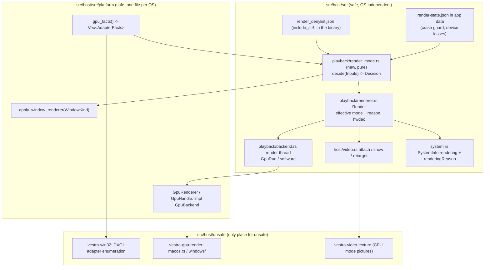

# Render modes: CPU and GPU behind one decision, with a driver check

API maintainer, 2026-10-28. Design proposal only: no code was changed. Main = `C:\PROJECT\vestra-player` at 692e631; branch = `windows-wgpu-render-2` (`C:\vestra\wt-wgpu-port`, f4cf5e7); `host-followups` for `SystemInfo.rendering` (0.5.12).

**Binding rulings this design keeps:** Windows GPU rendering stays off main until the user decides (`2026-10-windows-render.md` §E, `2026-10-windows-wgpu.md` header); macOS GPU rendering is unchanged; on hybrid laptops the GPU follows Windows' per-app order (`2026-10-windows-wgpu.md` §18); the UI hits the display rate in CPU mode too; OS-specific code only in platform modules, and `unsafe` only in `src/host/unsafe/*` (`agentic-workflow.md` §1.5, §1).

Terms: **CPU mode** = libmpv's software renderer (`RenderContext::new_software`, hardware decoding with copy-back) shown in a window. **GPU mode** = libmpv renders on the GPU and the window shows its texture (macOS: OpenGL into IOSurfaces; branch: Direct3D 11 into shared Direct3D 12 textures). The mode is a *pair*: the video renderer **and** Slint's window renderer.

## 1. Today

### 1.1 Who decides, per OS

| Step | Main (macOS GPU, Windows CPU) | Branch (Windows GPU) |
| --- | --- | --- |
| Wanted? | `renderer::wanted` = `platform::GPU_RENDER && !headless && !VESTRA_SOFTWARE_RENDER` (`playback/renderer.rs:101-104`); `GPU_RENDER` is `true` on macOS (`platform/macos.rs:579`), `false` elsewhere (`platform/mod.rs:321`) | same, plus `GPU_RENDER = true` on Windows (`platform/windows.rs:681`) |
| Window renderer | `main.rs:166-191`: femtovg (OpenGL) if GPU wanted, else Slint's default; femtovg failure → software video | `platform/windows.rs:764-861` `select_window_renderer`: `VESTRA_WINDOW_RENDERER`, DXGI adapter (`VESTRA_GPU_ADAPTER`, `unsafe/render/src/windows/d3d.rs:111-160`), software-adapter check (vendor `0x1414`), wgpu → GL → Slint software ladder; installs the device-lost hook; one `render:` line |
| Video renderer start | render thread: `GpuRun::run` → `platform::gpu_start`, refusal → software (`playback/backend.rs:110-126`, `:685-718`) | same, plus `platform::gpu_failed` (render thread died) |
| Runtime fallback | `Render::fall_back` once, GPU → software, never back (`renderer.rs:64-69`); window cannot show GPU frames (`host/video.rs:46-51`); hwdec switched to copy-back on the control worker (`backend.rs:544-556`) | same, plus a lost window device restarts the player; a second loss in a row restarts with GL windows (`host/restart.rs:30-70`, `main.rs:202-231`, `:613-621`) |
| Reported as | `render:` diag lines; `stats().backend` (`renderer.rs:16-21`); `SystemInfo.rendering` = `gpu`/`software` (host-followups `system.rs:117-124`, `:188`) | the same, the adapter line names how the GPU was chosen (§17.1) |

### 1.2 What is duplicated or tangled

1. **The decision is spread over 4 places** (env in `renderer.rs`, window renderer in `main.rs` or `platform/windows.rs`, GPU start in `backend.rs`, runtime fallback in `Render`). None records *why*; the reason exists only in a `diag!` string.
2. **Policy inside a platform module** (branch): `select_window_renderer` mixes env parsing, adapter choice, the software-adapter rule, device-loss restart and a test switch (`VESTRA_TEST_REMOVE_DEVICE`) in one 100-line function. A driver denylist added there would make it worse, and would be Windows-only by construction.
3. **The window/video pair is implicit.** On the branch "CPU" can mean three window renderers (wgpu, GL, Slint software). `VESTRA_SOFTWARE_RENDER=1` keeps the wgpu windows, which measured 21-26 presented fps on the 780M (`2026-10-windows-wgpu.md` §8): so "force CPU" today would not escape a bad GPU driver.
4. **The GPU backend contract is duck-typed.** `platform::GpuHandle` on macOS (`vestra-gpu-render`), on Windows (branch) and the inert `no_gpu` stub (`platform/mod.rs:313-371`) must expose the same method names; nothing but compilation on each OS checks it. Host code tests `render.gpu().is_some()` at ~10 sites (`host/video.rs:24,118,171,308,332,341,367`, `host/window.rs:84`, `backend.rs:243,420,437,546,728`).
5. **No memory across starts**, except the restart counter passed as an argument: a driver that crashes during GPU init crashes every start.

What is *not* tangled and stays: frame pacing (by OS clock, `frame_pacing.rs:531`, `platform::VBLANK_CLOCK`), the software path (`render_target.rs`, `vestra-video-texture`), snapshots and exports (offline FFmpeg, `media_jobs.rs`; renderer-independent), PiP (macOS; GPU frames when GPU, else the software picture, `host/video.rs:305-345`).

## 2. Target architecture



### 2.1 The decision module (`playback/render_mode.rs`, new, `forbid(unsafe_code)`, no OS calls)

```rust
pub struct Inputs<'a> {
    pub headless: bool,
    pub gpu_backend: bool,            // platform::GPU_RENDER (compile-time per OS)
    pub env: Overrides,               // VESTRA_RENDER=cpu|gpu|auto (VESTRA_SOFTWARE_RENDER=1 kept as cpu),
                                      // VESTRA_GPU_ADAPTER, VESTRA_WINDOW_RENDERER (test only)
    pub preference: Preference,       // the user's setting: Auto | Cpu | Gpu
    pub os: &'a OsFacts,              // platform::os_facts(): os, version, build
    pub adapter: Option<AdapterFacts>,// the adapter GPU mode would use (Windows' order, or VESTRA_GPU_ADAPTER)
    pub denylist: &'a Denylist,       // built-in merged with the local override
    pub state: &'a RenderState,       // crash guard and device losses from earlier runs
    pub now: SystemTime,
}
pub enum Mode { Cpu, Gpu { adapter: Option<AdapterId> } }   // macOS: adapter None
pub struct Decision { pub mode: Mode, pub windows: WindowKind, pub reason: Reason, pub warnings: Vec<Note> }
pub enum Reason { Default, Headless, NoGpuBackend, User, Env, Denylist { rule: String }, SoftwareAdapter,
                  PreviousCrash { until: SystemTime }, DeviceLost, InitFailed, WindowFallback }
pub fn decide(inputs: &Inputs) -> Decision
```

- **Order** (first match wins): headless → `NoGpuBackend` (no GPU backend in this build/OS) → env (`Env`) → user `Cpu`/`Gpu` (`User`) → sticky crash guard (`PreviousCrash`) → no adapter or software adapter (`SoftwareAdapter`, today's `0x1414`/DXGI software flag rule moved out of `windows.rs`) → denylist rule with action `cpu` (`Denylist`) → `Gpu` (`Default`). A user/env `Gpu` that overrides a denylist rule or the guard keeps a warning (Chromium's `--ignore-gpu-blocklist`, Firefox's `force-enabled` prefs).
- **`WindowKind` follows the mode**, so CPU mode is one well-tested pair: `Cpu` → `Gl` (Windows and macOS: femtovg on OpenGL, today's main path) with Slint software as the last rung; `Gpu` → the OS's GPU windows (`Wgpu` on Windows, `Gl` on macOS). **CPU mode never creates a Direct3D 12 device**, so it also avoids the 780M's UI draw stalls (§14), which are in the window draw, not in mpv.
- **Pure and table-tested**: one test row per reason; no env reads inside (`main.rs` reads them, as `renderer::wanted` does today).
- After start the decision is the *intended* mode; `Render` (`renderer.rs`) holds the *effective* mode and the reason of its last change (`InitFailed`, `WindowFallback`, `DeviceLost`). The one-way GPU → CPU rule stays.

### 2.2 The two backends and the narrow interface

The host calls the same five operations in both modes. The CPU backend is the existing software path (always compiled, no trait needed); the GPU backend gets a trait in shared code that each OS's platform module implements for its handle, statically dispatched (no `dyn`), replacing the duck-typed contract of §1.2 item 4. The `no_gpu` stub implements it too, so a missing method fails to compile on every OS.

| Host operation | CPU backend | GPU backend (`trait GpuBackend` in `playback/renderer.rs`) |
| --- | --- | --- |
| start (render thread) | `RenderContext::new_software`, `BufferRing` | `platform::gpu_start(mpv, size, publish)` → `GpuRenderer` |
| attach to a window | `count_draws` + `vestra_video_texture::attach`/`direct` (`host/video.rs:59-110`) | `attach(component, show, failed, drawn)` |
| show a frame | `FrameSlot` → `show_frame` (`host/video.rs:125-175`) | `on_frame` / `latest` / `reshow`, through the frame gate (branch §17) |
| resize | `render_target` size to the render thread | `set_size` |
| retarget on shell swap | `video_target` replaced (`host/video.rs:116-122`) | `retarget(component)` |
| failure | — | `failed()` / device loss → `Render::fall_back(Reason)` |

Consumers ask `Render`, never the decision:

- **Frame pacing**: unchanged; keyed by OS (`VBLANK_CLOCK`). The branch's no-notifier rule (`window_notifiers()`, `platform/windows.rs:881-885`) becomes `WindowKind::Wgpu`.
- **PiP**: unchanged (`pip_gpu_frames` = GPU active and no generated stream).
- **Snapshots, exports**: offline FFmpeg; not affected.
- **Render options** (`processing.video` → `video.render.set`): `unsupported` in CPU mode as today (`backend.rs:420-424`); the message adds the reason code, e.g. "render options need GPU rendering; the player renders in software (denylist: amd-780m-stall)".
- **hwdec**: `renderer::hwdec(env, software)` from the effective mode, unchanged.

**macOS** fits as is: `gpu_backend = true`, `adapter = None`, `WindowKind::Gl` in both modes, the denylist matches `os.build` only (no rule needed today). Linux: `NoGpuBackend`.

## 3. Driver check

### 3.1 Where the facts come from

`platform::gpu_facts()` (safe; Windows implementation calls a new function in `unsafe/win32`, which already links the `windows` crate). It runs before any window or device exists, costs one DXGI factory, and **lands on main without any GPU rendering code**:

- `IDXGIFactory1::EnumAdapters1` in Windows' order (the ruling) → `IDXGIAdapter1::GetDesc1`: `VendorId`, `DeviceId`, `SubSysId`, `Revision`, `AdapterLuid`, `Description`, `Flags` (software).
- **Driver version**: `IDXGIAdapter::CheckInterfaceSupport(IDXGIDevice)` returns the user-mode driver version as four 16-bit parts; since WDDM 2.3 all components of a driver package share one version (the rationale of a VLC merge request that moves its driver check to `CheckInterfaceSupport`). Fallback: the adapter's `DriverVersion` registry value (what Chromium and VLC's older code read).
- This machine (read-only `Win32_VideoController`, 2026-10-28): AMD Radeon 780M `VEN_1002 DEV_15BF`, driver **31.0.14005.21001** (dated 2023-10-25); RTX 4070 Laptop `VEN_10DE DEV_2820`, 32.0.16.1062; Windows build 26200.

The branch's `adapter_facts` (`unsafe/render/src/windows/d3d.rs:111-119`) then reuses this instead of its own `GetDesc1`.

### 3.2 Denylist data

- **Format**: a subset of Chromium's `software_rendering_list.json` (fields `id`, `description`, `os`, `vendor_id`, `device_id`, `driver_version {op, value, value2}`, `exceptions`), so rules can be copied from there and reviewers know the shape. Driver versions compare part by part as numbers.
- **Ships in the binary** (`include_str!` of `src/host/render-denylist.json`): no install-layout change, never "missing". Chromium compiles its list in the same way.
- **Local override without a host release**: `<app data>/render-denylist.json`, same format, merged by `id` (an entry with `"disabled": true` switches a built-in rule off). Support can hand a user one file. A malformed file gives one `render:` line and is ignored.
- **Remote updates** (Firefox's Remote Settings `gfx` list) are not proposed now: see §5 Q2.

```json
{
  "version": 1,
  "rules": [
    {
      "id": "amd-780m-draw-stalls",
      "description": "Radeon 780M driver 31.0.14005: GPU draws stall for tens of ms (p95 52 ms), 4K60 drops to ~40 fps",
      "refs": ["doc/process/rounds/2026-10-windows-wgpu.md §14, §18"],
      "os": { "type": "windows" },
      "vendor_id": "0x1002",
      "device_id": ["0x15BF"],
      "driver_version": { "op": "between", "value": "31.0.14005.0", "value2": "31.0.14005.65535" },
      "action": "cpu"
    }
  ]
}
```

Rule fields: `os.type`, optional `os.build {op, value}`, `vendor_id`, `device_id` (list, or `device_range {from, to}`), `driver_version`, `exceptions`, `reason`/`description`, `refs`, `action`: `cpu` (force CPU mode) or `warn` (keep the mode, show a note). The bound on the 780M rule is the exact driver branch until the Adrenalin 26.10.1 test says which version is good; then it becomes `< <first good version>`.

The AMD kernel leak (every exited process; github.com/stablyai/orca/issues/28293) is system-wide and **CPU mode does not avoid it**, so at most it is a `warn` rule ("update the graphics driver"), not `cpu` (§5 Q3).

### 3.3 Reporting

- One startup line, always: `render: GPU mode on AMD Radeon 780M (1002:15BF, driver 31.0.14005.21001; Windows' order); reason: default` or `render: CPU mode; reason: denylist amd-780m-draw-stalls (AMD Radeon 780M, driver 31.0.14005.21001)`. Later changes add one line each (`InitFailed`, `DeviceLost`, …).
- `SystemInfo`: `rendering` stays `gpu`/`software` (0.5.12); add `renderingReason: { code, message }` with the `Reason` codes in kebab case. (Superseded: the codes M2 implements are in §8.1; `user` became `preference`, and `software-adapter` and `device-lost` wait for M3.) OS-independent: no DXGI ids; the adapter name and driver version are in `message`. SDK minor release.
- User-visible: the built-in `info` plugin's About page (`src/plugins/info/about.ts`) shows "Rendering: software — your graphics driver is known to stall (update it, or choose …)" from `SystemInfo`. That is a plugin-author request, not host code.

### 3.4 User override

- Env `VESTRA_RENDER=cpu|gpu|auto` (developers, support); `VESTRA_SOFTWARE_RENDER=1` stays an alias of `cpu`.
- A persisted preference `Auto | Software | GPU` in a host settings file in app data. Choosing GPU against a rule shows the reason once and keeps a warning in the `render:` line and About. Where the UI for it lives is a product decision (§5 Q1); M2 can ship with env and the file only.
- **Ruling (user, 2026-10-28; Chrome/Firefox behaviour):** the preference is saved at once, the current run does not change, and it applies at the next start whether or not the user restarts. The API keeps the mode in effect now apart from the preference and the mode of the next start, and reports `restartPending` (true while the next start's mode differs from the mode this run started with; false again when the user changes the preference back). A plugin shows its menu item as "GPU rendering (restart to apply)" while it is true. Implemented in M2 (§8).

### 3.5 Sticky fallback after a crash (Firefox `DriverCrashGuard` pattern)

`<app data>/render-state.json`, read by `main.rs`, written by the host (safe code):

1. Before GPU init (window device and `gpu_start`): `guard = attempting {adapter, driver, app version}`, flushed.
2. After GPU mode has presented frames for 3 s: `guard = ok`.
3. Next start sees `attempting` (the process died in GPU init: crash, hang killed, TDR bugcheck) → `PreviousCrash`, CPU mode.
4. A device loss (branch §1.1) records `losses += 1` before the restart; two losses within one day → sticky CPU too (replaces the branch's "second loss → GL windows" argument).
5. **Expiry**: cleared when the driver version, adapter or app version changes (Firefox resets on the same three), or after 7 days; then GPU is tried once more, and a new crash re-arms it. The `render:` line and About say "GPU rendering was turned off after a crash on <date>; it is retried after a driver update or on <date>".

Chromium's in-session fallback (GPU process crashes → software) is what `Render::fall_back` already does; it is not sticky there. mpv and VLC have no general blocklist: mpv falls back across `--gpu-api`/`--vo` at init and leaves the rest to the user; VLC hard-codes driver-version checks for specific hardware, e.g. which AMD drivers may display decoder NV12 textures (`D3D11CheckDriverVersion`). So: Chromium's list format, Firefox's crash guard, mpv's user override.

## 4. Migration plan

| Step | Content | Behaviour change? | Approval |
| --- | --- | --- | --- |
| M1 | `render_mode.rs` with `decide()` and its table tests; `main.rs` calls it instead of `renderer::wanted`; `Reason` in `Render`; `GpuBackend` trait implemented by macOS and `no_gpu`; one `render:` decision line | None (main has CPU on Windows and GPU on macOS as before; the line text is new) | Pure refactor; reviewer |
| M2 | `gpu_facts` (DXGI in `vestra-win32`), denylist (built-in + local file), `render-state.json` guard, `VESTRA_RENDER`, `renderingReason` + SDK minor, About request to `info` | On main Windows is already CPU, so the denylist only reports; macOS: guard can turn GPU off after an init crash | Guard on macOS and the new `SystemInfo` field are small user-visible changes: coordinator decides (standard practice, §8); reviewer |
| M3 | The branch rebased onto M1/M2: `select_window_renderer` keeps only "apply `WindowKind`" (policy moves to `decide`), restart writes the guard, `cfg(windows)` GPU backend implements `GpuBackend`. Built only with a cargo feature `windows-gpu`, **off in release builds**; nightly builds turn it on, and even there `Auto` resolves to CPU on Windows unless `VESTRA_RENDER=gpu` or the preference is GPU | Release: none (feature off, Windows binary identical in behaviour). Nightly: GPU mode reachable | **User ruling needed**: lifts "not on main, not even opt-in" |
| M4 | `Auto` resolves to GPU on Windows where the denylist and guard allow it; release notes say where to choose the GPU (§18 ruling) | Yes: default Windows rendering changes | **User ruling** |

CPU mode is undisturbed through M3 because `WindowKind::Gl` + software video is exactly main's code path, and without the feature none of the wgpu crates are linked. A regression in M4 is reverted by the denylist (a rule with no device filter) or by one line in `decide`.

## 5. Questions for the user (real trade-offs only)

1. **Where the rendering choice lives in the UI.** The host has no settings page of its own (all pages are plugin pages). Options: (a) env and the file only, plus the About note (no UI work; recommended for M2); (b) a host menu item "Video ▸ Rendering ▸ Automatic / Software / GPU" (needs the interaction design lead); (c) a host settings page (new host UI surface).
   - **User answer (2026-10-28):** the host adds no UI. The rendering mode is an SDK API (`rendering.state` / `rendering.setPreference` / `rendering.restart`, capability `rendering.manage`); the switch is a checkable item in a built-in plugin's menu (the video plugin, §8.4), applied at the next start, which the user accepted. **When GPU rendering is offered to users (M3 nightly, M4), a simple switch "Use GPU acceleration when available" is a required condition of M3** (Chrome/Firefox practice; unchecked = software rendering).
2. **Remote denylist updates.** Firefox fetches its graphics blocklist from a signed remote collection; Chromium only updates with releases. We could deliver the list through the plugin repository's signed index (no new server, but the player then fetches data at start). Recommended: not now (built-in + local file); revisit if a bad driver ships between releases.
   - **User answer:** no remote updates.
3. **Warn about drivers that hurt the system, not the player** (the AMD process leak)? A `warn` rule would tell users of affected drivers to update; it is outside "rendering". Recommended: no, unless the 26.10.1 test shows the leak gone (then the note has a clear fix to point at).
   - **User answer:** no warning; no leak rule, and About does not mention it.
4. **Hybrid laptops when the default adapter is denied.** Following the §18 ruling, a denied 780M gives CPU mode even though the RTX 4070 is fine; the About note then says "choose High performance for Vestra in Windows' graphics settings". The alternative (silently using the other GPU) overrides Windows' per-app order. Recommended: follow the ruling (CPU + note).
   - **User answer:** software rendering, and the reason's message points to Windows Settings > System > Display > Graphics (the host adds the hint to a denylist reason on Windows; no chooser of our own).
5. M3 and M4 themselves (table above).

## Insufficient evidence / to verify

- The first good AMD driver version (Adrenalin 26.10.1 test pending); whether 26.10.1 also fixes the leak.
- `CheckInterfaceSupport(IDXGIDevice)` returning the same four-part version as `Win32_VideoController.DriverVersion` on both GPUs here: to check in M2 (read-only).
- Firefox source re-read this round: `gfx/src/DriverCrashGuard.cpp` (guard file + pref, reset on driver version / device id / app version change). Chromium list format re-read from `gpu/config/software_rendering_list.json`. VLC: from its commit history (`D3D11CheckDriverVersion`, AMD checks 2017-2019, a merge request on `CheckInterfaceSupport`, merge status not confirmed), current source not re-read. Firefox's Remote Settings `gfx` collection: from memory, not re-checked.

## 6. Driver test (coordinator, 2026-10-28)

- The 780M was updated to AMD Adrenalin 26.10.1 (`amdkmdag.sys` 32.0.32015.7029, from amd.com, Authenticode signer Advanced Micro Devices).
- Process leak, 200 × `cmd /c exit`, `Proc` pool tag live objects: old driver 31.0.14005.21001 +400 (after a fresh boot too); new driver −11 and +8 in two runs. **The leak is fixed in 32.0.32015.7029.** So §3.2's rule can name a real bound (`< 32.0.32015.7029` for the leak warning, if §5 Q3 is answered yes).
- The draw stalls (wgpu §14) on the new driver are not measured yet (needs a 20 s windowed run of the branch player).

## 7. M1: the decision module (API maintainer, 2026-10-28)

Branch `render-modes` (worktree `C:\vestra\wt-rm`, from main f53a76f). Pure refactor: the same renderer is chosen for every input as before (test `gpu_exactly_when_it_was_wanted_before` checks all eight input combinations against the old `renderer::wanted`); only the log text changes.

- **New `playback/render_mode.rs`** (safe, pure): `Mode {Cpu, Gpu}`, `WindowKind {Default, OpenGl}` (CPU mode keeps Slint's default window renderer, as `winit().select()` did; GPU mode asks for femtovg), `Reason` with stable codes (`default`, `headless`, `no-gpu-backend`, `env`, `init-failed`, `window-fallback`; the M2 reasons come with M2), `Inputs {headless, gpu_backend, software_env}`, `Decision {mode, windows, reason}` with `gpu()`, `fall_back(Reason)`, `line()`, and `decide()` (first match: headless, no GPU backend, `VESTRA_SOFTWARE_RENDER`, else GPU). `software_requested` moved here from `renderer::wanted`.
- **`renderer.rs`**: `trait GpuBackend` (associated `Frame: Deref<Target = platform::GpuFrame>`; `set_size`, `set_display_fps`, `frames`, `shown`, `size`, `reshow`, `latest`, `on_frame`, `attach`, `retarget`). `Render::new(&Decision)` (was `new(bool)`), `Render::reason()`, `Render::start_failed(Reason)` (new: `gpu_start` refused), `Render::fall_back(Reason)` (was `&str`), `Render::gpu() -> Option<&impl GpuBackend>` (was `Option<&platform::GpuHandle>`: the host can only use the contract). `renderer::wanted` removed.
- **Platform**: `no_gpu`'s inert methods became its `GpuBackend` impl; macOS implements `GpuBackend` for `vestra_gpu_render::Handle` by delegation (`platform/macos.rs`); `vestra-gpu-render` gains `pub type Frame = CFRetained<IOSurfaceRef>` (no new unsafe). Callers import the trait as `GpuBackend as _` (`backend.rs`, `host/{video,window,state}.rs`).
- **`Backend::start(events, silent, &Decision)`** (was `gpu: bool`).
- **Log lines**: one decision line at start, e.g. `render: software rendering, Slint's default window renderer; reason: no-gpu-backend (no GPU rendering on windows yet)` or `render: GPU rendering, OpenGL windows; reason: default`; a femtovg failure prints a second decision line with `init-failed (the OpenGL window renderer is unavailable: …)`; `gpu_start` refusing prints `render: init-failed (GPU rendering unavailable: …); software rendering`; a window fallback prints `render: window-fallback (…); switching to software rendering`.

**Checks (Windows):** `cargo fmt --check` (host and `unsafe/render`), `cargo clippy --locked --workspace --all-targets -- -D warnings` and without `--workspace`, `cargo test --locked --workspace` (host 556 passed / 13 ignored), `cargo shear`, `typos`; in `src/`: `npm run check`, `format:check`, `test:sdk` (55/55), `boundaries`, `portability` (clean), `node scripts/check-unsafe-policy.mjs` (137, ok). macOS cross-check: `cargo clippy --locked --target aarch64-apple-darwin -- -D warnings` passes (the macOS `GpuBackend` impl and `vestra-gpu-render` type-check); with `--all-targets` it stops on `lease_stream::register` unused in the macOS test build, untouched by this change. Not run: plugin builds and tests (no TypeScript changed), GUI, GPU, macOS tests.

**For the Mac test list:** start the player normally (one `render: GPU rendering, OpenGL windows; reason: default` line, GPU video as before), with `VESTRA_SOFTWARE_RENDER=1` (`reason: env`, software video), and PiP once in GPU mode (frames still reach PiP through `GpuBackend::latest`).

## 8. M2: driver check, crash guard, preference and the rendering API (API maintainer, 2026-10-28)

Branch `render-modes` in `C:\vestra\wt-rm`, on main dfe8cf3 (M1 merged as #101), uncommitted; SDK 1.5.35 on the SDK repository's branch `rendering-api`. Split decided by the user (2026-10-28): the host owns the mechanism and the safety net, the SDK gets a narrow API, and a built-in plugin offers the switch; the host adds no menu. Architecture summary: `doc/architecture/README.md` §4.3.

### 8.1 Host

- **Facts** (`host/rendering.rs` `startup`): `VESTRA_RENDER` (`cpu`/`software`/`gpu`/`auto`; an unknown value is one `render:` warning, then ignored) and its alias `VESTRA_SOFTWARE_RENDER`; the system build; the first adapter of `platform::gpu_adapters` (Windows: `vestra_win32::dxgi_adapters`, DXGI in Windows' order, driver version from `CheckInterfaceSupport(IDXGIDevice)`; no device is created; macOS and Linux: none yet); the denylist; `render.json`; the crash guard. A headless player reads and writes none of the files and asks for no adapter.
- **Decision** (`playback/render_mode.rs`): `decide(&Facts, Preference)`; order in architecture §4.3. Holding denylist rules are always logged (`render: denylist rule … holds for … (software rendering): …`), so Windows on main reports the 780M rule although it has no GPU renderer.
- **Denylist** (`playback/render_denylist.rs`, data `src/host/render-denylist.json`): two rules: `amd-780m-draw-stalls` (`0x1002`/`0x15BF`, driver 31.0.14005.0–31.0.14005.65535, action `cpu`) and `amd-780m-white-opengl-windows` (same device, driver `>= 32.0.32015.7029`, action `software-windows`, §9). No leak rule (§5 Q3). The local file `<app data>/render-denylist.json` adds or replaces rules by id; a broken one is ignored with a `render:` line.
- **Crash guard** (`playback/render_state.rs` `GuardFile`, `<app data>/render-state.json`): armed before GPU rendering starts, settled 5 s after the event loop starts, on a window-renderer fallback and at quit; key = adapter name, driver version (macOS: the system build), player version; blocks for 7 days.
- **Preference** (`render.json`, `{"preference":"auto|gpu|software"}`): written whole (temporary file renamed over it) by `rendering.setPreference`; read at start; a broken file counts as `auto` with a `render:` line.
- **Reasons**: `Render` starts at `pending` in GPU mode and takes the decision's reason when the render thread installs GPU rendering (M1 review); `Render::now` reads mode and reason together. Codes: `default`, `pending`, `headless`, `no-gpu-backend`, `env`, `preference`, `denylist`, `previous-crash`, `init-failed`, `window-fallback`. `no-gpu-backend` names the system as people write it ("Windows").
- **Restart** (main had none): `rendering.restart` spawns the player with `--vestra-restart PID`, this run's `--plugin` directories and `--silent`, and the current local file with `--vestra-resume`, then quits like Quit. The new player waits up to 20 s for the instance lock (`platform::single_instance_restarted`); development runs (no instance directory) do not wait. Resume: `host.resume`, from the parked GPU branch. (Both changed in §8.6.)
- **API** (`capabilities/rendering_manage.rs`, `host/rendering.rs`, `system.rs`): `rendering.state` (no capability), `rendering.setPreference` and `rendering.restart` (`rendering.manage`, risky); `app.system` adds `renderingReason`. Error codes: `invalid`, `unsupported` (GPU on a system without a GPU renderer, headless), `unavailable` (denylist, crash guard), `failed` (file or spawn), `busy` (restart under way).
- **M1 review fixes**: `Render::reason` is `cfg_attr(not(test), allow(dead_code))`; `vestra_gpu_render::Frame` moved below the `use` block; the system name is capitalised; §7 no longer says "uncommitted"; the reason no longer disagrees with `rendering` before the render thread installs GPU rendering (`pending`); `lease_stream::register` no longer fails the macOS test build (`cfg_attr(not(windows), allow(dead_code))`).
- Host version 0.5.13.

### 8.2 What Windows on main reports now (this machine)

`rendering.state`: `mode: "software"`, reason `no-gpu-backend`, `gpu: {available: false, reason: no-gpu-backend}`; `setPreference("gpu")` → `unsupported`. With the 780M on driver 31.0.14005 the start-up log also has the draw-stall line; on 32.0.32015.7029 (§6) it has the white-window line, and the windows use Slint's software renderer (`render: software rendering, Slint's software window renderer; reason: no-gpu-backend (…)`) unless `SLINT_BACKEND` is set.

### 8.3 SDK 1.5.35 (branch `rendering-api` in the SDK repository, from `origin/main` b633d18 = 1.5.34)

`plugin.rendering.state()`, `setPreference(preference)`, `restartPlayer()`; types `Rendering`, `RenderingState`, `RenderingMode`, `RenderingPreference`, `RenderingReason`, `RenderingReasonCode` (an open union: the listed codes `| (string & {})`, new for the SDK); `SystemInfo.renderingReason?`; capability `rendering.manage` last in `CAPABILITIES` (`src/host-capabilities.ts` matches the host's `capabilities.json`: `capabilities:sync --check` passes); `TestHost.rendering` (`reason`, `preference`, `startedWith`, `gpu`, `restarts`); how-to *Offer a GPU rendering switch*; CHANGELOG "Who must change: nobody." A plugin that declares `rendering.manage` does not load on players before 0.5.13 (the manifest check refuses unknown capabilities), so only `state()` can meet `unsupported` there.

### 8.4 Requests to plugin authors (§4.1 format; the host side is done)

1. **Picture Adjustments (`src/plugins/video`)**: in the Video menu, a checkable item "GPU Rendering (Experimental)" (menu title case as the SDK guide writes it).
   - Read `plugin.rendering.state()` when the menu opens (no capability). Checked when `preference` is `gpu`, or `auto` with `nextMode` `gpu`.
   - Disabled while `gpu.available` is false, with `gpu.reason.message` as the reason (Windows on main: `no-gpu-backend`, "this player has no GPU renderer on Windows yet"; a denylisted driver: the denylist message, which already points to Windows' graphics settings).
   - Toggling calls `setPreference("gpu" | "software")` (needs `rendering.manage`, risky: the store shows it amber); while `restartPending` the item reads "GPU Rendering (Restart to Apply)", and an optional "Restart Player to Apply" calls `restartPlayer()`. The choice applies at the next start even without a restart.
   - `minPlayerVersion` 0.5.13, SDK ^1.5.35. Tests with `TestHost.rendering`.
2. **Store (`src/plugins/store/labels.ts`)**: add `"rendering.manage": { text: "Choose GPU or software rendering and restart the player", risky: true }` and its translations. Until then the player's `host-agreement` test "CAPABILITY_INFO's store wording is the store's" fails with SDK 1.5.35 installed.
3. **Workshop (`src/plugins/workshop`)**: `npm run vendor:sdk` after the SDK upgrade (its test "vendor/ matches a fresh build from the player's SDK" fails with 1.5.35 installed, as at every SDK release).
4. **Info (`src/plugins/info`, About)**: optionally show `SystemInfo.renderingReason.message` beside the renderer (no capability). Nothing about the AMD process leak (§5 Q3).

### 8.5 Checks (Windows, this machine, 2026-10-28)

- Host (`C:\vestra\target-rm`, build lock held, deleted afterwards): `cargo fmt --check` (host, `unsafe/win32`, `unsafe/render`) 0; `cargo clippy --locked --workspace --all-targets -- -D warnings` 0 and without `--workspace` 0; `cargo clippy --locked --target aarch64-apple-darwin --all-targets -- -D warnings` 0 (the macOS test build passes now that `lease_stream::register` is fixed); `cargo test --locked --workspace`: host 570 passed / 13 ignored, `vestra-win32` 3 passed / 2 ignored (DXGI lists this machine's adapters); `VESTRA_UPDATE_CAPABILITIES=1 cargo test capabilities` regenerated `capabilities.json`; `cargo shear` 0; `typos` 0. `cargo deny check`: advisories fail on RUSTSEC-2026-0414 (pulldown-cmark wikilinks) and a yanked `clipboard-win`, both already on main and unrelated (bans, licenses, sources ok).
- `src/` with SDK 1.5.35 installed (`npm install --no-save C:\vestra\sdk`, restored with `npm ci` afterwards): `npm run check` 0, `format:check` 0, `boundaries` 0, `unsafe-policy` (141 blocks) 0, `docs:check` 0, `portability` clean, `plugins:build` 0; `test:sdk` 55 of 56 (the store-label test, 8.4 item 2); plugin tests: 15 of 16 pass, `workshop` fails only its vendored-SDK test (8.4 item 3).
- SDK (`C:\vestra\sdk`, branch `rendering-api`): `npm run check` 0, `format:check` 0, `npm test` 246 passed / 1 skipped / 0 failed, `npm pack --dry-run` 1.5.35 (110 files); the SDK agent also ran `lint`, `docs:check`, `doc-lint`, `docs:llms -- --check`, `docs`, `build` (all 0).
- Not run: GUI, GPU, a real restart (the coordinator's: start the player on a file, call `rendering.restart` from a plugin, check the new player continues at the position; and the 780M window rule with and without `SLINT_BACKEND`).

### 8.6 Review fixes (2026-10-28)

Should-fix:

1. **Crash guard on ordinary errors.** `GuardFile::arm` returns `Armed`, which settles the guard when dropped; `main` keeps it until it returns, so an early `?` (`Backend::start`, `host.load`, `compile_json`…) or an unwind settles it and only a process that dies leaves `attempting`. Test: a start returning `Err` leaves `ok`; `mem::forget` (a dead process) leaves `attempting`.
2. **Restart loop.** A player started with `--vestra-restart` refuses `rendering.restart` with `busy` for 30 s (`RESTART_COOLDOWN`, `restart_refused`, tested). SDK docs say so.
3. **Windows foreground.** `platform::allow_handoff_foreground()` before the new player is spawned.
4. **Field agreement.** `host-agreement` test "WireRenderingState has the fields rendering.state answers with": the SDK's `WireRenderingState` (and its inline `gpu`) keys vs the keys of `Rendering::state`'s `json!`, and `WireRenderingReason` vs `Reason::json`.

Nits:

- Resume (changed again after the second review): the resume point travels with the open intent instead of mpv's global options. `host.resume` stores it in `Sources` (`resume_next_open`); the first open, close or provider the session admits takes it (`source_backend::resume_claim`, then `take_resume` after admission, so an open refused as stale, busy or malformed keeps it): an open of exactly that path gets the old pause state in its intent (so the session reports it) and loads with `loadfile <src> replace -1 pause=…,start=<t>` (`start_option`, mpv's per-file options); any other first source drops it with one `restart:` line, so a plugin opening another file first neither gets the position nor makes the resumed file start from 0 with a global `start` left over. The global `start`/`pause` setting, their clearing and the match by file name are gone. A source a resolver plugin claims opens paused as before, from its start. Tested (`resume_tests`).
- `os.build` on macOS: builds with letters (`25C56`) match only with `=`, as text; documented on the field and tested.
- `merged()` refuses a file whose rule (or exception) has an unknown `op`, `between` without `value2`, or a vendor/device id that is not hexadecimal; the caller logs one `render:` line and keeps the built-in rules. Tested.
- A restarted player that does not get the lock in 20 s runs on its own with the usual `single instance: …; running on its own` line instead of quitting.
- `software-windows` rules are matched against every adapter with a GPU of its own, not only the first (a hybrid laptop with Vestra on "High performance" may still draw WGL windows on the 780M); `cpu` and `warn` rules stay on the first adapter. `Facts.adapters` replaces `Facts.adapter`. Tested.
- `VESTRA_RENDER=gpu` no longer overrides a `software-windows` rule (it still overrides the crash guard and `cpu` rules). Tested.
- SDK: `TestHost` computes the next start's reason in the player's order (`headless`/`no-gpu-backend` before the preference; GPU chosen and available is `default`), its default messages are the player's, and the `preference` code is documented as "the user chose software rendering".

Checks after the fixes: host `cargo fmt --check` 0, `cargo clippy --locked --workspace --all-targets -D warnings` 0 and without `--workspace` 0, macOS cross-clippy `--all-targets` 0, `cargo test --locked --workspace` (host 572 passed / 13 ignored, `vestra-win32` 3 / 2 ignored), `cargo shear` 0; `src/` with the SDK branch installed: `check` 0, `format:check` 0, `test:sdk` 56 of 57 (the store label, 8.4 item 2); SDK: `build`, `check`, `format:check`, `lint`, `doc-lint`, `docs:check`, `docs:llms -- --check` all 0, `npm test` 246 / 1 skipped / 0 failed, `npm pack --dry-run` 1.5.35.

### 8.7 Noted for M3 (second review)

- With a `software-windows` rule holding, `Facts::blocked` also rules GPU mode out (and `gpu.available` is false), because on main GPU mode needs OpenGL windows. M3 brings wgpu (Direct3D 12) windows on Windows, which do not use the driver's OpenGL: there the rule must only replace OpenGL windows (the CPU mode ladder and an OpenGL fallback), not exclude GPU mode.

## 9. The first real window rule: white OpenGL windows on Adrenalin 26.10.1 (2026-10-28)

**Evidence (coordinator, this machine, main 0.5.12 on Windows, software video):** after the 780M's driver update to AMD Adrenalin 26.10.1 (`amdkmdag.sys` 32.0.32015.7029, §6), the player's default window renderer, Slint's femtovg on OpenGL (WGL), shows **whole white windows**, the main window and plugin pop-ups alike. The frame log still counts 60 presented frames per second, but a desktop-duplication screenshot is white. With `SLINT_BACKEND=winit-software` (Slint's software renderer) everything draws, and 4K60 shows 60 frames per second. On the old driver 31.0.14005 femtovg drew correctly. So the fault is in the new driver's OpenGL, and it hits CPU mode, which main uses on Windows.

**Change to M2 (coordinator's instruction):**

- `WindowKind::Software` (Slint's software renderer) joins `Default` and `OpenGl`. A new denylist action `software-windows` means software rendering **and** software windows; it applies whatever decided the mode (on Windows today `no-gpu-backend`) and rules GPU out like `cpu`. It is detected before any window or GL context exists: `platform::gpu_adapters` reads DXGI at start.
- Rule `amd-780m-white-opengl-windows`: Windows, vendor `0x1002`, device `0x15BF` (the 780M only for now), driver `>= 32.0.32015.7029` (no upper bound until AMD fixes it), action `software-windows`. The draw-stall rule for 31.0.14005 (`cpu`) stays.
- `SLINT_BACKEND`, when set, wins: the host leaves the window renderer to Slint and logs that the rule was not applied to the windows. The user's temporary `SLINT_BACKEND=winit-software` can be removed once this is merged.
- Window ladder of CPU mode on a matching driver: software windows directly (no OpenGL attempt, which would "succeed" and draw white).

## 10. M3: Windows GPU rendering on main, off by default (API maintainer, 2026-10-31)

User ruling (relayed by the coordinator, 2026-10-28): the wgpu renderer is compiled into release builds with no cargo feature; on Windows it is off by default and only the Video menu's GPU Rendering (Experimental) switch (preference `gpu`) or `VESTRA_RENDER=gpu` turns it on at the next start; the denylist and the crash guard then decide as on macOS. Built on branch `windows-wgpu-render-2` (`C:\vestra\wt-wgpu-port`) by merging `render-modes` at 0f99c4c (main 92fa15d + M2; M2 is not on `origin/main` yet), so the branch rebases or merges cleanly once M2 lands; `render-modes` has since gained only `src/plugins/info` (04eb02a), which the branch does not touch. Uncommitted, host 0.5.14.

- **Decision** (`playback/render_mode.rs`): `WindowKind::Wgpu`; facts `wgpu_windows` (`platform::GPU_WINDOWS_WGPU`) and `gpu_opt_in` (`platform::GPU_OPT_IN`), both true on Windows only. With nothing ruling GPU out, `auto` on an opt-in system gives software rendering with reason `OffByDefault` (code `default`, the SDK's "the platform's default", so no SDK change; message "GPU rendering on Windows is experimental and off until it is turned on"); `gpu` and `VESTRA_RENDER=gpu` give GPU mode with wgpu windows. `gpu.available` is true on Windows unless the guard or a `cpu` rule holds, so the switch is enabled.
- **§8.7 done**: with wgpu GPU windows a `software-windows` rule no longer rules GPU out (and `VESTRA_RENDER=gpu` is not refused by it); it still gives CPU mode Slint's software windows, including the fallback after a failed GPU start (`Decision.cpu_windows`). The 780M 31.0.14005 draw-stall rule stays `cpu`.
- **Window renderer**: `platform::select_window_renderer` is gone. `main.rs` applies the decision's `WindowKind`: `Wgpu` → `platform::select_wgpu_windows` (device, device-loss hook, `femtovg-wgpu`; `Err` for no Direct3D 12, an adapter without a GPU, or Slint refusing → `init-failed`, software rendering, CPU windows); CPU windows through `select_cpu_windows`. `VESTRA_WINDOW_RENDERER=gl|software` (test switch) moved into the decision (`window_env`, reason `env` when GPU mode needs other windows); `=wgpu` still lets wgpu windows use a software adapter (WARP).
- **GpuBackend**: Windows' `GpuHandle` implements it by delegation (`Frame = Box<GpuFrame>`); `log_text` joined the trait (default empty) and replaced `platform::gpu_log_text`.
- **Device loss → crash guard** (replaces "second loss → OpenGL windows"): `host/restart.rs` records the loss with `GuardFile::device_lost` (losses within a day kept in `render-state.json`, kept across `arm` for the same key) before starting the new player; the second loss within a day sets `crashed`, so the next start renders in software with `previous-crash` ("the graphics device was lost twice within a day…"). The restart uses `rendering::relaunch_command` (`--vestra-restart PID`, as `rendering.restart`) and shares its once-per-process flag; the restarted player waits up to 20 s for the old process to end, then for the lock (runs on its own after that, as M2). `launch::Restart {parent, count, opengl_windows}` and the branch's own resume (seek after load) are gone; M2's `start=` resume is used.
- A render-thread device removal (`platform::gpu_failed`) falls back with `window-fallback` (no new reason code, which would need an SDK release).
- Checks (Windows, `C:\vestra\target-m3`, deleted): `cargo fmt --check` (host, `unsafe/win32`, `unsafe/render`) 0; `cargo clippy --locked --workspace --all-targets -- -D warnings` 0 and without `--workspace` 0; `cargo clippy --locked --target aarch64-apple-darwin --all-targets -- -D warnings` 0; `cargo test --locked --workspace` host 584 passed / 13 ignored, `vestra-gpu-render` 11 / 1 ignored, `vestra-win32` 3 / 2 ignored; `cargo shear` 0; `check-unsafe-policy` ok; `boundaries`, `portability`, `format:check` 0. Not caused by M3: `npm run check` failed only because `src/plugins/workshop/node_modules` was missing (workshop worker implicit `any`; corrected after review), and `test:sdk` because SDK 1.5.35 lacks `video.gpu-rendering` in `BUILTIN_COMMANDS` (SDK 1.5.36 has it); `typos` flags "PNG files" in the branch's `gpu-probe/vsr-check.ps1`.
- Known limits: (L1) the crash guard is keyed on the first DXGI adapter, while `VESTRA_GPU_ADAPTER` may choose another for GPU mode (as M2), so a driver update of the other GPU does not re-arm GPU rendering and a loss on it is recorded under the first one's key; (L6) if the old process hangs during teardown, the restarted one waits up to 20 s for it to exit and 20 s for the single-instance lock, then runs on its own; the hung process keeps the lock, so later launches first try to hand their files to it and wait 5 s. Hardware runs: coordinator.

### 10.1 Review fixes (2026-10-31)

The independent review of 617ec2c asked for fixes first; the branch first merged `origin/main` 4e0b476 (M2 squash-merged as #105, SDK 1.5.36): the conflicts were the files both M2 copies added, resolved as a three-way merge with `render-modes` 0f99c4c as the base, so the result equals 617ec2c plus main's changes since 0f99c4c (only `src/plugins/info`, the workshop's vendored SDK, `package.json`/lock).

- **H1**: with femtovg-wgpu compiled in, Slint 1.18.1's default renderer on Windows is femtovg-wgpu and OpenGL femtovg leaves its fallback chain. `decide` now gives CPU mode on Windows `WindowKind::OpenGl` explicitly (and `cpu_windows` too, for a failed GPU start), which `select_cpu_windows` selects as `renderer_name("femtovg")` with Slint's software renderer when it fails, main's path; the `software-windows` rule still makes them software windows. The line reads `software rendering, OpenGL windows`. Test `cpu_mode_with_wgpu_compiled_in_never_draws_with_wgpu` walks adapters, environment, window switch, guard and preference.
- **Coordinator ruling (item 7)**: on Windows with preference `auto` and no environment override the decision is CPU with `OffByDefault` (code `default`) before the crash guard or a `cpu` rule is looked at, and only `software-windows` rules are logged; `gpu.available` still reports them, so the switch shows why GPU cannot be chosen. macOS unchanged.
- **M1**: when the device loss turns the guard to `crashed`, the new player gets `VESTRA_RENDER=software` (else `VESTRA_RENDER=gpu` would override the guard and lose the device again, forever). A player started by a restart (`--vestra-restart`) less than `RESTART_COOLDOWN` (30 s) ago records a loss but does not restart. Tested (`host/restart.rs`).
- **L2**: the duplicated `host.resume` send in `main.rs` is gone.
- **L3**: every read-modify-write of `render-state.json` (`recover`, `arm`, `device_lost`, `settle`) holds one process-wide lock.
- **L4**: "lost twice within a day" only when `Guard::crashed_by_losses` (crashed at the newest loss, the last two losses within a day); stale losses kept by `arm` do not count. Tested.
- **L5**: the device-loss restart calls `platform::allow_handoff_foreground()` and `stop_handoffs()` as `rendering.restart` does.

### 10.2 Re-review fixes (2026-10-31, on 199f567)

- **N1**: a player started by a restart that loses its device within `RESTART_COOLDOWN` used to record the loss and exit (the shared once-per-process flag made the fallback call in `main.rs` a no-op), so it disappeared after a TDR right after "Restart Player to Apply". It now always relaunches, in software (`VESTRA_RENDER=software`) when the guard turned GPU off or a GPU relaunch is refused by the cooldown (`restart::software_after_loss`). Tested.
- **N2**: `SLINT_BACKEND` again leaves CPU mode's windows to Slint on Windows (`WindowKind::Default`, `winit().select()`; an explicit `renderer_name` would win over it), as on main; GPU mode keeps its wgpu windows and logs that `SLINT_BACKEND` is not applied to them; the `software-windows` rule note says Slint chooses CPU mode's windows. Tested.

- Known limit (review of bbbee56): a player relaunched in software after a device loss carries `VESTRA_RENDER=software` in its environment, so a later "Restart Player to Apply" from it still starts in software (reason `env`) until the user opens the player again. A command-line marker instead of the environment would avoid it.

### 10.3 Hardware checks (coordinator, 2026-10-31, staged release 0.5.14 from bbbee56)

Separate application data directory; each run ≤ 60 s; `VESTRA_FRAME_LOG`; 4K60 HEVC 10-bit or a 10-minute 1080p clip; internal 2560x1600 60 Hz panel.

| Case | Result |
| --- | --- |
| Auto, no environment (780M first, AMD 26.10.1) | `software rendering, Slint's software window renderer; reason: default (… experimental …)`; only the `software-windows` rule logged; no Direct3D 12; 60/60 shown, paint mean ~10 ms |
| Preference `gpu` on the 780M | `GPU rendering, Direct3D 12 (wgpu) windows`, mpv Direct3D 11 on the 780M, shared textures; windows not white; presented 60–61/s, paint mean 3.1–3.3 ms |
| `gpu` + `VESTRA_GPU_ADAPTER=high-performance` | windows and mpv on the RTX 4070; presented 59–61/s, paint mean 3.5–3.7 ms |
| `VESTRA_RENDER=gpu` with Auto / `VESTRA_RENDER=software` with `gpu` | GPU, reason `env` / software, reason `env` |
| `VESTRA_RENDER_TARGET=3840x2160` (780M GPU, 4070 GPU, CPU) | 60 presented on both GPUs; CPU 60 shown. The forced target scales mpv's render only, not Slint's composition, so an external 4K screen still needs a real check |
| `VESTRA_TEST_REMOVE_DEVICE=15`, first loss | one restart with `--vestra-resume 13:playing`; one new process; resumed at 0:13 and playing; `losses` 1, state ok |
| second loss the same day (new start) | "restarting the player with software rendering (the second loss within a day; crash guard)"; state `crashed`; one new process |
| next normal start | software, reason `previous-crash` ("lost twice within a day … tried again after a driver or player update, or in 7 days") |
| `SLINT_BACKEND=winit-software`, Auto | "Slint's default window renderer", "Slint chooses CPU mode's windows" |
| Real menu: Video ▸ GPU Rendering (Experimental) → dialog → Restart Now | `render.json` `gpu`; one new process; resumed in place and playing; About shows Rendering GPU; the About tool window draws with wgpu |
| Switch off → Later → next start | `render.json` `software`; software rendering, reason `preference` |

Not run on hardware (unit tests only): a loss inside the 30 s cooldown (N1), the 31.0.14005 rule on Auto, wgpu unavailable (Remote Desktop / WARP), an external 4K monitor, a running game.

## 11. Windows GPU path polish (API maintainer, 2026-10-31)

Worktree `C:\vestra\wt-gpupol`, branch `gpu-polish` from main 8fdf89b (host 0.5.17), uncommitted; host **0.5.19** (0.5.18 is lazy activation B1). Plan B of the research: keep Slint composing the video and polish M3; not Direct3D 11-on-12 (RTX Video Super Resolution's `VideoProcessorGet/SetStreamExtension` are `E_NOTIMPL` there) and not Vulkan (libmpv has no Vulkan render API). macOS unchanged. Items in the order the user approved; item 5 is the coordinator's decision, item 7 the coordinator's addition after the hardware run below.

**Coordinator's hardware run before this work (installed 0.5.17, PresentMon 2.6, H.264 2160p60, internal 2560x1600 60 Hz panel):** 780M GPU mode windowed 60/60 presented, redraws 0, paint ~3.0 ms, Independent Flip for every frame (the 39–45 fps of the wgpu record §16–19 did not reproduce with this clip); 4070 windowed displayed time p50 16.67 / p99 16.77 ms. Full screen (both GPUs): still Independent Flip with the extra pixel, but ~10–14 `redraws` a second, ~71 presents a second (858 in 12 s), displayed time p50 13 ms / p99 31–36 ms, frame time p99 27–28 ms. CPU mode (GDI windows) is invisible to PresentMon.

### 11.1 What changed

1. **L1: the crash guard is keyed on the adapter GPU rendering uses.** `platform::gpu_adapters` returns the adapters and the index of the one `VESTRA_GPU_ADAPTER` opens (unset: the first, Windows' per-app order; an index; `high-performance`/`minimum-power` through `vestra_win32::dxgi_preferred_adapter`, `IDXGIFactory6::EnumAdapterByGpuPreference`, matched by LUID; `warp`: the first software adapter); `GpuAdapter` gained `luid` (never a key: it changes across boots). `Facts::render_adapter` holds the index; `cpu`/`warn` denylist rules are matched against that adapter too (OpenGL window rules still against every adapter with a GPU). The `render: adapter …` lines mark it `; GPU rendering's`. **Migration:** `render-state.json` gets `"schema": 2`; a file without it (0.5.13–0.5.18) was keyed on the first adapter and is compared with the first adapter's key (`render_state::Keys { key, legacy }`, `Guard::is_for`), so an existing crash keeps blocking exactly what it blocked; the next `arm` or `device_lost` rewrites it with the new key (losses carried over when the old record was for this setup). Tests: `render_state::tests::a_guard_file_from_before_the_adapter_key_is_read_as_it_was_meant`, `render_mode::tests::a_cpu_rule_holds_for_the_adapter_gpu_rendering_uses`, `platform::windows::tests::the_render_adapter_follows_the_adapter_choice`.
2. **Denylist rules for Direct3D 12 windows.** `software-windows` rules take `"window_api": "opengl"` (the default, unchanged meaning) or `"direct3d12"` (matched against the adapter GPU rendering uses); `window_api` with another action is refused. A Direct3D 12 rule rules GPU mode out on Windows (`gpu.available` false, `VESTRA_RENDER=gpu` does not override it, like an OpenGL rule for OpenGL GPU windows) and keeps CPU mode on OpenGL windows. **Evaluation:** the user ruling runs the driver check only when GPU mode is requested; since item 5 CPU mode draws in Direct3D 12 windows too, a Direct3D 12 rule is looked at whenever those windows would be used, `auto` included (as OpenGL window rules always were); `cpu` rules and the crash guard still do not decide the mode under `auto`. No rule was added (no evidence). Tests: `render_denylist::tests::a_window_rule_names_its_windows_api`, `render_mode::tests::a_direct3d_12_window_rule_keeps_both_modes_off_wgpu_windows`.
3. **No CPU wait per frame on the render thread** (`vestra-gpu-render` `windows/mod.rs` `produce`). Before, after `Signal(ready)` the thread waited on the CPU until mpv's frame finished (4070: `complete` mean 4–9 ms, max 20 ms), so mpv's next render could not start before the GPU had finished the last one, and publish times wandered with the GPU (wgpu record §17.2). Now the frame is published with its `ready` value at once. `VESTRA_GPU_CPU_WAIT=1` restores the old wait for A/B (`VESTRA_GPU_FENCES=0` forces it); the `render:` line says `CPU wait for each frame on|off`. Hazards and what covers them:
   - *Slot reuse*: unchanged rules. A window samples a texture only after its queue waited (on the GPU) for the frame's `ready`; mpv renders into a texture only after its device waited (on the GPU) for the `done` of the last window draw that showed it, and never into the newest or a claimed one (`ring.rs`). The only effect: a window draw may wait on the GPU for mpv's frame, so its present can be later (watch `past-blank`).
   - *Render target lifetime*: a ring generation is replaced (resize) and the thread ends only after a CPU wait for mpv's last `ready` value (Direct3D 11 would defer the release of resources its queue still uses anyway; the wgpu textures stay alive through payloads and window images as before).
   - *Device loss*: no completion timeout notices it any more, so `GetDeviceRemovedReason` is asked after each frame; signal and render failures fail as before; a removed device's fences complete with `u64::MAX`, so no queue waits forever; the window device's loss callback is unchanged; fences that never move without a removal are the watchdog's (item 4).
   - *Queue depth*: at most two frames in flight (before frame n+1, a CPU wait for frame n-1, normally already done), so a GPU slower than the video cannot queue frames and latency without end. Counted as ` throttled N` at the end of the ` gpu:` segment.
   - `complete` keeps its meaning (signal until the GPU reached it), measured on a thread of its own (`vestra-gpu-complete`).

   Tests (WARP): `warp_frames_are_published_without_the_cpu_wait_and_timed_off_thread`; the existing WARP tests now wait for `ready` before reading textures back.
4. **Watchdog** (`windows/watchdog.rs`, pure, and a `vestra-gpu-watchdog` thread per renderer, every 100 ms): GPU rendering stalls when the `ready` or `done` fence has work outstanding (enqueued above reached) and the reached value does not move for 10 s, or when the render thread stays inside one mpv render call for 30 s (a first frame after a new shader compiles inside it). Paused, seeking or buffering playback and hidden windows enqueue nothing; a slow GPU still moves the fence; each observation adds at most 250 ms (a suspended laptop is not a stall). This is the stall TDR does not catch: a fence that is waited for but never signalled (a cross-API deadlock) is not a hung GPU, so no device is lost. On a stall: one `render:` line, both fences released from the CPU (the windows draw again), GPU rendering marked failed, and the device-loss handler runs (`WindowDevice::on_error`'s `lost`, now also kept for the watchdog): the loss is recorded in the crash guard and the player restarts where it was (`host/restart.rs`); the second within a day restarts it in software and later starts say `previous-crash`. New for every device loss: a player that has not ended 15 s after it ends itself (`restart::exit_if_stuck`; the render thread may be stuck in the driver, and the restarted player waits only 20 s for it; L6 of §10). The first failure stands: once the watchdog released the fences, the render thread's next `Signal(ready)` fails (`E_INVALIDARG`, a value below the fence's `u64::MAX`), and that no longer replaces the reason; a failed signal now logs its `HRESULT`. `VESTRA_GPU_WATCHDOG=<seconds>` (`0`: off), `VESTRA_TEST_GPU_STALL=<seconds>` (hardware test: mpv's device then waits for a `done` value no window signals; removed from a restarted player's environment). Tests: `watchdog::tests::*` (a stall after the limit; progress, pause and idle never; the render call; the suspend cap; the environment value), WARP `warp_the_watchdog_stops_a_renderer_whose_fences_stop_moving`.
5. **CPU mode draws in Direct3D 12 (wgpu) windows on Windows** (behaviour change, Windows only). `decide`'s windows step (`render_mode::windows`) gives CPU mode `WindowKind::Wgpu` unless a Direct3D 12 window rule or the crash guard holds, `SLINT_BACKEND` is set (Slint chooses), or `VESTRA_WINDOW_RENDERER=gl|software`. `Decision::fallback_windows` (OpenGL, or Slint's software renderer under an OpenGL rule such as `amd-780m-white-opengl-windows`, which now matters only there) is used when `select_wgpu_windows` fails (no Direct3D 12, an adapter without a GPU such as a remote session's, Slint refusing) and after a GPU start whose wgpu windows failed. The video path is the existing one of a failed GPU start (`vestra-video-texture`'s wgpu twin, one upload per frame, no rendering notifier, flip model with vsync, the host's frame pacing). The crash guard is armed for these windows too (settled after their first picture, or 3 draws when nothing is opening, §11.4, §11.5), and their device's loss restarts the player the same way. Visible: the `render:` line (`software rendering, Direct3D 12 (wgpu) windows; reason: default (…)`, a second line when they fall back) and, in software rendering, `renderingReason.message` and `rendering.state`'s `reason.message` end with the windows ("…; the windows draw with Direct3D 12 (wgpu)"); no new field, so no SDK change. Release note in architecture §4.3. Risk to measure: the wgpu record §8 measured software video in wgpu windows at 21–26 presented fps on the 780M, before the notifier fix of §9; not measured since. Tests: `render_mode::tests::cpu_mode_uses_wgpu_windows_unless_something_keeps_it_from_direct3d_12`, `with_wgpu_windows_a_software_windows_rule_changes_only_cpu_windows`, `rendering::tests::the_software_reason_names_the_windows`.
6. **Full screen's extra pixel**: the switch already existed (`VESTRA_FULLSCREEN_MATCH=exact`: winit's exact rectangle; `shorter`: one pixel short). It is now a tested pure function (`fullscreen_match`), and a value other than the default is logged once. Behaviour unchanged (the coordinator saw Independent Flip with the extra pixel, so low priority).
7. **Full screen: UI redraws between video frames** (coordinator's item). Displayed time p50 13 ms on a 60 Hz panel means that in full screen the panel follows the presents (independent flip on a variable-refresh panel): every present is shown at once, and every extra present moves the next video frame off its blank. The frame pacing allowed one draw per blank, and in full screen the blanks follow the presents, so a UI change between two pictures got a draw of its own. Windowed, DWM composes at a fixed 60 Hz and the same changes fall into a picture's draw (redraws 0). Candidates for the changes themselves (not measured; no GUI here): the time display and other panel updates driven by `source.state` (10 a second), including the hidden bottom bar and the off-screen sidebar overlay, whose children Slint 1.18.1 still visits and whose geometry it tracks (`i-slint-core` `item_rendering.rs` `render_item_children` only skips drawing items outside the clip). Change (`frame_pacing::Gate`): while a video plays (a picture within 60 ms), a draw owed only for a UI change waits for the next picture and is drawn with it, up to 50 ms; not after input within 250 ms and not while Slint animates, so hover feedback and animations stay at the display's rate (the UI frame-rate rule); `overdue` draws between blanks only while no blank arrives. GPU and CPU mode alike (CPU mode's Direct3D 12 windows are a swapchain too; GDI windows had the same gate). The frame log's counts segment ends with ` folded N` (blanks at which a UI-only draw waited): its value in full screen tells how many such changes there are. Tests: `frame_pacing::tests::ui_changes_while_a_video_plays_are_drawn_with_the_next_picture`, `ui_changes_draw_at_the_next_blank_after_input_or_without_playback`, `overdue_draws_only_when_the_blanks_stop`.

Environment variables added: `VESTRA_GPU_CPU_WAIT=1`, `VESTRA_GPU_WATCHDOG=<seconds>|0`, `VESTRA_TEST_GPU_STALL=<seconds>`, `VESTRA_FRAME_FOLD=0` (§11.3).

### 11.2 For the coordinator (hardware; each run ≤ 60 s, one at a time, `quiet.flag` set; H.264 2160p60 clip, `VESTRA_FRAME_LOG=1`, a separate application data directory)

| # | Case | Expected |
| --- | --- | --- |
| H1 | Auto, no environment, windowed, 20 s (780M first) | `render: software rendering, Direct3D 12 (wgpu) windows; reason: default (…)`, `render: the windows draw with Direct3D 12 (wgpu) on AMD Radeon 780M …`; windows not white; shown ≈ presented ≈ 60; PresentMon sees a swapchain (flip model). About's rendering reason ends "the windows draw with Direct3D 12 (wgpu)". Compare player CPU and `paint` with 0.5.17's Slint software windows |
| H2 | As H1 in full screen, 20 s, PresentMon | presents/s ≈ 60, `redraws` ≈ 0, displayed time p99 ≈ 16.7 ms; note ` folded N` |
| H3 | As H1 with `VESTRA_WINDOW_RENDERER=software`, then with `SLINT_BACKEND=winit-software`, 10 s each | 0.5.17's path: `Slint's software window renderer`, then `Slint's default window renderer` |
| H4 | GPU preference, 780M, then `VESTRA_GPU_ADAPTER=high-performance`, windowed, 20 s each | `CPU wait for each frame off`; presented 60; ` gpu:` `complete` as before, ` throttled` near 0; then both again with `VESTRA_GPU_CPU_WAIT=1` (A/B for the default) |
| H5 | GPU preference in full screen, both GPUs, 20 s each, PresentMon | presents/s ≈ 60, `redraws` ≈ 0, displayed time p99 ≈ 16.7 ms (item 7); hover over the seek bar for a few seconds: the hover feedback still follows the pointer |
| H6 | H2 once more with `VESTRA_FRAME_PACING=slint`, 10 s | the unpaced behaviour, for comparison |
| H7 | GPU preference, `VESTRA_TEST_GPU_STALL=8 VESTRA_GPU_WATCHDOG=3`, 30 s | about 3 s after the `VESTRA_TEST_GPU_STALL` line: `GPU rendering stalled: mpv's frames did not finish …; GPU rendering stops as after a lost device`; `logs/restart.log` "the GPU device was lost; restarting the player"; one new process resuming at the position. A second run the same day restarts in software, and the next normal start says `previous-crash`. Stop on any hang (a fence wait is not a hang to the driver; the watchdog releases it from the CPU) |
| H8 | GPU preference with `VESTRA_GPU_ADAPTER=high-performance`, 10 s | `render: adapter NVIDIA …; GPU rendering's`; `render-state.json` has `"schema": 2` and the 4070's name |
| H9 | Optional (item 6): full screen with `VESTRA_FULLSCREEN_MATCH=exact`, PresentMon, 20 s | one `ui: VESTRA_FULLSCREEN_MATCH=exact` line; Independent Flip or not |
| H10 | Auto with `VESTRA_GPU_ADAPTER=warp` (or a Remote Desktop session), 10 s | `render: no Direct3D 12 windows for software rendering (… has no GPU of its own)`, then `software rendering, Slint's software window renderer` on the 26.10.1 780M (OpenGL windows elsewhere) |
| H11 | GPU preference, playing: Win+L, then display off / sleep, 30 s, back | no stall line, no restart, playback continues (the watchdog's clock adds at most 250 ms per look) |
| H12 | GPU preference on the 780M, 4K HEVC 10-bit: pause, seek, minimize and restore, 40 s | no stall, ` throttled` ≈ 0, frames continue after restore |
| H13 | Auto, playing: fast seek-bar drags with thumbnails, context-menu hover, 30 s | the UI follows at the display rate; ` folded` grows only while there is no input (pointer moves, enter/leave, clicks, keys stop folding for 250 ms) |
| H14 | GPU preference, resize by dragging the border for 10 s | no tearing, no black or stale-size frames |
| H15 | §11.3 T1/T2: full screen with and without `VESTRA_FRAME_FOLD=0` | see §11.3 |
| H16 | Auto (CPU mode, Direct3D 12 windows), start with a file (file association or a file argument), 10 s | `render-state.json` stays `attempting` until the first video picture is shown, then `ok` (§11.5; check the file at about 0.3 s and at 2 s, or by the order of its modification time against the first `vestra frames:` line with a picture) |
| H17 | GPU preference, `VESTRA_GPU_WATCHDOG=0 VESTRA_TEST_GPU_STALL=3`, play 10 s, then quit with Alt+F4 | no restart (watchdog off); the player ends within about 1 s of the quit (the stopped renderer gives up its waits, §11.4 item 5, §11.5) |

### 11.3 Coordinator's hardware results (7494c15, release build, H.264 2160p60, internal 60 Hz panel, PresentMon 2.6, quiet machine) and the open full-screen tail

| Case | Result |
| --- | --- |
| H1 Auto windowed | `software rendering, Direct3D 12 (wgpu) windows`; 60/60; paint 2.6 ms (0.5.17's software windows: 7–10 ms); Independent Flip; displayed time p50 16.67 / p99 16.76 ms |
| H2 Auto full screen | presents 60/s (900 in 15 s; 0.5.17: 71/s), redraws 0, folded 9–21/s; displayed time p99 25.9 ms (max 36.9), frame time p99 25.6 ms, past-blank 1–4/s |
| H5 GPU full screen | 780M: presents 60/s, redraws 0, folded 5–6/s, p99 25.4 ms. 4070: folded 2–8/s, p99 28.6 ms (max 40). Windowed has no such tail (p99 16.76 ms) |
| H4 CPU wait off vs on, both GPUs windowed | identical: 60/60, paint 3.1–3.5 ms, complete 8–10 ms, throttled 0. **Decision: keep the wait off by default** |
| H7 watchdog | stall detected after 3 s, window-fallback, restart with resume, one new process; `render-state.json` schema 2 with the loss |
| H8 4070 | `render-state.json` schema 2 keyed "NVIDIA GeForce RTX 4070 Laptop GPU" |
| H10 WARP | "no Direct3D 12 windows for software rendering", Slint's software windows (the 780M white-OpenGL rule) |

**Open item: the full-screen tail.** Item 7 removed the extra presents (one present per blank now), but in full screen only about 1 % of video frames are still shown for two blanks (p99 ≈ 26 ms), with past-blank 1–4/s; windowed has none. Candidates: (a) a UI change folded into a picture makes that draw slower and it misses its blank (folded > 0 only in full screen, where the hidden bar and the off-screen sidebar overlay update); (b) the 50 ms fold window; (c) the extra full-screen pixel or the DWM path; (d) the frame gate's choice under Independent Flip. Added for the A/B (no behaviour change by default):

- `VESTRA_FRAME_FOLD=0`: no folding (UI-only draws at the next blank, as 0.5.17 drew them; logged once).
- The counts segment's ` folded N` is followed by ` folded-late M`: draws that carried a folded UI change and ended past the next blank. M close to `past-blank` points at (a); M = 0 with `past-blank` > 0 points elsewhere.
- `VESTRA_FULLSCREEN_MATCH=exact` (item 6) for (c).

| # | Case (full screen, 20 s each, PresentMon) | Reading |
| --- | --- | --- |
| T1 | Auto, default | `past-blank`, `folded-late`, displayed p99 (baseline) |
| T2 | Auto, `VESTRA_FRAME_FOLD=0` | extra presents back (~71/s); does p99 of the *video* frames improve? |
| T3 | Auto, `VESTRA_FULLSCREEN_MATCH=exact` | same as T1 → not the pixel |
| T4 | GPU preference on the 4070, T1 and T2 | the same comparison on the fastest GPU |

**Results (coordinator, staged 37b41b3, Auto: CPU mode in Direct3D 12 windows, H.264 2160p60, full screen, 15 s each):**

| Run | Result |
| --- | --- |
| default | presented 60/s, folded 10–13/s, folded-late 0–1/s, past-blank 0–5/s |
| `VESTRA_FRAME_FOLD=0` | redraws 14–19/s, past-blank 17–19/s; PresentMon 1163 presents in 15 s (77/s) |
| `VESTRA_FULLSCREEN_MATCH=exact` | like the default: past-blank 2–5/s, folded-late 0–2/s |

Conclusion: folding removes most missed refreshes; the few left do not come from folding (`folded-late` ≪ `past-blank`) nor from the extra pixel. **Open item:** the remaining full-screen misses (0–5/s). Candidate in CPU mode: the picture's upload into the Direct3D 12 texture, 5–7 ms (upload max 6.8–8.2 ms), plus the draw, ending past the next blank; GPU mode's tail (H5) is not explained yet. Not addressed in this round.

### 11.4 Review fixes (independent review of 7494c15)

1. **Mojibake**: five `§` in `frame_pacing.rs` and `windows/tests.rs` had been read as GBK and written back as U+6402 (a PowerShell `Get-Content` without `-Encoding UTF8`); restored, and every changed file checked for CJK or replacement characters and a byte-order mark (only `system.rs`'s original Chinese test string remains). Files are now edited with UTF-8 tools only.
2. **The crash guard in Auto.** It is armed in Auto because CPU mode now draws in Direct3D 12 windows: a driver that crashes while they are made would otherwise crash every start (the guard chooses the windows, as the white-OpenGL rule does). Before this fix a crash of any cause in the first 5 s of an Auto start would have turned Direct3D 12 windows off and shown `previous-crash` on the GPU switch for up to 7 days. **Narrower rule (implemented):** for CPU mode's Direct3D 12 windows the guard settles once the main window has drawn its first 3 frames (changed in §11.5: the first picture when a source is opening), so only a crash while those windows are made and first draw counts; GPU mode keeps the 5 s (mpv's Direct3D 11 start is inside it). When the guard keeps CPU mode off Direct3D 12, a `render:` note says so ("the crash guard keeps the windows off Direct3D 12 (…)", `Facts::direct3d12_windows_off`), and the software rendering reason (About) ends with it ("…; the windows draw with OpenGL (the crash guard keeps the windows off Direct3D 12 (…))"); a Direct3D 12 denylist rule is named the same way. Tests: `on_windows_gpu_rendering_is_opt_in_and_draws_with_wgpu_windows`, `the_software_reason_names_the_windows`.
3. **`fallback_windows` is never `Wgpu`**, also for a forced window kind (`render_mode::windows`). Test: `the_window_renderer_switch_chooses_the_windows_and_software_where_it_must`.
4. **After the watchdog**: the render thread checks `failed` after mpv's render call and before `Signal(ready)`, and never publishes once failed, so no signal can lower a released fence.
5. **Stopping with stuck fences**: every CPU wait of the render thread and of the completion thread is taken in 100 ms steps and given up when the renderer stops (`wait_ready`); at its end the thread waits at most 250 ms for mpv's last frame and otherwise releases both fences, so dropping a renderer whose fences do not move (`VESTRA_GPU_WATCHDOG=0`) no longer waits 2 s per wait.
6. **Item 7**: `CursorEntered` and `CursorLeft` count as input, so the end of a hover is not folded.

### 11.5 Re-review fixes (on 37b41b3)

- **M: the crash guard of CPU mode's Direct3D 12 windows settled too early.** It settled after 3 counted draws (counted when a draw is let through, before it renders), tens of ms after start, while a start with a file uploads its first software picture into the windows' texture hundreds of ms later; a driver crashing on that upload would have crashed every file start without the fallback. Now (`render_state::windows_started`, called from the host tick): settled once the first video picture was presented (`presentation.counts().1 ≥ 1`), or after 3 draws when no source is being opened (the launch had no file and no source is `loading`); the 5 s timer stays the backstop (audio only, an open that fails). Test: `render_state::tests::direct3d_12_windows_count_as_started_after_their_first_picture_when_opening`. Hardware: H16.
- **L1**: the software rendering reason blames the crash guard (or a Direct3D 12 rule) only when they chose the windows, not when `VESTRA_WINDOW_RENDERER` or `SLINT_BACKEND` did (as the `render:` note). Test: `rendering::tests::the_software_reason_names_the_windows`.
- **L2**: a stopping render thread no longer renders and signals once more after a given-up throttle wait (and checks the stop before every render call). Hardware: H17.

### 11.6 H17 failed: quitting during a stall (coordinator, staged 1edd284)

**Result:** GPU preference, `VESTRA_GPU_WATCHDOG=0 VESTRA_TEST_GPU_STALL=3`, 1080p clip; `WM_CLOSE` to the main window after 10 s: the process had not ended 15 s later (killed); the log shows the stall line, then the plugins stopping. Without the stall: `WM_CLOSE` → exit in 0.95 s. H16 passed (guard `attempting` at 1.07 s, `ok` at 4.0 s, after the first picture).

**Cause:** in a stall mpv's Direct3D 11 queue waits for a `done` value no window signals, so its frame's `ready` value is never reached, and the windows' Direct3D 12 queue waits on the GPU for that `ready` before the draw that shows it. That is not a CPU wait the host can give up: everything queued behind it (the window's presents, the swapchains' teardown, the wgpu device's drain when the windows go) waits with it. §11.4 item 5 only bounded the render thread's own CPU waits.

**Fix:** `vestra_gpu_render::release_gpu_waits()` (through `platform::release_gpu_waits`; a no-op on other systems): every live renderer (a registry of weak references) releases both shared fences (`u64::MAX`, so every GPU wait on them passes), sets its stop flag and wakes the render thread; it is marked *quitting*, not failed (no window fallback, no `render:` failure, no watchdog restart), and the windows stop claiming frames and signalling `done` (`Shared::halted`). Called when Quit starts (`actions.rs`, before the plugins stop), when `rendering.restart` quits, and again whenever the event loop returns (`main.rs`, before the windows, their device and the renderer are dropped). The UI thread never waits on the CPU for a GPU fence (only the render thread and its timing thread do, bounded and stop-aware). With the default watchdog (unset) a stall is the same until its 10 s limit, so a quit within that time takes the same path; after the limit the watchdog has already released the fences. Test (WARP): `warp_quitting_during_a_stall_releases_the_fences_and_stops_at_once` (a frame stalled on the GPU, then the quit release: fences at `u64::MAX`, no failure, no claim or `done` after it, the renderer drops in under 1.5 s).

| # | Case (hardware) | Expected |
| --- | --- | --- |
| H17 again | GPU preference, `VESTRA_GPU_WATCHDOG=0 VESTRA_TEST_GPU_STALL=3`, 10 s, then `WM_CLOSE` | the process ends within about 1–2 s |
| H18 | GPU preference, `VESTRA_TEST_GPU_STALL=3` (default watchdog, 10 s), `WM_CLOSE` 2 s after the stall line (before the limit) | ends within about 1–2 s, no restart |

### 11.7 Every video picture redid the window's layout (host maintainer, 2026-10-31; host 0.5.24)

**Report (coordinator, 0.5.19 release, Radeon 780M laptop, windowed about 1400×860, a 60 fps YouTube stream through VestraTube, `VESTRA_FRAME_LOG=1`):** with the VestraTube sidebar tab visible (about 20 results; its view keeps 200 rows, the rest blank and hidden) only 20–22 of 60 pictures were shown; `ui: turn max` 50–72 ms, `timers max` 45–57 ms, `cpu paint` about 50 Mcycles (CPU mode) / 22 Mcycles (GPU mode). Same in CPU and GPU mode; with the playlist tab or the sidebar closed 60/60 (turn max 12–18 ms); paused fine. The user also found CPU mode smoother than GPU mode with a low-resolution YouTube video while dragging the window.

**Ruled out (headless):**

- *Plugin updates per position tick.* The SDK re-evaluates `panel.bind` on each `source.state` (10/s) but sends only changed properties: with the SDK test host, 50 position changes during playback sent 0 `ui.setMount` (13 during the search before); the evaluation itself takes 0.037 ms in the plugin's process.
- *Drawing the sidebar.* A bench (femtovg on wgpu, Direct3D 12 on the 780M, into an offscreen texture; the real shell with the playlist and VestraTube tabs and the playback bar; 1400×860 logical at scale 1.75; Chinese titles with emoji), UI-thread CPU per frame, p50:

| Sidebar | Redraw only | New `video-frame` each frame |
| --- | --- | --- |
| closed | 0.83 ms | 1.7 ms |
| VestraTube, 20 rows + 180 blank | 2.5 ms | 4.2 ms |
| VestraTube, a model of 20 rows | 2.2 ms | 3.5 ms |
| VestraTube, 200 real rows | 4.4 ms | 6.2 ms |

Variants (20 + 180, redraw only): no rounded clip 2.8 ms, no images 2.6 ms, no texts 2.1 ms, no title wrapping 2.6 ms, `ListView` 3.5 ms + 0.76 ms layout, `cache-rendering-hint` on the list 1.3 ms. femtovg has no partial rendering: every draw repaints the whole window; items outside the clip are not drawn but their children are visited.

**Cause.**

1. Every picture marks `video-frame` changed in both modes. GPU mode sets one of its ring's textures each frame. CPU mode sets its one reused texture again each frame, and Slint 1.18.1's `ImageInner` equality has no case for `WGPUTexture` (`_ => false`), so the same image never compares equal.
2. The video `Image` in `host.slint` had no `x`/`y`. Slint merges the size constraints of such children into the parent's (`default_geometry::gen_layout_info_prop`), so the picture's implicit size fed the window's layout: every new picture made the whole layout, and the geometry of every item, dirty.
3. While a UI Automation client is active (a screen reader, an input method, other assistive tools), Slint's winit AccessKit adapter rebuilds every accessibility node whose tracker went dirty, in a zero-delay timer (`rebuild_tree_of_dirty_nodes`): in the frame log's `timers` segment. VestraTube's 200 rows make 668 accessible nodes (a model of 20 rows: 128; sidebar closed: 35).

The bench with that rebuild emulated (each accessible item's visibility, geometry, window position and accessible properties under its own tracker, as AccessKit does; without the UIA serialization), new `video-frame` each frame: 20 + 180 rows 31 ms p50 (max 42), 200 real rows 41 ms (max 53), a model of 20 rows 6 ms, sidebar closed 1.8 ms. That matches the report's `timers max`. Not yet confirmed on the hardware: that a UI Automation client was active there (case A/B below).

**Fix.**

- **H1** (`host.slint`): the video `Image` is placed (`x: 0px; y: 0px`), so its source no longer reaches the layout. Bench: the emulated rebuild per frame 31 ms → 0.02 ms, the picture still drawn. Test: `ui::composition::tests::a_new_video_picture_leaves_the_window_layout_alone` (the video area's size and place, read under a property tracker, stay clean when `video-frame` changes; a resize marks them; fails without the fix).
- **H2** (`host/video.rs` `show_frame`, `platform::same_video_image`): CPU mode sets the reused texture's image only when the video area shows another one (a new texture after a size change, a rebuilt shell, a cleared picture); Windows compares the wgpu textures, elsewhere `Image` equality. GPU mode still sets one of three ring textures per frame, harmless after H1. Upstream: an issue text for Slint (`ImageInner` equality without `WGPUTexture`) is prepared, not filed.

**Not changed, listed:**

- Slint warns that `sidebar-actual` (clamped by `root.width`) and the window's `layoutinfo-h` form a binding loop (deprecated, "may cause panic at runtime"). Not a small change: the sidebar's width would have to move from a computed `width` to the layout's constraints, which changes how a narrow window shares its width; a round of its own. H1 changed the loop member Slint names first, so `ui::view::tests::host_generated_sources_compile_without_warnings` now recognises the known loop by its members instead of its first one.
- VestraTube (plugin repo): send only the result rows, or a window of them as the playlist does, instead of 200 rows with hidden blanks (668 → 128 accessible nodes, 0.3 ms less drawing). It keeps 200 because the player replaces a model whose length changes; letting `ui_values` append rows in place would make that safe (host/SDK item).
- The sidebar as a cached layer (`cache-rendering-hint`): 2.5 → 1.3 ms per redraw in the bench, to try with hover and selection.

**For the coordinator (hardware; staged 0.5.24, `VESTRA_FRAME_LOG=1`, a separate application data directory, `quiet.flag` set, ≤ 60 s each):**

| # | Case | Expected |
| --- | --- | --- |
| A | VestraTube tab visible, the same 60 fps YouTube stream, CPU mode then GPU mode, windowed | 60/60; `timers max` ≤ 5 ms; `turn max` close to the playlist tab's |
| B | 0.5.22 and 0.5.24, playlist tab, a local 1080p60 file, Narrator on (Ctrl+Win+Enter) and off | 0.5.22 with Narrator: `timers` up (the accessibility rebuild); 0.5.24: no difference. Also note which other UI Automation clients run on the machine |
| C | 640×360 30/60 fps YouTube, VestraTube tab, GPU vs CPU mode, still and dragging the window, small window and maximized | GPU mode's `render`/`complete` max, `done_waits`, `stuck`, `throttled`, ` ui-gpu wait/draw/present`, `pre`, `present` against CPU mode's; if GPU mode's cost grows with the window, mpv's scaling to the output size on the iGPU is the cost |
| D | C's dragging case, GPU mode, with `VESTRA_GPU_CPU_WAIT=1` | whether the cross-API fences and the texture ring explain the stutter while dragging |
