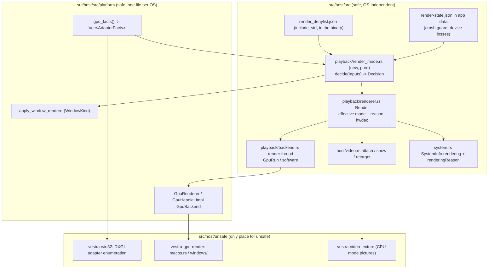

# Render modes: CPU and GPU behind one decision, with a driver check

API maintainer, 2026-10-28. Design proposal only: no code was changed. Main = `C:\PROJECT\vestra-player` at 692e631; branch = `windows-wgpu-render-2` (`C:\vestra\wt-wgpu-port`, f4cf5e7); `host-followups` for `SystemInfo.rendering` (0.5.12).

**Binding rulings this design keeps:** Windows GPU rendering stays off main until the user decides (`2026-10-windows-render.md` §E, `2026-10-windows-wgpu.md` header); macOS GPU rendering is unchanged; on hybrid laptops the GPU follows Windows' per-app order (`2026-10-windows-wgpu.md` §18); the UI hits the display rate in CPU mode too; OS-specific code only in platform modules, and `unsafe` only in `src/host/unsafe/*` (`agentic-workflow.md` §1.5, §1).

Terms: **CPU mode** = libmpv's software renderer (`RenderContext::new_software`, hardware decoding with copy-back) shown in a window. **GPU mode** = libmpv renders on the GPU and the window shows its texture (macOS: OpenGL into IOSurfaces; branch: Direct3D 11 into shared Direct3D 12 textures). The mode is a *pair*: the video renderer **and** Slint's window renderer.

## 1. Today

### 1.1 Who decides, per OS

| Step | Main (macOS GPU, Windows CPU) | Branch (Windows GPU) |
| --- | --- | --- |
| Wanted? | `renderer::wanted` = `platform::GPU_RENDER && !headless && !VESTRA_SOFTWARE_RENDER` (`playback/renderer.rs:101-104`); `GPU_RENDER` is `true` on macOS (`platform/macos.rs:579`), `false` elsewhere (`platform/mod.rs:321`) | same, plus `GPU_RENDER = true` on Windows (`platform/windows.rs:681`) |
| Window renderer | `main.rs:166-191`: femtovg (OpenGL) if GPU wanted, else Slint's default; femtovg failure → software video | `platform/windows.rs:764-861` `select_window_renderer`: `VESTRA_WINDOW_RENDERER`, DXGI adapter (`VESTRA_GPU_ADAPTER`, `unsafe/render/src/windows/d3d.rs:111-160`), software-adapter check (vendor `0x1414`), wgpu → GL → Slint software ladder; installs the device-lost hook; one `render:` line |
| Video renderer start | render thread: `GpuRun::run` → `platform::gpu_start`, refusal → software (`playback/backend.rs:110-126`, `:685-718`) | same, plus `platform::gpu_failed` (render thread died) |
| Runtime fallback | `Render::fall_back` once, GPU → software, never back (`renderer.rs:64-69`); window cannot show GPU frames (`host/video.rs:46-51`); hwdec switched to copy-back on the control worker (`backend.rs:544-556`) | same, plus a lost window device restarts the player; a second loss in a row restarts with GL windows (`host/restart.rs:30-70`, `main.rs:202-231`, `:613-621`) |
| Reported as | `render:` diag lines; `stats().backend` (`renderer.rs:16-21`); `SystemInfo.rendering` = `gpu`/`software` (host-followups `system.rs:117-124`, `:188`) | the same, the adapter line names how the GPU was chosen (§17.1) |

### 1.2 What is duplicated or tangled

1. **The decision is spread over 4 places** (env in `renderer.rs`, window renderer in `main.rs` or `platform/windows.rs`, GPU start in `backend.rs`, runtime fallback in `Render`). None records *why*; the reason exists only in a `diag!` string.
2. **Policy inside a platform module** (branch): `select_window_renderer` mixes env parsing, adapter choice, the software-adapter rule, device-loss restart and a test switch (`VESTRA_TEST_REMOVE_DEVICE`) in one 100-line function. A driver denylist added there would make it worse, and would be Windows-only by construction.
3. **The window/video pair is implicit.** On the branch "CPU" can mean three window renderers (wgpu, GL, Slint software). `VESTRA_SOFTWARE_RENDER=1` keeps the wgpu windows, which measured 21-26 presented fps on the 780M (`2026-10-windows-wgpu.md` §8): so "force CPU" today would not escape a bad GPU driver.
4. **The GPU backend contract is duck-typed.** `platform::GpuHandle` on macOS (`vestra-gpu-render`), on Windows (branch) and the inert `no_gpu` stub (`platform/mod.rs:313-371`) must expose the same method names; nothing but compilation on each OS checks it. Host code tests `render.gpu().is_some()` at ~10 sites (`host/video.rs:24,118,171,308,332,341,367`, `host/window.rs:84`, `backend.rs:243,420,437,546,728`).
5. **No memory across starts**, except the restart counter passed as an argument: a driver that crashes during GPU init crashes every start.

What is *not* tangled and stays: frame pacing (by OS clock, `frame_pacing.rs:531`, `platform::VBLANK_CLOCK`), the software path (`render_target.rs`, `vestra-video-texture`), snapshots and exports (offline FFmpeg, `media_jobs.rs`; renderer-independent), PiP (macOS; GPU frames when GPU, else the software picture, `host/video.rs:305-345`).

## 2. Target architecture



### 2.1 The decision module (`playback/render_mode.rs`, new, `forbid(unsafe_code)`, no OS calls)

```rust
pub struct Inputs<'a> {
    pub headless: bool,
    pub gpu_backend: bool,            // platform::GPU_RENDER (compile-time per OS)
    pub env: Overrides,               // VESTRA_RENDER=cpu|gpu|auto (VESTRA_SOFTWARE_RENDER=1 kept as cpu),
                                      // VESTRA_GPU_ADAPTER, VESTRA_WINDOW_RENDERER (test only)
    pub preference: Preference,       // the user's setting: Auto | Cpu | Gpu
    pub os: &'a OsFacts,              // platform::os_facts(): os, version, build
    pub adapter: Option<AdapterFacts>,// the adapter GPU mode would use (Windows' order, or VESTRA_GPU_ADAPTER)
    pub denylist: &'a Denylist,       // built-in merged with the local override
    pub state: &'a RenderState,       // crash guard and device losses from earlier runs
    pub now: SystemTime,
}
pub enum Mode { Cpu, Gpu { adapter: Option<AdapterId> } }   // macOS: adapter None
pub struct Decision { pub mode: Mode, pub windows: WindowKind, pub reason: Reason, pub warnings: Vec<Note> }
pub enum Reason { Default, Headless, NoGpuBackend, User, Env, Denylist { rule: String }, SoftwareAdapter,
                  PreviousCrash { until: SystemTime }, DeviceLost, InitFailed, WindowFallback }
pub fn decide(inputs: &Inputs) -> Decision
```

- **Order** (first match wins): headless → `NoGpuBackend` (no GPU backend in this build/OS) → env (`Env`) → user `Cpu`/`Gpu` (`User`) → sticky crash guard (`PreviousCrash`) → no adapter or software adapter (`SoftwareAdapter`, today's `0x1414`/DXGI software flag rule moved out of `windows.rs`) → denylist rule with action `cpu` (`Denylist`) → `Gpu` (`Default`). A user/env `Gpu` that overrides a denylist rule or the guard keeps a warning (Chromium's `--ignore-gpu-blocklist`, Firefox's `force-enabled` prefs).
- **`WindowKind` follows the mode**, so CPU mode is one well-tested pair: `Cpu` → `Gl` (Windows and macOS: femtovg on OpenGL, today's main path) with Slint software as the last rung; `Gpu` → the OS's GPU windows (`Wgpu` on Windows, `Gl` on macOS). **CPU mode never creates a Direct3D 12 device**, so it also avoids the 780M's UI draw stalls (§14), which are in the window draw, not in mpv.
- **Pure and table-tested**: one test row per reason; no env reads inside (`main.rs` reads them, as `renderer::wanted` does today).
- After start the decision is the *intended* mode; `Render` (`renderer.rs`) holds the *effective* mode and the reason of its last change (`InitFailed`, `WindowFallback`, `DeviceLost`). The one-way GPU → CPU rule stays.

### 2.2 The two backends and the narrow interface

The host calls the same five operations in both modes. The CPU backend is the existing software path (always compiled, no trait needed); the GPU backend gets a trait in shared code that each OS's platform module implements for its handle, statically dispatched (no `dyn`), replacing the duck-typed contract of §1.2 item 4. The `no_gpu` stub implements it too, so a missing method fails to compile on every OS.

| Host operation | CPU backend | GPU backend (`trait GpuBackend` in `playback/renderer.rs`) |
| --- | --- | --- |
| start (render thread) | `RenderContext::new_software`, `BufferRing` | `platform::gpu_start(mpv, size, publish)` → `GpuRenderer` |
| attach to a window | `count_draws` + `vestra_video_texture::attach`/`direct` (`host/video.rs:59-110`) | `attach(component, show, failed, drawn)` |
| show a frame | `FrameSlot` → `show_frame` (`host/video.rs:125-175`) | `on_frame` / `latest` / `reshow`, through the frame gate (branch §17) |
| resize | `render_target` size to the render thread | `set_size` |
| retarget on shell swap | `video_target` replaced (`host/video.rs:116-122`) | `retarget(component)` |
| failure | — | `failed()` / device loss → `Render::fall_back(Reason)` |

Consumers ask `Render`, never the decision:

- **Frame pacing**: unchanged; keyed by OS (`VBLANK_CLOCK`). The branch's no-notifier rule (`window_notifiers()`, `platform/windows.rs:881-885`) becomes `WindowKind::Wgpu`.
- **PiP**: unchanged (`pip_gpu_frames` = GPU active and no generated stream).
- **Snapshots, exports**: offline FFmpeg; not affected.
- **Render options** (`processing.video` → `video.render.set`): `unsupported` in CPU mode as today (`backend.rs:420-424`); the message adds the reason code, e.g. "render options need GPU rendering; the player renders in software (denylist: amd-780m-stall)".
- **hwdec**: `renderer::hwdec(env, software)` from the effective mode, unchanged.

**macOS** fits as is: `gpu_backend = true`, `adapter = None`, `WindowKind::Gl` in both modes, the denylist matches `os.build` only (no rule needed today). Linux: `NoGpuBackend`.

## 3. Driver check

### 3.1 Where the facts come from

`platform::gpu_facts()` (safe; Windows implementation calls a new function in `unsafe/win32`, which already links the `windows` crate). It runs before any window or device exists, costs one DXGI factory, and **lands on main without any GPU rendering code**:

- `IDXGIFactory1::EnumAdapters1` in Windows' order (the ruling) → `IDXGIAdapter1::GetDesc1`: `VendorId`, `DeviceId`, `SubSysId`, `Revision`, `AdapterLuid`, `Description`, `Flags` (software).
- **Driver version**: `IDXGIAdapter::CheckInterfaceSupport(IDXGIDevice)` returns the user-mode driver version as four 16-bit parts; since WDDM 2.3 all components of a driver package share one version (the rationale of a VLC merge request that moves its driver check to `CheckInterfaceSupport`). Fallback: the adapter's `DriverVersion` registry value (what Chromium and VLC's older code read).
- This machine (read-only `Win32_VideoController`, 2026-10-28): AMD Radeon 780M `VEN_1002 DEV_15BF`, driver **31.0.14005.21001** (dated 2023-10-25); RTX 4070 Laptop `VEN_10DE DEV_2820`, 32.0.16.1062; Windows build 26200.

The branch's `adapter_facts` (`unsafe/render/src/windows/d3d.rs:111-119`) then reuses this instead of its own `GetDesc1`.

### 3.2 Denylist data

- **Format**: a subset of Chromium's `software_rendering_list.json` (fields `id`, `description`, `os`, `vendor_id`, `device_id`, `driver_version {op, value, value2}`, `exceptions`), so rules can be copied from there and reviewers know the shape. Driver versions compare part by part as numbers.
- **Ships in the binary** (`include_str!` of `src/host/render-denylist.json`): no install-layout change, never "missing". Chromium compiles its list in the same way.
- **Local override without a host release**: `<app data>/render-denylist.json`, same format, merged by `id` (an entry with `"disabled": true` switches a built-in rule off). Support can hand a user one file. A malformed file gives one `render:` line and is ignored.
- **Remote updates** (Firefox's Remote Settings `gfx` list) are not proposed now: see §5 Q2.

```json
{
  "version": 1,
  "rules": [
    {
      "id": "amd-780m-draw-stalls",
      "description": "Radeon 780M driver 31.0.14005: GPU draws stall for tens of ms (p95 52 ms), 4K60 drops to ~40 fps",
      "refs": ["doc/process/rounds/2026-10-windows-wgpu.md §14, §18"],
      "os": { "type": "windows" },
      "vendor_id": "0x1002",
      "device_id": ["0x15BF"],
      "driver_version": { "op": "between", "value": "31.0.14005.0", "value2": "31.0.14005.65535" },
      "action": "cpu"
    }
  ]
}
```

Rule fields: `os.type`, optional `os.build {op, value}`, `vendor_id`, `device_id` (list, or `device_range {from, to}`), `driver_version`, `exceptions`, `reason`/`description`, `refs`, `action`: `cpu` (force CPU mode) or `warn` (keep the mode, show a note). The bound on the 780M rule is the exact driver branch until the Adrenalin 26.10.1 test says which version is good; then it becomes `< <first good version>`.

The AMD kernel leak (every exited process; github.com/stablyai/orca/issues/28293) is system-wide and **CPU mode does not avoid it**, so at most it is a `warn` rule ("update the graphics driver"), not `cpu` (§5 Q3).

### 3.3 Reporting

- One startup line, always: `render: GPU mode on AMD Radeon 780M (1002:15BF, driver 31.0.14005.21001; Windows' order); reason: default` or `render: CPU mode; reason: denylist amd-780m-draw-stalls (AMD Radeon 780M, driver 31.0.14005.21001)`. Later changes add one line each (`InitFailed`, `DeviceLost`, …).
- `SystemInfo`: `rendering` stays `gpu`/`software` (0.5.12); add `renderingReason: { code, message }` with the `Reason` codes in kebab case. (Superseded: the codes M2 implements are in §8.1; `user` became `preference`, and `software-adapter` and `device-lost` wait for M3.) OS-independent: no DXGI ids; the adapter name and driver version are in `message`. SDK minor release.
- User-visible: the built-in `info` plugin's About page (`src/plugins/info/about.ts`) shows "Rendering: software — your graphics driver is known to stall (update it, or choose …)" from `SystemInfo`. That is a plugin-author request, not host code.

### 3.4 User override

- Env `VESTRA_RENDER=cpu|gpu|auto` (developers, support); `VESTRA_SOFTWARE_RENDER=1` stays an alias of `cpu`.
- A persisted preference `Auto | Software | GPU` in a host settings file in app data. Choosing GPU against a rule shows the reason once and keeps a warning in the `render:` line and About. Where the UI for it lives is a product decision (§5 Q1); M2 can ship with env and the file only.
- **Ruling (user, 2026-10-28; Chrome/Firefox behaviour):** the preference is saved at once, the current run does not change, and it applies at the next start whether or not the user restarts. The API keeps the mode in effect now apart from the preference and the mode of the next start, and reports `restartPending` (true while the next start's mode differs from the mode this run started with; false again when the user changes the preference back). A plugin shows its menu item as "GPU rendering (restart to apply)" while it is true. Implemented in M2 (§8).

### 3.5 Sticky fallback after a crash (Firefox `DriverCrashGuard` pattern)

`<app data>/render-state.json`, read by `main.rs`, written by the host (safe code):

1. Before GPU init (window device and `gpu_start`): `guard = attempting {adapter, driver, app version}`, flushed.
2. After GPU mode has presented frames for 3 s: `guard = ok`.
3. Next start sees `attempting` (the process died in GPU init: crash, hang killed, TDR bugcheck) → `PreviousCrash`, CPU mode.
4. A device loss (branch §1.1) records `losses += 1` before the restart; two losses within one day → sticky CPU too (replaces the branch's "second loss → GL windows" argument).
5. **Expiry**: cleared when the driver version, adapter or app version changes (Firefox resets on the same three), or after 7 days; then GPU is tried once more, and a new crash re-arms it. The `render:` line and About say "GPU rendering was turned off after a crash on <date>; it is retried after a driver update or on <date>".

Chromium's in-session fallback (GPU process crashes → software) is what `Render::fall_back` already does; it is not sticky there. mpv and VLC have no general blocklist: mpv falls back across `--gpu-api`/`--vo` at init and leaves the rest to the user; VLC hard-codes driver-version checks for specific hardware, e.g. which AMD drivers may display decoder NV12 textures (`D3D11CheckDriverVersion`). So: Chromium's list format, Firefox's crash guard, mpv's user override.

## 4. Migration plan

| Step | Content | Behaviour change? | Approval |
| --- | --- | --- | --- |
| M1 | `render_mode.rs` with `decide()` and its table tests; `main.rs` calls it instead of `renderer::wanted`; `Reason` in `Render`; `GpuBackend` trait implemented by macOS and `no_gpu`; one `render:` decision line | None (main has CPU on Windows and GPU on macOS as before; the line text is new) | Pure refactor; reviewer |
| M2 | `gpu_facts` (DXGI in `vestra-win32`), denylist (built-in + local file), `render-state.json` guard, `VESTRA_RENDER`, `renderingReason` + SDK minor, About request to `info` | On main Windows is already CPU, so the denylist only reports; macOS: guard can turn GPU off after an init crash | Guard on macOS and the new `SystemInfo` field are small user-visible changes: coordinator decides (standard practice, §8); reviewer |
| M3 | The branch rebased onto M1/M2: `select_window_renderer` keeps only "apply `WindowKind`" (policy moves to `decide`), restart writes the guard, `cfg(windows)` GPU backend implements `GpuBackend`. Built only with a cargo feature `windows-gpu`, **off in release builds**; nightly builds turn it on, and even there `Auto` resolves to CPU on Windows unless `VESTRA_RENDER=gpu` or the preference is GPU | Release: none (feature off, Windows binary identical in behaviour). Nightly: GPU mode reachable | **User ruling needed**: lifts "not on main, not even opt-in" |
| M4 | `Auto` resolves to GPU on Windows where the denylist and guard allow it; release notes say where to choose the GPU (§18 ruling) | Yes: default Windows rendering changes | **User ruling** |

CPU mode is undisturbed through M3 because `WindowKind::Gl` + software video is exactly main's code path, and without the feature none of the wgpu crates are linked. A regression in M4 is reverted by the denylist (a rule with no device filter) or by one line in `decide`.

## 5. Questions for the user (real trade-offs only)

1. **Where the rendering choice lives in the UI.** The host has no settings page of its own (all pages are plugin pages). Options: (a) env and the file only, plus the About note (no UI work; recommended for M2); (b) a host menu item "Video ▸ Rendering ▸ Automatic / Software / GPU" (needs the interaction design lead); (c) a host settings page (new host UI surface).
   - **User answer (2026-10-28):** the host adds no UI. The rendering mode is an SDK API (`rendering.state` / `rendering.setPreference` / `rendering.restart`, capability `rendering.manage`); the switch is a checkable item in a built-in plugin's menu (the video plugin, §8.4), applied at the next start, which the user accepted. **When GPU rendering is offered to users (M3 nightly, M4), a simple switch "Use GPU acceleration when available" is a required condition of M3** (Chrome/Firefox practice; unchecked = software rendering).
2. **Remote denylist updates.** Firefox fetches its graphics blocklist from a signed remote collection; Chromium only updates with releases. We could deliver the list through the plugin repository's signed index (no new server, but the player then fetches data at start). Recommended: not now (built-in + local file); revisit if a bad driver ships between releases.
   - **User answer:** no remote updates.
3. **Warn about drivers that hurt the system, not the player** (the AMD process leak)? A `warn` rule would tell users of affected drivers to update; it is outside "rendering". Recommended: no, unless the 26.10.1 test shows the leak gone (then the note has a clear fix to point at).
   - **User answer:** no warning; no leak rule, and About does not mention it.
4. **Hybrid laptops when the default adapter is denied.** Following the §18 ruling, a denied 780M gives CPU mode even though the RTX 4070 is fine; the About note then says "choose High performance for Vestra in Windows' graphics settings". The alternative (silently using the other GPU) overrides Windows' per-app order. Recommended: follow the ruling (CPU + note).
   - **User answer:** software rendering, and the reason's message points to Windows Settings > System > Display > Graphics (the host adds the hint to a denylist reason on Windows; no chooser of our own).
5. M3 and M4 themselves (table above).

## Insufficient evidence / to verify

- The first good AMD driver version (Adrenalin 26.10.1 test pending); whether 26.10.1 also fixes the leak.
- `CheckInterfaceSupport(IDXGIDevice)` returning the same four-part version as `Win32_VideoController.DriverVersion` on both GPUs here: to check in M2 (read-only).
- Firefox source re-read this round: `gfx/src/DriverCrashGuard.cpp` (guard file + pref, reset on driver version / device id / app version change). Chromium list format re-read from `gpu/config/software_rendering_list.json`. VLC: from its commit history (`D3D11CheckDriverVersion`, AMD checks 2017-2019, a merge request on `CheckInterfaceSupport`, merge status not confirmed), current source not re-read. Firefox's Remote Settings `gfx` collection: from memory, not re-checked.

## 6. Driver test (coordinator, 2026-10-28)

- The 780M was updated to AMD Adrenalin 26.10.1 (`amdkmdag.sys` 32.0.32015.7029, from amd.com, Authenticode signer Advanced Micro Devices).
- Process leak, 200 × `cmd /c exit`, `Proc` pool tag live objects: old driver 31.0.14005.21001 +400 (after a fresh boot too); new driver −11 and +8 in two runs. **The leak is fixed in 32.0.32015.7029.** So §3.2's rule can name a real bound (`< 32.0.32015.7029` for the leak warning, if §5 Q3 is answered yes).
- The draw stalls (wgpu §14) on the new driver are not measured yet (needs a 20 s windowed run of the branch player).

## 7. M1: the decision module (API maintainer, 2026-10-28)

Branch `render-modes` (worktree `C:\vestra\wt-rm`, from main f53a76f). Pure refactor: the same renderer is chosen for every input as before (test `gpu_exactly_when_it_was_wanted_before` checks all eight input combinations against the old `renderer::wanted`); only the log text changes.

- **New `playback/render_mode.rs`** (safe, pure): `Mode {Cpu, Gpu}`, `WindowKind {Default, OpenGl}` (CPU mode keeps Slint's default window renderer, as `winit().select()` did; GPU mode asks for femtovg), `Reason` with stable codes (`default`, `headless`, `no-gpu-backend`, `env`, `init-failed`, `window-fallback`; the M2 reasons come with M2), `Inputs {headless, gpu_backend, software_env}`, `Decision {mode, windows, reason}` with `gpu()`, `fall_back(Reason)`, `line()`, and `decide()` (first match: headless, no GPU backend, `VESTRA_SOFTWARE_RENDER`, else GPU). `software_requested` moved here from `renderer::wanted`.
- **`renderer.rs`**: `trait GpuBackend` (associated `Frame: Deref<Target = platform::GpuFrame>`; `set_size`, `set_display_fps`, `frames`, `shown`, `size`, `reshow`, `latest`, `on_frame`, `attach`, `retarget`). `Render::new(&Decision)` (was `new(bool)`), `Render::reason()`, `Render::start_failed(Reason)` (new: `gpu_start` refused), `Render::fall_back(Reason)` (was `&str`), `Render::gpu() -> Option<&impl GpuBackend>` (was `Option<&platform::GpuHandle>`: the host can only use the contract). `renderer::wanted` removed.
- **Platform**: `no_gpu`'s inert methods became its `GpuBackend` impl; macOS implements `GpuBackend` for `vestra_gpu_render::Handle` by delegation (`platform/macos.rs`); `vestra-gpu-render` gains `pub type Frame = CFRetained<IOSurfaceRef>` (no new unsafe). Callers import the trait as `GpuBackend as _` (`backend.rs`, `host/{video,window,state}.rs`).
- **`Backend::start(events, silent, &Decision)`** (was `gpu: bool`).
- **Log lines**: one decision line at start, e.g. `render: software rendering, Slint's default window renderer; reason: no-gpu-backend (no GPU rendering on windows yet)` or `render: GPU rendering, OpenGL windows; reason: default`; a femtovg failure prints a second decision line with `init-failed (the OpenGL window renderer is unavailable: …)`; `gpu_start` refusing prints `render: init-failed (GPU rendering unavailable: …); software rendering`; a window fallback prints `render: window-fallback (…); switching to software rendering`.

**Checks (Windows):** `cargo fmt --check` (host and `unsafe/render`), `cargo clippy --locked --workspace --all-targets -- -D warnings` and without `--workspace`, `cargo test --locked --workspace` (host 556 passed / 13 ignored), `cargo shear`, `typos`; in `src/`: `npm run check`, `format:check`, `test:sdk` (55/55), `boundaries`, `portability` (clean), `node scripts/check-unsafe-policy.mjs` (137, ok). macOS cross-check: `cargo clippy --locked --target aarch64-apple-darwin -- -D warnings` passes (the macOS `GpuBackend` impl and `vestra-gpu-render` type-check); with `--all-targets` it stops on `lease_stream::register` unused in the macOS test build, untouched by this change. Not run: plugin builds and tests (no TypeScript changed), GUI, GPU, macOS tests.

**For the Mac test list:** start the player normally (one `render: GPU rendering, OpenGL windows; reason: default` line, GPU video as before), with `VESTRA_SOFTWARE_RENDER=1` (`reason: env`, software video), and PiP once in GPU mode (frames still reach PiP through `GpuBackend::latest`).

## 8. M2: driver check, crash guard, preference and the rendering API (API maintainer, 2026-10-28)

Branch `render-modes` in `C:\vestra\wt-rm`, on main dfe8cf3 (M1 merged as #101), uncommitted; SDK 1.5.35 on the SDK repository's branch `rendering-api`. Split decided by the user (2026-10-28): the host owns the mechanism and the safety net, the SDK gets a narrow API, and a built-in plugin offers the switch; the host adds no menu. Architecture summary: `doc/architecture/README.md` §4.3.

### 8.1 Host

- **Facts** (`host/rendering.rs` `startup`): `VESTRA_RENDER` (`cpu`/`software`/`gpu`/`auto`; an unknown value is one `render:` warning, then ignored) and its alias `VESTRA_SOFTWARE_RENDER`; the system build; the first adapter of `platform::gpu_adapters` (Windows: `vestra_win32::dxgi_adapters`, DXGI in Windows' order, driver version from `CheckInterfaceSupport(IDXGIDevice)`; no device is created; macOS and Linux: none yet); the denylist; `render.json`; the crash guard. A headless player reads and writes none of the files and asks for no adapter.
- **Decision** (`playback/render_mode.rs`): `decide(&Facts, Preference)`; order in architecture §4.3. Holding denylist rules are always logged (`render: denylist rule … holds for … (software rendering): …`), so Windows on main reports the 780M rule although it has no GPU renderer.
- **Denylist** (`playback/render_denylist.rs`, data `src/host/render-denylist.json`): two rules: `amd-780m-draw-stalls` (`0x1002`/`0x15BF`, driver 31.0.14005.0–31.0.14005.65535, action `cpu`) and `amd-780m-white-opengl-windows` (same device, driver `>= 32.0.32015.7029`, action `software-windows`, §9). No leak rule (§5 Q3). The local file `<app data>/render-denylist.json` adds or replaces rules by id; a broken one is ignored with a `render:` line.
- **Crash guard** (`playback/render_state.rs` `GuardFile`, `<app data>/render-state.json`): armed before GPU rendering starts, settled 5 s after the event loop starts, on a window-renderer fallback and at quit; key = adapter name, driver version (macOS: the system build), player version; blocks for 7 days.
- **Preference** (`render.json`, `{"preference":"auto|gpu|software"}`): written whole (temporary file renamed over it) by `rendering.setPreference`; read at start; a broken file counts as `auto` with a `render:` line.
- **Reasons**: `Render` starts at `pending` in GPU mode and takes the decision's reason when the render thread installs GPU rendering (M1 review); `Render::now` reads mode and reason together. Codes: `default`, `pending`, `headless`, `no-gpu-backend`, `env`, `preference`, `denylist`, `previous-crash`, `init-failed`, `window-fallback`. `no-gpu-backend` names the system as people write it ("Windows").
- **Restart** (main had none): `rendering.restart` spawns the player with `--vestra-restart PID`, this run's `--plugin` directories and `--silent`, and the current local file with `--vestra-resume`, then quits like Quit. The new player waits up to 20 s for the instance lock (`platform::single_instance_restarted`); development runs (no instance directory) do not wait. Resume: `host.resume`, from the parked GPU branch. (Both changed in §8.6.)
- **API** (`capabilities/rendering_manage.rs`, `host/rendering.rs`, `system.rs`): `rendering.state` (no capability), `rendering.setPreference` and `rendering.restart` (`rendering.manage`, risky); `app.system` adds `renderingReason`. Error codes: `invalid`, `unsupported` (GPU on a system without a GPU renderer, headless), `unavailable` (denylist, crash guard), `failed` (file or spawn), `busy` (restart under way).
- **M1 review fixes**: `Render::reason` is `cfg_attr(not(test), allow(dead_code))`; `vestra_gpu_render::Frame` moved below the `use` block; the system name is capitalised; §7 no longer says "uncommitted"; the reason no longer disagrees with `rendering` before the render thread installs GPU rendering (`pending`); `lease_stream::register` no longer fails the macOS test build (`cfg_attr(not(windows), allow(dead_code))`).
- Host version 0.5.13.

### 8.2 What Windows on main reports now (this machine)

`rendering.state`: `mode: "software"`, reason `no-gpu-backend`, `gpu: {available: false, reason: no-gpu-backend}`; `setPreference("gpu")` → `unsupported`. With the 780M on driver 31.0.14005 the start-up log also has the draw-stall line; on 32.0.32015.7029 (§6) it has the white-window line, and the windows use Slint's software renderer (`render: software rendering, Slint's software window renderer; reason: no-gpu-backend (…)`) unless `SLINT_BACKEND` is set.

### 8.3 SDK 1.5.35 (branch `rendering-api` in the SDK repository, from `origin/main` b633d18 = 1.5.34)

`plugin.rendering.state()`, `setPreference(preference)`, `restartPlayer()`; types `Rendering`, `RenderingState`, `RenderingMode`, `RenderingPreference`, `RenderingReason`, `RenderingReasonCode` (an open union: the listed codes `| (string & {})`, new for the SDK); `SystemInfo.renderingReason?`; capability `rendering.manage` last in `CAPABILITIES` (`src/host-capabilities.ts` matches the host's `capabilities.json`: `capabilities:sync --check` passes); `TestHost.rendering` (`reason`, `preference`, `startedWith`, `gpu`, `restarts`); how-to *Offer a GPU rendering switch*; CHANGELOG "Who must change: nobody." A plugin that declares `rendering.manage` does not load on players before 0.5.13 (the manifest check refuses unknown capabilities), so only `state()` can meet `unsupported` there.

### 8.4 Requests to plugin authors (§4.1 format; the host side is done)

1. **Picture Adjustments (`src/plugins/video`)**: in the Video menu, a checkable item "GPU Rendering (Experimental)" (menu title case as the SDK guide writes it).
   - Read `plugin.rendering.state()` when the menu opens (no capability). Checked when `preference` is `gpu`, or `auto` with `nextMode` `gpu`.
   - Disabled while `gpu.available` is false, with `gpu.reason.message` as the reason (Windows on main: `no-gpu-backend`, "this player has no GPU renderer on Windows yet"; a denylisted driver: the denylist message, which already points to Windows' graphics settings).
   - Toggling calls `setPreference("gpu" | "software")` (needs `rendering.manage`, risky: the store shows it amber); while `restartPending` the item reads "GPU Rendering (Restart to Apply)", and an optional "Restart Player to Apply" calls `restartPlayer()`. The choice applies at the next start even without a restart.
   - `minPlayerVersion` 0.5.13, SDK ^1.5.35. Tests with `TestHost.rendering`.
2. **Store (`src/plugins/store/labels.ts`)**: add `"rendering.manage": { text: "Choose GPU or software rendering and restart the player", risky: true }` and its translations. Until then the player's `host-agreement` test "CAPABILITY_INFO's store wording is the store's" fails with SDK 1.5.35 installed.
3. **Workshop (`src/plugins/workshop`)**: `npm run vendor:sdk` after the SDK upgrade (its test "vendor/ matches a fresh build from the player's SDK" fails with 1.5.35 installed, as at every SDK release).
4. **Info (`src/plugins/info`, About)**: optionally show `SystemInfo.renderingReason.message` beside the renderer (no capability). Nothing about the AMD process leak (§5 Q3).

### 8.5 Checks (Windows, this machine, 2026-10-28)

- Host (`C:\vestra\target-rm`, build lock held, deleted afterwards): `cargo fmt --check` (host, `unsafe/win32`, `unsafe/render`) 0; `cargo clippy --locked --workspace --all-targets -- -D warnings` 0 and without `--workspace` 0; `cargo clippy --locked --target aarch64-apple-darwin --all-targets -- -D warnings` 0 (the macOS test build passes now that `lease_stream::register` is fixed); `cargo test --locked --workspace`: host 570 passed / 13 ignored, `vestra-win32` 3 passed / 2 ignored (DXGI lists this machine's adapters); `VESTRA_UPDATE_CAPABILITIES=1 cargo test capabilities` regenerated `capabilities.json`; `cargo shear` 0; `typos` 0. `cargo deny check`: advisories fail on RUSTSEC-2026-0414 (pulldown-cmark wikilinks) and a yanked `clipboard-win`, both already on main and unrelated (bans, licenses, sources ok).
- `src/` with SDK 1.5.35 installed (`npm install --no-save C:\vestra\sdk`, restored with `npm ci` afterwards): `npm run check` 0, `format:check` 0, `boundaries` 0, `unsafe-policy` (141 blocks) 0, `docs:check` 0, `portability` clean, `plugins:build` 0; `test:sdk` 55 of 56 (the store-label test, 8.4 item 2); plugin tests: 15 of 16 pass, `workshop` fails only its vendored-SDK test (8.4 item 3).
- SDK (`C:\vestra\sdk`, branch `rendering-api`): `npm run check` 0, `format:check` 0, `npm test` 246 passed / 1 skipped / 0 failed, `npm pack --dry-run` 1.5.35 (110 files); the SDK agent also ran `lint`, `docs:check`, `doc-lint`, `docs:llms -- --check`, `docs`, `build` (all 0).
- Not run: GUI, GPU, a real restart (the coordinator's: start the player on a file, call `rendering.restart` from a plugin, check the new player continues at the position; and the 780M window rule with and without `SLINT_BACKEND`).

### 8.6 Review fixes (2026-10-28)

Should-fix:

1. **Crash guard on ordinary errors.** `GuardFile::arm` returns `Armed`, which settles the guard when dropped; `main` keeps it until it returns, so an early `?` (`Backend::start`, `host.load`, `compile_json`…) or an unwind settles it and only a process that dies leaves `attempting`. Test: a start returning `Err` leaves `ok`; `mem::forget` (a dead process) leaves `attempting`.
2. **Restart loop.** A player started with `--vestra-restart` refuses `rendering.restart` with `busy` for 30 s (`RESTART_COOLDOWN`, `restart_refused`, tested). SDK docs say so.
3. **Windows foreground.** `platform::allow_handoff_foreground()` before the new player is spawned.
4. **Field agreement.** `host-agreement` test "WireRenderingState has the fields rendering.state answers with": the SDK's `WireRenderingState` (and its inline `gpu`) keys vs the keys of `Rendering::state`'s `json!`, and `WireRenderingReason` vs `Reason::json`.

Nits:

- Resume (changed again after the second review): the resume point travels with the open intent instead of mpv's global options. `host.resume` stores it in `Sources` (`resume_next_open`); the first open, close or provider takes it (`source_backend::claim_resume`): an open of exactly that path gets the old pause state in its intent (so the session reports it) and loads with `loadfile <src> replace -1 pause=…,start=<t>` (`start_option`, mpv's per-file options); any other first source drops it with one `restart:` line, so a plugin opening another file first neither gets the position nor makes the resumed file start from 0 with a global `start` left over. The global `start`/`pause` setting, their clearing and the match by file name are gone. A source a resolver plugin claims opens paused as before, from its start. Tested (`resume_tests`).
- `os.build` on macOS: builds with letters (`25C56`) match only with `=`, as text; documented on the field and tested.
- `merged()` refuses a file whose rule (or exception) has an unknown `op`, `between` without `value2`, or a vendor/device id that is not hexadecimal; the caller logs one `render:` line and keeps the built-in rules. Tested.
- A restarted player that does not get the lock in 20 s runs on its own with the usual `single instance: …; running on its own` line instead of quitting.
- `software-windows` rules are matched against every adapter with a GPU of its own, not only the first (a hybrid laptop with Vestra on "High performance" may still draw WGL windows on the 780M); `cpu` and `warn` rules stay on the first adapter. `Facts.adapters` replaces `Facts.adapter`. Tested.
- `VESTRA_RENDER=gpu` no longer overrides a `software-windows` rule (it still overrides the crash guard and `cpu` rules). Tested.
- SDK: `TestHost` computes the next start's reason in the player's order (`headless`/`no-gpu-backend` before the preference; GPU chosen and available is `default`), its default messages are the player's, and the `preference` code is documented as "the user chose software rendering".

Checks after the fixes: host `cargo fmt --check` 0, `cargo clippy --locked --workspace --all-targets -D warnings` 0 and without `--workspace` 0, macOS cross-clippy `--all-targets` 0, `cargo test --locked --workspace` (host 572 passed / 13 ignored, `vestra-win32` 3 / 2 ignored), `cargo shear` 0; `src/` with the SDK branch installed: `check` 0, `format:check` 0, `test:sdk` 56 of 57 (the store label, 8.4 item 2); SDK: `build`, `check`, `format:check`, `lint`, `doc-lint`, `docs:check`, `docs:llms -- --check` all 0, `npm test` 246 / 1 skipped / 0 failed, `npm pack --dry-run` 1.5.35.

### 8.7 Noted for M3 (second review)

- With a `software-windows` rule holding, `Facts::blocked` also rules GPU mode out (and `gpu.available` is false), because on main GPU mode needs OpenGL windows. M3 brings wgpu (Direct3D 12) windows on Windows, which do not use the driver's OpenGL: there the rule must only replace OpenGL windows (the CPU mode ladder and an OpenGL fallback), not exclude GPU mode.

## 9. The first real window rule: white OpenGL windows on Adrenalin 26.10.1 (2026-10-28)

**Evidence (coordinator, this machine, main 0.5.12 on Windows, software video):** after the 780M's driver update to AMD Adrenalin 26.10.1 (`amdkmdag.sys` 32.0.32015.7029, §6), the player's default window renderer, Slint's femtovg on OpenGL (WGL), shows **whole white windows**, the main window and plugin pop-ups alike. The frame log still counts 60 presented frames per second, but a desktop-duplication screenshot is white. With `SLINT_BACKEND=winit-software` (Slint's software renderer) everything draws, and 4K60 shows 60 frames per second. On the old driver 31.0.14005 femtovg drew correctly. So the fault is in the new driver's OpenGL, and it hits CPU mode, which main uses on Windows.

**Change to M2 (coordinator's instruction):**

- `WindowKind::Software` (Slint's software renderer) joins `Default` and `OpenGl`. A new denylist action `software-windows` means software rendering **and** software windows; it applies whatever decided the mode (on Windows today `no-gpu-backend`) and rules GPU out like `cpu`. It is detected before any window or GL context exists: `platform::gpu_adapters` reads DXGI at start.
- Rule `amd-780m-white-opengl-windows`: Windows, vendor `0x1002`, device `0x15BF` (the 780M only for now), driver `>= 32.0.32015.7029` (no upper bound until AMD fixes it), action `software-windows`. The draw-stall rule for 31.0.14005 (`cpu`) stays.
- `SLINT_BACKEND`, when set, wins: the host leaves the window renderer to Slint and logs that the rule was not applied to the windows. The user's temporary `SLINT_BACKEND=winit-software` can be removed once this is merged.
- Window ladder of CPU mode on a matching driver: software windows directly (no OpenGL attempt, which would "succeed" and draw white).
