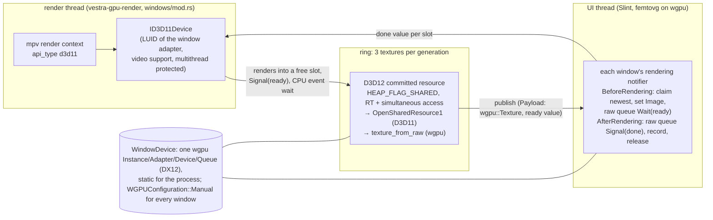

# Windows GPU rendering on wgpu/Direct3D 12: integration, milestone 1

API maintainer (host, Windows GPU rendering), 2026-10-27. Branch `windows-wgpu-render` only (from main 85f2902).

**User ruling (binding):** Windows GPU rendering does not go to main in any form, not even opt-in, without a new user decision. macOS GPU rendering (IOSurface + CGL) is unchanged, and Linux is unaffected. Everything new is `cfg(windows)`.

Sources:

- the spike that proved the approach: `doc/process/rounds/2026-10-wgpu-d3d-spike.md` on branch `spike-wgpu-d3d` (§1-§4, and the coordinator's visible-window measurements in §8);
- the parked D3D11→OpenGL attempt: `2026-10-windows-render.md` (Appendix C, §E) and branch `gpu-render`. Its producer and pitfalls are reused here; its OpenGL interop is not.

## Short answer

Milestone 1 (spike §4 items 1, 2, 4, 5) is built, and every static check and headless test passes. Nothing has run in a window yet: that is the coordinator's GUI acceptance (§5).

- **Windows:** every Slint window (main window, floating sidebar, plugin windows, settings) draws with femtovg on wgpu. They all share one Direct3D 12 device on DXGI's first adapter.
- **GPU rendering:** libmpv renders through its Direct3D 11 render API, on a device of the same adapter (matched by LUID), into a ring of three textures. Direct3D 12 creates the textures and Direct3D 11 opens them. Each window shows the newest texture directly as a `slint::Image` built from its `wgpu::Texture`. There is no copy. Two shared fences order the two APIs on the GPU, and the UI thread never waits.
- **Software rendering** draws into the same wgpu windows through a wgpu twin of `vestra-video-texture`. The window ladder falls back to OpenGL windows (main's current path), and then to Slint's software renderer.
- **Tests:**
  - WARP tests cover the handover (Direct3D 11 WARP and Direct3D 12 WARP read the same pixels), the renderer end to end, a broken shader, and the RGB→RGBA twin. They run in plain `cargo test`.
  - The spike's measurement is an `#[ignore]` real-GPU test.
- **Unsafe:** 40 new sites (38 in product code and 2 in a test readback), against an estimate of about 50 and the parked branch's 89. Every site has a SAFETY comment, and the policy script passes.
- **Not in this milestone:**
  - Pacing mpv's render to the vblank (spike §4 item 3, the AV1 ~53 shown fps). The pacing is unchanged; §6 says what item 3 needs.
  - DXGI frame statistics for `presented`: Slint keeps the swapchain private (§2.9).

## 1. Design

### 1.1 The window device (`vestra-gpu-render`, `windows/mod.rs` `WindowDevice`, `windows/d3d.rs` `Gpu`)

- **Adapter:** DXGI's first adapter (`EnumAdapters1(0)`). That is the adapter Windows lists first for this process, so it follows the per-app graphics preference, and on hybrid laptops it is the one that drives the screen (parked record C.3). `VESTRA_GPU_ADAPTER` picks another index, or `warp`.
- **wgpu:** an instance with only the DX12 backend. The wgpu adapter is the one with the same LUID (`Adapter::as_hal` → `GetDesc1`). The device asks for the default limits raised to the adapter's resolution limits, as Slint does for its own devices.
- **One per process:** the device is kept in a `static OnceLock` and never dropped. Slint's windows, the render thread and the shared textures all refer to it. The spike crashed when the `wgpu::Instance` was dropped before its `Device`, so the drop order has one owner: the `Gpu` struct's field order (raw Direct3D references, then queue, device, adapter, and the instance last). `Shared` holds its `Arc<Gpu>` as its last field, so a test's textures drop before the device.
- **Errors:** `WindowDevice::on_error` replaces wgpu's default handler for uncaptured errors, which panics. Each distinct message becomes a `render:` line, up to 16, and a lost device (reason other than `Destroyed`) sets `device_lost()`, is reported, and ends the event loop (`slint::quit_event_loop` from the callback). Slint cannot give existing windows a new device, so the host tears down as usual (`ui_state.flush` and the rest after `window.run()`, which no longer returns early on an error) and restarts the player with the same arguments (`main.rs` `restart_player`, one `render:` line). The new process waits for the old one's single-instance lock (`single_instance_restarted`) instead of handing its files over. A second loss in a row restarts with OpenGL windows (`VESTRA_WINDOW_RENDERER=gl`), so a failing device cannot cause a restart loop. Browsers recreate the device in-process; that needs Slint support (§6).
- **Kept only when used:** `WindowDevice::open` returns a device that becomes the process's one (`install`) only after Slint's selection with it succeeded; an OpenGL fallback drops it again (instance last, by field order).

### 1.2 Choosing the window renderer (`platform/windows.rs` `select_window_renderer`)

The order, with exactly one `render:` line for the outcome:

1. `VESTRA_WINDOW_RENDERER=software` makes the windows use Slint's software renderer, with software rendering. `=gl` skips to step 3. Any other value gives one `render:` warning and counts as unset (`Forced::parse`, tested with the ladder).
2. If the window device opens and its adapter is a GPU, every window uses `renderer_name("femtovg-wgpu")` with `require_wgpu_30(Manual { instance, adapter, device, queue })`. GPU rendering stays as wanted: off when headless or with `VESTRA_SOFTWARE_RENDER=1`, the existing switch. Software rendering then draws into these wgpu windows.
   - An adapter without a GPU of its own is WARP, Microsoft Basic Render, a remote desktop's adapter, or a Hyper-V adapter: the DXGI software flag or vendor `0x1414`. Such an adapter falls through to step 3, unless `VESTRA_WINDOW_RENDERER=wgpu` forces wgpu windows. With `VESTRA_GPU_ADAPTER=warp` that gives software rendering in wgpu windows on WARP.
3. femtovg on OpenGL with software rendering: what main does on Windows today, including the OpenGL `vestra-video-texture`.
4. Slint's software renderer with software rendering.

macOS and Linux keep main's exact selection code. It moved unchanged into `platform/mod.rs` (`cfg(not(windows))`).

### 1.3 The renderer (`windows/mod.rs`, `windows/d3d.rs`, `windows/mpv.rs`, `windows/ring.rs`)

**Start.** `Renderer::start` keeps macOS's signature. It refuses, and the host renders in software with its existing `render: GPU rendering unavailable (…)` line, in any of these cases:

- the windows are not on the window device;
- the adapter is not a GPU;
- the Direct3D 11 device lacks 11.4 (`ID3D11Device5` / `ID3D11DeviceContext4`, needed for the shared fences);
- a shared fence cannot be opened;
- a 16x16 test texture cannot be shared, or mpv's D3D11 render context cannot be created.

**mpv's device.**

- It is created on the same DXGI adapter, so it matches by construction.
- It has `VIDEO_SUPPORT` when the adapter allows it, and `SetMultithreadProtected(TRUE)`.
- The GPU thread priority is -7, as in the spike's measured runs. `VESTRA_GPU_PRIORITY` overrides it.
- The render context is the parked branch's code (`rsmpv-sys`, params 21/22). Its update callback points at `Shared`, which outlives it: the render thread drops the context first.

**The ring.**

- Three textures per size (generation). Each is a Direct3D 12 committed resource on a shared heap, `ALLOW_RENDER_TARGET | ALLOW_SIMULTANEOUS_ACCESS`, `R8G8B8A8_UNORM`.
- The NT handle goes `CreateSharedHandle` → `ID3D11Device1::OpenSharedResource1` and is closed at once by an owning guard (`Owned`). This fixes the parked branch's leaked handles by construction. The two shared fences close their handles the same way.
- wgpu wraps each texture through `wgpu_hal::dx12::Device::texture_from_raw` and `create_texture_from_hal` (usage `TEXTURE_BINDING | RENDER_ATTACHMENT | COPY_SRC`, initial state COMMON; wgpu does not clear textures created from hal).
- A new size makes a new generation only once it has held for 150 ms (`SETTLE`). During a border drag the old ring keeps rendering and Slint scales it, so a drag no longer allocates three shared textures per frame. The old generation's D3D11 textures go at once; its wgpu textures go when the last frame payload or cached window image that refers to them does (each window keeps images of the current generation only). `ring.rs` is the spike's (and the parked branch's) pure claim logic, with its tests.

**Per frame (render thread).**

1. Pick a free slot: neither the newest published one nor one claimed by a window's draw in progress. If none is free for 100 ms, the windows are asked to draw: that releases a claim left by a draw that never finished, and the `stuck` counter counts it.
2. If the last window draw that showed this slot has not finished on the GPU (`done` < recorded value), mpv's GPU waits for it: `ID3D11DeviceContext4::Wait(done, value)`.
3. `mpv_render_context_render` into the slot. It blocks for the target time unless display-synced pacing is on, as on macOS.
4. `Signal(ready, n)`, flush, and a CPU event wait on the render thread until the frame is finished. The spike and the parked branch both kept this wait (parked C.4 condition 2). The waiter checks the fence again after each wake-up, so a late completion event of an earlier, timed-out wait cannot end a later wait early.
5. Publish `(wgpu::Texture, ready n, size)` only if the `ready` signal was enqueued, ask the attached windows to redraw, and call the frame hooks.
6. **Failure:** the render thread ends when the `ready` signal or the `done` wait cannot be enqueued, the ring cannot be made, or a render or completion fails with the device removed. Before ending:
   - it writes one `render:` line with `GetDeviceRemovedReason`;
   - it sets both shared fences to `u64::MAX` from the CPU, so no GPU wait on either queue blocks forever;
   - it marks itself failed.

   The host's GPU loop (`backend.rs`) sees `platform::gpu_failed` and switches to software rendering, as for a window fallback. The windows' views stop claiming frames.

**Per window draw (UI thread, the rendering notifier; the GPU view replaces the OpenGL blit of macOS).**

- `RenderingSetup`: the window is accepted only if `GraphicsAPI::WGPU30`'s device is the window device. Otherwise `failed` runs, and the host falls back to software as on macOS.
- `BeforeRendering`:
  - release any stale claim;
  - claim the newest frame, unless a `reshow` holds it (the same epoch/hold rule as macOS);
  - enqueue `ID3D12CommandQueue::Wait(ready, n)` on the raw queue wgpu-hal submits on (`Gpu::wait`);
  - set the slot's `Image` on the video area when the shown slot changed. Images are cached per slot of the current generation; the import is a wrap, not a copy. If the import fails, the claim is released and the video area is cleared, so no unclaimed texture stays on screen.
- `AfterRendering`: enqueue `Signal(done, k)` on the same raw queue (`Gpu::signal`), record `done[slot] = k` for the current generation, and release the claim. If a draw never reached `AfterRendering`, its claim gets the `Signal` and is released at the window's next `BeforeRendering`.
- **Invariant** (documented on `Gpu::wait`): wgpu-hal's Direct3D 12 backend runs every submit of the wgpu queue on that one `ID3D12CommandQueue`, in order. femtovg-wgpu submits the draw synchronously between `BeforeRendering` and `AfterRendering`. So the `Wait` gates the whole draw and the `Signal` follows all of it, however many submits it makes; nothing depends on which submit comes next. `Draw::End { copied }` is true when the draw showed a newer frame.
- `RenderingTeardown`: release.

### 1.4 Software rendering in wgpu windows (`vestra-video-texture`, `wgpu_view.rs`, safe code)

- The same `Feed` API; `attach` now also accepts `GraphicsAPI::WGPU30`. There is one `Rgba8Unorm` texture per window and picture size, shown as `Image::try_from(wgpu::Texture)`.
- Slint imports only RGBA textures, and wgpu has no 3-byte format, while software rendering produces `Rgb24`. A CPU conversion would add a pass over 25 MB per 4K frame on the UI thread.
- So the RGB bytes go as they are into one reused storage buffer (`Queue::write_buffer`, the same single copy as the OpenGL path's `glTexSubImage2D`). A full-screen triangle (WGSL) expands them into the texture on the same queue, submitted right before Slint's draw. A picture whose byte count is not a multiple of 4 has its tail written padded.
- A picture beyond the device's texture or storage-binding limits makes `put` return `None`, and the host sets an image as before.

### 1.5 Host changes (shared code stays OS-agnostic)

- `platform/windows.rs`:
  - `GPU_RENDER = true`, `gpu_start`;
  - `GpuRenderer`/`GpuHandle`/`GpuDraw`/`GpuFrame` from `vestra-gpu-render`;
  - `select_window_renderer`;
  - `gpu_started`: the renderer's own `render:` lines, for example "mpv renders with Direct3D 11 on … (LUID …, video support yes, GPU thread priority -7)", and ring or GPU failures;
  - `gpu_log_text`.
- `platform/mod.rs`: the same functions for the other systems. macOS keeps its code, moved verbatim. `no_gpu` now covers only Linux and the rest.
- `main.rs`:
  - the GPU view's `Draw::Begin` calls `frame_pacing::draw_began()` (a no-op without host pacing, as on macOS);
  - `gpu_pacing_hook` (from the parked branch): each new GPU frame owes the paced main window a draw at the next vblank, the same as a software picture. Only where `frame_pacing::wanted()`, so not on macOS;
  - the `VESTRA_FRAME_LOG` line gains a ` gpu: render max/mean ms complete max/mean ms done-waits N stuck N` segment.
- `renderer.rs`: `stats().backend` says "libmpv · GPU rendering (Direct3D)" on Windows; the new string is in the template and in all six translations.
- `video_render.rs`: shader compile errors in the Direct3D 11 formats (shaderc, D3DCompile) count as failures (`compile_error`, from the parked branch). The host test `warp_a_broken_shader_logs_a_line_that_compile_error_counts` runs libmpv's Direct3D 11 renderer on WARP and passes its real error line through `compile_error`, so `video.render` shader failures report `failed` on Windows as they do on macOS.
- `Cargo.toml` (host): a Windows-only target entry adds Slint's `renderer-femtovg-wgpu` and `unstable-wgpu-30`, and `vestra-gpu-render`. macOS's Slint features are unchanged, and macOS keeps femtovg-GL.
- `wgpu` and `wgpu-hal` are pinned `=30.0.1` in both unsafe crates: Slint 1.18.1's `unstable-wgpu-30`, already in `Cargo.lock`. `windows` is pinned to `=0.62.2`, the version wgpu-hal uses.

## 2. Decisions and why

1. **Wait in `BeforeRendering` and signal in `AfterRendering`, directly on the raw queue** (review M1). The first version staged `add_wait_fence` / `add_signal_fence` for the queue's next submit, which relied on that submit being the window's draw. The raw queue needs no such assumption (the invariant in §1.3). The `done` value is recorded only after its `Signal` was enqueued, so mpv never waits for a signal that was not submitted.
2. **The window shows the ring texture itself and rotates `Image`s between the three slots**, instead of copying into a per-window texture (macOS's blit). There is no GPU copy at 4K. Claims last one draw, and the `done` fence covers the GPU side.
3. **The render thread keeps the CPU completion wait** before publishing. The `ready` wait on wgpu's queue is then always satisfied at once but stays as the formal ordering. Measured in the spike: the handover costs 0.05 ms on the UI thread.
4. **Direct3D 12 creates the ring and Direct3D 11 opens it** (the spike's default `--ring d3d12`). It read back bit-identically, and the coordinator's present measurements used it.
5. **DXGI adapter 0** for both devices, with no dGPU export hints. That is the product choice the parked record left open (C.5); the 4070 rows of the spike are what a "high performance" per-app preference would give.
6. **Software adapters → OpenGL windows → Slint software**, rather than wgpu on WARP by default: WARP draws the whole UI on the CPU through Direct3D 12. `VESTRA_WINDOW_RENDERER=wgpu` is there to test that case.
7. **RGB→RGBA on the GPU** (§1.4).
8. **Device errors are logged, not panicked on, and a lost device restarts the player** (§1.1). A clean restart with a `render:` line is the minimum the review asked for. Recreating the device in-process, as browsers and mpv do, needs Slint support.
9. **`presented` keeps its meaning** from `render_target::Presentation`: main-window draws that showed a newer frame, counted in `AfterRendering` with the GPU view's `copied`. The DXGI frame statistics the spike read through `Surface::as_hal().swap_chain()` are not reachable here, because Slint's femtovg-wgpu backend keeps its `wgpu::Surface` private and gives the rendering notifier only the instance, device and queue. Reading them needs an upstream Slint API, or a custom winit renderer, which is milestone 2's pacing work anyway (§6).
10. **The swapchain acquire still waits on the UI thread** (review M3). Slint's femtovg-wgpu configures FIFO (`AutoVsync`) with frame latency 2, so `get_current_texture` may block inside a draw. The host's vblank pacing draws once per vblank, so it normally finds a free image. Milestone 2's pacing (§6) must keep it that way: draw right after the vblank, never twice in one refresh, and measure the acquire time per draw.

## 3. Checks (Windows, this machine)

All in `src/host`, with `CARGO_TARGET_DIR=C:\vestra\wgpuint`, under `build.lock`:

- `cargo fmt --all --check`: clean.
- `cargo clippy --locked --all-targets -- -D warnings` and `--workspace --all-targets`: clean.
- `cargo test --locked --workspace`: everything passes.
  - The host: 512 passed, 11 ignored (including the window-renderer ladder and the WARP broken-shader test that calls `compile_error`).
  - `vestra-gpu-render`: 9 passed, 1 ignored. These include:
    - `warp_mpv_renders_into_a_shared_texture_that_wgpu_reads_identically`: Direct3D 11 and wgpu readbacks equal, top row first, and the fence pair round-trips on the raw queue;
    - `warp_done_holds_mpv_back_until_the_window_draw_signals_it`: mpv's next frame does not finish before the windows' queue signals `done`, and does after;
    - `warp_renderer_publishes_shows_resizes_and_honours_reshow`: the publish gate, claims and draws, `done` reached, reshow, resize to a new generation, the log segment;
  - `vestra-video-texture`: 1 passed (`warp_rgb_pictures_become_the_same_rgba_texture_reused_per_size`, with odd sizes and non-word tails).
- `cargo deny --offline check licenses bans`: ok. Every new crate is MIT/Apache-2.0 (wgpu, wgpu-core, wgpu-hal, naga and their dependencies) and already allowed. cargo-about's `accepted` list equals deny's, so `check-licenses.mjs` is unaffected.
- `cargo shear`: no issues.
- `node src/scripts/check-unsafe-policy.mjs`: ok, 177 sites in `src/host/unsafe/` (main: 137).
- `cargo build --release --locked`: ok. `C:\vestra\wgpuint\release\vestra-host.exe` is 72.1 MB, against 64.7 MB for main's release build on this machine (+7.4 MB: wgpu, naga, the DX12 backend).

Not run:

- the `#[ignore]` real-GPU test, and any window: the coordinator runs those;
- the macOS build: there is no Mac here. By reasoning:
  - the macOS module is the old `lib.rs`, moved byte for byte;
  - every new item is `cfg(windows)`, or a `cfg(not(windows))` function with main's exact code;
  - the texture crate's enum has one variant on macOS;
  - the new host call sites (`gpu_started`, `gpu_log_text`, `gpu_failed`, `window_device_lost`, `select_window_renderer`, `single_instance_restarted`) exist on every system.

**Unsafe count** (the policy script's count: `unsafe {`, `unsafe impl`, `unsafe fn`, `unsafe extern`):

| file | sites | of which |
| --- | --- | --- |
| `render/src/windows/d3d.rs` | 32 | 2 in the test-only readback; adapters, the wgpu device and queue by LUID, the D3D11 device and its removed reason, shared resources and fences (the CPU release included), waits, the raw queue's `Wait`/`Signal` |
| `render/src/windows/mpv.rs` | 8 | the D3D11 render context |
| `render/src/windows/mod.rs`, `ring.rs`, `tests.rs` | 0 | |
| `texture/src/wgpu_view.rs` | 0 | safe wgpu only |
| **new** | **40** | **38 in product code** |

## 4. Environment variables (Windows)

| variable | effect |
| --- | --- |
| `VESTRA_SOFTWARE_RENDER=1` | software rendering (existing); the windows stay on wgpu |
| `VESTRA_WINDOW_RENDERER=gl` / `software` / `wgpu` | force the OpenGL windows (main's path), Slint's software renderer, or wgpu windows even on a software adapter; any other value: one warning, then ignored |
| `VESTRA_RESTARTED=<n>` | set by the player on itself when it restarts after a lost device (not for users) |
| `VESTRA_GPU_ADAPTER=<index>` / `high-performance` / `minimum-power` / `warp` | the DXGI adapter for the windows and the renderer; unset: Windows' order for the process (per-app setting, §17) |
| `VESTRA_GPU_FRAME_GATE=0` | A/B only: GPU frames in windows without a notifier skip the frame pacing gate (the behaviour before §17) |
| `VESTRA_GPU_PRIORITY=-7..7` | mpv's device's GPU thread priority (default -7) |
| `VESTRA_FRAME_LOG=1` | as before, plus the ` gpu:` segment |

## 5. For the coordinator: GUI acceptance (each run at most 60 s, one at a time, stop on a hang or a TDR)

Executable: `C:\vestra\wgpuint\release\vestra-host.exe`. Copy it into a staged layout of the same main revision (85f2902). The `render:` lines on stderr name the window device and mpv's device.

1. **Start-up lines:**
   - `render: the windows draw with Direct3D 12 (wgpu) on AMD Radeon(TM) 780M Graphics (LUID …); GPU rendering`;
   - then `render: mpv renders with Direct3D 11 on … video support yes …`;
   - `stats().backend` reads "libmpv · GPU rendering (Direct3D)".
2. **4K60 H.264, HEVC 10-bit and AV1 10-bit, each windowed, maximized and full screen.** Check with `measure.ps1` (`VESTRA_FRAME_LOG=1`):
   - presented ≥ 59.5, produced ~60, CPU;
   - `hwdec-current = d3d11va`;
   - the ` gpu:` segment: `complete` ≈ the spike's 3-12 ms, `stuck 0`, few `done-waits`.
   - Expected shortfall: AV1 shown ~53 (spike §8) until milestone 2's pacing.
3. **Menus open during playback** (the context menu with a submenu); hover over the seek bar and menu rows. Presented must stay; compare with the 4K menu-hover stutter test (`sweep2.ps1 -Max`, `VESTRA_RENDER_TARGET=3840x2160`).
4. **Resize by dragging the border, and maximize/restore during playback.** Each new size is a new ring generation, so no black or torn frames and no stale-size frame.
5. **Sidebar detach and re-attach during playback.** The rebuilt main window shows video at once, playback does not stop, and the floating sidebar window renders (wgpu).
6. **Plugin windows and the settings window** open and render: text, images, the Markdown viewer.
7. **NES** (a generated stream): the picture shows; after stopping, the screen clears; then a normal file shows again (the reshow path).
8. **Snapshot export:** the output matches the source frame. Window snapshots (`take_snapshot` in test mode) are not black.
9. **`video.render` options:**
   - a GLSL shader applies;
   - a broken shader reports `failed`;
   - HDR target options;
   - interpolation (`video-sync=display-resample` pacing; `set_display_fps`).
10. **Software fallback:**
    - `VESTRA_SOFTWARE_RENDER=1`: playback in wgpu windows through the wgpu texture twin, presented ~60 at 4K as on main;
    - `VESTRA_WINDOW_RENDERER=gl`: main's current OpenGL path;
    - `VESTRA_WINDOW_RENDERER=software`: Slint's software renderer;
    - optionally `VESTRA_GPU_ADAPTER=warp VESTRA_WINDOW_RENDERER=wgpu`: software rendering in wgpu windows on WARP, slow but correct.
    - Each gives exactly one `render:` line about the choice.
11. **Optional, one run:** `cargo test --locked -p vestra-gpu-render -- --ignored --nocapture` (about 12 s on the default GPU with the HEVC 4K60 clip; `VESTRA_GPU_CLIP` names another clip).
12. **The System log:** no `Display` 4101, `amdkmdag` or `nvlddmkm` entries.
13. **If a TDR happens during any run:** the player should log `render: the Direct3D 12 device was lost …`, then `render: the GPU device was lost; restarting the player`, and come back with the same arguments. There is no deliberate TDR test: a forced driver reset is not run on this machine.

## 6. Open items and what milestone 2 needs

- **Spike §4 item 3, pacing (the AV1 ~53 shown fps):**
  - mpv's render must be phase-locked to the main window's vblank. Render once per vblank right after the window's draw is submitted, with `BLOCK_FOR_TARGET_TIME` off and `report_swap` after each present; or use mpv's display-sync timing with `video-sync=display-*` and the display rate.
  - The renderer already has `set_display_fps` and `report_swap`, and the host has the vblank clock (`frame_pacing`).
  - Missing: a "the main window drew" signal from the GPU view to the render thread (the parked branch had `VESTRA_GPU_ALIGN` for this), and the decision of how the host's vblank pacing and the FIFO swapchain (frame latency 2) combine. Today the host paces draws to vblanks, and each present may block for a further interval under FIFO.
  - Measure presented and shown per second as in spike §8 before and after.
- **`presented` from DXGI frame statistics:** needs the swapchain. Slint 1.18.1 does not expose the `wgpu::Surface` of a winit window. Options: an upstream API (an `unstable` accessor for the surface or swapchain), or a host-side winit renderer.
- **Device loss (TDR):** handled by restarting the player (§1.1). Recovering in-process would mean rebuilding the window device, the windows (Slint would need to re-create their renderers) and the renderer. Not tested with a forced driver reset.
- **M4, wgpu's other backends** (see Binary size): `i-slint-renderer-femtovg`'s wgpu dependency brings in wgpu's default features, so Vulkan and GLES are compiled in. Recorded, not changed.
- **Not covered here:** an Intel GPU, a current AMD driver, a second monitor on another adapter, an RDP session (only the software-adapter rule), HDR output (the ring is 8-bit, as on macOS), and a cold-start time measurement of the DX12 device and shader compilation.
- **Binary size:** +7.4 MB. wgpu's default features are on in the graph (enabled somewhere in Slint's dependency graph, not by the unsafe crates, which ask only for `dx12` and `wgsl`), so the Vulkan and GLES backends are compiled in too, though only DX12 is used; trimming them means finding and changing that dependency.
- **Docs for a merge, if the user ever un-parks:**
  - architecture: the platform module's rendering row (done in code docs), the `render:` lines and the environment variables;
  - SDK site: render options are supported on Windows.

**Estimate for milestone 2:** about 2.5-4 agent-days:

- pacing item 3 with its measurements: 1-1.5;
- in-process recovery from a lost device (optional; the restart covers it now): 0.5-1;
- fixes from this milestone's GUI acceptance: 0.5-1;
- docs: 0.5.

The DXGI-statistics `presented` depends on an upstream Slint change, which is not estimated.

## 7. Milestone 1 review fixes (2026-10-27)

The reviewer's findings on the first delivery, all fixed on this branch (sections above updated):

| finding | fix |
| --- | --- |
| H1: a lost device ended the process without teardown | device-lost callback quits the event loop; `window.run()` no longer skips teardown; the player restarts itself (second loss: OpenGL windows); §1.1 |
| H2: a failed `ready` signal published a frame both queues would deadlock on | publish only with the signal enqueued; on failure `GetDeviceRemovedReason`, both fences released to `u64::MAX`, the render thread ends and the host falls back to software (`gpu_failed`); §1.3 |
| M1: `done` relied on "the next submit is the draw" | raw-queue `Wait` / `Signal` in `BeforeRendering` / `AfterRendering`, invariant documented; §1.3, §2.1 |
| M2: three shared textures per size during a drag | a new size takes effect after 150 ms; old generations freed; §1.3 |
| M3: the swapchain acquire waits on the UI thread | recorded for milestone 2; §2.10 |
| M4: wgpu Vulkan/GLES compiled in | recorded; §6 |
| L1: a failed image import left an unclaimed texture shown | claim released, video area cleared |
| L2: a stale completion event could end a later wait early | the waiter re-checks the fence and loops |
| L4: the Direct3D 12 device stayed after an OpenGL fallback | `install` only after a successful selection |
| L5: unknown `VESTRA_WINDOW_RENDERER` values were silent | one `render:` warning |
| L6: `gpu_paced` never reset | reset when the GPU renderer goes |
| tests | `warp_done_holds_mpv_back_until_the_window_draw_signals_it`, the window-renderer ladder, the broken-shader test through `compile_error` (moved to the host) |

## 8. Paint-time diagnostics and the second review (2026-10-27)

**The coordinator's first hardware runs** (fbf9cc8, 780M, 4K60 H.264 windowed):

| configuration | presented | UI `paint` mean |
| --- | --- | --- |
| Direct3D 12 windows, GPU video | 34–51 | 17–18 ms |
| `VESTRA_WINDOW_RENDERER=gl`, software video | 59–61 | 3.6 ms |
| `VESTRA_SOFTWARE_RENDER=1`, Direct3D 12 windows | 21–26 | 21.7 ms |

The cost is in the Slint-managed wgpu surface on the UI thread, independent of the handover.

**Instrumentation** (`VESTRA_FRAME_LOG=1`):

- The pacing segment gains `draw` (`BeforeRendering`→`AfterRendering`: Slint's draw and its submits) and `present` (`AfterRendering`→the end of the draw's dispatch: `Queue::present`). It ends with `paced yes|no`.
- `pre` (dispatch→`BeforeRendering`) now includes the swapchain acquire (`get_current_texture`, which waits on DXGI's frame-latency object) and the clear's submit. Slint gives no hook between the two, so they cannot be split further.
- The hook stays installed with `VESTRA_FRAME_PACING=slint`. It then only measures (`paced no`), so the same numbers exist with and without host pacing.
- The software path adds ` upload max/mean ms`: the RGB copy plus the expansion's submit (wgpu) or `glTexSubImage2D` (OpenGL), timed inside `BeforeRendering`.

**Toggles:**

| variable | effect |
| --- | --- |
| `VESTRA_FRAME_PACING=slint` | host vblank pacing off; the swapchain and Slint's timer pace (existing switch, now measured) |
| `WGPU_DX12_USE_FRAME_LATENCY_WAITABLE_OBJECT=Wait\|None\|DontWait` | whether the acquire waits on DXGI's frame-latency object (wgpu's own variable; the window device now reads wgpu's environment, `render:` line shows it) |
| `WGPU_DX12_PRESENTATION_SYSTEM=DxgiFromHwnd\|DxgiFromVisual` | swapchain from the HWND or from a DirectComposition visual |
| `VESTRA_MPV_BLOCK=1` | mpv's `BLOCK_FOR_TARGET_TIME` on again (default now off) |

**Not possible without patching Slint:** present mode (FIFO / FIFO-relaxed / Mailbox / Immediate) and `desired_maximum_frame_latency`.

- Slint 1.18.1's femtovg-wgpu backend makes the surface configuration itself (`get_default_config`, latency 2). It forces `PresentMode::AutoVsync` on every resize (`i-slint-renderer-femtovg` `wgpu.rs` `resize`) and exposes neither the surface nor a configuration hook. `WGPUConfiguration::Manual` covers only the instance, adapter, device and queue.
- Changing these needs either a `[patch.crates-io]` copy of `i-slint-renderer-femtovg` that reads them (a small, local patch of one function), or an upstream API. This is a coordinator or user decision, because it means carrying a patched Slint crate.

**mpv's block-for-target-time** is now off by default on the Direct3D 11 render thread. That thread never draws the UI, so the 16.5 ms `gpu: render` mean was the block, not work.

**Second review, fixed:**

- **R1:** a restarted player first waits for the process it replaces to end: its PID comes as `--vestra-restart PID:COUNT[:gl]`, waited on with `OpenProcess` + `WaitForSingleObject` (`vestra-win32`, up to 20 s). Only then does it claim the instance lock (`single_instance_restarted`, up to 5 s). It exits with a `render:` line if either fails, so a restarted player never runs without the lock.
- **R2:**
  - `VESTRA_TEST_REMOVE_DEVICE=<seconds>` removes the window device through `ID3D12Device5::RemoveDevice`, for a hardware run of the loss → restart path;
  - `warp_a_failed_renderer_releases_its_fences_and_windows_stop_claiming` covers the H2 `fail` path: both fences at `u64::MAX`, `failed()` set, `before()` gives `(None, false)`, no `done` signals after it.
- **R3:** the restart reopens what was playing (browser practice: restore the session).
  - The local file of the last `source.state`, if one was loading or ready, goes to the new player with `--vestra-resume SECONDS:paused|playing`, `--plugin` directories and `--silent`; the launch's files do not.
  - The backend seeks there and restores pause once that file is ready (`host.resume`, matched by file name).
  - A URL source is not reopened: the host cannot open URLs, only plugins can. The `render:` line says so.
- **L-a:** the lost flag is read right after `window.run()` returns.
- **L-b:**
  - The restart state travels as internal arguments, not environment variables, so plugin processes inherit nothing. `VESTRA_RESTARTED` is gone.
  - A user's `VESTRA_WINDOW_RENDERER` still applies to the new process; the "second loss → OpenGL windows" rule overrides it.
- **L-c:** a failed ring allocation retries after `SETTLE`. It ends GPU rendering only with a removed device or on the third failure in a row.
- **L-d:** `asked_size` is cleared once the ring has the asked size.
- **L-e:** `on_error` is installed before `select()`.
- **L-f:** `start_on_warp` is behind the `test-support` feature, enabled only by the host's Windows dev-dependency.
- **Also fixed:**
  - the stale `backend.rs` comment;
  - the raw-queue SAFETY wording, which now states the fence's lifetime;
  - `after()` signals nothing once the renderer failed.
- **Optional, not done:** `serve` refusing handoffs once the event loop ended. A launch in the last moments of a dying player could still hand its files to it.

**Unsafe:** 43 sites in this branch's new code (41 in product code):

- `render/windows/d3d.rs` 33 (`remove_for_test`);
- `mpv.rs` 8;
- `vestra-win32` +2 (`wait_for_process_exit`).

The repository total is 180, against 137 on main.

**Checks:** fmt, clippy (default and `--workspace --all-targets`) and `cargo test --locked --workspace` pass:

- host: 514 passed, 11 ignored;
- `vestra-gpu-render`: 10 passed, 1 ignored;
- `vestra-video-texture`: 1 passed.

deny, shear, the unsafe policy, typos and the release build all pass.

## 9. Why Slint's draw took 18-25 ms, and the restart that did not happen (2026-10-27)

**The coordinator's matrix on 62a4602:** Slint's `draw` took 18-25 ms in every configuration, software video included. `present` took 0.3 ms and mpv 1.3 ms. The spike drew the same composed UI in about 2.6 ms.

**Cause (from the code, not measured yet):**

1. Slint 1.18.1's femtovg renderer (`i-slint-renderer-femtovg` `lib.rs`, `internal_render_with_post_callback`) flushes the window's clear to the GPU separately *before* `BeforeRendering` whenever the window has a rendering notifier. This is a separate `flush_to_output` and `submit_commands`.
2. femtovg-wgpu 0.27 ends every flush with `pipeline_cache.retain(|_, p| take(&mut p.accessed))`. It drops every render pipeline the flush did not use.
3. The clear flush uses only the clear pipeline, so every other pipeline is dropped. The draw that follows recreates all of them.
4. On Direct3D 12 each `create_render_pipeline` translates and compiles its shaders and builds a pipeline state object. That costs milliseconds, every frame.

Without a notifier the clear is in the draw's own flush and nothing is evicted. The spike had no notifier, and neither do the OpenGL windows' pipelines (femtovg-GL keeps its programs). Every configuration in the matrix had a notifier on the main window: the GPU view or the software texture feed.

**Spike vs product settings** (none of these explains a 10x difference, but they are listed):

| setting | spike | product |
| --- | --- | --- |
| instance | `new_without_display_handle()`, DX12 | the same plus wgpu's environment variables (§8) |
| limits | `Limits::default()` | default raised to the adapter's resolution |
| memory hints | `Performance` (default) | `MemoryUsage` (as Slint's own devices) |
| rendering | `FemtoVGWGPURenderer::render_to_texture_view`, custom platform, **no notifier** | Slint's winit renderer, **a rendering notifier on the main window** |

**Fix: no rendering notifier on wgpu windows** (default; `VESTRA_WGPU_NOTIFIER=1` brings back the first design for comparison).

- **GPU video** (`Handle::attach` → `attach_direct`, `View::direct`):
  - each published frame wakes the UI thread (coalesced), and between draws the window sets the newest texture's image;
  - the shown texture stays claimed until the next one replaces it;
  - at that switch, `Signal(done)` goes on the raw queue for the old texture. Every draw that sampled it was already submitted on the same thread and queue, so the invariant of §1.3 still holds;
  - `Wait(ready)` is enqueued before the next draw;
  - a window that is gone releases its texture at the next update.
- **Software video** (`vestra_video_texture::direct`): `put` uploads and expands the picture at once on the window device, instead of at the next `BeforeRendering`.
- **Presented counting** goes through the pacing hook (`frame_pacing::on_draw`), plus a picture count per new image. `draw` and `present` then show `-`, and `paint` is the whole draw.
- **`VESTRA_GPU_FENCES=0`** (diagnostics only): no GPU waits or signals from the windows' side.

**Instrumentation:** a ` cpu paint P draw D Mcycles` segment, the UI thread's own cycles (`QueryThreadCycleTime`) per draw dispatch and per Slint draw. It tells a draw that works from one that waits. The 780M runs at about 4-5 GHz, so 20 ms of work is about 80-100 Mcycles. Slint gives no hook to split its draw further (CPU tessellation vs pipeline creation vs submit) without patching it.

**Restart (run 8): no new process appeared.** The parent's `render: … restarting` line was not in the log, so the restart never ran: the process ended without reaching it, most likely in a teardown that fails on the lost device. Now:

- the restart starts from the device-lost callback itself, before anything else;
- the new player waits for the old one's PID either way, so it no longer matters how the old process ends;
- the restart is spawned once per process; the post-loop path stays as a fallback;
- every restart step goes to stderr **and** to `%APPDATA%\Vestra\logs\restart.log` (with timestamp and PID): the command line, the child's PID, and a restarted player's start, wait timeout or failed lock claim.

**Checks:** fmt, clippy (default and workspace), tests (host 514, `vestra-gpu-render` 11 + 1 ignored, `vestra-video-texture` 1), deny, shear, the unsafe policy (181, main 137) and typos all pass, as does the release build. The new unsafe site is `thread_cycles` in `vestra-win32`.

## 10. Counting, and why presented stays at ~40 (2026-10-27)

**The coordinator's runs on 1fd82cd** (780M, 4K60 windowed):

- The notifier fix is confirmed. Default H.264: `paint` 7.4 ms and `cpu paint` 16.8 Mcycles, against 17.9 ms and 68.8 Mcycles with `VESTRA_WGPU_NOTIFIER=1`.
- But presented is still 39-45 (AV1 42-52, software video 33-39).
- `shown` reads 92-120 per second.
- The restart works. Because the test switch was inherited, a second loss restarted with OpenGL windows, so the loop guard holds.

**`shown` > 60:** the GPU frames were counted once per window that took them. More than one window was attached without a notifier and still alive (the main window after a rebuild), so each frame was taken, and counted, twice.

- A frame is now counted once, by sequence (`count_shown`).
- Only the newest window attached without a notifier shows the video (`direct_generation`). An earlier one releases its texture at the next update, so it no longer holds a ring slot either.
- The doubled claims may have cost presented frames as well, so presented has to be measured again before anything else.

**New per-line counters** (` counts:` segment):

- `requested`: winit `RedrawRequested` for the main window;
- `drawn`: draws the hook let through;
- `pictures`: new pictures owed a draw (`frame_pacing::picture_set`);
- `blank-to-draw max/mean`: how long after the last vertical blank each draw started.

The ` ui-gpu max/mean` segment measures when each main-window draw (with its present) finishes on the GPU. It comes from a fence the windows' queue signals after the draw, waited for on a thread.

- 780M contention between mpv's 4K render and the UI draw (the spike's phase finding) shows as a high `ui-gpu`.
- Late frame wakes show as `pictures` < produced, or `blank-to-draw` near a full period.

**Toggle:** `VESTRA_FRAME_PACING=every` draws at every vertical blank while the clock runs, whether or not there is a new picture.

**Restart:** the restarted player no longer inherits `VESTRA_TEST_REMOVE_DEVICE`.

**Unsafe:** 185 sites in total. The 4 new ones are the queue fence for `ui-gpu`: create, signal, the event wait and the completed value.

## 11. Where the main window's GPU time goes (2026-10-27)

**The coordinator's runs on b2ab267:**

- Scheduling is fine: blank-to-draw < 1 ms.
- The main window's draw takes 14-21 ms on the GPU in H.264 and software-video runs, but 3.4 ms with AV1.
- `pictures` is 52 of 60 produced with H.264, and drawn < requested.

**What the code says:**

- **No 4K texture is drawn.** The ring (GPU) and the software picture are both made at the video area's size (`set_size(render_area)`; software `render_target::target`), not at the source's 3840x2160. The forced `VESTRA_RENDER_TARGET` is the exception, and it now applies to GPU frames too.
- **The import does not copy.** Slint's femtovg wraps the `wgpu::Texture` as a native femtovg image (`create_image_from_native_texture`, `i-slint-renderer-femtovg` `images.rs`), Rgba8, with no copy or conversion pass. It is drawn with femtovg's image fill; mipmaps are not needed at about 1:1.
- **The video element** (`host.slint`: `Image { … image-fit: contain }` in a plain `Rectangle`) has no opacity, clip, radius or shadow, so it is not drawn into a layer. The OSD (opacity animated from 0, rounded) is a small layer.
- **The earlier `ui-gpu` figure** included everything queued ahead of the draw on the windows' queue and on the engine (mpv's D3D11 work shares the 780M's one 3D engine). It was not the draw's own GPU time.

**Instrumentation:** ` ui-gpu wait W draw D`.

- A start mark goes on the windows' queue when a draw starts (before Slint's acquire and draw), and an end mark after its present. A thread notes when the GPU reaches each mark.
- `wait` is the start mark's submission until the GPU reached it: queued work, a software picture's expansion pass, or the engine busy with mpv.
- `draw` runs from there until the draw and its present are done.
- Timestamp queries inside femtovg's passes are not reachable without patching Slint/femtovg: the encoder is theirs.

**Toggles for the matrix:**

- `VESTRA_TEST_NO_VIDEO_IMAGE=1`: frames are rendered and uploaded but never set on the video area, so the window's own draw cost can be seen.
- `VESTRA_RENDER_TARGET=WxH`: GPU frames at a fixed size.

## 12. The draw and its present on the GPU timeline (2026-10-27)

**The coordinator's runs on 096d432:**

| run | `ui-gpu draw` (the draw and its present) |
| --- | --- |
| H.264 | ~16 ms |
| without the video image | 14.5 ms |
| GPU frames at 640x360 | 17 ms |
| paused | 8.8 ms |

The video's size and the contention with mpv do not explain it.

**A third mark, between the draw and its present:**

- At the draw's start the host now stages a `drawn` signal with wgpu-hal's `Queue::add_signal_fence`. With no rendering notifier, Slint submits a window's draw in one submit, so the next submit is the draw's own. The signal therefore fires when the draw's command lists finish, before the present that follows.
- After the present, `presented` is signalled on the raw queue.
- A dispatch that submitted nothing takes its staged signal back (`remove_signal_fence`) and is not timed.
- The log now reads ` ui-gpu wait … draw … present …`.

**The surface Slint configures** (`i-slint-renderer-femtovg` `wgpu.rs`, read from the source; Slint keeps the surface private, so the host cannot log the live configuration or read DXGI frame statistics):

- `get_default_config`, so frame latency 2;
- format: the first of `Rgba8Unorm`/`Bgra8Unorm` the surface offers. It is not sRGB, so there is no conversion pass;
- alpha `Opaque` when offered;
- `present_mode = AutoVsync` (FIFO) on every resize. The first configure, before any resize, uses the default config's mode.

femtovg-wgpu 0.27 uses no MSAA: every texture and pipeline has `sample_count: 1`, and antialiasing is done in its shaders. These settings are the spike's too.

**Why `drawn` < `pictures` < `requested`** (§10 counters):

- **`requested` is about 2 × `drawn`.** A paced draw starts from two `RedrawRequested` events: Slint's own request, which the hook holds, and the pacing's request at the vertical blank, which it lets through.
- **`pictures` > `drawn`.** Two new frames within one refresh owe one draw: the newer replaces the older on the video area (only the newest is shown), so presented counts one.
- **`drawn` < 60.** The gate draws only when a picture or an animation is owed. With frames arriving 48-56 times a second, at most that many draws are owed. A draw also blocks in the swapchain acquire when two frames are already queued on the GPU (latency 2, FIFO), so a draw that costs more than a refresh on the GPU limits the rate. The new `draw`/`present` split shows which part costs it.

## 13. State at the pause (2026-10-27, coordinator's instruction)

**The coordinator's runs on 0f06912** (H.264 4K60 windowed, 20 s):

| run | presented | `ui-gpu` wait / draw / present |
| --- | --- | --- |
| default | 31.1 | 9.7 / 16.4 / 0.4 ms |
| paused | - | draw 5.3 / present 0.2 ms |
| `VESTRA_FRAME_PACING=slint` | - | 10.1 / 16.5 / 0.5 ms |
| frame-latency object `None` | - | 27.5 / 20.8 / 0.5 ms |

The present is not the cost. The window's draw takes about 16 ms of GPU time while video plays and 5.3 ms paused. That is consistent with contention on the 780M's single 3D engine.

**Caveat, which confounds this afternoon's matrices:** the spike (`C:\vestra\spike-wgpu\run.ps1`, H.264 2160p60 windowed, 20 s) was re-run at the same time. It presented 45.5 (worst second 43), against 61 in every second this morning. Its UI draw took 2.8 ms of CPU, and its GPU completion averaged 17.2 ms, against 3-4 ms this morning. The machine's GPU was much slower than in the morning (possibly its thermal or clock state after a day of runs, or other applications), so §9-§12's absolute GPU numbers are not comparable with the spike's §8.

**Established, independent of that:**

| finding | evidence |
| --- | --- |
| A rendering notifier made femtovg-wgpu recompile its pipelines on every draw (§9). Fixed: no notifier on wgpu windows. | `cpu paint` 68.8 → 16.8 Mcycles; `paint` 17.9 → 7.4 ms, measured back to back |
| Counting is fixed (§10): each frame is counted once, and only the newest window attached without a notifier shows the video. | `shown` ≤ produced |
| The restart after a lost device works (§8-§10). | `VESTRA_TEST_REMOVE_DEVICE`: restart 1, then, while the variable was still inherited, a second loss restarted with OpenGL windows (the loop guard). `restart.log` records each step. |
| Scheduling is not the limit. | blank-to-draw < 1 ms |
| The present is not the cost (§12). | `ui-gpu present` 0.2-0.5 ms |

**Open, needs clean measurements:** whether the window's draw GPU time during playback (about 16 ms this afternoon) is contention that milestone 2's pacing must solve (rendering mpv's frame and the window's draw in turn, the spike's phase finding), or that day's slow GPU.

**Next step (the coordinator's):** with the machine idle and cool, run spike → branch → spike back to back, 20 s each. Nothing new is prepared for it: the current executable (`C:\vestra\wgpuint\release\vestra-host.exe`, 0f06912) and the spike's `run.ps1` are used as they are.

## 14. Baseline re-check with the machine idle (2026-10-27 night)

The coordinator re-ran the spike with no build, no other agent load and nothing else on the GPU (the only 3D user was the terminal at 3.7 %), on AC power, Balanced plan:

| run | presented | UI draw GPU completion |
| --- | --- | --- |
| spike window, H.264 2160p60, 20 s | 48.3 (worst second 44) | mean 14.5, max 71 ms |
| spike `play --adapter amd` (offscreen), 20 s | - | mean 13.3, p50 3.9, p95 52.1, p99 63.0 ms |
| spike `play --adapter nvidia` (offscreen), 20 s | - | mean 0.68, p50 0.57, p95 1.8, p99 2.1 ms |

- The slowdown is still there with the machine idle, so it is not load from other work. It is in the 780M: the median draw is near the morning's 3-4 ms, but one draw in five or more stalls for tens of milliseconds (p95 52 ms). The RTX 4070 draws the same frames in under 1 ms with no stalls, and both adapters read back identical pixels.
- Not tried (the user's call): a reboot, a driver update, a different power plan. Whether the stalls are linked to the bugcheck 0x14F of 2026-10-27 or to a driver state a reboot would clear is open.
- Consequence for the branch: absolute 780M numbers from this afternoon on are not comparable with the morning's; milestone 2's pacing work should be measured after a reboot, or on the 4070 with the panel's cross-adapter copy measured separately.

## 15. Port onto main after C2 and 0.5.11 (2026-10-28)

API maintainer, on the coordinator's instruction. The old branch `windows-wgpu-render` is left as it is; the port is a new branch `windows-wgpu-render-2` from main bdbb210 (host 0.5.11), worktree `C:\vestra\wt-wgpu-port`, uncommitted. The user ruling at the top still binds: none of this goes to main.

**Method.** The branch's net change (`git diff 85f2902 windows-wgpu-render`, 33 files) was applied with `git apply -3` after renaming the paths C2 moved (`backend.rs`, `frame_pacing.rs`, `renderer.rs`, `source_backend.rs`, `video_render.rs` → `playback/`). 25 files applied cleanly; the rest were resolved by hand as below.

**What moved where.**

| branch hunk (85f2902 layout) | on main after C2 |
| --- | --- |
| `main.rs` `Host::gpu_paced` field | `host/mod.rs` (field), `main.rs` (initializer) |
| `main.rs` `source.state` → `LAST_SOURCE` | `host/handle.rs` |
| `main.rs` `attach_gpu` (draw split, no-notifier counting, `VESTRA_TEST_NO_VIDEO_IMAGE`), `count_draws` (direct feed, `draw_ended`), `count_draws_without_notifier`, `show_frame`, `gpu_pacing_hook`, `apply_render_size` (`VESTRA_RENDER_TARGET`), `video_image_hidden` | `host/video.rs` |
| `main.rs` frame-log line (` gpu:` and ` upload` segments) | `host/window.rs` (`window_tick`) |
| `main.rs` `LAST_SOURCE`, `RESTARTING`, `restart_player`, `restart_log`, `resume_point` | new `host/restart.rs` (kept out of `main.rs`, which C2 slimmed) |
| `main.rs` `main()`: restart/resume arguments, waiting for the replaced process, `single_instance_restarted`, `on_window_device_lost`, `select_window_renderer`, `host.resume`, the device-lost branch after the event loop | `main.rs` (`window.run()` is `slint::run_event_loop()` on main: a lost device restarts, otherwise `ran?` as main does) |
| `unsafe/render/src/lib.rs` split into `macos.rs` + `windows/` | same split; main's 0.5.11 change to the old `lib.rs` (`retarget`, `show(Image)`) applied to `macos.rs`, which is now byte-identical to main's `lib.rs` |

**Conflicts and decisions.**

- `unsafe/win32`: main replaced `drive_is_remote` with `file_is_remote` (`NtQueryVolumeInformationFile`); the branch added `thread_cycles` and `wait_for_process_exit`. Kept both; features = main's list plus `Win32_System_Threading` and `Win32_System_WindowsProgramming` (main dropped `Win32_Storage_FileSystem`, which only `drive_is_remote` used).
- `unsafe/texture`: main's `show(Image)` (no component; the host's `video_target` picks the current shell) with the branch's upload timing.
- `playback/backend.rs`: main's `crate::playback::` paths with the branch's `host.resume` and `gpu_started`; one stale `crate::session` path fixed.
- `platform/windows.rs` tests: both sides' new tests kept (window icon; renderer ladder).
- **0.5.11's same-window shell swap on the wgpu path.** The Windows renderer gets main's API: `attach(component, show: Fn(Image), …)` and `retarget(component)`. With a notifier (`VESTRA_WGPU_NOTIFIER=1`, or GL windows that then fall back) it works as on macOS: new frames ask the new component to redraw, and the next draw hands the current texture's image to `show` again. Without a notifier (the default on wgpu windows) the direct update used to stop when its component was dropped, so a swapped-in shell would have lost the video; it now checks the window through a liveness cell that `retarget` points at the new component, keeps its claimed texture (no extra fence or ring traffic), and sets the current image on the new shell at once (also when paused). The draw count through the pacing hook (`frame_pacing::on_draw`) and the pacing clock are per native window and stay (`frame_pacing::follow`). The software direct feed (`vestra_video_texture::direct`) needs nothing: `show_frame` sets on `self.shell`, and `bind_shell` puts the last software picture on the new shell. Device loss and the GL fallback are unchanged.
- Main's software path is unchanged: no new code runs unless a GPU renderer exists or `platform::window_notifiers()` is false (Windows wgpu windows only).

**Checks (this machine, 2026-10-28).** See the coordinator's report for the exact output: `cargo fmt --check`, `cargo clippy --locked --all-targets -- -D warnings` and with `--workspace`, `cargo test --locked --workspace` (host 542 passed / 12 ignored; vestra-gpu-render 11 passed on WARP / 1 ignored), `cargo build --release --locked`; in `src/`: `npm run test:sdk` (53/53), `npm run boundaries`, `node scripts/check-unsafe-policy.mjs`. Not run: GPU hardware tests, GUI.

**For the coordinator (hardware, ≤ 60 s each, one at a time).** Executable `C:\vestra\wgpuint2\vestra-host.exe` (main 0.5.11 + this port), staged like §5 but on main bdbb210.

1. H.264 4K60 windowed, 20 s, `VESTRA_FRAME_LOG=1`: the start-up `render:` lines of §5.1; compare presented and `ui-gpu` with §13 (31.1, 9.7 / 16.4 / 0.4 ms) and §14 (780M stalls). Same machine state as §14, or the numbers are not comparable.
2. The 0.5.11 path, 40 s: during playback install or remove a panel plugin (or detach/re-attach the sidebar) twice, once paused. Expected: no flash, the video stays on the new shell, paused frame kept; `shown` keeps rising after the swap; no `render:` failure line.
3. `VESTRA_WGPU_NOTIFIER=1`, same swap, 30 s: the video comes back at the next draw.
4. `VESTRA_WINDOW_RENDERER=gl`, 20 s: one `render:` line, software video as on main.
5. Optional: `VESTRA_TEST_REMOVE_DEVICE=10` (seconds), 30 s: `logs/restart.log` shows the restart and the new player resumes the file; this exercises `host/restart.rs` after the move.

## 16. Coordinator's hardware check of the port (2026-10-28, 780M, H.264 2160p60 windowed)

- Baseline, 20 s, `VESTRA_FRAME_LOG=1`: the startup `render:` lines name Direct3D 12 (wgpu) windows and mpv on Direct3D 11 with shared Direct3D 12 textures; per second produced 59–61, shown 45–51, presented 39–42 (§13 had 31.1; the 780M is in the §14 state, so the numbers are only comparable with each other).
- Shell swap (0.5.11) on the GPU path: VestraTube disabled and enabled from the store while playing. No fade, no move; the video stayed on the new tree (screenshot after the second swap shows the picture); no `render:` failure line; `shown` kept counting. The two seconds containing a swap dipped (presented 18 and 23, shown 32 and 32), the others stayed at 31–49.
- Not run this time: the notifier path, the GL fallback and the device-removal restart (steps 3–5 of the port report); the clip ended at 20 s.

## 17. Adapter choice, and the last drops on the RTX 4070 (2026-10-28)

API maintainer, on the coordinator's instruction, in `C:\vestra\wt-wgpu-port` (branch `windows-wgpu-render-2`), uncommitted. The ruling at the top still holds: none of this goes to main.

### 17.1 Which GPU by default

**What the others do on hybrid laptops** (sources checked 2026-10-28):

| program | default adapter | how the user picks another |
| --- | --- | --- |
| mpv | `--d3d11-adapter` empty: `mp_d3d11_create_present_device` passes a null adapter to `D3D11CreateDevice`, so Direct3D's default, the first one DXGI enumerates (`video/out/gpu/d3d11_helpers.c`). mpv exports neither `NvOptimusEnablement` nor `AmdPowerXpressRequestHighPerformance` (`osdep/main-fn-win.c`) | `--d3d11-adapter=<name>`, or Windows' per-app setting |
| Chromium (Dawn, WebGPU) | with no power preference Dawn keeps the OS order "so users can control adapter preference through OS system settings (e.g. Windows Graphics Settings per-app GPU preference)" (Dawn change `da528f5`, 2026-04); `EnumAdapterByGpuPreference` only when a page asks for a preference (Dawn `6949f01`) | Windows' per-app setting |
| Chrome WebGL | the `default` power preference has meant low power since Chrome 80, to save battery | Windows' per-app setting |
| VLC | the default Direct3D 11 adapter (not re-checked this round: the source URL moved) | Windows' per-app setting |

`IDXGIFactory6::EnumAdapterByGpuPreference` with `UNSPECIFIED` "is equivalent to calling `IDXGIFactory1::EnumAdapters1`" (Microsoft Learn), and that order follows the per-app choice in Settings > System > Display > Graphics ("Let Windows decide", "Power saving", "High performance"). **None of these programs switches by power source on its own.** An "AC: high performance, battery: minimum power" policy would be ours alone, and it would override the user's per-app setting.

**Decision (§8 rule: follow the precedent):** the default stays Windows' order (`EnumAdapters1(0)`), as mpv and Dawn do. On the test laptop the user makes the player run on the RTX 4070 by choosing "High performance" for `vestra-host.exe` in Windows' graphics settings, as for mpv. If the user wants a power-source policy anyway, that is a product decision for them; the switch below makes it easy to try. Live switching is not added: the adapter is chosen once per process (`OnceLock`).

**Changes:**

- `VESTRA_GPU_ADAPTER` also takes `high-performance` and `minimum-power`: the first adapter of `EnumAdapterByGpuPreference` with that preference (Windows 10 1803 and later; on an older system the error is reported and the windows fall back as for any adapter that fails). An index and `warp` work as before; unset or unknown means Windows' order.
- The startup `render:` line says how the adapter was chosen and which other GPUs exist, for example:
  `render: the windows draw with Direct3D 12 (wgpu) on AMD Radeon 780M Graphics (LUID …; chosen by Windows' order for this process (Settings > Display > Graphics); other GPUs: 1 NVIDIA GeForce RTX 4070 Laptop GPU; swapchain Wait, DxgiFromHwnd); GPU rendering`.
  The numbers are `EnumAdapters1` indices, so the line also tells which `VESTRA_GPU_ADAPTER=<index>` picks the other GPU. Adapters without a GPU of their own (Basic Render) are not listed.

### 17.2 Why the 4070 still presents 55-59 of 60

**From the V2 frame log** (`C:\vestra\logs\v2a.err`, AI upscaling record §7), the seconds after start-up:

| produced | shown | pictures | drawn | presented | redraws | `gpu: complete` mean / max | `paint` mean / max | `ui-gpu draw` mean |
| --- | --- | --- | --- | --- | --- | --- | --- | --- |
| 60 | 60 | 60 | 60 | 58 | 2 | 4.6 / 9.4 ms | 3.6 / 12.6 ms | 3.6 ms |
| 60 | 60 | 60 | 60 | 60 | 0 | 4.4 / 9.4 | 3.7 / 5.3 | 3.7 |
| 61 | 61 | 61 | 61 | 61 | 0 | 4.2 / 9.1 | 3.8 / 5.7 | 3.8 |
| 60 | 59 | 59 | 60 | 59 | 1 | 4.5 / 16.1 | 3.6 / 5.2 | 3.9 |
| 60 | 60 | 60 | 60 | 56 | 4 | 8.3 / 16.7 | 4.1 / 10.3 | 4.9 |
| 60 | 59 | 59 | 60 | 55 | 5 | 9.0 / 18.5 | 3.7 / 10.5 | 4.1 |
| 61 | 60 | 60 | 60 | 59 | 1 | 8.9 / 18.7 | 3.5 / 8.9 | 3.7 |
| 60 | 60 | 60 | 60 | 57 | 3 | 9.2 / 19.6 | 3.6 / 8.7 | 3.8 |

**What it rules out:**

- Not the swapchain (latency 2, FIFO, the `Wait` frame-latency object): every draw went out (`drawn` 60), the whole dispatch took 3.5-4.1 ms on average and at most 12.6 ms, under a refresh, and `ui-gpu wait` stayed at 0.0-0.1 ms.
- Not scheduling: `blank-to-draw` ≤ 0.6 ms, `skipped` 0, `late` ≤ 0.5 ms.
- Not mpv: `shown` equals produced (±1); the frames reached the window.
- Not the gate drawing too little: `drawn` equals `pictures` (±1) every second.

**What it shows:** in every second presented + redraws = drawn. Each missing frame is one draw that showed no new picture, and the frame before it was never drawn on its own. With no rendering notifier (the default since §9), each published frame posts two separate UI-thread events (`produce`: `ask_redraw`, then the `on_frame` callbacks):

1. the window's direct update, which sets the newest texture's image at once (`View::direct`), and
2. the pacing hook's `frame_pacing::picture_set`, which owes the next blank a draw (`gpu_pacing_hook`).

The vertical blank arrives as a third posted event. When frame k+1 is published just before a blank, its image replaces frame k's before the blank's draw. Frame k is lost, and the draw owed for k+1 then shows nothing new: a `redraw`. The same happens when the blank's event lands between frame k+1's two events. Unlike software pictures (`show_frame` asks `accept_picture` first), the GPU direct path had no "one new picture per refresh" gate, so jitter around a blank dropped a frame instead of delaying it.

Why some seconds and not others: the render thread publishes a frame only after waiting on the CPU for mpv's GPU work (`complete`). In the bad seconds that wait doubled (mean 8-9 ms, max 16-20 ms, longer than a refresh), so publish times wandered across the blanks. The good seconds had `complete` at 4.2-4.6 ms. Why the wait grew (the cross-adapter copy to the 780M panel, clocks) is not known; the fix does not depend on it.

**Fix (`VESTRA_GPU_FRAME_GATE=0` restores the old path for A/B):** GPU frames in windows without a notifier go through the same gate as software pictures.

- `vestra-gpu-render`: `gate_direct_frames(accept)` (UI thread). `View::direct` asks `accept` before it claims a new frame. When refused, the frame stays in the ring and the shown texture stays claimed (no fence or ring traffic). `update_direct_views()` runs the update again.
- Host: `attach_gpu` installs `frame_pacing::accept_picture` as the gate, and the image the update sets owes the draw (`frame_pacing::picture_set` in `show`). Image and owed draw are now one step, so no event can fall between them. `gpu_pacing_hook` is not installed for these windows. After the draw that took the waiting picture, the pacing's deliver (`on_deliver`) also calls `platform::update_gpu_frames()`, so the refused frame is set and drawn at the next blank.
- Ring: three textures (one shown and claimed, the newest published, one being rendered). A refused frame stays the newest until it is taken; a still newer one replaces it only when frames come faster than the display for longer than a refresh, as before.
- Cost: a frame published just after a picture that still waits is shown one refresh later instead of being dropped (the software path's 0.5.x behaviour). `VESTRA_WGPU_NOTIFIER=1` (frames taken inside the draw) is unchanged.

**New counters** (` pacing:` segment, after `paint`):

- `slow N`: draw dispatches of 8 ms or more (the swapchain acquire blocked, or a long draw). Without a notifier, `paint` is the whole dispatch: acquire, draw and present.
- `past-blank N`: dispatches that ended more than a refresh after the blank they followed. The present went out after the next blank, so that blank most likely showed the previous picture again. Eager draws (clock stopped) are not counted.

The existing `refused` counter now also counts GPU frames held for the next refresh.

**Tests:** WARP: a refused frame leaves the shown texture claimed, and the next update shows the newer frame (`warp_a_window_without_a_notifier_keeps_its_texture_until_the_next_frame`). Pacing: the two new counters (`the_log_counts_slow_draws_and_draws_past_the_next_blank`). Adapter choice: parsing of the new values.

**Checks (this machine):** `cargo fmt --check`, `cargo clippy --locked --workspace --all-targets -- -D warnings`, `cargo test --locked --workspace` (host 543 passed / 12 ignored; `vestra-gpu-render` 11 passed on WARP / 1 ignored; `vestra-video-texture` 1; `vestra-win32` 1 / 2 ignored), `cargo build --release --locked`, `node scripts/check-unsafe-policy.mjs` (193 unsafe blocks, ok). Not run: GPU hardware tests, GUI.

### 17.3 For the coordinator (hardware, each ≤ 60 s, one at a time, quiet flag set)

Executable `C:\vestra\wgpuint2\vestra-host.exe` (this change on top of §15; SHA-256 `77F94F1B053745660F091CA831D1447CDFE23DF69277DD2C93114E071E86E5C2`), staged as for §16. Clip `C:\vestra\clips\h264-2160p60.mp4`, windowed, `VESTRA_FRAME_LOG=1`, 20 s each. Ignore the first two seconds (start-up).

1. **4070, gate on:** `VESTRA_GPU_ADAPTER=high-performance`. The `render:` line names the RTX 4070 "chosen by VESTRA_GPU_ADAPTER=high-performance; other GPUs: 0 AMD Radeon 780M Graphics". Expected per second: produced 60, presented 59-61, redraws 0-1, `refused` 0-6 (the frames that used to be lost, now one refresh late), `past-blank` 0, `slow` 0-2.
2. **4070, gate off (A/B):** as 1 plus `VESTRA_GPU_FRAME_GATE=0`. Expected as in V2: presented 55-61, redraws 1-5, `refused` 0. `past-blank` 0 here confirms the old drops were not missed presents.
3. **Default adapter, 10 s:** no `VESTRA_GPU_ADAPTER`. The `render:` line names the adapter "chosen by Windows' order for this process …; other GPUs: 1 NVIDIA GeForce RTX 4070 Laptop GPU" (the 780M while the per-app setting is "Let Windows decide"). Optional: set "High performance" for `vestra-host.exe` in Settings > System > Display > Graphics, start again, and the line names the 4070 with the same "Windows' order" wording. Reset the setting afterwards.
4. **Optional, 780M, gate on vs off, 20 s each:** the §14 stalls remain (draws of tens of ms; expect `slow` and `past-blank` > 0). The gate turns jitter drops into one-refresh delays but cannot hide stalls longer than a refresh.

Reading the results: if presented is still below drawn with the gate on, compare `shown` with produced. Below produced means frames were replaced in the ring before any window took them (frames faster than the display for more than a refresh). `past-blank` > 0 together with presented < 60 means the present itself is late (acquire or GPU), which the gate does not address.
