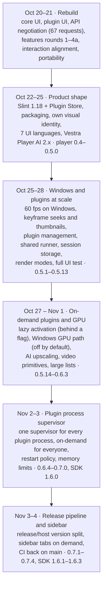

# Project history and current round

This file replaces the per-topic round records of October and November 2026. It keeps what still matters: how the project got here, the decisions in force, the lessons that changed how we work, and the open topics. Process rules live in [agentic-workflow](../../../agentic-workflow/README.md); architecture lives in [doc/architecture](../../architecture/README.md).

The full round texts are in git: `git show 03c75d2e:doc/process/rounds/<file>` (for example `2026-10-render-modes.md`). Ruling tables, measurements and step-by-step logs are there.

**How this file is used.** It is the current round record (the blackboard). A new piece of work adds its state and log under [Current round](#current-round). When the work ends, its lasting decisions, lessons and open topics are folded into the sections above it, and its log is deleted.

## 1. Timeline

| Dates | Work | Result |
| --- | --- | --- |
| 10-20 | Core UI step one; plugin UI step two | Binding table, menu model, shell, widgets, OSD, info layer; menu order and shortcut allocation table ([menus.md](../../product/menus.md)) |
| 10-20/21 | Features rounds 1–2, API negotiation | 29 plugin-only features; 67 core requests settled (6 rejected with alternatives, 30 rewritten, 31 accepted, 0 rebuttals); basic playback moved into the core (`core_actions.rs`) |
| 10-21 | Rounds 3a/3b/4a, interaction alignment, portability | Window, bindings, devices, chapters, A-B loop, secondary subtitles, timeline marks, images, drops, settings pages, render size and pacing; OS code only in `platform/`; first `unsafe` crates for PiP and GPU |
| 10-21/22 | macOS GPU rendering and PiP | OpenGL into IOSurface, software fallback; system PiP on macOS 14+ |
| 10-22 | Slint 1.16 → 1.18.1, Plugin Store, packaging | Signed index, revocation, sideload; bundled Node; DMG, Inno Setup, portable zip; license manifest |
| 10-22/24 | Own identity | "V-Line × Aurora" and "Aurora Light" themes; reference-player traces removed; git history rewritten (player and SDK) |
| 10-24/25 | i18n, sidebar tabs and file resolvers, Vestra Player AI 2.x | English source + 6 languages (0.5.0); AI on pi-coding-agent with a permission-restricted child process |
| 10-25/26 | Windows 4K60 | 30 → 60 fps: vblank clock, reused texture, buffer ring, one-pixel-taller full screen |
| 10-26/27 | Seeks, thumbnails, UI fixes, redraw stutter | Keyframe seeks on by default; sprite-sheet hover thumbnails; AccessKit rebuild found and avoided |
| 10-26 | Plugin management, plugin center | Built-ins run in place, no rollback; the store is the only plugin manager |
| 10-27 | Memory spike, session storage, shared runner, full UI test | Built-ins share one Node process (≈1.1 GB → ≈60 MB); `storage.session`; Windows-wide test with many fixes |
| 10-27/28 | GPU on Windows | GL bridge parked, Vulkan rejected; wgpu/D3D12 with D3D11 shared textures; render-mode decision, denylist, crash guard |
| 10-26 → 31 | Lazy activation | Record/replay, residency, `plugin.when`, wake events; capability traits; host source split (behind `VESTRA_LAZY`) |
| 10-31 | GPU polish, AI upscaling, video primitives, deinterlace auto | Windows GPU on main but off by default (0.5.14); RTX VSR experiment; shader channel, convolution, 3D LUT |
| 10-31 → 11-02 | 0.6.0–0.6.5 | ListView and large lists, widget library, update check, Reset submenu, shader crash guard, stop reasons, keep-disabled on update |
| 11-02/03 | Plugin process supervisor B0–B7 | Pure core plus adapter; on-demand start for everyone; restart and backoff; 512 MB heap cap; process budget and memory pressure; old start/stop logic removed (0.7.0) |
| 11-03 | AI chat, perf, download page | One activity record per turn, selectable text (SDK 1.6.0); revision-gated list updates; AI feature video |
| 11-03 | 0.7.1, store, Options window | v0.7.1 published; store tabs All · Installed · Updates (0.2.11) and one control per row (0.2.12, #164); a woken plugin no longer rebuilds the Options window (#162) |
| 11-03/04 | Release and host versions | Release version split from the host version; a published host is reused by input hash (`host.json`) (#166/#167) |
| 11-04 | Sidebar tabs on demand | No tab cap, » overflow menu; only the current tab keeps its plugin running (#171; SDK 1.6.2, Workshop 2.2.33) |
| 11-04 | v0.7.4 | v0.7.3 tagged, run stopped at typos; tags are not moved, so it shipped as v0.7.4 (release 0.7.4, host 0.7.3; #172/#173); main remote CI back on |
| 11-03/04 | SDK 1.6.1–1.6.3 | 1.6.1 docs (player and Workshop 2.2.32, #168); 1.6.2 no tab cap, TestHost `keepsRunning` reports the current tab; 1.6.3 docs, examples name window handles after their window; built-ins do the same (#176) |
| 11-04 | CI fixes | `host.mjs` exits via `exitCode` (Node 26 `process.exit` deadlock with a GC worker, #174); runtime tests without stdout/stderr race or leftover children, with step timeouts (#177) |
| 11-03/04 | Download page (separate repo, not deployed) | Hero centre and store clip re-recorded on the final build, AI clip re-cut; NES footage is Twin Dragons (open-source homebrew) instead of Concentration Room; Blender films kept (CC BY) |
| 11-04 | Download page text | Credits and a YouTube trademark line in the footer; "All downloads" in the header; player card text rewritten |

## 2. Decisions in force

Grouped by area. "User" marks a user ruling; the rest are coordinator or maintainer rulings that still shape the product.

### Principles and process

- **Plugins are independent; the core does not know plugins.** Anything several plugins share becomes a general core capability; nothing is opened for one plugin's special need; no compatibility layers; nothing built ahead of a user (user, 10-20).
- **One public API** `vestra/1` for built-in and third-party plugins. SDK releases are patch bumps by default, removals included (deprecate, then remove); `apiVersion` stays `vestra/1` (user, 10-26). SDK 1.6.0 was a minor bump for selectable Markdown (user, 11-03).
- **First-party Rust forbids `unsafe`**, except isolated crates under `src/host/unsafe/` with SAFETY comments, checked by the unsafe-policy script (user, 10-21).
- **The player repository stays private until release; the SDK and plugin repositories are public** (user, 10-22, 11-01).
- **Remote CI for the player runs on main and tags only** (back on after v0.7.4, 11-04); branches merge on local checks. SDK releases never wait on macOS runner capacity (user, 11-02).
- **Follow established practice** (mpv and mainstream players; Chrome, VS Code and similar for plugin models) without asking; ask only real trade-offs (user, 10-27).
- **Round records are condensed here and deleted at the end of each round** (user, 11-03).

### Plugin platform

- **Plugin management is install, uninstall, disable and enable.** No rollback or older versions. Built-ins can be neither uninstalled nor disabled; they run in place and update with the player. The Plugin Store is the only management UI and works offline (user, 10-26).
- **A plugin the user disabled stays disabled** across updates and reinstalls (11-02).
- **Built-ins share one Node process.** Trust comes from provenance (digest, install directory, catalog), never from a manifest field. A hang or unattributed crash restarts all members; three restarts in 60 s fall back to own processes (user, 10-27; the shared runner stays for its memory win).
- **One supervisor decides when every plugin process exists**; no lazy and non-lazy modes; on-demand start for everyone; built on the existing implementation, wire protocol unchanged (user, 11-02). Design: [supervisor.md](../../architecture/supervisor.md).
- **Limits and timings** (user, 11-02): idle 30 s; start 60 s, a timed-out start is not retried, spawn failures are; stop grace 5 s; only `source.resolveRequest` is capped (5 min); resident plugins never stand by; 512 MB JS heap per own process; process budget `clamp(physMiB/2 × 0.30 / 85, 3, 16)`; built-ins never count against the installed-package limit.
- **Session storage** survives reload, upgrade, crash and standby; cleared on disable, uninstall and quit; 1 MiB per plugin (user, 10-27).
- **Declarative command state** (`plugin.when`) and wake on low-frequency events; no API to run another plugin's commands (user, 10-31).
- **A rejected command declaration is skipped, not fatal**; TestHost stays strict (user, 11-01).
- **Large lists**: the whole list lives in the host and is shown with ListView; no sparse rows or placeholders (user, 10-31).
- **Sidebar tabs on demand**: no tab cap, extra tabs in a » menu; only the current tab keeps its plugin running, background tabs stand by (11-04).
- **No OS sandbox for plugins** (user, 11-03, confirmed 11-04). No plugin ecosystem with full Node sandboxes meaningfully (Electron's sandbox and VS Code web extensions drop Node; Figma has its own API); Windows AppContainer is blocked by libuv #5178 (spawn with pipes hangs; fixed in libuv 1.53, in no Node release yet) and by blocked loopback for `openStream`. Security comes from store PR scanning, transparency at install, and revocation.

### Interface

- **Slint mechanisms over hand-rolled code** (ListView, std-widgets, menus); one compact Vestra widget set (user, 10-31). Slint is pinned exactly (`=1.18.1`); private APIs in use are re-tested on every upgrade.
- **Nothing under the pointer creates or destroys an element** (`visible:`/`opacity:` instead of `if`): Slint rebuilds the whole accessibility tree otherwise.
- **Bottom-bar buttons are contributed by commands and drawn by the player**; one per plugin, eight in total, each with a menu twin (user, 10-27).
- **Languages**: English source plus zh-Hans, ja, ko, de, fr, es; follows the system; applies at the next start. Plugins write no translation code (user, 10-24).
- **Fonts**: system UI fonts with a per-script CJK fallback ending in bundled Noto Sans CJK SC (user, 10-22/24).
- **Mouse**: a click on the video plays or pauses, double click unbound (user, 10-26). Full screen leaves with Escape only (user, 11-01). Volume up stops at 100.
- **Own visual identity**: two themes, vestra and vestra-light; menu layout and geometry unchanged (user, 10-22).
- **No compile cache for plugin windows yet**; a brief stall on open is acceptable. Any cache first needs an experiment measuring memory per definition with a hard bound, then a user decision (user, 11-03).
- **No hide-instead-of-destroy for windows**: it hides the problem rather than fixing it (user, 11-03).
- **The Options window is not special** in how it compiles and updates; only its composition of many plugins' pages is (user, 11-03).

### Playback and media

- **Basic playback actions belong to the core** (play, seek, rate, volume, frame step), usable without any plugin (10-20).
- **Keyframe seeks**: one switch, on by default, for arrow-key steps and the seek bar; never a second exact seek (user, 10-26/27).
- **Seek thumbnails**: on by default for local files, generated after playback starts, software decode only; opening must not get slower (user, 10-26).
- **ASS subtitles keep their own style by default**; the secondary subtitle has the primary's size (mpv cannot scale it).
- **Deinterlace Auto costs nothing on progressive files** (user, 10-27).

### Rendering

- **Windows GPU rendering ships off by default**; only Video ▸ GPU Rendering (Experimental) or `VESTRA_RENDER=gpu` turns it on (user, 10-28/31). Architecture: mpv D3D11 frames in D3D12 shared textures, shown in wgpu windows. CPU mode also draws in D3D12 windows.
- **One render-mode decision** with a built-in denylist, a local override file and a crash guard; no remote list updates (user, 10-28).
- **Hybrid laptops render on the high-performance GPU** unless Windows has a per-app preference (user, 10-31).
- **The UI must reach the display rate even in CPU mode** (user).
- **macOS stays on OpenGL with a software fallback; PiP is the system PiP on macOS, unsupported elsewhere** (user, 10-21).
- **Device loss restarts the player**; a second loss within a day falls back to software.
- **AI upscaling**: no DLSS plugin; RTX VSR experiment on Windows + NVIDIA only, greyed elsewhere (user, 10-27).

### Online video and AI

- **VestraTube** uses youtubei.js; **VestraBili** is paste-a-link only, and downloads yt-dlp on first use with consent and a checksum (user).
- **Vestra Player AI**: no subscription providers or per-provider special cases; Markdown output; no trial. One activity record per turn, thinking not shown; chat text is selectable (user, 11-03).

### Packaging and releases

- Bundled Node 26 (only going up during `vestra/1`); installers on this repository's GitHub Releases; macOS arm64 from 15.0; Windows per-user installer plus portable zip; release notes at `doc/releases/v<version>.md` (user, 10-22).
- **0.x releases need no question**; the update check is on by default (download and verify; the user runs the installer) (user, 11-01).
- Internal versions that were never published are combined into the next public one (0.6.6–0.6.8 and 0.7.0 → 0.7.1, user, 11-03).
- **The release version is separate from the host version**; a release reuses a published host whose inputs hash the same (`host.json`) (11-03).
- **Tags are never moved**; a tag whose run fails ships as the next patch (v0.7.3 → v0.7.4).

## 3. Lessons that changed how we work

Most lessons are already rules in agentic-workflow.md, with their evidence. These are the ones that are not, or that explain a rule:

- **Measure before believing.** Three Windows hypotheses (timer granularity, 30 Hz monitor, "UI redraws drop the video") were refuted by data; the last was memory starvation. "Shown" is not "presented": count the frames the window actually presents.
- **Predictions about plugin behaviour were wrong by a wide margin** (8–9 built-ins expected to idle, 1 did). Measure classification instead of assuming it; the fix was API work (`plugin.when`, wake events), not tuning.
- **Record every half of a ruling** and what it supersedes. A ruling recorded only in part (the API half of "follow Chrome", without its idle stop) stayed wrong for hours.
- **Real-machine GUI tests catch what unit tests cannot**: modifier keys lost by Slint, recomposition flashing the window, white OpenGL windows on one AMD driver.
- **Agents cannot see Slint output.** Screenshot with `npm run ui:shots` (en and de) and check against ui-spec before delivering UI.
- **Framework facts must be checked, not assumed**: Slint lets `.slint` write a global's `in` property; a Slint `PopupWindow` swallows outside presses; layout geometry updates a frame after an `if` flips; femtovg-wgpu recompiles pipelines when a window has a rendering notifier.
- **Driver facts**: AMD crashes on a GL/D3D adapter mismatch (match adapters by LUID first); a window exactly the display size triggers a mode switch (one pixel taller avoids it); mpv's "RTX Super Resolution enabled" proves nothing (query the extension).
- **Staging**: `builtin.json` must list each plugin's current version (no BOM); the bundled runtime SDK and the Workshop vendored SDK must match the player's SDK.
- **Windows PowerShell 5.1 reads UTF-8 files as ANSI** and mangles `§` and CJK text; edit records with UTF-8 tools only.
- **Removing an unmerged worktree loses work**; check status and merge state first.
- **`[skip ci]` in a tagged commit also suppresses the tag-push release run**; dispatch `release.yml` on the tag instead. A branch head without `[skip ci]` starts remote CI on push.
- **Node 26 can deadlock in `process.exit` with a GC worker**; scripts set `process.exitCode` and return.
- **A clean history rewrite needs**: a mirror backup and bundle, a dry run proving zero matches across all refs, paused Actions and rulesets, then rebuilt worktrees. npm unpublish works only within 72 h.

## 4. Open topics

| Area | Topic | Evidence / next step |
| --- | --- | --- |
| Release | **macOS signing and notarization; Windows code signing**: the user's top priority, before publishing the download page or making the repo public (user, 11-04) | `release.yml` "TODO(S7)"; Intel macOS build on demand |
| Release | The player repo is private, so the update check and the download links get 404 | User decides on making it public; signing comes first |
| Interface | Whether a hidden sidebar should also stand by the current tab's plugin (today it stays up) | User decision pending |
| Interface | Sidebar tabs on demand: fullscreen overlay not checked by hand | GUI check |
| Supervisor | Store shows "Running" for a plugin in standby | `store.ts` has no `idle` state |
| Supervisor | Hang attribution inside the shared runner (today a hang restarts all members) | `shared-runner.ts` attributes only exceptions |
| Platform | Install records do not keep the repository index signature evidence; third-party plugins in the shared runner | `package_store` `Source::Repository` |
| Platform | Automatic async tracking so `plugin.update()` becomes unnecessary | Designed for after 0.6.0 |
| Platform | Uninstall with data removal deletes the directory inline | `package_manager.rs` `remove_dir_all` |
| Rendering | Windows Auto still resolves to CPU (GPU default not decided) | `OffByDefault` in `host/rendering.rs` |
| Rendering | Full-screen tail: about 1% of frames shown for two refreshes | architecture README "Open" |
| Rendering | Slint upgrade for the double-draw fix, present mode and latency control, surface access, in-process device recovery; two upstream issues drafted but not filed | Slint pinned `=1.18.1` |
| Rendering | After a device-loss relaunch `VESTRA_RENDER=software` stays set for "Restart Player to Apply" | `host/restart.rs` |
| Rendering | `unsafe/gpu-probe` still in the tree and outside the unsafe-policy check; wgpu Vulkan/GLES backends compiled in (+7.4 MB) | Remove or reduce to a test |
| Rendering | CPU path: cap `zimg-threads`, skip rendering while minimized | Waiting for a ruling |
| Rendering | PiP on Windows and Linux (host-made always-on-top window) | `pip_unsupported.rs` |
| Hardware | Never-run cases: video primitives H1–H9, upscaling U5/U9–U11, render-mode G1–G7, device loss in cooldown, WARP/RDP, external 4K, any Intel GPU | Run when hardware is at hand |
| Interface | Custom-drawn title bar (IA-CORE-07); settings toggles IA-CORE-06 | interaction-spec "not implemented" |
| Interface | Store icons from the shared icon set (STORE-ICONS) | `store/ui/parts.slint` |
| Interface | Markdown line spacing (no line height in StyledText) | `markdown.slint` |
| Interface | `sidebar-actual` binding-loop warning | `host.slint`, `composition.rs` |
| Online | Site preview thumbnails for network sources (`ResolvedMedia.preview`); re-resolve an expired stream URL mid-playback | Host API needed |
| Online | VestraTube on ListView (pads to 200 rows) | large-lists.md §4.5 |
| AI | Web search for Vestra Player AI | Research only; needs rulings (paid, default off, security) |
| macOS | Checks owed: ⌥ + named keys and the panel menu after them; deinterlace auto; seek-bar click test; playlist thumbnails; the full-UI-test list | [mac-verification.md](../mac-verification.md) |
| Repository | Old pre-rewrite commit hashes in docs no longer resolve; SDK `refs/pull` still point at pre-rewrite commits (GitHub Support only) | Leave, or map from the backup |
| Repository | Worktree cleanup on this machine: unmerged or dirty worktrees left for the user | Coordinator |
| Security | Strengthen the official repository (no OS sandbox, see Decisions; only the Vestra AI worker uses Node's permission model): automated scan in the plugin repository's PR CI → human review of flagged items. Candidate tools (verify cost/setup first): CodeQL default setup, Dependency Review, secret scanning with push protection (free on public repos); Semgrep CE with our own rules (child processes, eval/new Function, files outside the plugin's dirs, hard-coded hosts, native modules) that label a PR for security review; GuardDog on the packed plugin (fails on malicious-package heuristics); OSV-Scanner for dependencies. The private player repo gets only the free CLI tools until it is public; registered publishers; revocation as today. Optional later: manifest-declared Node permission flags shown at install | Infrastructure maintainer, after 0.7.1 |
| Repository | The store's own files were never prettier-formatted (no prettier config for `plugins/`); decide a printWidth before formatting them in one commit | — |
| Platform | Command limit 160 per plugin is no longer twice the largest built-in (video registers 83; all built-ins 318) | `commands.rs` `limits_leave_room_for_real_plugins` still uses 71 |

## 5. Superseded

Kept so that old commits and comments make sense:

- **Lazy activation** (`VESTRA_LAZY`, `lazy.rs`, first-run throttle of 8, idle 60 s) → the supervisor (0.6.7–0.7.0). Recordings, residency, `plugin.when` and wake events live on inside it.
- **Plugin Manager plugin and rollback** → the Plugin Store, no rollback.
- **Seeding built-ins into the package store** → built-ins run in place.
- **"No GPU rendering on Windows main"** → on main, off by default.
- **D3D11 → OpenGL bridge and a Vulkan path on Windows** → wgpu/D3D12.
- **Fullscreen keys Enter, Alt+Enter, F11** → Escape only.
- **Gapless playback (preload)** → "fast advance"; reopening needs recorded-waveform evidence.
- **The "classic" theme** → removed.
- **About 3 000 host lines per round** as a size budget → not applied since.
- **No remote CI for the player** (11-02) → main and tags run remote CI again after v0.7.4.
- **A sidebar tab cap** → no cap, » overflow menu.
- **Concentration Room NES footage** on the download page → Twin Dragons (the former's author is publicly anti-AI).

## Current round

In progress (2026-11-07). If a loop is used, the procedure is [agentic-workflow-loop.md](../../../agentic-workflow/agentic-workflow-loop.md).

**Goal:** a calmer UI after a week of real use: task panels in a new adjust slot, a host-owned bottom button strip, a command palette, visible shortcuts and a slim right-click menu. The in-flight fixes go first. After that come the SDK review, the download page touch-ups and the launch video, in that order. **Done when** B6 is merged and released, and C and D are reviewed by the user. E is not part of the done criteria.

**Design:** `C:\vestra\design\menu-redesign\PROPOSAL.md` v2 (local, uncommitted), with its inventory and mockups 02–09. It moves into `doc/specs/` with B1.

### User rulings (2026-11-07)

- **Menus:** the built-in menus copied PotPlayer and are cluttered. Replace them with graphical task panels, show shortcuts in the GUI and cut the menus drastically. Rejected: sidebar groups (plugins would have to know their group), icon tabs (authors will not draw icons), button-style docking.
- **Adjust slot:** a new panel slot `adjust`, next to `sidebar`, `bottom` and `backdrop`. A plugin only declares the slot, and the SDK docs say what the slot does in the GUI today. The host may change how a slot is presented at any time. Layout: `[video][adjust][sidebar]`. Both columns can be open at once, and the sidebar is always rightmost.
- **Bottom button strip:** owned by the host, at the right end of the bottom slot, in today's style. It no longer depends on the bottom-bar plugin to place it. One button per plugin. Buttons past the cap or the width go to a » menu and are never dropped silently. Layout: `[plugin buttons…][»][🔍][Adjust][Sidebar]`. The last three are host commands and always visible. 🔍 opens the command palette, which the host draws.
- **Window:** remember size, position and maximized. Fullscreen is not restored and has no option. The sidebar header's ✕ is removed.
- **Filters:** host-side fixes 1–4 are approved, generalised: process at the displayed resolution, and neutral nodes pass through.
- **Order after the menu work:** first the SDK review (some features may fit a sidebar or panel better and need rewriting), then the download page (re-record the affected clips, small copy fixes), and the launch video last (re-made for the new UI).
- **Screen and workflow (11-07, later):** the coordinator may use the screen for GUI checks while the user is away (isolated profiles only). agentic-workflow.md is not changed for now; CI and workflow topics are discussed with the user during the work.
- **Recording and capture (11-07, later):** recording is a general host feature for any source that plays, as in VLC, mpv and OBS; nothing is restricted or detected per platform. Only public copy and official plugins avoid platform-specific recording (no "YouTube downloader" wording, no record button in VestraTube). Mini OBS (third-party screen capture plus live recording): studied (report C:estradesignmini-obsREPORT.md, local) and **shelved** by the user (larger than expected). Plugin-stream snapshots (VestraNES): not wanted for now.
- **Snapshots & Clips tab (11-07, user):** an ordinary sidebar tab for the capture plugin (design C:estradesigncapture-tabPROPOSAL.md, local) replaces the Export Clip, Export Tasks, Snapshot Settings and Burst windows. Right-click Snapshot ▸ item 5 becomes "Snapshots & Clips…" (Snapshot Settings… stays palette-only). Recommended answers accepted: recent results persist; Last N s adjustable; no smart cut; Fast cut copies no soft subtitles in v1; Precise may encode multi-threaded. Work runs in parallel with the menu steps: host export modes (R1 stream copy, R2 actual times, R4 progress, R6 options), range marks and OSD actions (R3, R5), the tab itself.
- **Authority while the user is away:** the coordinator assigns, reviews, commits, merges on local checks and releases SDK patches (agentic-workflow.md §8). It stops for the user on: workflow-file changes, player release tags (CI is left alone for now), paid services, deploys, using the screen without consent, and new trade-offs (agentic-workflow.md §7).

### State

| # | Item | State |
| --- | --- | --- |
| A1 | **Window state and sidebar ✕** | Merged (#185, follow-ups #188: minimized start, macOS restore drift, round-trip test). Owed: minimized-start and multi-monitor GUI check on the next main build |
| A2 | **Filter performance** | Merged (#189). GUI: 4K blur 8.6 → 60 fps; drags at 60; paused preview stays on the frame; values survive a seek. Follow-ups: snapshot `presentation` reads the scaled size; convolution/unsharp kernel minimum; play during a timed-out step; tool windows (Picture Adjustments) fall behind the main window when it is clicked — should stay above it (owned windows) |
| A3 | **Exit-code fix for the remaining scripts** | Merged (#183); main CI green |
| A4 | **Nightly advisories** | Merged (#184, fixed by #187: plain ID in deny.toml). SDK minimatch advisory left: the fix needs minimatch 11, which typedoc 0.28 does not allow (dev-only) |
| A5 | **Design doc consolidation** (`design-doc-consolidation`) | Workflow edits on hold (user). Rest: SDK 1.6.4 doc links, review, rebase, merge |
| A6 | **Release 0.7.5**: macOS job cancelled on 11-04 | Needs the user (CI left alone for now) |
| B1 | **Command palette and categories** | Done: palette #191 (host 0.7.4, SDK 1.6.4); categories for all 16 built-in plugins, Keyboard Shortcuts names Category: Title, SDK 1.6.5, release.json 0.7.6 (#193). Follow-ups in progress: host/core command categories; x-machine marks, capture Export/Snapshot, shortcuts search by menu path, duplicate list rows |
| B2 | **Shortcut hints** in tabs, sliders and buttons | Maintainer at work: SDK 1.6.6 `plugin.commands.keys`, `KeyHint` widget, `ToolTipArea.keys`, host push. Then plugin authors use them in the three tool windows |
| B3a | **Host-owned button strip**, » overflow, 🔍 button; host and playback in one release | After B2 |
| B3b | **Adjust slot**: adjust column, narrow-window overlay, fullscreen slide-out, Adjust button; SDK patch (`adjust` slot value, docs) | After B3a |
| B4 | **Panels**: Picture (its effects part after A2), Audio, Subtitles, Playback. One plugin author each | After B3b |
| B5 | **Slim right-click menu**, `menus.md` refreshed | After B4 |
| B6 | Full GUI test, then a release | Release tag needs the user |
| C | **SDK review**: examples, docs and built-in plugins whose features fit a sidebar or an adjust panel better. A proposal goes to the user before any rewrite | After B3b |
| D | **Download page**: re-record the clips that show menus, fix copy for the panels and the palette. Push only, no deploy | After B6 |
| E | **Signing** (Apple enrolment, Windows choice), page deploy and SEO | Needs the user |
| F | **Launch video v4**, re-made for the new UI; music decision | Last; needs the user |
| G | GPU test clip default | Done: env.ps1 sets VESTRA_GPU_CLIP to the testmedia 4K60 clip |
| H | **Fullscreen title strip (Windows), side lane** (user request 11-07) | Merged (#192), spec G-19. GUI: reveal/hide, top-right vs sidebar, 60 fps, minimize→restore→exit returns maximized |
| I | **Snapshots & Clips tab** (side lane) | Host R1/R2/R4/R6, host R3/R5/R7 and the capture tab in progress (SDK 1.6.9) |

### Log (newest first)

- 11-07 evening: #198 key hints merged (SDK 1.6.7). SDK 1.6.8 (bar strip docs) released. B3a GUI check found non-monotonic overflow (plugin buttons hide, reappear, hide while narrowing); fix: plugin cells get only the room beyond the bar's full width (`content-full-width`). Capture tab approved and started.
- 11-07 evening: SDK 1.6.6 never reached npm (provenance transparency log 500, then 409 on re-runs); republished as 1.6.7. The bar-strip SDK docs become 1.6.8. B3a reviewed (merge) with small follow-ups; B2 bumping to SDK 1.6.7. Mini-OBS feasibility report done.
- 11-07 afternoon: #191 palette, #192 title strip, #193 categories merged; SDK 1.6.4 and 1.6.5 released (1.6.5: i18n extract missed `category`). release.json is 0.7.6 (v0.7.5 tag exists; tags are not moved); no release published. Follow-ups noted: `ToolTipArea` recreates its tooltip per press (AccessKit rebuild per click); preferences pages use for-loops instead of ListView; flaky tests: lifecycle_baseline b2b (pid reuse), info J10 download, playlist C21 debounce; tool windows fall behind the main window; palette long titles clip without ellipsis.
- 11-07: #187 (main CI green again), #188, #189 merged; SDK 1.6.4 released. Lessons: (1) a reviewer of a deny.toml change runs `npm run licenses` (its TOML reader takes only strings in arrays); (2) a squash merge must set its own body, or the branch commits' `[skip ci]` skips main CI (#185 ran no CI); (3) each agent keeps scripts in its own scratchpad subfolder (a reviewer's check script was overwritten by another agent); (4) watch C: free space: parallel target dirs filled the disk to 1 GB.
- 11-07: A3 (#183) and A4 (#184) merged; A1 GUI-checked and merged (#185); A2 under review; B1 and A1 follow-ups started.
- 11-07: menu redesign proposal v2 approved, with the host-owned strip and the 🔍 button. A1 re-review passed. A2 in progress. Nightly advisory failure found (A4).
