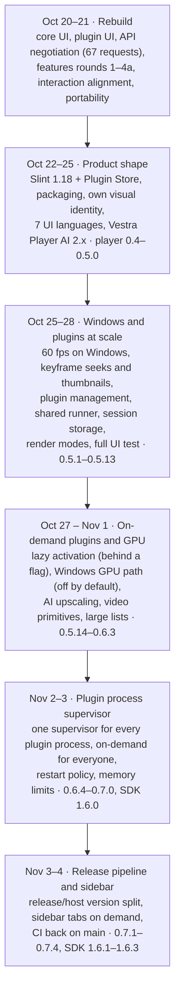

# Project history and current round

This file replaces the per-topic round records of October and November 2026. It keeps what still matters: how the project got here, the decisions in force, the lessons that changed how we work, and the open topics. Process rules live in [agentic-workflow](../../../agentic-workflow/README.md); architecture lives in [doc/architecture](../../architecture/README.md).

The full round texts are in git: `git show 03c75d2e:doc/process/rounds/<file>` (for example `2026-10-render-modes.md`). Ruling tables, measurements and step-by-step logs are there.

**How this file is used.** It is the current round record (the blackboard). A new piece of work adds its state and log under [Current round](#current-round). When the work ends, its lasting decisions, lessons and open topics are folded into the sections above it, and its log is deleted.

## 1. Timeline

| Dates | Work | Result |
| --- | --- | --- |
| 10-20 | Core UI step one; plugin UI step two | Binding table, menu model, shell, widgets, OSD, info layer; menu order and shortcut allocation table ([menus.md](../../product/menus.md)) |
| 10-20/21 | Features rounds 1–2, API negotiation | 29 plugin-only features; 67 core requests settled (6 rejected with alternatives, 30 rewritten, 31 accepted, 0 rebuttals); basic playback moved into the core (`core_actions.rs`) |
| 10-21 | Rounds 3a/3b/4a, interaction alignment, portability | Window, bindings, devices, chapters, A-B loop, secondary subtitles, timeline marks, images, drops, settings pages, render size and pacing; OS code only in `platform/`; first `unsafe` crates for PiP and GPU |
| 10-21/22 | macOS GPU rendering and PiP | OpenGL into IOSurface, software fallback; system PiP on macOS 14+ |
| 10-22 | Slint 1.16 → 1.18.1, Plugin Store, packaging | Signed index, revocation, sideload; bundled Node; DMG, Inno Setup, portable zip; license manifest |
| 10-22/24 | Own identity | "V-Line × Aurora" and "Aurora Light" themes; reference-player traces removed; git history rewritten (player and SDK) |
| 10-24/25 | i18n, sidebar tabs and file resolvers, Vestra Player AI 2.x | English source + 6 languages (0.5.0); AI on pi-coding-agent with a permission-restricted child process |
| 10-25/26 | Windows 4K60 | 30 → 60 fps: vblank clock, reused texture, buffer ring, one-pixel-taller full screen |
| 10-26/27 | Seeks, thumbnails, UI fixes, redraw stutter | Keyframe seeks on by default; sprite-sheet hover thumbnails; AccessKit rebuild found and avoided |
| 10-26 | Plugin management, plugin center | Built-ins run in place, no rollback; the store is the only plugin manager |
| 10-27 | Memory spike, session storage, shared runner, full UI test | Built-ins share one Node process (≈1.1 GB → ≈60 MB); `storage.session`; Windows-wide test with many fixes |
| 10-27/28 | GPU on Windows | GL bridge parked, Vulkan rejected; wgpu/D3D12 with D3D11 shared textures; render-mode decision, denylist, crash guard |
| 10-26 → 31 | Lazy activation | Record/replay, residency, `plugin.when`, wake events; capability traits; host source split (behind `VESTRA_LAZY`) |
| 10-31 | GPU polish, AI upscaling, video primitives, deinterlace auto | Windows GPU on main but off by default (0.5.14); RTX VSR experiment; shader channel, convolution, 3D LUT |
| 10-31 → 11-02 | 0.6.0–0.6.5 | ListView and large lists, widget library, update check, Reset submenu, shader crash guard, stop reasons, keep-disabled on update |
| 11-02/03 | Plugin process supervisor B0–B7 | Pure core plus adapter; on-demand start for everyone; restart and backoff; 512 MB heap cap; process budget and memory pressure; old start/stop logic removed (0.7.0) |
| 11-03 | AI chat, perf, download page | One activity record per turn, selectable text (SDK 1.6.0); revision-gated list updates; AI feature video |
| 11-03 | 0.7.1, store, Options window | v0.7.1 published; store tabs All · Installed · Updates (0.2.11) and one control per row (0.2.12, #164); a woken plugin no longer rebuilds the Options window (#162) |
| 11-03/04 | Release and host versions | Release version split from the host version; a published host is reused by input hash (`host.json`) (#166/#167) |
| 11-04 | Sidebar tabs on demand | No tab cap, » overflow menu; only the current tab keeps its plugin running (#171; SDK 1.6.2, Workshop 2.2.33) |
| 11-04 | v0.7.4 | v0.7.3 tagged, run stopped at typos; tags are not moved, so it shipped as v0.7.4 (release 0.7.4, host 0.7.3; #172/#173); main remote CI back on |
| 11-03/04 | SDK 1.6.1–1.6.3 | 1.6.1 docs (player and Workshop 2.2.32, #168); 1.6.2 no tab cap, TestHost `keepsRunning` reports the current tab; 1.6.3 docs, examples name window handles after their window; built-ins do the same (#176) |
| 11-04 | CI fixes | `host.mjs` exits via `exitCode` (Node 26 `process.exit` deadlock with a GC worker, #174); runtime tests without stdout/stderr race or leftover children, with step timeouts (#177) |
| 11-03/04 | Download page (separate repo, not deployed) | Hero centre and store clip re-recorded on the final build, AI clip re-cut; NES footage is Twin Dragons (open-source homebrew) instead of Concentration Room; Blender films kept (CC BY) |
| 11-04 | Download page text | Credits and a YouTube trademark line in the footer; "All downloads" in the header; player card text rewritten |

## 2. Decisions in force

Grouped by area. "User" marks a user ruling; the rest are coordinator or maintainer rulings that still shape the product.

### Principles and process

- **Plugins are independent; the core does not know plugins.** Anything several plugins share becomes a general core capability; nothing is opened for one plugin's special need; no compatibility layers; nothing built ahead of a user (user, 10-20).
- **One public API** `vestra/1` for built-in and third-party plugins. SDK releases are patch bumps by default, removals included (deprecate, then remove); `apiVersion` stays `vestra/1` (user, 10-26). SDK 1.6.0 was a minor bump for selectable Markdown (user, 11-03).
- **First-party Rust forbids `unsafe`**, except isolated crates under `src/host/unsafe/` with SAFETY comments, checked by the unsafe-policy script (user, 10-21).
- **The player repository stays private until release; the SDK and plugin repositories are public** (user, 10-22, 11-01).
- **Remote CI for the player runs on main and tags only** (back on after v0.7.4, 11-04); branches merge on local checks. SDK releases never wait on macOS runner capacity (user, 11-02).
- **Follow established practice** (mpv and mainstream players; Chrome, VS Code and similar for plugin models) without asking; ask only real trade-offs (user, 10-27).
- **Round records are condensed here and deleted at the end of each round** (user, 11-03).

### Plugin platform

- **Plugin management is install, uninstall, disable and enable.** No rollback or older versions. Built-ins can be neither uninstalled nor disabled; they run in place and update with the player. The Plugin Store is the only management UI and works offline (user, 10-26).
- **A plugin the user disabled stays disabled** across updates and reinstalls (11-02).
- **Built-ins share one Node process.** Trust comes from provenance (digest, install directory, catalog), never from a manifest field. A hang or unattributed crash restarts all members; three restarts in 60 s fall back to own processes (user, 10-27; the shared runner stays for its memory win).
- **One supervisor decides when every plugin process exists**; no lazy and non-lazy modes; on-demand start for everyone; built on the existing implementation, wire protocol unchanged (user, 11-02). Design: [supervisor.md](../../architecture/supervisor.md).
- **Limits and timings** (user, 11-02): idle 30 s; start 60 s, a timed-out start is not retried, spawn failures are; stop grace 5 s; only `source.resolveRequest` is capped (5 min); resident plugins never stand by; 512 MB JS heap per own process; process budget `clamp(physMiB/2 × 0.30 / 85, 3, 16)`; built-ins never count against the installed-package limit.
- **Session storage** survives reload, upgrade, crash and standby; cleared on disable, uninstall and quit; 1 MiB per plugin (user, 10-27).
- **Declarative command state** (`plugin.when`) and wake on low-frequency events; no API to run another plugin's commands (user, 10-31).
- **A rejected command declaration is skipped, not fatal**; TestHost stays strict (user, 11-01).
- **Large lists**: the whole list lives in the host and is shown with ListView; no sparse rows or placeholders (user, 10-31).
- **Sidebar tabs on demand**: no tab cap, extra tabs in a » menu; only the current tab keeps its plugin running, background tabs stand by (11-04).
- **No OS sandbox for plugins** (user, 11-03, confirmed 11-04). No plugin ecosystem with full Node sandboxes meaningfully (Electron's sandbox and VS Code web extensions drop Node; Figma has its own API); Windows AppContainer is blocked by libuv #5178 (spawn with pipes hangs; fixed in libuv 1.53, in no Node release yet) and by blocked loopback for `openStream`. Security comes from store PR scanning, transparency at install, and revocation.

### Interface

- **Slint mechanisms over hand-rolled code** (ListView, std-widgets, menus); one compact Vestra widget set (user, 10-31). Slint is pinned exactly (`=1.18.1`); private APIs in use are re-tested on every upgrade.
- **Nothing under the pointer creates or destroys an element** (`visible:`/`opacity:` instead of `if`): Slint rebuilds the whole accessibility tree otherwise.
- **Bottom-bar buttons are contributed by commands and drawn by the player**; one per plugin, eight in total, each with a menu twin (user, 10-27).
- **Languages**: English source plus zh-Hans, ja, ko, de, fr, es; follows the system; applies at the next start. Plugins write no translation code (user, 10-24).
- **Fonts**: system UI fonts with a per-script CJK fallback ending in bundled Noto Sans CJK SC (user, 10-22/24).
- **Mouse**: a click on the video plays or pauses, double click unbound (user, 10-26). Full screen leaves with Escape only (user, 11-01). Volume up stops at 100.
- **Own visual identity**: two themes, vestra and vestra-light; menu layout and geometry unchanged (user, 10-22).
- **No compile cache for plugin windows yet**; a brief stall on open is acceptable. Any cache first needs an experiment measuring memory per definition with a hard bound, then a user decision (user, 11-03).
- **No hide-instead-of-destroy for windows**: it hides the problem rather than fixing it (user, 11-03).
- **The Options window is not special** in how it compiles and updates; only its composition of many plugins' pages is (user, 11-03).

### Playback and media

- **Basic playback actions belong to the core** (play, seek, rate, volume, frame step), usable without any plugin (10-20).
- **Keyframe seeks**: one switch, on by default, for arrow-key steps and the seek bar; never a second exact seek (user, 10-26/27).
- **Seek thumbnails**: on by default for local files, generated after playback starts, software decode only; opening must not get slower (user, 10-26).
- **ASS subtitles keep their own style by default**; the secondary subtitle has the primary's size (mpv cannot scale it).
- **Deinterlace Auto costs nothing on progressive files** (user, 10-27).

### Rendering

- **Windows GPU rendering ships off by default**; only Video ▸ GPU Rendering (Experimental) or `VESTRA_RENDER=gpu` turns it on (user, 10-28/31). Architecture: mpv D3D11 frames in D3D12 shared textures, shown in wgpu windows. CPU mode also draws in D3D12 windows.
- **One render-mode decision** with a built-in denylist, a local override file and a crash guard; no remote list updates (user, 10-28).
- **Hybrid laptops render on the high-performance GPU** unless Windows has a per-app preference (user, 10-31).
- **The UI must reach the display rate even in CPU mode** (user).
- **macOS stays on OpenGL with a software fallback; PiP is the system PiP on macOS, unsupported elsewhere** (user, 10-21).
- **Device loss restarts the player**; a second loss within a day falls back to software.
- **AI upscaling**: no DLSS plugin; RTX VSR experiment on Windows + NVIDIA only, greyed elsewhere (user, 10-27).

### Online video and AI

- **VestraTube** uses youtubei.js; **VestraBili** is paste-a-link only, and downloads yt-dlp on first use with consent and a checksum (user).
- **Vestra Player AI**: no subscription providers or per-provider special cases; Markdown output; no trial. One activity record per turn, thinking not shown; chat text is selectable (user, 11-03).

### Packaging and releases

- Bundled Node 26 (only going up during `vestra/1`); installers on this repository's GitHub Releases; macOS arm64 from 15.0; Windows per-user installer plus portable zip; release notes at `doc/releases/v<version>.md` (user, 10-22).
- **0.x releases need no question**; the update check is on by default (download and verify; the user runs the installer) (user, 11-01).
- Internal versions that were never published are combined into the next public one (0.6.6–0.6.8 and 0.7.0 → 0.7.1, user, 11-03).
- **The release version is separate from the host version**; a release reuses a published host whose inputs hash the same (`host.json`) (11-03).
- **Tags are never moved**; a tag whose run fails ships as the next patch (v0.7.3 → v0.7.4).

## 3. Lessons that changed how we work

Most lessons are already rules in agentic-workflow.md, with their evidence. These are the ones that are not, or that explain a rule:

- **Measure before believing.** Three Windows hypotheses (timer granularity, 30 Hz monitor, "UI redraws drop the video") were refuted by data; the last was memory starvation. "Shown" is not "presented": count the frames the window actually presents.
- **Predictions about plugin behaviour were wrong by a wide margin** (8–9 built-ins expected to idle, 1 did). Measure classification instead of assuming it; the fix was API work (`plugin.when`, wake events), not tuning.
- **Record every half of a ruling** and what it supersedes. A ruling recorded only in part (the API half of "follow Chrome", without its idle stop) stayed wrong for hours.
- **Real-machine GUI tests catch what unit tests cannot**: modifier keys lost by Slint, recomposition flashing the window, white OpenGL windows on one AMD driver.
- **Agents cannot see Slint output.** Screenshot with `npm run ui:shots` (en and de) and check against ui-spec before delivering UI.
- **Framework facts must be checked, not assumed**: Slint lets `.slint` write a global's `in` property; a Slint `PopupWindow` swallows outside presses; layout geometry updates a frame after an `if` flips; femtovg-wgpu recompiles pipelines when a window has a rendering notifier.
- **Driver facts**: AMD crashes on a GL/D3D adapter mismatch (match adapters by LUID first); a window exactly the display size triggers a mode switch (one pixel taller avoids it); mpv's "RTX Super Resolution enabled" proves nothing (query the extension).
- **Staging**: `builtin.json` must list each plugin's current version (no BOM); the bundled runtime SDK and the Workshop vendored SDK must match the player's SDK.
- **Windows PowerShell 5.1 reads UTF-8 files as ANSI** and mangles `§` and CJK text; edit records with UTF-8 tools only.
- **Removing an unmerged worktree loses work**; check status and merge state first.
- **`[skip ci]` in a tagged commit also suppresses the tag-push release run**; dispatch `release.yml` on the tag instead. A branch head without `[skip ci]` starts remote CI on push.
- **Node 26 can deadlock in `process.exit` with a GC worker**; scripts set `process.exitCode` and return.
- **A clean history rewrite needs**: a mirror backup and bundle, a dry run proving zero matches across all refs, paused Actions and rulesets, then rebuilt worktrees. npm unpublish works only within 72 h.

## 4. Open topics

| Area | Topic | Evidence / next step |
| --- | --- | --- |
| Release | **macOS signing and notarization; Windows code signing**: the user's top priority, before publishing the download page or making the repo public (user, 11-04) | `release.yml` "TODO(S7)"; Intel macOS build on demand |
| Release | The player repo is private, so the update check and the download links get 404 | User decides on making it public; signing comes first |
| Interface | Whether a hidden sidebar should also stand by the current tab's plugin (today it stays up) | User decision pending |
| Interface | Sidebar tabs on demand: fullscreen overlay not checked by hand | GUI check |
| Supervisor | Store shows "Running" for a plugin in standby | `store.ts` has no `idle` state |
| Supervisor | Hang attribution inside the shared runner (today a hang restarts all members) | `shared-runner.ts` attributes only exceptions |
| Platform | Install records do not keep the repository index signature evidence; third-party plugins in the shared runner | `package_store` `Source::Repository` |
| Platform | Automatic async tracking so `plugin.update()` becomes unnecessary | Designed for after 0.6.0 |
| Platform | Uninstall with data removal deletes the directory inline | `package_manager.rs` `remove_dir_all` |
| Rendering | Windows Auto still resolves to CPU (GPU default not decided) | `OffByDefault` in `host/rendering.rs` |
| Rendering | Full-screen tail: about 1% of frames shown for two refreshes | architecture README "Open" |
| Rendering | Slint upgrade for the double-draw fix, present mode and latency control, surface access, in-process device recovery; two upstream issues drafted but not filed | Slint pinned `=1.18.1` |
| Rendering | After a device-loss relaunch `VESTRA_RENDER=software` stays set for "Restart Player to Apply" | `host/restart.rs` |
| Rendering | `unsafe/gpu-probe` still in the tree and outside the unsafe-policy check; wgpu Vulkan/GLES backends compiled in (+7.4 MB) | Remove or reduce to a test |
| Rendering | CPU path: cap `zimg-threads`, skip rendering while minimized | Waiting for a ruling |
| Rendering | PiP on Windows and Linux (host-made always-on-top window) | `pip_unsupported.rs` |
| Hardware | Never-run cases: video primitives H1–H9, upscaling U5/U9–U11, render-mode G1–G7, device loss in cooldown, WARP/RDP, external 4K, any Intel GPU | Run when hardware is at hand |
| Interface | Custom-drawn title bar (IA-CORE-07); settings toggles IA-CORE-06 | interaction-spec "not implemented" |
| Interface | Store icons from the shared icon set (STORE-ICONS) | `store/ui/parts.slint` |
| Interface | Markdown line spacing (no line height in StyledText) | `markdown.slint` |
| Interface | `sidebar-actual` binding-loop warning | `host.slint`, `composition.rs` |
| Online | Site preview thumbnails for network sources (`ResolvedMedia.preview`); re-resolve an expired stream URL mid-playback | Host API needed |
| Online | VestraTube on ListView (pads to 200 rows) | large-lists.md §4.5 |
| AI | Web search for Vestra Player AI | Research only; needs rulings (paid, default off, security) |
| macOS | Checks owed: ⌥ + named keys and the panel menu after them; deinterlace auto; seek-bar click test; playlist thumbnails; the full-UI-test list | [mac-verification.md](../mac-verification.md) |
| Repository | Old pre-rewrite commit hashes in docs no longer resolve; SDK `refs/pull` still point at pre-rewrite commits (GitHub Support only) | Leave, or map from the backup |
| Repository | Worktree cleanup on this machine: unmerged or dirty worktrees left for the user | Coordinator |
| Security | Strengthen the official repository (no OS sandbox, see Decisions; only the Vestra AI worker uses Node's permission model): automated scan in the plugin repository's PR CI → human review of flagged items. Candidate tools (verify cost/setup first): CodeQL default setup, Dependency Review, secret scanning with push protection (free on public repos); Semgrep CE with our own rules (child processes, eval/new Function, files outside the plugin's dirs, hard-coded hosts, native modules) that label a PR for security review; GuardDog on the packed plugin (fails on malicious-package heuristics); OSV-Scanner for dependencies. The private player repo gets only the free CLI tools until it is public; registered publishers; revocation as today. Optional later: manifest-declared Node permission flags shown at install | Infrastructure maintainer, after 0.7.1 |
| Repository | The store's own files were never prettier-formatted (no prettier config for `plugins/`); decide a printWidth before formatting them in one commit | — |
| Platform | Command limit 160 per plugin is no longer twice the largest built-in (video registers 83; all built-ins 318) | `commands.rs` `limits_leave_room_for_real_plugins` still uses 71 |

## 5. Superseded

Kept so that old commits and comments make sense:

- **Lazy activation** (`VESTRA_LAZY`, `lazy.rs`, first-run throttle of 8, idle 60 s) → the supervisor (0.6.7–0.7.0). Recordings, residency, `plugin.when` and wake events live on inside it.
- **Plugin Manager plugin and rollback** → the Plugin Store, no rollback.
- **Seeding built-ins into the package store** → built-ins run in place.
- **"No GPU rendering on Windows main"** → on main, off by default.
- **D3D11 → OpenGL bridge and a Vulkan path on Windows** → wgpu/D3D12.
- **Fullscreen keys Enter, Alt+Enter, F11** → Escape only.
- **Gapless playback (preload)** → "fast advance"; reopening needs recorded-waveform evidence.
- **The "classic" theme** → removed.
- **About 3 000 host lines per round** as a size budget → not applied since.
- **No remote CI for the player** (11-02) → main and tags run remote CI again after v0.7.4.
- **A sidebar tab cap** → no cap, » overflow menu.
- **Concentration Room NES footage** on the download page → Twin Dragons (the former's author is publicly anti-AI).

## Current round

In progress (2026-11-07). If a loop is used, the procedure is [agentic-workflow-loop.md](../../../agentic-workflow/agentic-workflow-loop.md).

**Goal:** a calmer UI after a week of real use: task panels in a new adjust slot, a host-owned bottom button strip, a command palette, visible shortcuts and a slim right-click menu. The in-flight fixes go first. After that come the SDK review, the download page touch-ups and the launch video, in that order. **Done when** B6 is merged and released, and C and D are reviewed by the user. E is not part of the done criteria.

**Design:** `C:\vestra\design\menu-redesign\PROPOSAL.md` v2 (local, uncommitted), with its inventory and mockups 02–09. It moves into `doc/specs/` with B1.

### User rulings (2026-11-07)

- **Menus:** the built-in menus copied PotPlayer and are cluttered. Replace them with graphical task panels, show shortcuts in the GUI and cut the menus drastically. Rejected: sidebar groups (plugins would have to know their group), icon tabs (authors will not draw icons), button-style docking.
- **Adjust slot:** a new panel slot `adjust`, next to `sidebar`, `bottom` and `backdrop`. A plugin only declares the slot, and the SDK docs say what the slot does in the GUI today. The host may change how a slot is presented at any time. Layout: `[video][adjust][sidebar]`. Both columns can be open at once, and the sidebar is always rightmost.
- **Bottom button strip:** owned by the host, at the right end of the bottom slot, in today's style. It no longer depends on the bottom-bar plugin to place it. One button per plugin. Buttons past the cap or the width go to a » menu and are never dropped silently. Layout: `[plugin buttons…][»][🔍][Adjust][Sidebar]`. The last three are host commands and always visible. 🔍 opens the command palette, which the host draws.
- **Window:** remember size, position and maximized. Fullscreen is not restored and has no option. The sidebar header's ✕ is removed.
- **Filters:** host-side fixes 1–4 are approved, generalised: process at the displayed resolution, and neutral nodes pass through.
- **Order after the menu work:** first the SDK review (some features may fit a sidebar or panel better and need rewriting), then the download page (re-record the affected clips, small copy fixes), and the launch video last (re-made for the new UI).
- **Screen and workflow (11-07, later):** the coordinator may use the screen for GUI checks while the user is away (isolated profiles only). agentic-workflow.md is not changed for now; CI and workflow topics are discussed with the user during the work.
- **Recording and capture (11-07, later):** recording is a general host feature for any source that plays, as in VLC, mpv and OBS; nothing is restricted or detected per platform. Only public copy and official plugins avoid platform-specific recording (no "YouTube downloader" wording, no record button in VestraTube). Mini OBS (third-party screen capture plus live recording): studied (report C:estradesignmini-obsREPORT.md, local) and **shelved** by the user (larger than expected). Plugin-stream snapshots (VestraNES): not wanted for now.
- **No accessibility tree (11-07, user):** the player does not offer screen-reader accessibility; build without Slint's `accessibility` feature (AccessKit rebuilds its whole tree on every element creation, 120–160 ms per hover at 4K). The no-churn rule (no elements created or destroyed per hover) stays as a plain performance rule. Long-term direction instead: an LLM assistant plugin that can run every known command with parameters, later with voice and an assisted mode that suggests commands. Host needs for it: a risky `commands.run` capability on the palette path, command state in the command list, typed command parameters, OSD/notification events, speech in/out, confirmation for dangerous commands.
- **Mini OBS timing (11-07, user):** starts only after all current work is done and an installer exists for the user to use.
- **Snapshots & Clips tab (11-07, user):** an ordinary sidebar tab for the capture plugin (design C:estradesigncapture-tabPROPOSAL.md, local) replaces the Export Clip, Export Tasks, Snapshot Settings and Burst windows. Right-click Snapshot ▸ item 5 becomes "Snapshots & Clips…" (Snapshot Settings… stays palette-only). Recommended answers accepted: recent results persist; Last N s adjustable; no smart cut; Fast cut copies no soft subtitles in v1; Precise may encode multi-threaded. Work runs in parallel with the menu steps: host export modes (R1 stream copy, R2 actual times, R4 progress, R6 options), range marks and OSD actions (R3, R5), the tab itself.
- **Shell recompile cost (11-07, user):** the user follows the coordinator's recommendation until they give their own: B3b merges with on-demand compile (first open compiles only the shown adjust tab). After B4, a small `ComponentContainer` spike (experimental Slint API, one panel compiled on its own) measures the gain; its numbers go to the user before any switch. Background: Slint compiles on the UI thread only (`ComponentDefinition` holds `Rc`), so precompiling at idle would only move the stall into playback.
- **Capture tab rework (11-07 night, user):** too cluttered. Sub-tabs are real pages; Snapshot has only Save and Copy (mpv default: source size with shown subtitles; effects, format and Burst in Settings); explanation blocks become ⓘ tooltips (the Fast keyframe snap shows only on the mini timeline); Quality, Audio, effects and burn-in go into a collapsed Advanced section. Precise exports use threads "auto" (export ffmpeg runs below normal priority). Coordinator: the tab and its menu entry are both "Capture" / "截取".
- **Effects in exports (11-07 night, user):** split by effect type — stateless chains seek to the keyframe before the start (identical output); stateful nodes keep about 10 s of history (tiny differences at the very start accepted). Coordinator, after measurement: frameBlend and MPEG-TS stay at 0 s; audio with effects is not sample-identical (correlation > 0.99), no extra full-file audio pass.
- **Builds (11-08, user):** at most 3 agents at once. One kept target dir per worktree (`. C:estraenv.ps1 -Worktree C:estrawt-x` → `C:estra	arget-wt-x`, deleted when the branch merges); builds stay serialized by build.lock. A single target dir shared by several worktrees was tried first and is unsafe: cargo fingerprints use workspace-relative paths and mtimes, so a worktree with older files reused another worktree's binaries (a capture stage shipped the adjust host; one ci:local run tested the export branch). Per-worktree dirs keep the speed-up (clippy 23 s, host tests 89 s, ci:local 14–17 min). agentic-workflow.md §8 still describes per-agent deleted dirs; it changes when the workflow is discussed.
- **GUI while the user uses the machine (11-08, user):** offline checks only until the user says the machine is free.
- **Fullscreen column toggles (11-08, user):** in fullscreen the Adjust/Sidebar buttons, Toggle Sidebar, Alt+n and `toggle()` switch a column on/off exactly as in windowed mode; the right-edge hover reveals an "on" column; no mechanical pop-out (SDK 1.6.13 withdraws the 1.6.12 rule). The command palette field has no extra bars under it.
- **SDK (11-08, user):** SDK versions stay patch releases (no minor bump). The SDK's boundary is broadly right (this logic is far easier in TypeScript than in Rust), so nothing moves into the host; the SDK gets a large refactor, as the Rust core did, under step C. Findings so far: 81 releases since 10-17 — about 18 for shared cross-plugin UI/behaviour, 15 new media capabilities, 14 docs/republish/process, 10 plugin lifecycle, 5 i18n, 6 removals/fixes; TestHost (an in-memory fake of the host's plugin-facing rules, 7.6k lines, no decoding or scheduling) is touched in 54 releases but drives only 4–6 of them (~18% of changed code lines); rules are duplicated between SDK/TestHost and the host (value ranges, limits, name lists, layout/command/job behaviour). A read-only inventory (researcher on the Fable model) is running; its report becomes the refactor plan for the user.
- **B4 redesign before merge (11-08, user):** Picture ▸ Geometry by dragging (fixed screen frame, video frame draggable/zoomable/croppable), Effects more compact, Denoise and its 3D/Gradual/Temporal mode clearly one group, Playback speed as a slider; design mockups first; the four panels merge only after this redesign.
- **B4 design choice (11-08, user):** the Picture panel keeps one scrolling page with Colour · Effects · Geometry · Advanced as jump tabs (the user looked at real sub-pages and kept the scroll page). Chosen from the v2 mockups: Geometry A (in-panel editor: fixed Screen frame, video frame dragged to pan, corner/wheel to zoom, double-click to centre; icon toolbar; crop as a mode with ratio chips, crop stays ratio + position), and the editor shows a still image (a Big Buck Bunny frame), not live video; Effects A (two columns of toggle chips, a strength slider only for active effects, Frames as Off / Doubling / Interpolate); Denoise A (one card, 3D / Gradual / Temporal each with its own toggle and strength); Speed B (preset ruler 0.25 · 0.5 · 1× · 1.25 · 1.5 · 2 · 4, 1× centred, snapping, double-click 1×, click-to-type value).
- **Agents (11-08 later, user):** at most 5 agents at once (supersedes 3); builds stay one at a time under build.lock, one kept target dir per worktree.
- **Deputy coordinator (11-08, user):** a deputy coordinator agent runs the UI and bug-fix lane (B4 redesign to merge, B5, follow-ups, B6 preparation) with its own agents and reports to the main coordinator, not to the user. The main thread concentrates on architecture with the user (SDK layering, step C). Things that need the user still go through the main coordinator.
- **SDK refactor direction (11-08 afternoon, user):** adopt three layers — L0 protocol (wire), L1 primitives (connection, writer, bare command registry, single-event subscription, services), L2 framework (bind, mirror, tracked commands, plugin.state) — with L2 built only on L1 and no primitive importing the pass scheduler. Three plugin styles, all documented: A declarative `bind()` (default), B subscribe + write (`player.on(event)`, `view.set/write`, typed event names), C experimental direct messages (`plugin.experimental`, marked unstable). New `plugin.state({...})` to replace manual `plugin.update()`. SDK docs refactored with it: event and message tables generated from code; a "three styles" chapter with 3–4 scenarios side by side; one main version per example, three only where the styles differ. Plan document goes to `doc/specs/sdk-refactor.md`; timing decided later; patch releases only; existing plugins run unchanged. Evidence: C:estradesignsdk-refactorINVENTORY.md and LAYERS.md (local).
- **SDK refactor details (11-08 afternoon, user):** the experimental entry is named `plugin.wire` (not `experimental`); `plugin.state` tracks one level only; `player.on` covers all ten host events; INVENTORY batches H and I are no longer batches — H becomes a measurement after Step 2 (pass counter + benchmark decide), I becomes a usage recount after the generated tables, with a short delete list for the user. The timing of the built-in `update()` sweep (spec §7 Q4) is under discussion.
- **Priority and budget (11-08 afternoon, user):** the SDK refactor is the top priority; other work may pause for it. It gets three agents of its own; all other work shares three more (six in total, builds still one at a time). Versioning: Step 1 (file moves, zero behaviour change) ships as 1.6.x patches; Steps 2+3 (`plugin.state`, `player.on`, `plugin.wire`) and the docs refactor ship together as **1.7.0**; the player then upgrades with no plugin edits, and the built-in `update()` sweep follows plugin by plugin. UI lane: finish the B4, B5 and owned-windows merges, then pause B6 and the follow-ups.
- **Still licence (11-08, user):** the CC BY 3.0 Big Buck Bunny frame in the Picture geometry editor is accepted; the allowance in `third-party.toml` is scoped to that file, not global.
- **B4 feedback after trying the build (11-08 afternoon, user):** (1) the Picture panel loses its four jump sub-tabs — one flat panel, modern screens do not need the scrolling tabs; (2) GPU Rendering becomes its own section at the top of the Picture panel, not under Advanced; (3) A-B Loop (today marks-plugin commands, palette-only after B5) moves into the Playback panel — the user calls leaving it in the menu their own oversight; chapters/bookmarks placement to be designed. Mockups first, then implementation as a B4 follow-up on main.
- **Picture and Playback v3 (11-08 afternoon, user):** from mockups 30–32: Picture is one flat panel (no jump tabs) with RENDERING on top (GPU Rendering switch + status line; AI Upscaling row), then Colour (presets in the heading row), Effects (Frames as chips), Geometry (150 px editor), Advanced as a collapsed disclosure row; default height target ≤ 730 px. AI upscaling (RTX VSR) is offered by the video plugin there — no separate upscaling plugin (supersedes the 10-27 plan of a plugin opened from the context menu). A-B Loop moves from marks into playback (Playback panel section after Speed, ~420 lines, command ids/keys unchanged); chapters, bookmarks and seek-bar marks stay in marks (list window H, shortcuts, palette; later the Chapters sidebar tab). Anime4K/FSR-style shader packs are wanted as store plugins after the SDK refactor (they use the host shader channel; content, not host features).
- **Facade size rule (11-08, coordinator):** the TestHost facade counts only non-comment code lines against the 1,500-line limit; doc comments must stay on the declaration.
- **Player remote CI (11-08 evening, user):** the private repo's Actions quota is not topped up now; remote CI runs once, right before the next release. Until then every merge goes in on the full local `ci:local` on the final tree, main merges carry `[skip ci]`, and main CI is not watched or rerun. Public repos (SDK, plugins, page) keep their CI.
- **Menu names and preview build (11-08 evening, user):** the four adjust-tab menu items and Playlist leave the right-click menu; the menu and the bottom-bar strip show two entries, **Adjustments and Effects** (调整与效果) and **Sidebar** (侧边栏); keys Alt+1…4 and F6 unchanged. The user tests one preview build with the A-B button fix, the slim menu and the rename on the SDK 1.7.0 code (installed from the local SDK, not published); the SDK docs refactor is written in parallel and 1.7.0 is published only with the docs.
- **One player ci:local per batch (11-08 evening, user):** a ci:local takes about half an hour, so the player does not run it per step: the rename, the A-B fix and the test fix stay on branch rename-adjust-sidebar; the user previews a build made straight from that branch with the SDK 1.7.0 code installed locally; when 1.7.0 is published the player upgrades once (1.6.20 → 1.7.0) and runs one ci:local before merging everything.
- **Authority while the user is away:** the coordinator assigns, reviews, commits, merges on local checks and releases SDK patches (agentic-workflow.md §8). It stops for the user on: workflow-file changes, player release tags (CI is left alone for now), paid services, deploys, using the screen without consent, and new trade-offs (agentic-workflow.md §7).

### State

| # | Item | State |
| --- | --- | --- |
| A1 | **Window state and sidebar ✕** | Merged (#185, follow-ups #188: minimized start, macOS restore drift, round-trip test). Owed: minimized-start and multi-monitor GUI check on the next main build |
| A2 | **Filter performance** | Merged (#189). GUI: 4K blur 8.6 → 60 fps; drags at 60; paused preview stays on the frame; values survive a seek. Follow-ups: snapshot `presentation` reads the scaled size; convolution/unsharp kernel minimum; play during a timed-out step; tool windows (Picture Adjustments) fall behind the main window when it is clicked — should stay above it (owned windows) |
| A3 | **Exit-code fix for the remaining scripts** | Merged (#183); main CI green |
| A4 | **Nightly advisories** | Merged (#184, fixed by #187: plain ID in deny.toml). SDK minimatch advisory left: the fix needs minimatch 11, which typedoc 0.28 does not allow (dev-only) |
| A5 | **Design doc consolidation** (`design-doc-consolidation`) | Workflow edits on hold (user). Rest: SDK 1.6.4 doc links, review, rebase, merge |
| A6 | **Release 0.7.5**: macOS job cancelled on 11-04 | Needs the user (CI left alone for now) |
| B1 | **Command palette and categories** | Done: palette #191 (host 0.7.4, SDK 1.6.4); categories for all 16 built-in plugins, Keyboard Shortcuts names Category: Title, SDK 1.6.5, release.json 0.7.6 (#193). Follow-ups in progress: host/core command categories; x-machine marks, capture Export/Snapshot, shortcuts search by menu path, duplicate list rows |
| B2 | **Shortcut hints** in tabs, sliders and buttons | Merged (#198, SDK 1.6.7) |
| B3a | **Host-owned button strip**, » overflow, 🔍 button; host and playback in one release | Merged (#200, SDK 1.6.8); overflow width sweep 1100→560 px GUI-checked |
| B3b | **Adjust slot**: adjust column, narrow-window overlay, fullscreen slide-out, Adjust button; SDK patch (`adjust` slot value, docs) | Merged (#209, SDK 1.6.11–1.6.13). Host multi-panel (one panel per slot per plugin, SDK 1.6.15) merged (#214) |
| B4 | **Panels**: Picture, Audio, Subtitles, Playback. One plugin author each | All four built, reviewed and integrated in branch b4-panels (SDK 1.6.16: tables + `commands.keys("host/<id>")`; ci:local 21/21; GUI-checked). **Held by the user (11-08): merge after the redesign** of Picture ▸ Geometry (direct manipulation: fixed screen frame + draggable/resizable video frame), a more compact Effects section, Denoise visibly grouped with its mode, and a Playback speed slider — mockups first (C:estradesignmenu-redesignmockups, PICTURE-PLAYBACK-v2.md). First-open cost with four real panels: 406 ms (one tab) / 713 ms (all compiled). Follow-ups: subtitle-online Online ▸ to Open ▸; lazy_activation covers only 9 built-ins (7 now mount panels headless-refused); host-command `home` for palette locations |
| B5 | **Slim right-click menu**, `menus.md` refreshed | After B4 |
| B6 | Full GUI test, then a release | Release tag needs the user |
| C | **SDK review → SDK refactor** (user, 11-08): inventory by a researcher (module map and consumers, duplicated rules SDK↔host, change history, specialised vs generic APIs, heavy runtime parts, ranked refactor batches as patch releases); plan goes to the user before any change | Plan written: `doc/specs/sdk-refactor.md` (three layers, three plugin styles, plugin.state, batches 4.0 → Step 1–3 → D/E/F, docs refactor); five open questions for the user; timing not decided |
| D | **Download page**: re-record the clips that show menus, fix copy for the panels and the palette. Push only, no deploy | After B6 |
| E | **Signing** (Apple enrolment, Windows choice), page deploy and SEO | Needs the user |
| F | **Launch video v4**, re-made for the new UI; music decision | Last; needs the user |
| G | GPU test clip default | Done: env.ps1 sets VESTRA_GPU_CLIP to the testmedia 4K60 clip |
| H | **Fullscreen title strip (Windows), side lane** (user request 11-07) | Merged (#192), spec G-19. GUI: reveal/hide, top-right vs sidebar, 60 fps, minimize→restore→exit returns maximized |
| I | **Capture tab** (side lane; renamed from Snapshots & Clips) | Host R3/R5 (#203), export modes R1/R2/R4/R6 (#205) and export input seek (#206) merged; SDK 1.6.10 released. Tab reworked after user feedback (real sub-pages, Save/Copy only, tooltips instead of explanation blocks, Advanced section, menu entry "Capture…"); review: product code OK, flaky tests being fixed (one helper for all 37 assert-after-wait spots, 20 green runs required). Then GUI check (layout, Fast/Precise, progress, OSD actions, frame rate with threads auto) and merge. Follow-ups: host request for subtitles without effects in `media.capture` (today shown subtitles force processed=true); OSD text too long pushes its action buttons off the video; Retry of a Fast failure should offer Precise |

### Log (newest first)

- 11-09 afternoon: SDK 1.7.3 published (#103: TestHost checks values against .slint declarations, player errors; two review rounds); player on 1.7.3 (#226), dev-load flash fix (#224), playback test flake fix (#225). Page re-cut: v2-based promo v7d, store/playlist/AI clips (NVENC capture, synthetic pointer), concise copy, compact credits. **User rulings:** (1) no hard memory cap for plugin/test processes now — the existing warning is enough; (2) crash reports are a candidate next feature (no crash report today; an unexplained player exit 11-09 14:07 was probably the user); (3) publish the general "How a plugin works" guide now (SDK 1.7.4); (4) AI validation: three tasks, one run each, no repeats (token cost).
- 11-09 early morning: Workshop investigation done (Fable). Regression real but small sample (1.6.20: 2 repair rounds / 600–800 s; 1.7.2: 8 rounds / 940 s); prompt and tools unchanged between the two, so the cause is the vendored SDK docs/test host. Example pages lost nothing needed; the deleted explanation chapter held general rules now lost (set vs bind, window lifecycle, command rules, scopes, idle stop, data directory, failure handling, filter chain vs display layer vs shaders, .cube rules, Slint types a plugin can write). Branches (not merged, await validation and the user): player `workshop-harness` 46b41b83 (check rejects brush/color written from TS; prompt value-type rules; row-order test), SDK `docs-1.7.3` 3cd76e6 (one general guide "How a plugin works", 2,378 words, no task-specific content). SDK follow-ups proposed: TestHost checks bound value types against .slint; union type pages show member TSDoc; docs search prefix match. Chat-order bug not reproduced (likely scroll position after the reply). Blocked: MiniMax balance (validation runs).
- 11-09 night: title strip merged (#223) and GUI-checked. Page re-recorded for 0.7.6 (page repo 01de686, 3efd704): fullscreen adjustments clip with command palette, new playlist slide (thumbnails, pushed in), store-3, ai-3, hero centre card on the Adjustments column; promo v5 preview (C:estramarketingideo5). Workshop AI investigation (Fable): before-fix runs show a regression (main 8 repair rounds / 940 s vs SDK 1.6.20 2 rounds / 584 s); fixes drafted (check rejects brush/color properties written from TS, two general prompt rules), docs audit drafted a general "How a plugin works" page in C:estrawt-sdk-docs173 (not task-specific; user ruling: no overfitting). **Needs the user:** MiniMax balance exhausted (402 insufficient_balance) — after-fix and cross-task validation runs wait for a top-up. Chat-order bug not reproduced; ask the user how they saw it.
- 11-08 ~23:00: sweep pilots merged (#222: playback 32→0, info 9→0 manual update()). Inventory H+I done (doc/process/research/sdk-measurement-2026-11-08.md): keep row-move planning and field-level dependencies (numbers inside); `part()` skipping never triggered — re-measure after the sweep; writer.ts index-path ~40% slower on 1.7.2 (noisy) — SDK follow-up. **Needs the user:** delete list (deprecate first): resolvers.fileTypes, resolvers.onFileTypesChange, commands.onKeysChange, timeline.onChange, appearance.onChange. Title strip a+b implemented and reviewed (wt-strip c83e491d); GUI check on the external screen waits for the user's go (they are at the keyboard). Page/promo re-recording rulings recorded in the page repo (recording-plan.md); recording starts only on the user's "开始".
- 11-08 ~22:30: player #221 merged (SDK 1.7.2, doc links, Workshop doc-tree paths) [skip ci]; plugins #30 merged (autoframe/shaderupscale text: AI Upscaling is in the Picture panel). Worktree cleanup: 18 merged worktrees and 5 target dirs removed, branches kept; ~99 GB free. `wt-store-all` was a stale copy of the built-in `subtitle-online` plugin (coordinator error) — deleted. **User ruling (11-08 ~22:45):** fullscreen title strip plan a+b approved (strip stops at the popped columns' left edge, no top-edge wake over the columns; window buttons move left while a column is out) — in progress. Open follow-ups unchanged: built-in update() sweep to plugin.state, A-B Count labels, GPU name in RenderingState, source display aspect API, TestHost producer throttle, host `since` per method, TestHost capability rejection, ComponentContainer spike decision (recommend no), B6 full GUI test + release (remote CI once before release).
- 11-08 late night: **SDK 1.7.2 published** (#102): docs in four groups, explanation/upgrading removed, no compat prose, 27 redirects + doc-tree aliases; two review rounds. **User ruling:** no focus ring on the playlist (no UI the user did not ask for) — #220 merged [skip ci]. Installer rebuilt from main for the user (stage-installer2). Running: player upgrade to SDK 1.7.2 + ~70 doc links to the new SDK pages (branch sdk-1.7.2). Open for the user: fullscreen title strip plan (recommend a+b).
- 11-08 night: player #219 merged (menu names, A-B buttons, playlist focus rules, SDK 1.7.1) [skip ci]; SDK 1.7.1 published (table refresh). Installer for the user at C:estrastage-installer (0.7.6, SDK 1.7.1). **User ruling (SDK docs):** too many sections, wordy, compat advice for unreleased players is noise, explanation theory unnecessary. Approved plan (scratchpad sdk-docs-plan.md, copy at C:estrascratch-docs172-plan.md): SDK 1.7.2 docs-only — 4 groups Tutorial (one page) · Guides (how-to + task tutorials + guidelines as design-rules) · Reference (generated tables kept, hand prose ≈4k words, no Player-versions table) · Examples (kept); explanation and upgrading deleted; every "before player x.y / older" sentence deleted, TSDoc keeps @since. Two lanes running (structure+reference+links in wt-sdk-170; content in wt-sdk-docs2), then review. Follow-up: player doc/ links (~25) to SDK site, separate small PR.
- 11-08 evening: **SDK 1.7.0 published** (#100, tag v1.7.0): steps 2+3, documentation refactor, `@vestra/focus.slint` (`VestraFocus.release()`). Player branch rename-adjust-sidebar: host VestraFocus (a35b0f05), playlist hands keys back after play/Esc and drops 11 list keys that shadowed global keys (066a20f2), host review regression fixed: panels take the focus on a blank click again so `focus: "panel"` bindings keep working (ed3e381e), docs (421ca958). Coordinator ruling: while the list has focus it keeps the standard navigation keys (arrows, PgUp/PgDn, Home/End) and Esc. Now: player upgrade to SDK 1.7.0 + the single ci:local. Fullscreen title strip research done (recommend: strip stops at the popped columns edge, no top-edge wake over columns; ~half day) — waits for the user after 1.7.0 lands in the player.
- 11-08 evening: SDK Step 3 (plugin.wire) and its follow-ups committed, in review; SDK 1.6.22 tables PR #99 open; docs refactor running; plugins repo #29 merged (RTX Upscale removed; the Picture panel offers AI Upscaling). Player branch rename-adjust-sidebar: menu rename, A-B Set buttons fix (bare ToolTipArea under an if had no size), host-agreement reads split types. Preview build started (C:estrastage-preview).
- 11-08 late afternoon: merged #218 (B5 slim menu + panels v3: flat Picture with Rendering/AI Upscaling, A-B Loop in Playback with rename migration, store text, Workshop SDK paths; player on SDK 1.6.20). SDK 1.6.21 released (batch G; Step 1 complete). SDK Step 2 (framework optional, S'' compatibility for playback.read plugins) committed and in review. New build staged at C:\vestra\stage-v3 and started for the user (isolated profile guiprof-user). **Needs the user:** GitHub Actions on the private player repo fail instantly since 13:27 (jobs end in ~1 s with no steps and no logs; reruns too) while the public SDK repo runs fine — most likely the Actions minutes/spending limit of the account; main CI for #216 and #218 is therefore unverified. Local ci:local was green for both.
- 11-08 afternoon: merged #217 (owned tool windows, ci:local 21/21) and #216 (B4 panels, ci:local 21/21 on the third run; earlier failures were a records typo, the playback preview EPERM flake, an audio-correlation and a lifecycle timing flake, and a vblank hardware test while the user used the machine). Main CI for #216: every job passed or was reused from the branch run, but the ci-ok aggregate failed twice with no readable log — open; the next host merge runs Windows again and settles it. SDK released: 1.6.18 (Step 0 characterisation tests + batch A TestHost split; a macOS-only golden-trace race fixed first), 1.6.19 (batches B runtime split + C ui split + check-layers lint), 1.6.20 (tables: A-B Loop owned by playback, AI Upscaling command, WAKE_EVENTS re-export). Batch G (types split) reviewed fix-first: d.ts {@link} imports elided, lint gap, order guard, player tests that read types.d.ts by path — in repair, will be 1.6.21. panels-v3 (B5 slim menu + Picture v3 + A-B Loop move + rename migration + store text) reviewed merge with follow-ups done (real switches, no dGPU wake on panel open, pass N of count+1, hotkeys rename-table drift test); its ci:local needs the player on SDK 1.6.20 (host-agreement) and workshop deps installed. Follow-ups: A-B count labels "Repeat N×"; ↺ Chapter reads bookmarks only from seek-bar marks; GPU name in RenderingState (API request); source display aspect (API request).
- 11-08 afternoon: SDK Step 0 (characterisation tests) committed on characterisation-tests (71f3fd5; built-in traces pinned to player 74b024a7); batch A reviewed merge on the old base, redone on Step 0 with 8 extra trace scenarios (Opus high). b4-panels merged into b5-menu (f0035e97); panels-v3 branch: video author (flat Picture, rendering section, upscaling) and playback/marks author (A-B loop move) started. ci:local for b4-panels and owned-windows re-queued with the ffmpeg env (first runs lacked it).
- 11-08 afternoon: SDK 1.6.17 merged (#94) and tagged (release running). B4 PR #216 open; final-tree ci:local queued behind owned-windows ci:local. B5: host part + menus.md committed (c45efbd4), hotkeys tests updated (d779391c), review running. User tried the B4 build and gave three rulings (above); mockup agent started.
- 11-08 midday: deputy coordinator handed the UI lane back to main (user: architecture discussion done). State: b4-panels efd1f515 (speed ruler + Picture v2 + typos rename + licence scope: per-component `allowed_licenses` in check-licenses.mjs/third-party.toml, not yet reviewer-glanced); ci:local 21/21 on 8e25e419; blocker: `check-licenses --bundle` fails because the vestra.video vxp lacks licenses/still/NOTICE.md — infra maintainer fixing the pack. owned-windows 10493b1b reviewed merge, full ci:local not yet run. SDK 1.6.17 (tables follow the slim menu) uncommitted in the SDK main clone; B5 b5-menu 413fd30e + uncommitted host part and menus.md rewrite, maintainer finishing clippy/tests. The user tries the B4 staged build themselves (isolated profile, no GUI checks by us). Superseded worktrees wt-b4-* still to remove after the merge.
- 11-08 evening: user — merge B4 at once, no GUI checks (the user tries the player themselves from a staged build in an isolated profile), then start the SDK work; SDK-lane agents run on Opus 5.5 high, others default.
- 11-08 afternoon: user made the SDK refactor top priority (3 dedicated agents, 1.7.0 for Steps 2+3) and accepted the still licence. SDK lane started: characterisation tests (spec §4.0) in C:estrawt-sdk-char; spec being updated with the rulings.
- 11-08 midday (deputy): ci:local on b4-panels 6e07a0e3 was 20/21 — typos rejected a two-letter editor identifier in picture.slint; renamed to inner-x/inner-y as a two-line coordinator fix (8e25e419; ruling: next time even a rename goes to an author with a reviewer glance); 21-step rerun and staged build queued. B5 sweep landed (413fd30e on b5-menu, 70 files): 13 plugins, all paths per mockup 04, ids/titles/keys/categories unchanged; 13 plugin suites green under the lock; small ordering deviations accepted (Recently Played 119, Audio Track 301 + Subtitle Track in domain, About in settings-main, Snapshot first item domain). Maintainer batch (host Play/Pause top level, Previous/Next palette-only, Command Palette… 829, SDK 1.6.17 tables, host-agreement test) in progress in the same worktree.
- 11-08 afternoon: SDK refactor plan document written (author on Fable) and merged as doc/specs/sdk-refactor.md; typos clean. Open questions for the user in its §7.
- 11-08 afternoon: SDK layering investigation (researcher) — L0 clean but private; L1 exists for services, missing for views/commands/events; L2 welded into Runtime/ViewBase/CommandHandle/PlayerService; ~90 manual update() calls. User approved the three-layer refactor with three plugin styles and docs refactor; writer assigned for the plan document.
- 11-08 evening (deputy): Picture v2 re-reviewed: merge (video 75/75 ×3, licenses OK, locales complete 307/307, host tests 1329/0; low notes: `editing` flag can stay set if the panel closes mid-drag; the editor keeps focus after leaving crop mode by button, so plain arrows pan instead of seeking until focus moves). Merged into b4-panels (6e07a0e3 = speed ruler + Picture v2). Full ci:local on the merged tree and a staged build (C:estrastage-b4v2) running; then the B4 GUI check. Merge to main waits for the user's answer on the CC BY 3.0 still.
- 11-08 late afternoon (deputy): owned tool windows (10493b1b) reviewed: merge (fmt/clippy/test 1328/0, darwin clippy, portability clean, unsafe policy). Visible change to record: plugin windows, Options and the detached sidebar lose the minimize button and taskbar entry and hide with the main window (Qt/VLC convention; winit gives owned windows WS_POPUP). GUI check pending (release build staging to C:estrastage-owned); user question open: Store/Workshop windows as tool windows. B5 started on branch b5-menu (wt-b5 = b4-panels + Picture v2 pre-merged): one sweep author for the mechanical path edits across plugins (precedent #193), one maintainer batch for host Play/Pause top level, Previous/Next palette-only, SDK 1.6.17 tables and the snapshot/agreement tests; menus.md by the coordinator; GUI check against mockup 04 before merge. Follow-ups left for later steps: Repeat/Shuffle in the playlist panel, Chapters sidebar tab with A-B Loop, Options pages for playback/history/playlist settings (proposal steps 8–9).
- 11-08 afternoon (deputy): Picture v2 fixes committed (af6f93b0: crop drag from the press position, pointer cancel releases, denoise memory on every path, one display announce per drag, modified arrows pass through; video tests 75/75, host tests 1329/0); fresh reviewer started. **§4 API request (video → maintainer):** `player.stats().video` has only coded width/height and this plugin's own displayWidth/Height — no sample aspect / source display aspect, so the Geometry editor shows 1.5 for a DVD 720x480 SAR 32:27 source while the host crops at 16:9. Request: a pre-filter source display aspect (e.g. `sampleAspect` or `sourceDisplayWidth/Height`). Follow-up: the software renderer ignores transform-rotation/scale while the editor swaps the frame w/h at 90°/270° (plugin cannot tell which renderer draws).
- 11-08 afternoon (deputy): **ComponentContainer spike** done (C:estrawt-cc-spike, uncommitted, kept until the user decides; src/host/src/ui/cc_spike.rs, CC_SPIKE switch in composition.rs; needs SLINT_ENABLE_EXPERIMENTAL_FEATURES=1). Release build, headless software window 1400x800, median of 7, "whole" = compile + create + palette + models + layout + 1 frame (baseline re-measured the same way: 414 ms, not the 268 of adjust-column.md); load = 4K60 software decode in parallel (noisy, +15–20%). today idle/load → CC idle/load (ms): startup shell 245/293 → 250/288; first open adjust (Picture) 414/490 → 222/279; first switch Audio 484/570 → 154/192; Subtitles 615/759 → 216/255; Playback 731/854 → 169/205; switch between panels ~1 → 10.9/12.4; any shell recompile after 4 panels 772/888 → 366/441. Floor per panel ~80 ms is re-compiling the shared libraries (palette 43, + widgets/icons/std-widgets 79; Slint caches no TypeLoader across compiles); Picture itself ~110. Working set: adjust closed 95.6 MB, today 196.2 MB, CC with 4 cached definitions 293.3 MB (+97 MB). Key bubbling, focus and bridge globals work across the boundary. Risks: experimental API (create_embedded is doc(hidden); technical-decisions.md §5 rejected it before), theme globals per instance, 29 shell-targeted sites in 13 files, shell rebuild re-embeds (366 ms), docked↔overlay re-create (~30 ms), tooltips/PopupWindow across trees untested, slint_lists/lazy_activation/composition tests assume Owner{n}View in shell source, i18n on wrapper sources. Recommendation: do not switch now (every case is still 10–20 frames; revisit when Slint stabilises it); cheaper: slim Picture/Subtitles panel files, drop shown panels from the shell while adjust is closed, upstream TypeLoader reuse. Real implementation: 600–900 host lines, 2–3 maintainer batches. Decision with the user.
- 11-08 afternoon (deputy): speed ruler fixes committed (868f160d) and re-reviewed: merge (151/151 ×3, host tests 1329/0; optional follow-ups: `changed pressed` release path for a right-click during a left drag; replace the 10 ms rateBusy poll with a settled promise). Merged into b4-panels (b69ebfa7). Picture v2 reviewed: fix first (crop-box drag accumulates displacement; no pointer-cancel release; denoise memory only updated by the chip; showView per drag frame; modified arrows swallowed; coded-size aspect) — a new video author is fixing. Owned tool windows delivered and committed (10493b1b, owned-windows): Windows owner windows via the winit attributes hook, macOS tool levels, Linux unchanged; under review, GUI check pending. Open with the user: CC BY 3.0 still, mockup deviations (Free chip, click-to-type, Shift-arrow edges, aspect chips), denoise card vanishing under the pointer, Store/Workshop windows losing taskbar and minimize.
- 11-08 noon: agent limit raised to 5. Speed ruler built (148/148 plugin tests), review: fix first (stuck display after a cancelled drag; speed changes lost while one is pending) — back with the author. Started: owned plugin tool windows (A2 follow-up), ComponentContainer spike (on b4-panels), researcher check whether the SDK is already layered (L0 protocol / L1 primitives / L2 framework). Row I (capture tab) merged as #211.
- 11-08 late morning: v2 mockups (two options for Geometry, Effects, Denoise, Speed) shown; the user asked why the Picture tabs mix sections, then kept the scroll page with jump tabs; chose the recommended options. Two authors started (Picture, Playback speed) in their own worktrees.
- 11-08 morning: merged #212 (main green: typos, capture chips, SDK 1.6.14, lazy_activation), #213 (CI-only test fixes: ffmpeg tests ignored, macOS Home), #214 (multi-panel host, SDK 1.6.15). SDK 1.6.14, 1.6.15, 1.6.16 released. Main CI was red from #206 to #211 unnoticed. Lessons: (1) run the full ci:local on the final merged tree before every merge (reviews ran only some Slint tests and missed `slint_lists`); (2) watch main CI after each merge — some failures appear only on CI runners (no ffmpeg, macOS keys); (3) a `ToolTipArea` wrapper does not stretch: rows inside it shrink and centre — set width/stretch explicitly; (4) built-in command tables in the SDK change with every menu move — batch panel changes into one table refresh.
- 11-08 early: SDK 1.6.13 released (fullscreen toggles switch, no pop-out). B3b reviewed four times (merge); joint GUI check with the user: panel live, width saved and restored, narrow overlay, edge reveal OK; ci:local on 1.6.13 running, then a final GUI check and merge. Capture tab reworked and reviewed; GUI check: clean pages, keyframe snap on the mini timeline, Results badge, 60 fps during Precise export; fixed since: export-card title overflow, time-left estimate, indeterminate bar during preroll; missing OSD after a Fast export still unexplained (logs added). Host fixes (OSD actions pushed off, submenu off-screen, palette bars) in checks. C: ran out of space twice (the user freed ~85 GB).
- 11-08 night: #206 (export input seek) merged; SDK 1.6.12 released (npm publish printed a notice that npm tokens bypassing 2FA are being restricted — the release job may need trusted publishing; needs the user in npm). Capture GUI check (4K external screen): range band, Fast cut length, below-normal ffmpeg and 60 fps during export OK; overlapping text and empty space found, and Precise exports decoding from 0 s (fixed by #206). Lessons: (1) an isolated profile still saves snapshots to the real Pictures folder — redirect or clean up; (2) check the screen size before screenshots (3840x2160 external display); (3) a panel that reads `player.state` in `bind()` needs `events` — SDK 1.6.12 warns once per plugin; (4) tests that wait on one value and assert another are flaky — wait on the asserted value.
- 11-07 night: #202 (no AccessKit: 18 packages fewer, ~469 KB smaller exe) and #203 (range marks, OSD actions, player on SDK 1.6.9) merged. SDK 1.6.10 (export modes) and 1.6.11 (adjust slot) released. Export review: a reviewer's "older players reject `encoding`" was wrong — the old player's bundled SDK drops it before the host sees it (lesson: §1.6 behaviour of older players is decided by their bundled SDK, not by the host's parser). Lesson: agents' lock-wait loops die at the 10-minute tool limit and leave the agent idle "waiting" for an hour; briefs now say "wait loops under 10 minutes per call, never stop waiting silently", and the fallback heartbeat checks lock age against agent activity.
- 11-07 evening: the machine froze at 18:11 (memory exhaustion: several rustc processes and a system service failed in the same second, C: at 4.3 GB free). Work in progress was saved as local WIP commits; agents resumed with at most 4 in parallel, build.lock also for full plugin suites and plugins:build, CARGO_BUILD_JOBS=8, no build under 15 GB free (brief rules, workflow unchanged by user decision). Accessibility removal started.
- 11-07 evening: #198 key hints merged (SDK 1.6.7). SDK 1.6.8 (bar strip docs) released. B3a GUI check found non-monotonic overflow (plugin buttons hide, reappear, hide while narrowing); fix: plugin cells get only the room beyond the bar's full width (`content-full-width`). Capture tab approved and started.
- 11-07 evening: SDK 1.6.6 never reached npm (provenance transparency log 500, then 409 on re-runs); republished as 1.6.7. The bar-strip SDK docs become 1.6.8. B3a reviewed (merge) with small follow-ups; B2 bumping to SDK 1.6.7. Mini-OBS feasibility report done.
- 11-07 afternoon: #191 palette, #192 title strip, #193 categories merged; SDK 1.6.4 and 1.6.5 released (1.6.5: i18n extract missed `category`). release.json is 0.7.6 (v0.7.5 tag exists; tags are not moved); no release published. Follow-ups noted: `ToolTipArea` recreates its tooltip per press (AccessKit rebuild per click); preferences pages use for-loops instead of ListView; flaky tests: lifecycle_baseline b2b (pid reuse), info J10 download, playlist C21 debounce; tool windows fall behind the main window; palette long titles clip without ellipsis.
- 11-07: #187 (main CI green again), #188, #189 merged; SDK 1.6.4 released. Lessons: (1) a reviewer of a deny.toml change runs `npm run licenses` (its TOML reader takes only strings in arrays); (2) a squash merge must set its own body, or the branch commits' `[skip ci]` skips main CI (#185 ran no CI); (3) each agent keeps scripts in its own scratchpad subfolder (a reviewer's check script was overwritten by another agent); (4) watch C: free space: parallel target dirs filled the disk to 1 GB.
- 11-07: A3 (#183) and A4 (#184) merged; A1 GUI-checked and merged (#185); A2 under review; B1 and A1 follow-ups started.
- 11-07: menu redesign proposal v2 approved, with the host-owned strip and the 🔍 button. A1 re-review passed. A2 in progress. Nightly advisory failure found (A4).
