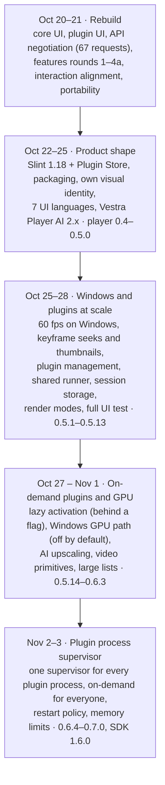

# Project history and current round

This file replaces the per-topic round records of October and November 2026. It keeps what still matters: how the project got here, the decisions in force, the lessons that changed how we work, and the open topics. Process rules live in [agentic-workflow](../../../agentic-workflow/README.md); architecture lives in [doc/architecture](../../architecture/README.md).

The full round texts are in git: `git show 03c75d2e:doc/process/rounds/<file>` (for example `2026-10-render-modes.md`). Ruling tables, measurements and step-by-step logs are there.

**How this file is used.** It is the current round record (the blackboard). A new piece of work adds its state and log under [Current round](#current-round). When the work ends, its lasting decisions, lessons and open topics are folded into the sections above it, and its log is deleted.

## 1. Timeline

| Dates | Work | Result |
| --- | --- | --- |
| 10-20 | Core UI step one; plugin UI step two | Binding table, menu model, shell, widgets, OSD, info layer; menu order and shortcut allocation table ([menus.md](../../product/menus.md)) |
| 10-20/21 | Features rounds 1–2, API negotiation | 29 plugin-only features; 67 core requests settled (6 rejected with alternatives, 30 rewritten, 31 accepted, 0 rebuttals); basic playback moved into the core (`core_actions.rs`) |
| 10-21 | Rounds 3a/3b/4a, interaction alignment, portability | Window, bindings, devices, chapters, A-B loop, secondary subtitles, timeline marks, images, drops, settings pages, render size and pacing; OS code only in `platform/`; first `unsafe` crates for PiP and GPU |
| 10-21/22 | macOS GPU rendering and PiP | OpenGL into IOSurface, software fallback; system PiP on macOS 14+ |
| 10-22 | Slint 1.16 → 1.18.1, Plugin Store, packaging | Signed index, revocation, sideload; bundled Node; DMG, Inno Setup, portable zip; license manifest |
| 10-22/24 | Own identity | "V-Line × Aurora" and "Aurora Light" themes; reference-player traces removed; git history rewritten (player and SDK) |
| 10-24/25 | i18n, sidebar tabs and file resolvers, Vestra Player AI 2.x | English source + 6 languages (0.5.0); AI on pi-coding-agent with a permission-restricted child process |
| 10-25/26 | Windows 4K60 | 30 → 60 fps: vblank clock, reused texture, buffer ring, one-pixel-taller full screen |
| 10-26/27 | Seeks, thumbnails, UI fixes, redraw stutter | Keyframe seeks on by default; sprite-sheet hover thumbnails; AccessKit rebuild found and avoided |
| 10-26 | Plugin management, plugin center | Built-ins run in place, no rollback; the store is the only plugin manager |
| 10-27 | Memory spike, session storage, shared runner, full UI test | Built-ins share one Node process (≈1.1 GB → ≈60 MB); `storage.session`; Windows-wide test with many fixes |
| 10-27/28 | GPU on Windows | GL bridge parked, Vulkan rejected; wgpu/D3D12 with D3D11 shared textures; render-mode decision, denylist, crash guard |
| 10-26 → 31 | Lazy activation | Record/replay, residency, `plugin.when`, wake events; capability traits; host source split (behind `VESTRA_LAZY`) |
| 10-31 | GPU polish, AI upscaling, video primitives, deinterlace auto | Windows GPU on main but off by default (0.5.14); RTX VSR experiment; shader channel, convolution, 3D LUT |
| 10-31 → 11-02 | 0.6.0–0.6.5 | ListView and large lists, widget library, update check, Reset submenu, shader crash guard, stop reasons, keep-disabled on update |
| 11-02/03 | Plugin process supervisor B0–B7 | Pure core plus adapter; on-demand start for everyone; restart and backoff; 512 MB heap cap; process budget and memory pressure; old start/stop logic removed (0.7.0) |
| 11-03 | AI chat, perf, download page | One activity record per turn, selectable text (SDK 1.6.0); revision-gated list updates; AI feature video |

## 2. Decisions in force

Grouped by area. "User" marks a user ruling; the rest are coordinator or maintainer rulings that still shape the product.

### Principles and process

- **Plugins are independent; the core does not know plugins.** Anything several plugins share becomes a general core capability; nothing is opened for one plugin's special need; no compatibility layers; nothing built ahead of a user (user, 10-20).
- **One public API** `vestra/1` for built-in and third-party plugins. SDK releases are patch bumps by default, removals included (deprecate, then remove); `apiVersion` stays `vestra/1` (user, 10-26). SDK 1.6.0 was a minor bump for selectable Markdown (user, 11-03).
- **First-party Rust forbids `unsafe`**, except isolated crates under `src/host/unsafe/` with SAFETY comments, checked by the unsafe-policy script (user, 10-21).
- **The player repository stays private until release; the SDK and plugin repositories are public** (user, 10-22, 11-01).
- **No remote CI for the player** (paid budget set to 0, 11-02): merge on local checks. SDK releases never wait on macOS runner capacity (user, 11-02).
- **Follow established practice** (mpv and mainstream players; Chrome, VS Code and similar for plugin models) without asking; ask only real trade-offs (user, 10-27).
- **Round records are condensed here and deleted at the end of each round** (user, 11-03).

### Plugin platform

- **Plugin management is install, uninstall, disable and enable.** No rollback or older versions. Built-ins can be neither uninstalled nor disabled; they run in place and update with the player. The Plugin Store is the only management UI and works offline (user, 10-26).
- **A plugin the user disabled stays disabled** across updates and reinstalls (11-02).
- **Built-ins share one Node process.** Trust comes from provenance (digest, install directory, catalog), never from a manifest field. A hang or unattributed crash restarts all members; three restarts in 60 s fall back to own processes (user, 10-27; the shared runner stays for its memory win).
- **One supervisor decides when every plugin process exists**; no lazy and non-lazy modes; on-demand start for everyone; built on the existing implementation, wire protocol unchanged (user, 11-02). Design: [supervisor.md](../../architecture/supervisor.md).
- **Limits and timings** (user, 11-02): idle 30 s; start 60 s, a timed-out start is not retried, spawn failures are; stop grace 5 s; only `source.resolveRequest` is capped (5 min); resident plugins never stand by; 512 MB JS heap per own process; process budget `clamp(physMiB/2 × 0.30 / 85, 3, 16)`; built-ins never count against the installed-package limit.
- **Session storage** survives reload, upgrade, crash and standby; cleared on disable, uninstall and quit; 1 MiB per plugin (user, 10-27).
- **Declarative command state** (`plugin.when`) and wake on low-frequency events; no API to run another plugin's commands (user, 10-31).
- **A rejected command declaration is skipped, not fatal**; TestHost stays strict (user, 11-01).
- **Large lists**: the whole list lives in the host and is shown with ListView; no sparse rows or placeholders (user, 10-31).

### Interface

- **Slint mechanisms over hand-rolled code** (ListView, std-widgets, menus); one compact Vestra widget set (user, 10-31). Slint is pinned exactly (`=1.18.1`); private APIs in use are re-tested on every upgrade.
- **Nothing under the pointer creates or destroys an element** (`visible:`/`opacity:` instead of `if`): Slint rebuilds the whole accessibility tree otherwise.
- **Bottom-bar buttons are contributed by commands and drawn by the player**; one per plugin, eight in total, each with a menu twin (user, 10-27).
- **Languages**: English source plus zh-Hans, ja, ko, de, fr, es; follows the system; applies at the next start. Plugins write no translation code (user, 10-24).
- **Fonts**: system UI fonts with a per-script CJK fallback ending in bundled Noto Sans CJK SC (user, 10-22/24).
- **Mouse**: a click on the video plays or pauses, double click unbound (user, 10-26). Full screen leaves with Escape only (user, 11-01). Volume up stops at 100.
- **Own visual identity**: two themes, vestra and vestra-light; menu layout and geometry unchanged (user, 10-22).

### Playback and media

- **Basic playback actions belong to the core** (play, seek, rate, volume, frame step), usable without any plugin (10-20).
- **Keyframe seeks**: one switch, on by default, for arrow-key steps and the seek bar; never a second exact seek (user, 10-26/27).
- **Seek thumbnails**: on by default for local files, generated after playback starts, software decode only; opening must not get slower (user, 10-26).
- **ASS subtitles keep their own style by default**; the secondary subtitle has the primary's size (mpv cannot scale it).
- **Deinterlace Auto costs nothing on progressive files** (user, 10-27).

### Rendering

- **Windows GPU rendering ships off by default**; only Video ▸ GPU Rendering (Experimental) or `VESTRA_RENDER=gpu` turns it on (user, 10-28/31). Architecture: mpv D3D11 frames in D3D12 shared textures, shown in wgpu windows. CPU mode also draws in D3D12 windows.
- **One render-mode decision** with a built-in denylist, a local override file and a crash guard; no remote list updates (user, 10-28).
- **Hybrid laptops render on the high-performance GPU** unless Windows has a per-app preference (user, 10-31).
- **The UI must reach the display rate even in CPU mode** (user).
- **macOS stays on OpenGL with a software fallback; PiP is the system PiP on macOS, unsupported elsewhere** (user, 10-21).
- **Device loss restarts the player**; a second loss within a day falls back to software.
- **AI upscaling**: no DLSS plugin; RTX VSR experiment on Windows + NVIDIA only, greyed elsewhere (user, 10-27).

### Online video and AI

- **VestraTube** uses youtubei.js; **VestraBili** is paste-a-link only, and downloads yt-dlp on first use with consent and a checksum (user).
- **Vestra Player AI**: no subscription providers or per-provider special cases; Markdown output; no trial. One activity record per turn, thinking not shown; chat text is selectable (user, 11-03).

### Packaging and releases

- Bundled Node 26 (only going up during `vestra/1`); installers on this repository's GitHub Releases; macOS arm64 from 15.0; Windows per-user installer plus portable zip; release notes at `doc/releases/v<version>.md` (user, 10-22).
- **0.x releases need no question**; the update check is on by default (download and verify; the user runs the installer) (user, 11-01).
- Internal versions that were never published are combined into the next public one (0.6.6–0.6.8 and 0.7.0 → 0.7.1, user, 11-03).

## 3. Lessons that changed how we work

Most lessons are already rules in agentic-workflow.md, with their evidence. These are the ones that are not, or that explain a rule:

- **Measure before believing.** Three Windows hypotheses (timer granularity, 30 Hz monitor, "UI redraws drop the video") were refuted by data; the last was memory starvation. "Shown" is not "presented": count the frames the window actually presents.
- **Predictions about plugin behaviour were wrong by a wide margin** (8–9 built-ins expected to idle, 1 did). Measure classification instead of assuming it; the fix was API work (`plugin.when`, wake events), not tuning.
- **Record every half of a ruling** and what it supersedes. A ruling recorded only in part (the API half of "follow Chrome", without its idle stop) stayed wrong for hours.
- **Real-machine GUI tests catch what unit tests cannot**: modifier keys lost by Slint, recomposition flashing the window, white OpenGL windows on one AMD driver.
- **Agents cannot see Slint output.** Screenshot with `npm run ui:shots` (en and de) and check against ui-spec before delivering UI.
- **Framework facts must be checked, not assumed**: Slint lets `.slint` write a global's `in` property; a Slint `PopupWindow` swallows outside presses; layout geometry updates a frame after an `if` flips; femtovg-wgpu recompiles pipelines when a window has a rendering notifier.
- **Driver facts**: AMD crashes on a GL/D3D adapter mismatch (match adapters by LUID first); a window exactly the display size triggers a mode switch (one pixel taller avoids it); mpv's "RTX Super Resolution enabled" proves nothing (query the extension).
- **Staging**: `builtin.json` must list each plugin's current version (no BOM); the bundled runtime SDK and the Workshop vendored SDK must match the player's SDK.
- **Windows PowerShell 5.1 reads UTF-8 files as ANSI** and mangles `§` and CJK text; edit records with UTF-8 tools only.
- **Removing an unmerged worktree loses work**; check status and merge state first.
- **A clean history rewrite needs**: a mirror backup and bundle, a dry run proving zero matches across all refs, paused Actions and rulesets, then rebuilt worktrees. npm unpublish works only within 72 h.

## 4. Open topics

| Area | Topic | Evidence / next step |
| --- | --- | --- |
| Release | **Publish 0.7.1** through `release.yml` (remote CI re-enabled for main and tags, 2026-11-03) | In progress |
| Release | macOS signing and notarization; Windows code signing | `release.yml` "TODO(S7)"; Intel macOS build on demand |
| SDK | 1.6.1 docs patch: "player 0.6.x (planned)" labels → 0.7.1; `platforms.md` and `how-to/gpu-rendering.md` still say Windows has no GPU renderer | SDK repo |
| Supervisor | Store shows "Running" for a plugin in standby | `store.ts` has no `idle` state |
| Supervisor | Hang attribution inside the shared runner (today a hang restarts all members) | `shared-runner.ts` attributes only exceptions |
| Platform | Install records do not keep the repository index signature evidence; third-party plugins in the shared runner | `package_store` `Source::Repository` |
| Platform | Automatic async tracking so `plugin.update()` becomes unnecessary | Designed for after 0.6.0 |
| Platform | Uninstall with data removal deletes the directory inline | `package_manager.rs` `remove_dir_all` |
| Rendering | Windows Auto still resolves to CPU (GPU default not decided) | `OffByDefault` in `host/rendering.rs` |
| Rendering | Full-screen tail: about 1% of frames shown for two refreshes | architecture README "Open" |
| Rendering | Slint upgrade for the double-draw fix, present mode and latency control, surface access, in-process device recovery; two upstream issues drafted but not filed | Slint pinned `=1.18.1` |
| Rendering | After a device-loss relaunch `VESTRA_RENDER=software` stays set for "Restart Player to Apply" | `host/restart.rs` |
| Rendering | `unsafe/gpu-probe` still in the tree and outside the unsafe-policy check; wgpu Vulkan/GLES backends compiled in (+7.4 MB) | Remove or reduce to a test |
| Rendering | CPU path: cap `zimg-threads`, skip rendering while minimized | Waiting for a ruling |
| Rendering | PiP on Windows and Linux (host-made always-on-top window) | `pip_unsupported.rs` |
| Hardware | Never-run cases: video primitives H1–H9, upscaling U5/U9–U11, render-mode G1–G7, device loss in cooldown, WARP/RDP, external 4K, any Intel GPU | Run when hardware is at hand |
| Interface | Custom-drawn title bar (IA-CORE-07); settings toggles IA-CORE-06 | interaction-spec "not implemented" |
| Interface | Store icons from the shared icon set (STORE-ICONS) | `store/ui/parts.slint` |
| Interface | Markdown line spacing (no line height in StyledText) | `markdown.slint` |
| Interface | `sidebar-actual` binding-loop warning | `host.slint`, `composition.rs` |
| Online | Site preview thumbnails for network sources (`ResolvedMedia.preview`); re-resolve an expired stream URL mid-playback | Host API needed |
| Online | VestraTube on ListView (pads to 200 rows) | large-lists.md §4.5 |
| AI | Web search for Vestra Player AI | Research only; needs rulings (paid, default off, security) |
| macOS | Checks owed: ⌥ + named keys and the panel menu after them; deinterlace auto; seek-bar click test; playlist thumbnails; the full-UI-test list | [mac-verification.md](../mac-verification.md) |
| Repository | Old pre-rewrite commit hashes in docs no longer resolve; SDK `refs/pull` still point at pre-rewrite commits (GitHub Support only) | Leave, or map from the backup |
| Repository | Typos allowlist for commit hashes; worktree cleanup on this machine | Coordinator |
| Security | Plugin processes run unsandboxed (only the Vestra AI worker uses Node's permission model). User ruling 2026-11-03: no runtime restriction now (it would push every capability into host APIs); strengthen the official repository instead: automated scan in the plugin repository's PR CI → human review of flagged items. Candidate tools (verify cost/setup first): CodeQL default setup, Dependency Review, secret scanning with push protection (free on public repos); Semgrep CE with our own rules (child processes, eval/new Function, files outside the plugin's dirs, hard-coded hosts, native modules) that label a PR for security review; GuardDog on the packed plugin (fails on malicious-package heuristics); OSV-Scanner for dependencies. The private player repo gets only the free CLI tools until it is public; registered publishers; revocation as today. Optional later: manifest-declared Node permission flags shown at install | Infrastructure maintainer, after 0.7.1 |
| Repository | The store's own files were never prettier-formatted (no prettier config for `plugins/`); decide a printWidth before formatting them in one commit | — |
| Platform | Command limit 160 per plugin is no longer twice the largest built-in (video registers 83; all built-ins 318) | `commands.rs` `limits_leave_room_for_real_plugins` still uses 71 |

## 5. Superseded

Kept so that old commits and comments make sense:

- **Lazy activation** (`VESTRA_LAZY`, `lazy.rs`, first-run throttle of 8, idle 60 s) → the supervisor (0.6.7–0.7.0). Recordings, residency, `plugin.when` and wake events live on inside it.
- **Plugin Manager plugin and rollback** → the Plugin Store, no rollback.
- **Seeding built-ins into the package store** → built-ins run in place.
- **"No GPU rendering on Windows main"** → on main, off by default.
- **D3D11 → OpenGL bridge and a Vulkan path on Windows** → wgpu/D3D12.
- **Fullscreen keys Enter, Alt+Enter, F11** → Escape only.
- **Gapless playback (preload)** → "fast advance"; reopening needs recorded-waveform evidence.
- **The "classic" theme** → removed.
- **About 3 000 host lines per round** as a size budget → not applied since.

## Current round

**Overnight loop, 2026-11-03/04** (user asked to finish this list tonight; procedure: [agentic-workflow-loop.md](../../../agentic-workflow/agentic-workflow-loop.md)). Main-repo CI: do not run remote CI without asking the user (merges to main use `[skip ci]`); plugin and SDK repos are public, their CI runs as usual.

| # | Item | State | Next step |
| --- | --- | --- | --- |
| 1 | **Release/host version split** (`release-version-split`, C:\vestra\wt-relsplit) | Host side done (src/release.json, `version::player()`, minPlayerVersion and plugin.app use the release version; 1223 tests). Infrastructure side (host input hash, reuse a published host in release.yml via `host.json`, local reuse staging) running | Infra report → independent review → merge `[skip ci]` |
| 2 | **Store 0.2.12 row controls** (`store-row-controls`, C:\vestra\wt-store-rows) | One control per row (Install / Update / ⋯), grey ✓ before the version, "Disabled" dims the row; Replace entry added to the detail pane | Screenshot → review → merge `[skip ci]` |
| 3 | **Player build with 1 + 2** | — | Bump `src/release.json` to 0.7.2 (host stays 0.7.1); stage locally with the reused host (first plugin-only release); isolated GUI check |
| 4 | **Recordings** (download page, `redesign`) | — | (a) hero centre: Picture Adjustments greying in sync with the butterfly (video ≈1:24–1:34), full-width player, playlist hidden; (b) feature 02 store: same flow as before on the new store, same camera timing as `scratchpad\storevideo2\build.mjs`; edit, commit, push (no deploy) |
| 5 | **Sidebar tabs design note** | User agreed to VS Code-style overflow; mounted panels make plugins Resident (100 sidebar plugins = 100 processes) | API maintainer writes a short design: overflow `»` menu, no hard cap, only the shown panel mounted (others are recorded placeholders), switch cost measured, API impact. **Implementation waits for the user** |
| 6 | **Shader Upscale status text truncated** (plugin repo) | "On: Anime4K mode A (Fast) + chroma + sh…" | Plugin author: shorter text or wrap; PR (public CI) |
| 7 | **SDK 1.6.1 docs patch** (SDK repo) | Open | "planned for player 0.6.x" → 0.7.1; Windows GPU renderer exists; lut3d `.cube` format (DOMAIN_MIN/MAX, no other keywords); two-version note |
| 8 | **Release 0.7.2** | Needs the user | `release.yml` is remote CI: ask before tagging |
| 9 | **Cleanup** | — | Old worktrees: remove only merged/clean ones (check status and merge state first); typos allowlist for commit hashes |

Done earlier this round: 0.7.1 published; #160–#162 (records, README, Options window fix); plugin repo #26 (security scan) and #27 (Shader Upscale 0.2.0).

Decisions this round:

- **No compile cache for windows yet** (user, 2026-11-03). A brief stall when a window opens is acceptable for now. A cache keeps compiled definitions in memory and could become a new unbounded consumer, which the supervisor work (2000-plugin stress test) set out to prevent. Before any cache: an experiment that measures memory per cached definition and the total under many plugins, with a hard bound (entries and bytes), cache only on open, eviction with the owning plugin and under memory pressure; then a user decision.
- **No hide-instead-of-destroy for windows** (user, 2026-11-03): it hides the problem rather than fixing it.
- **The Options window is not special** in how it compiles and updates (user, 2026-11-03); only its composition of many plugins' pages is.
- **Plugin repository security** (user, 2026-11-03): no runtime sandbox for plugins; scan at PR time in the plugin repository and review flagged plugins by hand.

Log (newest first):

- 2026-11-03: #157 (history, workflow folder) and #158 (store tabs, 0.7.1) merged; v0.7.1 tagged. #159 README Architecture shortened (current design only, simpler diagram). Vestra AI recordings: a one-line colour-picker prompt produced a plugin whose first version wrote invalid `.cube` files; told only the error text, Vestra AI found and fixed it. Final demo uses a colour-wheels prompt with a DaVinci Resolve example; it worked first time.

- 2026-11-03: store tabs All · Installed · Updates (store 0.2.11; user ruling, GNOME Software / JetBrains / VS Code practice); host 0.7.1; release note v0.7.0 → v0.7.1.

- 2026-11-03: round records condensed into this file; workflow moved to `agentic-workflow/` with the loop branch; code comments no longer cite rounds.
