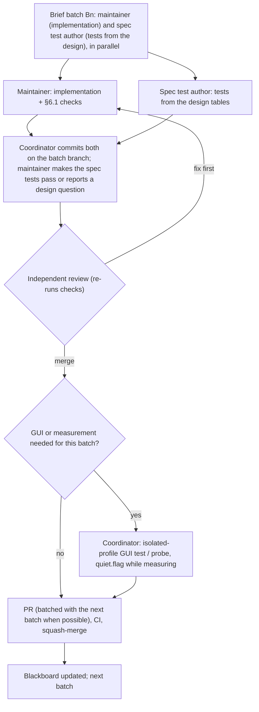

# Supervisor project: loop procedure (supplement to the agentic workflow)

This file supplements [agentic-workflow.md](../../agentic-workflow.md) for the plugin process supervisor project ([design](../architecture/supervisor.md), approved 2026-11-02). It does not replace any rule there; where they differ, agentic-workflow.md wins. The user approved running this project as a self-paced Claude Code loop while away (2026-11-02), with free use of the computer within the rules below. The temporary role and this procedure end when the project ends.

## 1. Every wake-up

1. Read this file, then agentic-workflow.md §0, §1, §1.4, §6–§8, then the blackboard: [doc/process/rounds/2026-11-supervisor.md](rounds/2026-11-supervisor.md) (state table, log, open items).
2. Check running agents, `C:\vestra\build.lock`, `C:\vestra\quiet.flag` (remove a stale flag older than the measurement that set it), free disk (clean own build outputs below 8 GB) and system commit.
3. Advance the current batch by one step of the pipeline (§3). Prefer finishing reviews and merges over starting new work.
4. Write what happened to the blackboard log (time, step, result, what is waiting and on whom), then schedule the next wake-up: 20–30 min while waiting on agents or CI.
5. Report to the user in Chinese, briefly, in the terminal.

After a context compaction, do not rely on memory of the conversation: the blackboard and this file are the state.

## 2. Roles for this project

| Role | Writable scope | Notes |
| --- | --- | --- |
| Coordinator | Records (this file, the blackboard), git, releases, GUI tests | As agentic-workflow.md §1 |
| API maintainer (up to 2 instances when files are disjoint) | `src/host/`, `src/runtime/`, `src/tests/`, `doc/architecture/` | Implements each batch; runs §6.1 checks; owns `doc/architecture/supervisor.md` updates |
| **Spec test author (temporary, 2026-11-02, B0–B4)** | New test files only: `src/host/src/supervisor/tests/**`, new files under `src/host/tests/` | Writes tests from the design's tables (transition table §3.2, merge table §4.2, named cases §4.3, policy table §3.4, deadlines §4.5) without reading the implementation under test; does not implement. Purpose: an independent check that the code matches the approved design, not the implementer's reading of it |
| Independent reviewer | Review records | Every batch, and every requested fix |
| Researcher | none (read-only) | On demand |

One role per agent; no sub-agents of agents; at most 8 background agents.

## 3. Pipeline per batch

- A spec test that fails because the design is ambiguous or wrong is a **design question**: the maintainer records it on the blackboard with options; the coordinator decides by precedent (systemd, Erlang/OTP, Chrome, Android, VS Code) and records the decision in `supervisor.md`. Only §7 cases go to the user.
- B2 sub-batches must show zero behaviour difference: B0 tests and the `VESTRA_TEST_REGISTRY` registry diff before/after.

## 4. Batches and done criteria

As in [supervisor.md §13](../architecture/supervisor.md). In short:

| Batch | Done when |
| --- | --- |
| B0 | Characterization tests of today's behaviour merged, including the known bugs (Book entry leak on spawn failure, `cleanup` only grows, disable-then-enable running two processes) marked as expected-to-change |
| B1 | Pure core `src/host/src/supervisor/` with today's tunables reproduces today's decisions in simulation; spec tests pass; not wired |
| B2a–B2d | Each wired in turn; zero behaviour difference proven; lazy.rs removed at B2c |
| B3 | Job queue limits live (concurrency, priorities, bounded backlog, start timeout, request accounting); LIMIT 64 removed; wake failures keep registrations; GUI + 200-wake storm measured |
| B4 | Restart policy, backoff, exit causes, heap cap, OOM handling; release 0.6.x (B3 + B4) |
| B5 | Process budget and memory pressure (Windows platform calls in `src/host/unsafe/win32`, reviewed separately) |
| B6 | Defaults flipped (on-demand scheduling, idle 30 s, start 60 s, grace 5 s), after P4 measurement and a GUI test with the supervisor on; release 0.6.x (B5 + B6) |
| B7 | Cleanup and docs; loop ends with a summary to the user |

## 5. Releases

0.6.x releases need no question (user ruling): local release build first → GUI check in the isolated profile → tag on the merged commit (after checking the version on `origin/main`) → CI → verify `latest.json` against `SHA256SUMS` → publish. Planned: after B4 and after B6.

## 6. Safety and limits while the user is away

- GUI only in the isolated profile (`C:\vestra\recprofile` via the run-isolated script); never the user's profile; never launch with a file argument on the real profile.
- GPU tests ≤ 60 s, one at a time; stop on any hang, TDR or device loss.
- Probes with many plugins: kill the run's process tree above 85 % system commit or below 8 GB free disk; one player at a time.
- Skip and log anything that needs a person: UAC, logins, other applications' dialogs. Never click OK/Install/Update in another application.
- No force push, no tag or release deletion, no paid services, no secrets in output.
- Stop and wait for the user only for agentic-workflow.md §7 cases; pause only the dependent work and continue the rest.

## 7. End

The loop ends after B7 and the last release, or when everything left waits on the user. Then: stop the loop, write the round summary on the blackboard, remove the temporary role from this file's status line, report to the user in Chinese.
